# 义务教育教科书 数学 四年级 上册（人教版，2022 课标修订版，2026 秋）

> 来源：本地 PDF `docs/人教版_数学_四年级上册_2026秋_2022课标修订版.pdf`（127 页，人民教育出版社 课程教材研究所 编著）
> 存档：2026-11-06。文字由 pdftotext 抽取，版式、算式竖式和插图以页图 `pages/p-NNN.png` 为准。
> 版权归人民教育出版社所有，仅供个人学习使用。

## 封面/前言/封底（PDF 第 1 页）


```text
义   务   教   育   教   科   书

                四年级
                上册

```

## 封面/前言/封底（PDF 第 2 页）

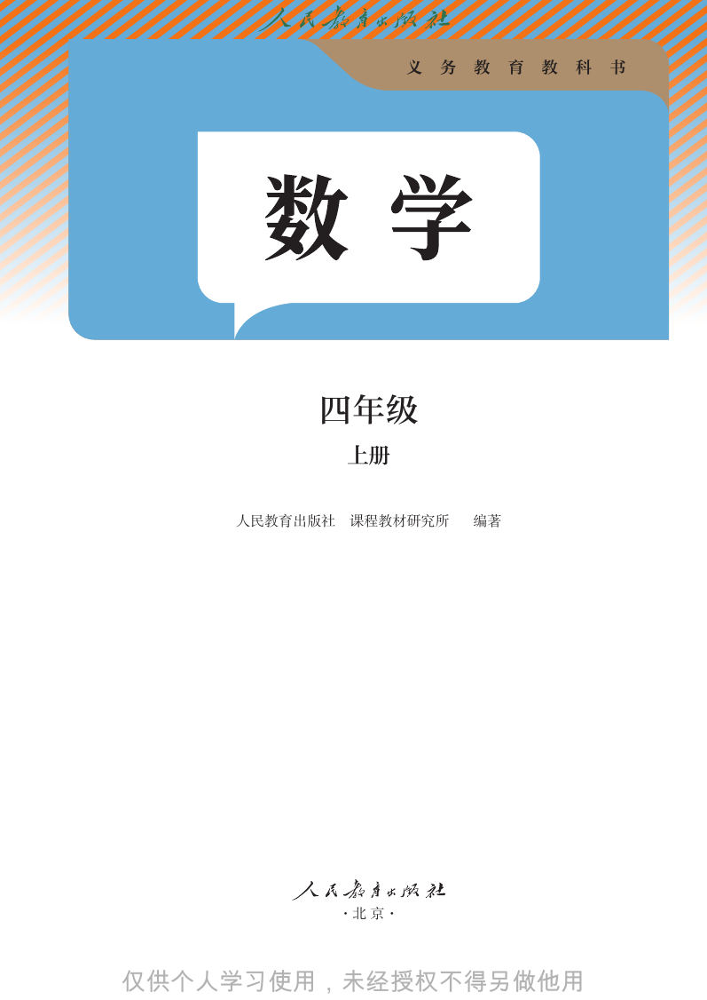

```text
                      义   务   教    育   教   科   书

         四年级
              上册

    人民教育出版社   课程教材研究所         编著

              ·北 京·


```

## 封面/前言/封底（PDF 第 3 页）

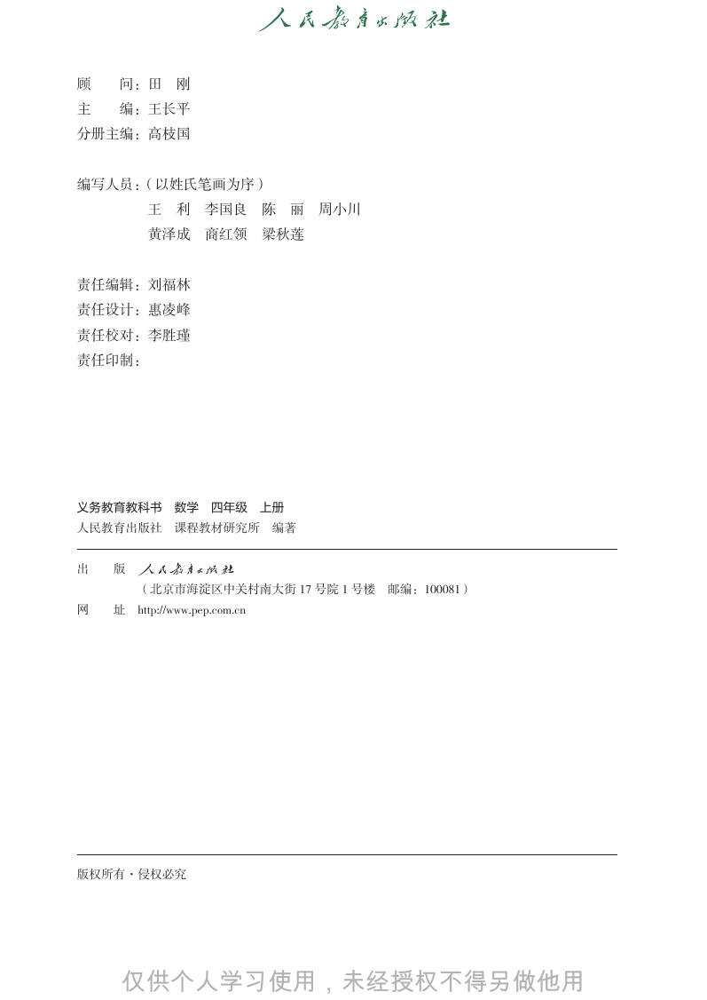

```text
顾   问：田         刚
主   编：王长平
分册主编：高枝国

编写人员：（以姓氏笔画为序）
          王     利     李国良        陈    丽   周小川
          黄泽成         商红领        梁秋莲

责任编辑：刘福林
责任设计：惠凌峰
责任校对：李胜瑾
责任印制：

义务教育教科书         数学     四年级       上册
人民教育出版社         课程教材研究所           编著

出   版
      （北京市海淀区中关村南大街 17 号院 1 号楼 邮编：100081）
网   址    http://www.pep.com.cn
  
  
  
           
  
  
  
  
  
           

版权所有·侵权必究


```

## 封面/前言/封底（PDF 第 4 页）


```text
   致同学

  新学期开始了，你已经是一名四年级学生了。现在让我们一起
走进数学王国，去探索数学的奥秘吧！
  在前面的学习中，你已经认识了万以内的数，本学期我们将学
习更大的数，了解十进制计数法。在数的运算方面，我们将进一步
探索乘数是两位数的乘法，同时结合生活中的实际问题，总结加法
模型和乘法模型。在图形方面，我们将进一步认识角和平行四边形，
并认识梯形。
  上学期你已经学习了用表格整理数据的方法，本学期将进一步
学习用条形统计图来表示数据，同时了解统计在生活中的广泛应用。

  本次数学之旅不仅能使我们学到知识，增长本领，还会让我们
感受到数学思想方法的魅力。让我们出发吧！


```

## 封面/前言/封底（PDF 第 5 页）

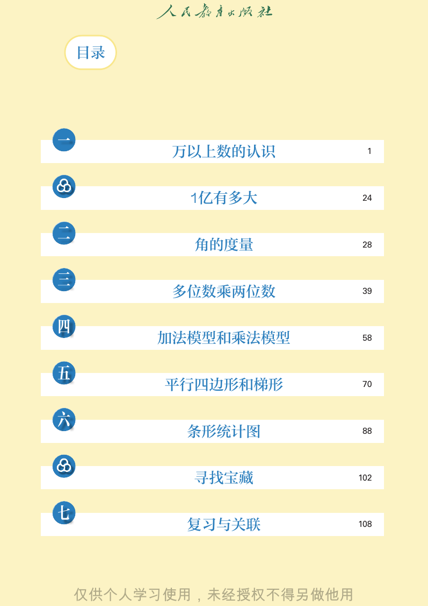

```text
    目录

一
          万以上数的认识          1

           1亿有多大          24

二
            角的度量          28

三
          多位数乘两位数         39

四
         加法模型和乘法模型        58

五
          平行四边形和梯形        70

六
           条形统计图          88

            寻找宝藏          102

七
           复习与关联          108


```

## 教材第 1 页（PDF 第 6 页）

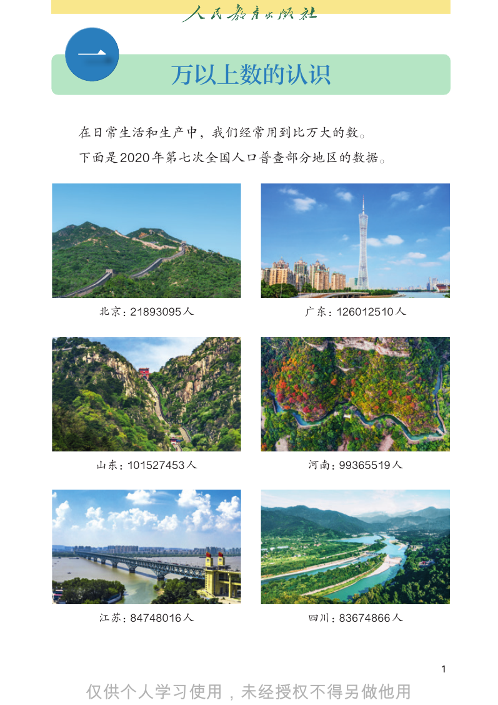

```text
一          万以上数的认识

在日常生活和生产中，我们经常用到比万大的数。
下面是 2020 年第七次全国人口普查部分地区的数据。

 北京：21893095 人     广东：126012510 人

 山东：101527453 人    河南：99365519 人

 江苏：84748016 人     四川：83674866 人

                                    1


```

## 教材第 2 页（PDF 第 7 页）

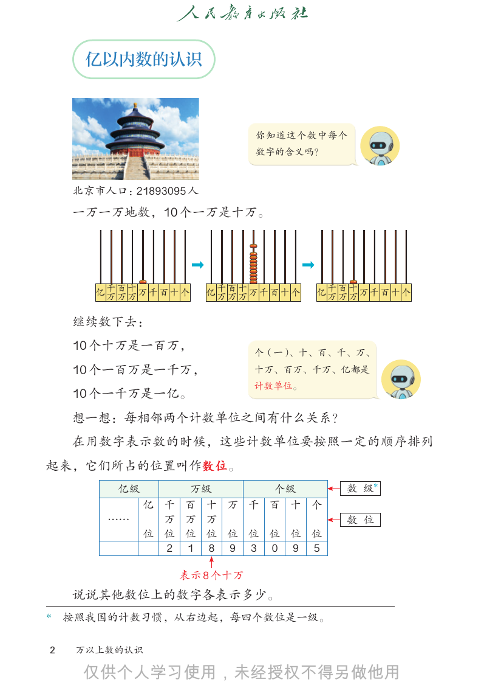

```text
      亿以内数的认识

                                你知道这个数中每个
                                数字的含义吗？

    北京市人口：21893095 人
    一万一万地数，10 个一万是十万。

       亿千 百十
        万 万 万 万 千 百十 个   亿千 百十
                          万 万 万 万 千 百十 个   亿千 百十
                                            万 万 万 万 千 百十 个

    继续数下去：
    10 个十万是一百万，                 个（一）、十、百、千、万、
    10 个一百万是一千万，                十万、百万、千万、亿都是
                                计数单位。
    10 个一千万是一亿。
    想一想：每相邻两个计数单位之间有什么关系？
    在用数字表示数的时候，这些计数单位要按照一定的顺序排列
起来，它们所占的位置叫作数位。
          亿级       万级      个级                  数 级
               亿 千 百 十 万 千 百 十 个
        ……       万 万 万                         数 位
               位 位 位 位 位 位 位 位 位
                 2 1 8 9 3 0 9 5

                    表示 8 个十万
    说说其他数位上的数字各表示多少。
*   按照我国的计数习惯，从右边起，每四个数位是一级。

2    万以上数的认识


```

## 教材第 3 页（PDF 第 8 页）

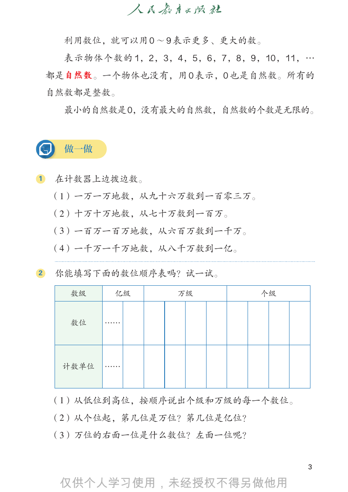

```text
      利用数位，就可以用 0 〜 9 表示更多、更大的数。
      表示物体个数的 1，2，3，4，5，6，7，8，9，10，11，…
    都是自然数。一个物体也没有，用 0 表示，0 也是自然数。所有的
    自然数都是整数。
      最小的自然数是0，没有最大的自然数，自然数的个数是无限的。

      做一做

1    在计数器上边拨边数。
    （1） 一万一万地数，从九十六万数到一百零三万。
    （2） 十万十万地数，从七十万数到一百万。
    （3） 一百万一百万地数，从六百万数到一千万。
    （4） 一千万一千万地数，从八千万数到一亿。

2    你能填写下面的数位顺序表吗？试一试。

      数级      亿级    万级         个级

       数位    ……

      计数单位   ……

    （1） 从低位到高位，按顺序说出个级和万级的每一个数位。
    （2） 从个位起，第几位是万位？第几位是亿位？
    （3） 万位的右面一位是什么数位？左面一位呢？

                                      3


```

## 教材第 4 页（PDF 第 9 页）

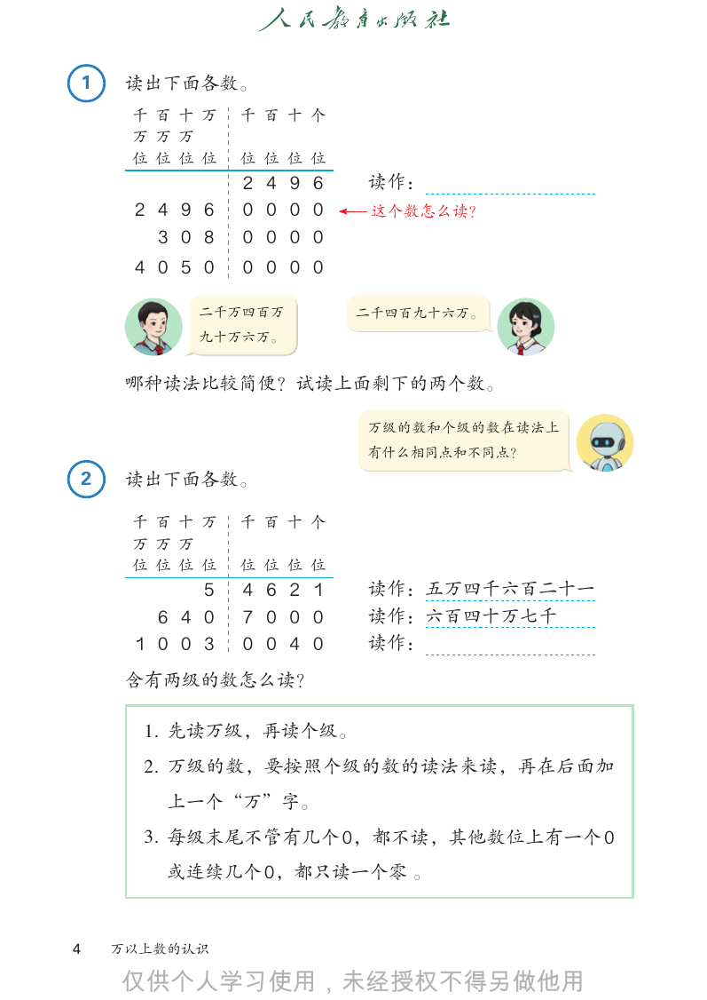

```text
    1    读出下面各数。
         千 百 十 万   千 百 十 个
         万 万 万
         位 位 位 位   位 位 位 位
                   2 4 9 6   读作：
         2 4 9 6   0 0 0 0    这个数怎么读？
           3 0 8   0 0 0 0
         4 0 5 0   0 0 0 0

              二千万四百万         二千四百九十六万。
              九十万六万。

         哪种读法比较简便？试读上面剩下的两个数。

                             万级的数和个级的数在读法上
                             有什么相同点和不同点？
    2    读出下面各数。

         千 百 十 万   千 百 十 个
         万 万 万
         位 位 位 位   位 位 位 位
               5   4 6 2 1   读作：五万四千六百二十一
           6 4 0   7 0 0 0   读作：六百四十万七千
         1 0 0 3   0 0 4 0   读作：
         含有两级的数怎么读？

          1. 先读万级，再读个级。
          2. 万级的数，要按照个级的数的读法来读，再在后面加
            上一个“万”字。
          3. 每级末尾不管有几个 0，都不读，其他数位上有一个 0
            或连续几个 0，都只读一个零 。

4       万以上数的认识


```

## 教材第 5 页（PDF 第 10 页）

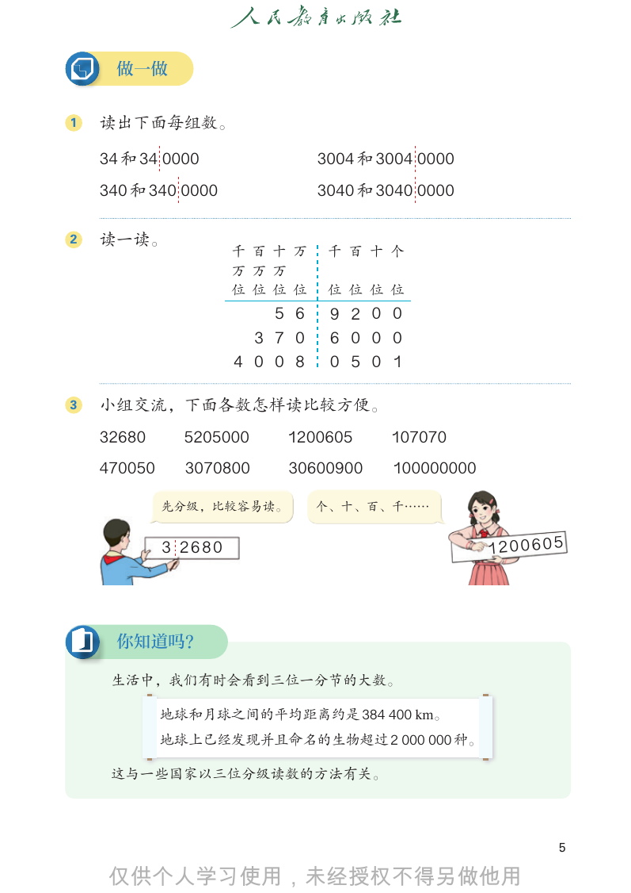

```text
      做一做

1   读出下面每组数。

    34 和 34 0000                3004 和 3004 0000
    340 和 340 0000              3040 和 3040 0000

2   读一读。
                      千 百 十 万    千 百 十 个
                      万 万 万
                      位 位 位 位    位 位 位 位
                          5 6    9 2 0 0
                        3 7 0    6 0 0 0
                      4 0 0 8    0 5 0 1

3   小组交流，下面各数怎样读比较方便。
    32680      5205000     1200605      107070
    470050     3070800     30600900     100000000

             先分级，比较容易读。         个、十、百、千……

             3 2680                                 1200605

      你知道吗？

     生活中，我们有时会看到三位一分节的大数。

             地球和月球之间的平均距离约是 384 400 km。
             地球上已经发现并且命名的生物超过 2 000 000 种。

     这与一些国家以三位分级读数的方法有关。

                                                          5


```

## 教材第 6 页（PDF 第 11 页）

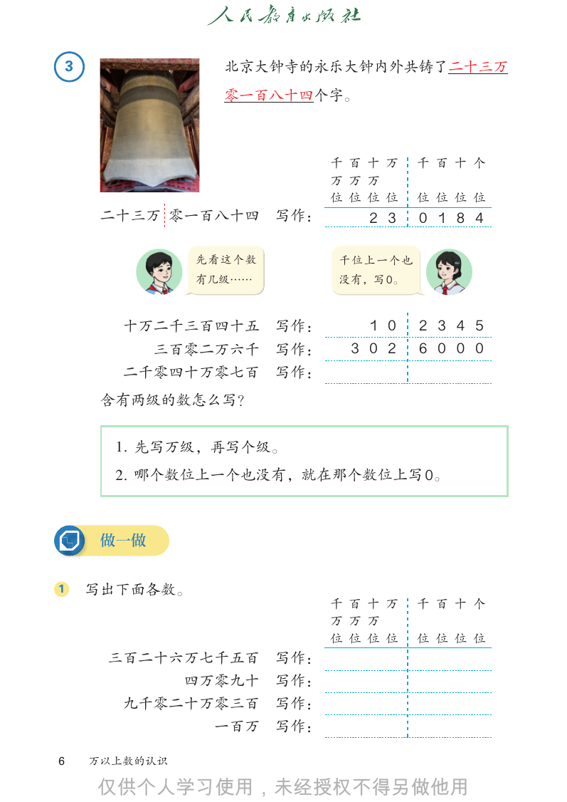

```text
    3               北京大钟寺的永乐大钟内外共铸了二十三万
                    零一百八十四个字。

                                千 百 十 万   千 百 十 个
                                万 万 万
                                位 位 位 位   位 位 位 位
         二十三万 零一百八十四      写作：       2 3   0 1 8 4

                  先看这个数         千位上一个也
                  有几级……         没有，写 0。

           十万二千三百四十五      写作：       1 0   2 3 4 5
               三百零二万六千    写作：     3 0 2   6 0 0 0
           二千零四十万零七百      写作：
         含有两级的数怎么写？

          1. 先写万级，再写个级。
          2. 哪个数位上一个也没有，就在那个数位上写 0。

         做一做

1       写出下面各数。
                                千 百 十 万   千 百 十 个
                                万 万 万
                                位 位 位 位   位 位 位 位
         三百二十六万七千五百       写作：
              四万零九十       写作：
          九千零二十万零三百       写作：
                一百万       写作：

6       万以上数的认识


```

## 教材第 7 页（PDF 第 12 页）

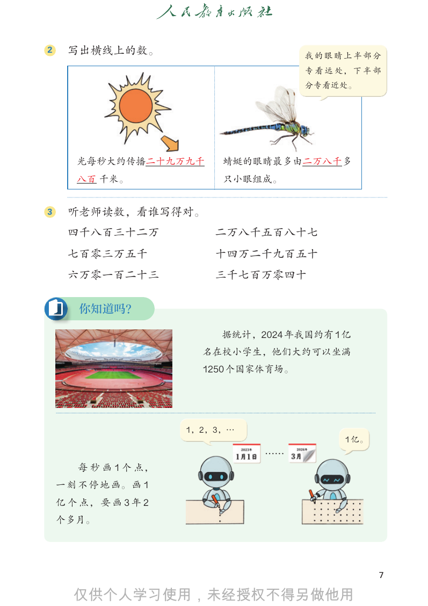

```text
2    写出横线上的数。                           我的眼睛上半部分
                                        专 看 远 处， 下 半 部
                                        分专看近处。

       光每秒大约传播二十九万九千        蜻蜓的眼睛最多由二万八千多
       八百 千米。               只小眼组成。

3    听老师读数，看谁写得对。
     四千八百三十二万              二万八千五百八十七
     七百零三万五千               十四万二千九百五十
     六万零一百二十三              三千七百万零四十

        你知道吗？

                            据统计，2024 年我国约有 1 亿
                         名在校小学生，他们大约可以坐满
                         1250 个国家体育场。

                       1，2，3，…
                                               1 亿。
                                 ……
       每 秒 画 1 个 点，
    一 刻 不 停 地 画。 画 1
    亿 个 点， 要 画 3 年 2
    个多月。

                                                      7


```

## 教材第 8 页（PDF 第 13 页）

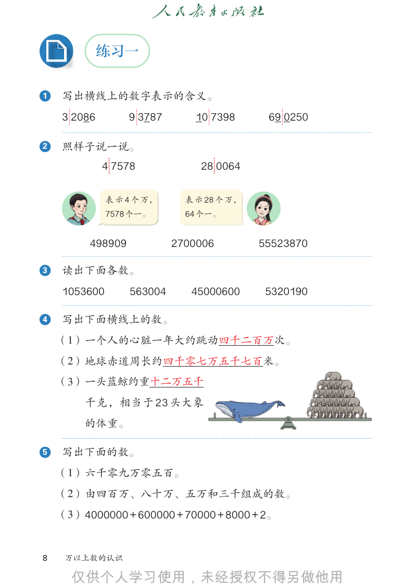

```text
              练习一

1    写出横线上的数字表示的含义。
     3 2086        9 3787       10 7398      69 0250

2    照样子说一说。
              4 7578             28 0064

               表 示 4 个 万，     表 示 28 个 万，
               7578 个一。       64 个一。

          498909            2700006         55523870

3    读出下面各数。
     1053600       563004      45000600      5320190

4    写出下面横线上的数。
    （1） 一个人的心脏一年大约跳动四千二百万次。
    （2） 地球赤道周长约四千零七万五千七百米。
    （3） 一头蓝鲸约重十二万五千
         千克，相当于 23 头大象
         的体重。

5    写出下面的数。
    （1） 六千零九万零五百。
    （2） 由四百万、八十万、五万和三千组成的数。
    （3） 4000000 + 600000 + 70000 + 8000 + 2。

8    万以上数的认识


```

## 教材第 9 页（PDF 第 14 页）

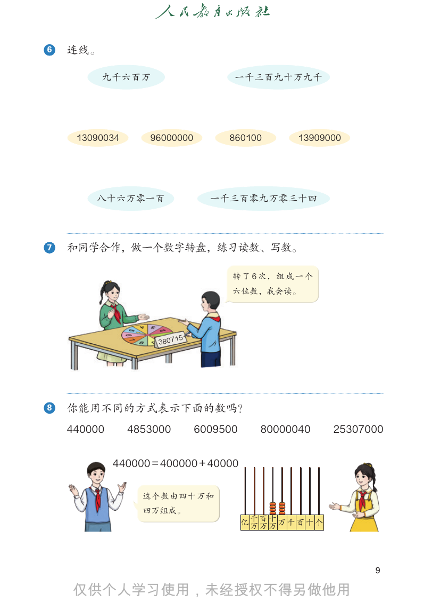

```text
6   连线。

          九千六百万                     一千三百九十万九千

     13090034      96000000        860100         13909000

        八十六万零一百                 一千三百零九万零三十四

7   和同学合作，做一个数字转盘，练习读数、写数。

                                    转 了 6 次， 组 成 一 个
                                    六位数，我会读。

                          5
                     38071

8   你能用不同的方式表示下面的数吗？
    440000      4853000       6009500      80000040       25307000

             440000 = 400000 + 40000

                  这个数由四十万和
                  四万组成。
                                        亿千 百十
                                         万 万 万 万 千 百十 个

                                                                9


```

## 教材第 10 页（PDF 第 15 页）

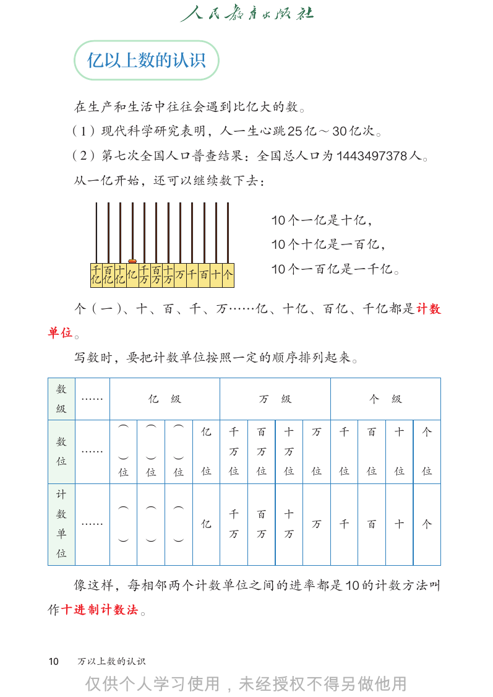

```text
      亿以上数的认识

     在生产和生活中往往会遇到比亿大的数。
     （1） 现代科学研究表明，人一生心跳 25 亿〜 30 亿次。
     （2） 第七次全国人口普查结果：全国总人口为 1443497378 人。
     从一亿开始，还可以继续数下去：

                                   10 个一亿是十亿，
                                   10 个十亿是一百亿，
       千 百 十 亿 千 百 十万 千 百十个        10 个一百亿是一千亿。
       亿 亿 亿 万 万万

     个（一）、十、百、千、万……亿、十亿、百亿、千亿都是计数
单位。
     写数时，要把计数单位按照一定的顺序排列起来。

 数
      ……       亿   级           万   级            个   级
 级
           ︵   ︵   ︵
                       亿   千   百    十   万   千   百   十   个
 数
      ……   ︶   ︶   ︶       万   万    万
 位
           位   位   位   位   位   位    位   位   位   位   位   位

 计         ︵   ︵   ︵
 数                         千   百    十
      ……               亿                万   千   百   十   个
 单         ︶   ︶   ︶       万   万    万
 位

     像这样，每相邻两个计数单位之间的进率都是 10 的计数方法叫
作十进制计数法。

10   万以上数的认识


```

## 教材第 11 页（PDF 第 16 页）

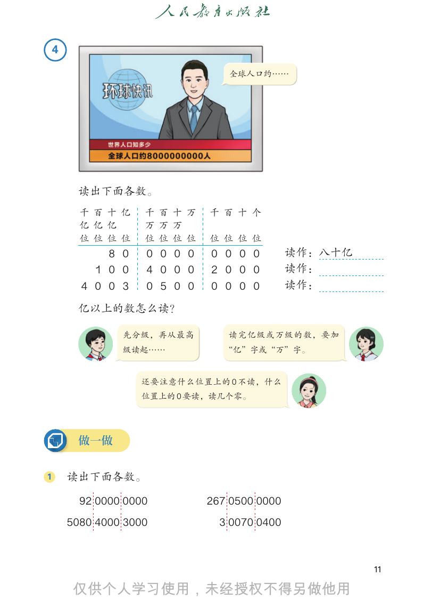

```text
    4

                                  全球人口约……

         读出下面各数。
          千 百 十 亿    千 百 十 万   千 百 十 个
          亿 亿 亿      万 万 万
          位 位 位 位    位 位 位 位   位 位 位 位
              8 0    0 0 0 0   0 0 0 0         读作：八十亿
            1 0 0    4 0 0 0   2 0 0 0         读作：
          4 0 0 3    0 5 0 0   0 0 0 0         读作：

         亿以上的数怎么读？

                 先分级，再从最高         读完亿级或万级的数，要加
                 级读起……            “亿”字或“万”字。

                    还要注意什么位置上的 0 不读，什么
                    位置上的 0 要读，读几个零。

          做一做

1       读出下面各数。

          92 0000 0000         267 0500 0000
        5080 4000 3000           3 0070 0400

                                                        11


```

## 教材第 12 页（PDF 第 17 页）

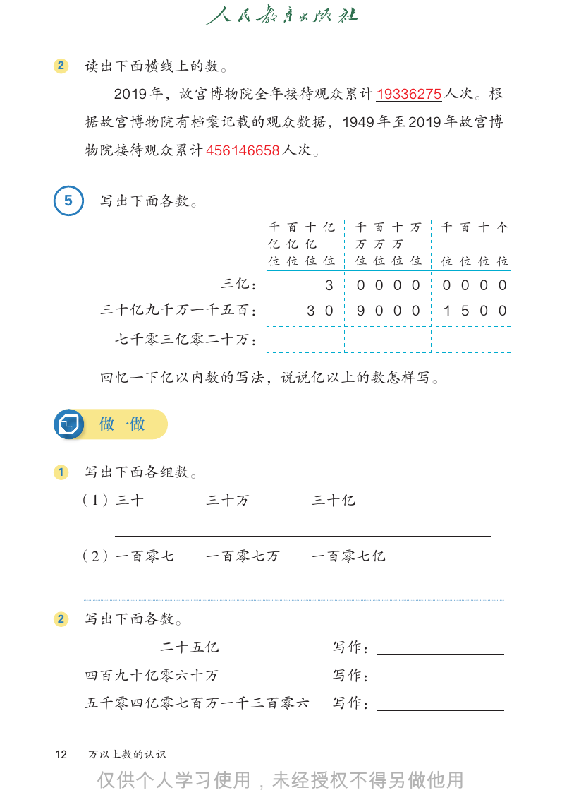

```text
2       读出下面横线上的数。
           2019 年，故宫博物院全年接待观众累计 19336275 人次。根
        据故宫博物院有档案记载的观众数据，1949 年至 2019 年故宫博
        物院接待观众累计 456146658 人次。

    5    写出下面各数。
                              千 百 十 亿   千 百 十 万   千 百 十 个
                              亿 亿 亿     万 万 万
                              位 位 位 位   位 位 位 位   位 位 位 位
                        三亿：         3   0 0 0 0   0 0 0 0
         三十亿九千万一千五百：              3 0   9 0 0 0   1 5 0 0
           七千零三亿零二十万：

         回忆一下亿以内数的写法，说说亿以上的数怎样写。

          做一做

1       写出下面各组数。
        （1） 三十      三十万           三十亿

        （2） 一百零七    一百零七万         一百零七亿

2       写出下面各数。
                 二十五亿               写作：
        四百九十亿零六十万                   写作：
        五千零四亿零七百万一千三百零六             写作：

12      万以上数的认识


```

## 教材第 13 页（PDF 第 18 页）

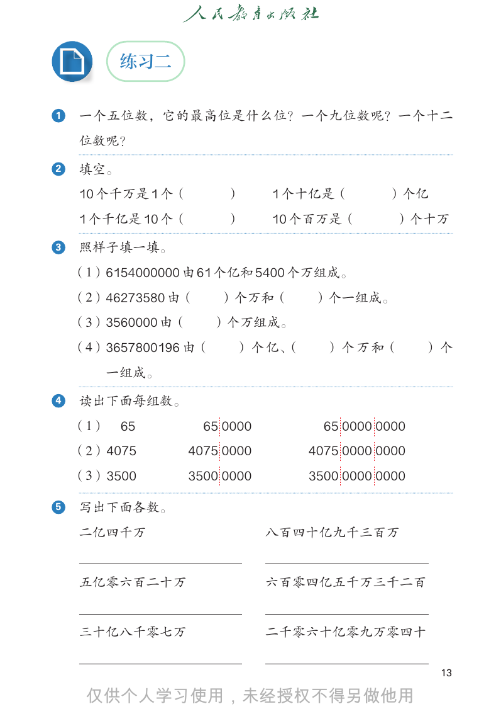

```text
          练习二

1   一个五位数，它的最高位是什么位？一个九位数呢？一个十二
    位数呢？
2   填空。
    10 个千万是 1 个（         ）      1 个十亿是（       ）个亿
    1 个千亿是 10 个（         ）      10 个百万是（       ）个十万
3   照样子填一填。
    （1）6154000000 由 61 个亿和 5400 个万组成。
    （2）46273580 由（      ）个万和（       ）个一组成。
    （3）3560000 由（      ）个万组成。
    （4）3657800196 由（      ） 个 亿、
                               （     ） 个 万 和（       ）个
        一组成。
4   读出下面每组数。
    （1）   65          65 0000        65 0000 0000
    （2） 4075        4075 0000      4075 0000 0000
    （3） 3500        3500 0000      3500 0000 0000

5   写出下面各数。
    二亿四千万                       八百四十亿九千三百万

    五亿零六百二十万                    六百零四亿五千万三千二百

    三十亿八千零七万                    二千零六十亿零九万零四十

                                                     13


```

## 教材第 14 页（PDF 第 19 页）

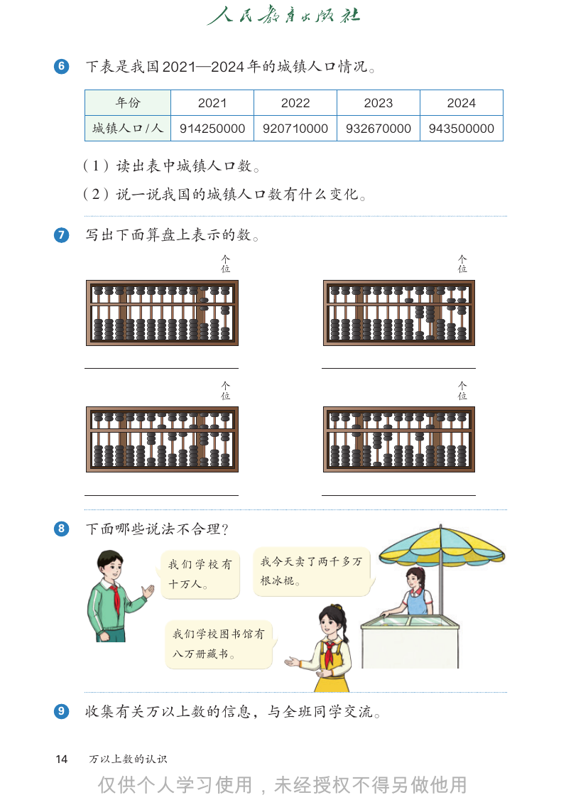

```text
6    下表是我国 2021—2024 年的城镇人口情况。

        年份          2021        2022        2023        2024
      城镇人口 / 人    914250000   920710000   932670000   943500000

     （1） 读出表中城镇人口数。
     （2） 说一说我国的城镇人口数有什么变化。

7    写出下面算盘上表示的数。
                        个位                                个位

                        个位                                个位

8    下面哪些说法不合理？

                 我们学校有        我今天卖了两千多万
                 十万人。         根冰棍。

                 我们学校图书馆有
                 八万册藏书。

9    收集有关万以上数的信息，与全班同学交流。

14   万以上数的认识


```

## 教材第 15 页（PDF 第 20 页）


```text
     数的大小比较

6    下面是 2024 年全国主要农产品的产量（单位：t）。

            稻谷：207534900                小麦：140099400

            玉米：294916900                大豆：20647800
     按照万以内数比较大小的方法，选择两种农产品的产量，比较
它们的大小。
    207534900 > 20647800          207534900    294916900

            位数多的数就大。                   位数相同的数呢？

     位数相同的两个数，从最高位比起，最高位上的数大的那个
数就大，如果最高位上的数相同，就比较下一个数位上的数。

     做一做

    比较下面每组中两个数的大小。
    92504    103600        830207000     1020010000
    28906    28890    100388770000       99385270000

                                                           15


```

## 教材第 16 页（PDF 第 21 页）

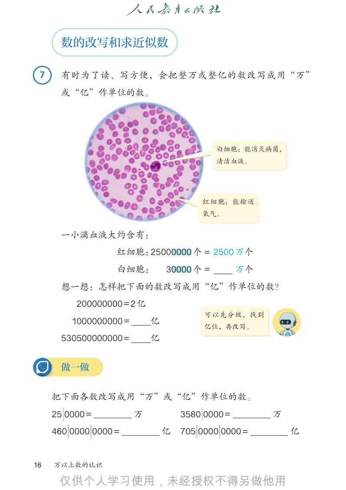

```text
       数的改写和求近似数

 7     有时为了读、写方便，会把整万或整亿的数改写成用“万”
       或“亿”作单位的数。

                                            白细胞：能消灭病菌，
                                            清洁血液。

                                        红细胞：能输送
                                        氧气。

       一小滴血液大约含有：
                   红细胞：25000000 个 = 2500 万个
                   白细胞：         30000 个 =         万个
       想一想：怎样把下面的数改写成用“亿”作单位的数？
          200000000 = 2 亿
                                         可 以 先 分 级， 找 到
         1000000000 =       亿
                                         亿位，再改写。
       530500000000 =       亿

       做一做

     把下面各数改写成用“万”或“亿”作单位的数。
     25 0000 =          万           3580 0000 =           万
     460 0000 0000 =            亿   705 0000 0000 =           亿

16   万以上数的认识


```

## 教材第 17 页（PDF 第 22 页）

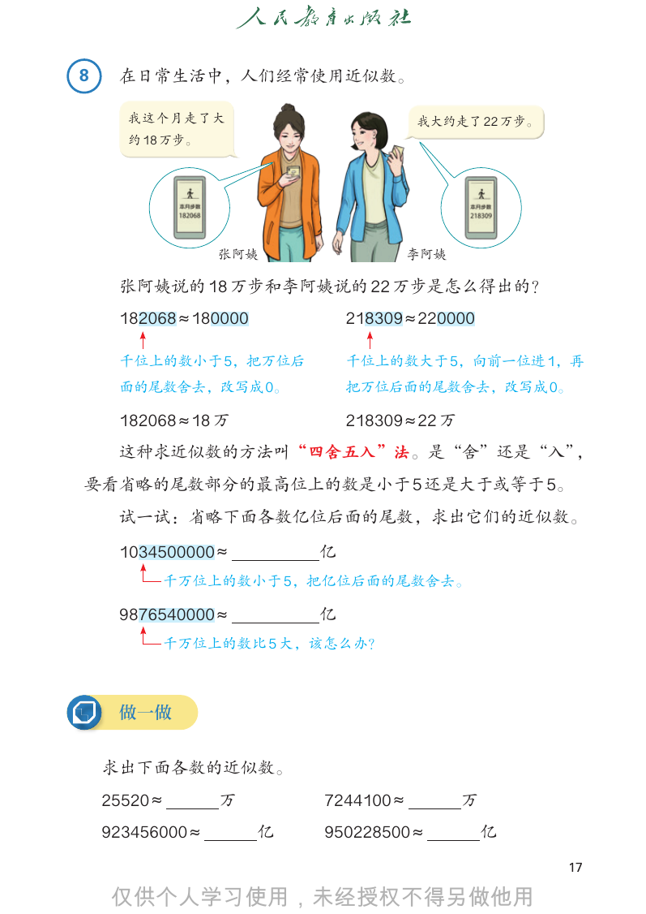

```text
8     在日常生活中，人们经常使用近似数。

       我这个月走了大                          我大约走了 22 万步。
       约 18 万步。

                  张阿姨                   李阿姨

      张阿姨说的 18 万步和李阿姨说的 22 万步是怎么得出的？
      182068 ≈ 180000           218309 ≈ 220000

      千位上的数小于5，把万位后             千位上的数大于 5，向前一位进 1，再
      面的尾数舍去，改写成0。              把万位后面的尾数舍去，改写成0。

      182068 ≈ 18 万             218309 ≈ 22 万
      这种求近似数的方法叫“四舍五入”法。是“舍”还是“入”，
要看省略的尾数部分的最高位上的数是小于 5 还是大于或等于 5。
      试一试：省略下面各数亿位后面的尾数，求出它们的近似数。

      1034500000 ≈          亿
              千万位上的数小于 5，把亿位后面的尾数舍去。

      9876540000 ≈          亿
              千万位上的数比 5 大，该怎么办？

      做一做

    求出下面各数的近似数。
    25520 ≈       万         7244100 ≈           万
    923456000 ≈         亿   950228500 ≈             亿
                                                        17


```

## 教材第 18 页（PDF 第 23 页）

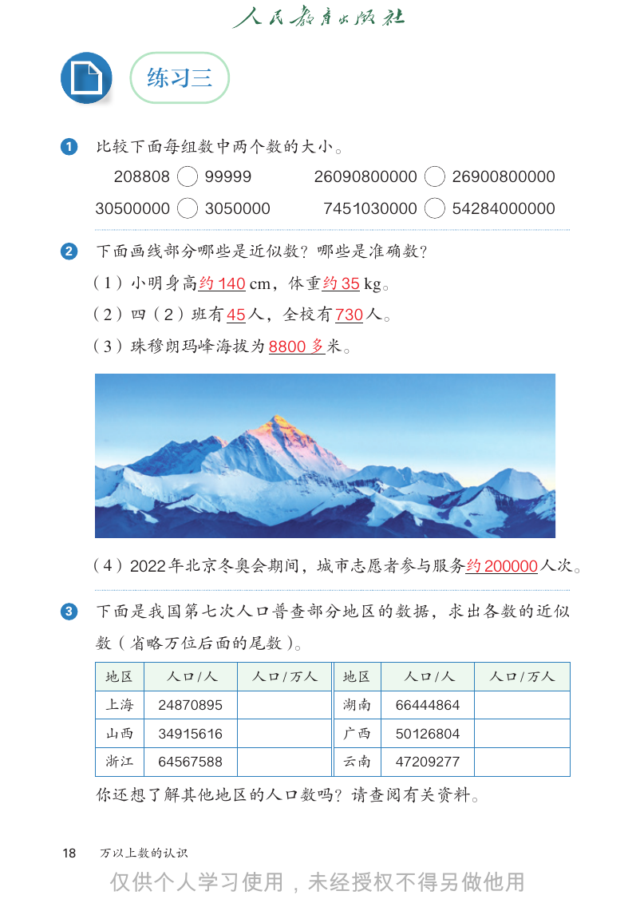

```text
           练习三

1    比较下面每组数中两个数的大小。
       208808   99999         26090800000      26900800000
     30500000   3050000           7451030000   54284000000

2    下面画线部分哪些是近似数？哪些是准确数？
     （1） 小明身高约 140 cm，体重约 35 kg。
     （2） 四（2）班有 45 人，全校有 730 人。
     （3） 珠穆朗玛峰海拔为 8800 多米。

     （4） 2022年北京冬奥会期间，城市志愿者参与服务约200000人次。

3    下面是我国第七次人口普查部分地区的数据，求出各数的近似
     数（省略万位后面的尾数）。
      地区    人口 / 人      人口 / 万人     地区    人口 / 人    人口 / 万人
      上海   24870895                 湖南   66444864
      山西   34915616                 广西   50126804
      浙江   64567588                 云南   47209277

     你还想了解其他地区的人口数吗？请查阅有关资料。

18    万以上数的认识


```

## 教材第 19 页（PDF 第 24 页）

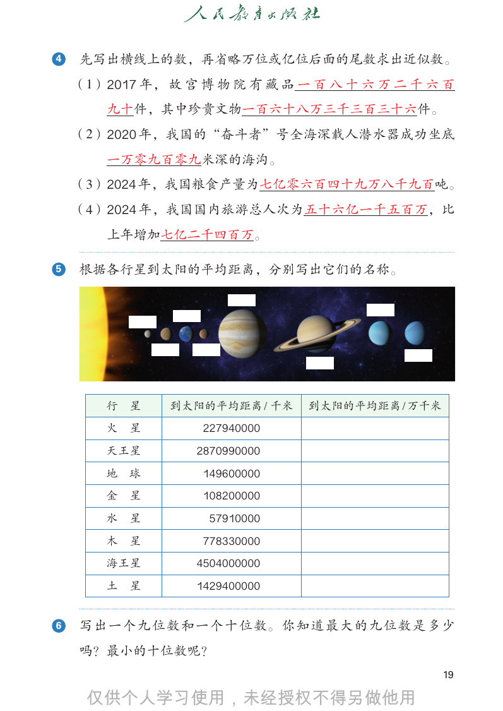

```text
4   先写出横线上的数，再省略万位或亿位后面的尾数求出近似数。
    （1） 2017 年， 故 宫 博 物 院 有 藏 品 一 百 八 十 六 万 二 千 六 百
        九十件，其中珍贵文物一百六十八万三千三百三十六件。
    （2） 2020 年，我国的“奋斗者”号全海深载人潜水器成功坐底
        一万零九百零九米深的海沟。
    （3） 2024 年，我国粮食产量为七亿零六百四十九万八千九百吨。
    （4） 2024 年，我国国内旅游总人次为五十六亿一千五百万，比
        上年增加七亿二千四百万。

5   根据各行星到太阳的平均距离，分别写出它们的名称。

        行   星   到太阳的平均距离 / 千米   到太阳的平均距离 / 万千米
        火   星       227940000
        天王星        2870990000
        地   球       149600000
        金   星       108200000
        水   星       57910000
        木   星       778330000
        海王星        4504000000
        土   星      1429400000

6   写出一个九位数和一个十位数。你知道最大的九位数是多少
    吗？最小的十位数呢？
                                                 19


```

## 教材第 20 页（PDF 第 25 页）

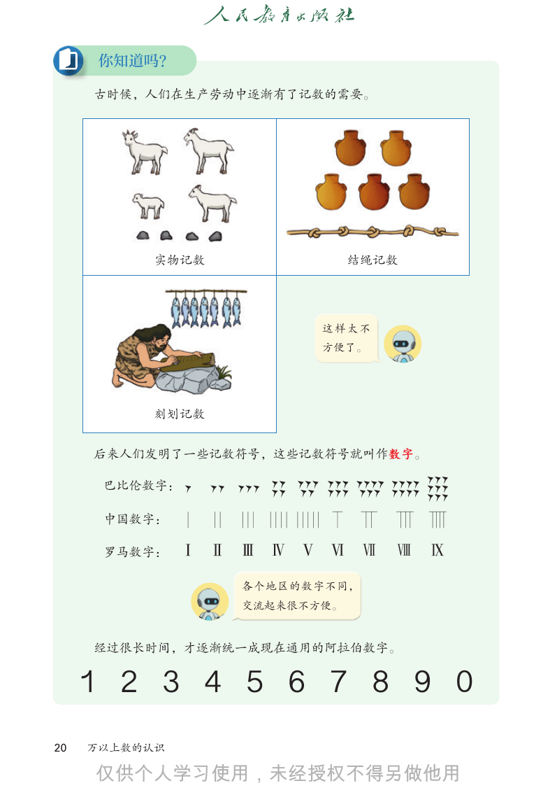

```text
      你知道吗？

     古时候，人们在生产劳动中逐渐有了记数的需要。

           实物记数               结绳记数

                         这样太不
                         方便了。

           刻划记数

     后来人们发明了一些记数符号，这些记数符号就叫作数字。

      巴比伦数字：

      中国数字：

      罗马数字：

                  各个地区的数字不同，
                  交流起来很不方便。

     经过很长时间，才逐渐统一成现在通用的阿拉伯数字。

     1 2 3 4 5 6 7 8 9 0
20   万以上数的认识


```

## 教材第 21 页（PDF 第 26 页）

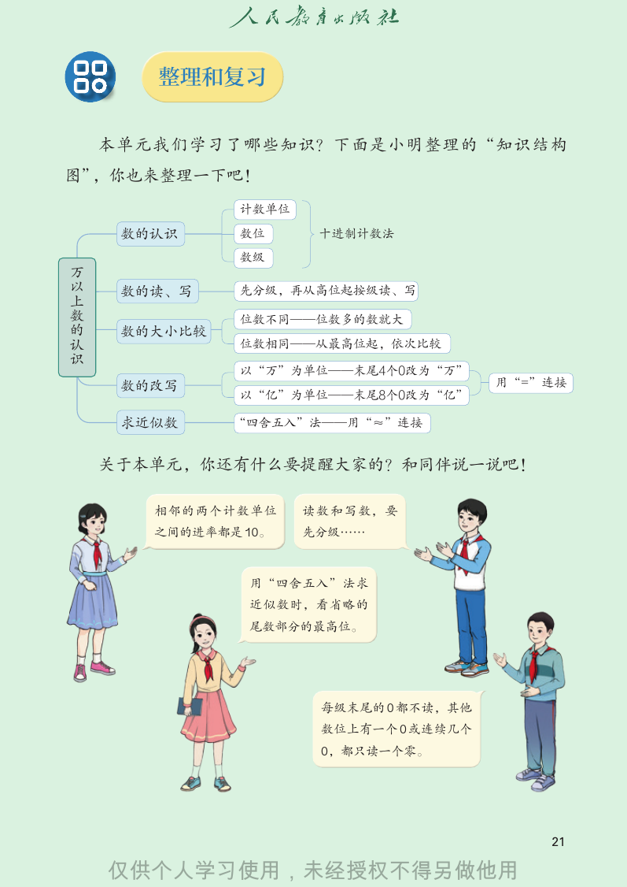

```text
             整理和复习

          本单元我们学习了哪些知识？下面是小明整理的“知识结构
图”，你也来整理一下吧！
                     计数单位

           数的认识      数位       十进制计数法

万以上数的认识
                     数级

           数的读、写     先分级，再从高位起按级读、写

                     位数不同——位数多的数就大
           数的大小比较
                     位数相同——从最高位起，依次比较

                     以“万”为单位——末尾4个0改为“万”
           数的改写                                用“=”连接
                     以“亿”为单位——末尾8个0改为“亿”

           求近似数     “四舍五入”法——用“≈”连接

          关于本单元，你还有什么要提醒大家的？和同伴说一说吧！

             相邻的两个计数单位      读 数 和 写 数， 要
             之间的进率都是 10。    先分级……

                     用“四舍五入”法求
                     近似数时，看省略的
                     尾数部分的最高位。

                              每级末尾的 0 都不读，其他
                              数位上有一个 0 或连续几个
                              0，都只读一个零。

                                                   21


```

## 教材第 22 页（PDF 第 27 页）

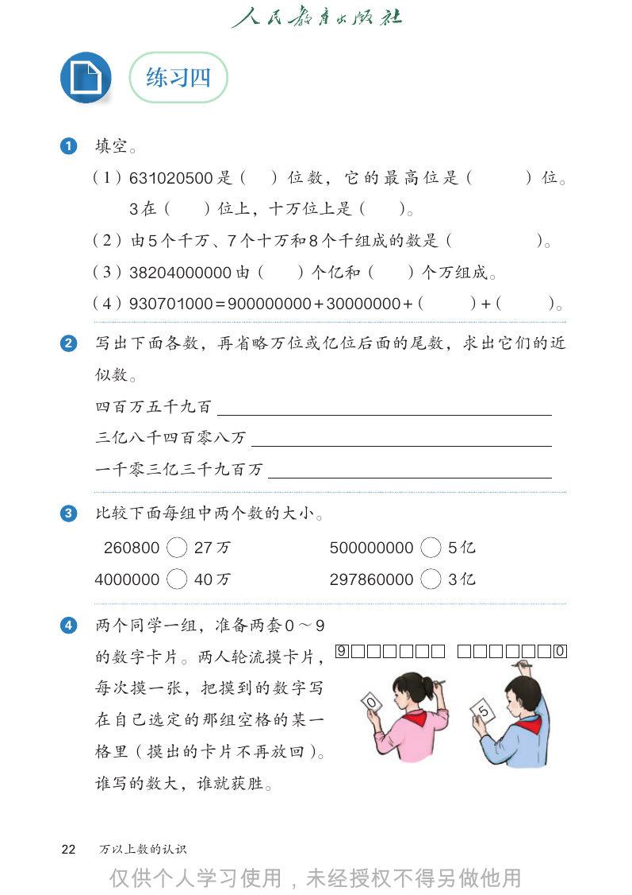

```text
           练习四

1    填空。
     （1） 631020500 是（ ） 位 数， 它 的 最 高 位 是（               ） 位。
         3 在（    ）位上，十万位上是（              ）。
     （2） 由 5 个千万、7 个十万和 8 个千组成的数是（                      ）。
     （3） 38204000000 由（     ）个亿和（        ）个万组成。
     （4） 930701000 = 900000000 + 30000000 +（    ）+（      ）。

2    写出下面各数，再省略万位或亿位后面的尾数，求出它们的近
     似数。
     四百万五千九百
     三亿八千四百零八万
     一千零三亿三千九百万

3    比较下面每组中两个数的大小。
       260800    27 万           500000000      5亿
     4000000     40 万           297860000      3亿

4    两个同学一组，准备两套 0 〜 9
     的数字卡片。两人轮流摸卡片， 9                                     0

     每次摸一张，把摸到的数字写
                                     0
                                                    5
     在自己选定的那组空格的某一
     格里（摸出的卡片不再放回）。
     谁写的数大，谁就获胜。

22    万以上数的认识


```

## 教材第 23 页（PDF 第 28 页）

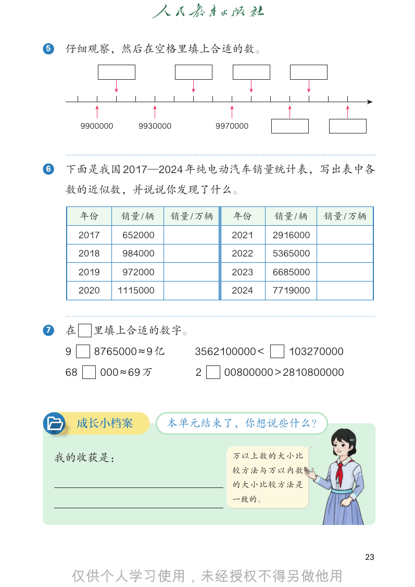

```text
5    仔细观察，然后在空格里填上合适的数。

          9900000       9930000         9970000

6    下面是我国 2017—2024 年纯电动汽车销量统计表，写出表中各
     数的近似数，并说说你发现了什么。

          年份        销量 / 辆    销量 / 万辆      年份     销量 / 辆    销量 / 万辆
          2017       652000                2021   2916000
          2018       984000                2022   5365000
          2019       972000                2023   6685000
          2020      1115000                2024   7719000

7    在      里填上合适的数字。
     9      8765000 ≈ 9 亿         3562100000 <      103270000
     68          000 ≈ 69 万       2      00800000 > 2810800000

         成长小档案                本单元结束了，你想说些什么？

    我的收获是：                                 万以上数的大小比
                                           较方法与万以内数
                                           的大小比较方法是
                                           一致的。

                                                                  23


```

## 教材第 24 页（PDF 第 29 页）

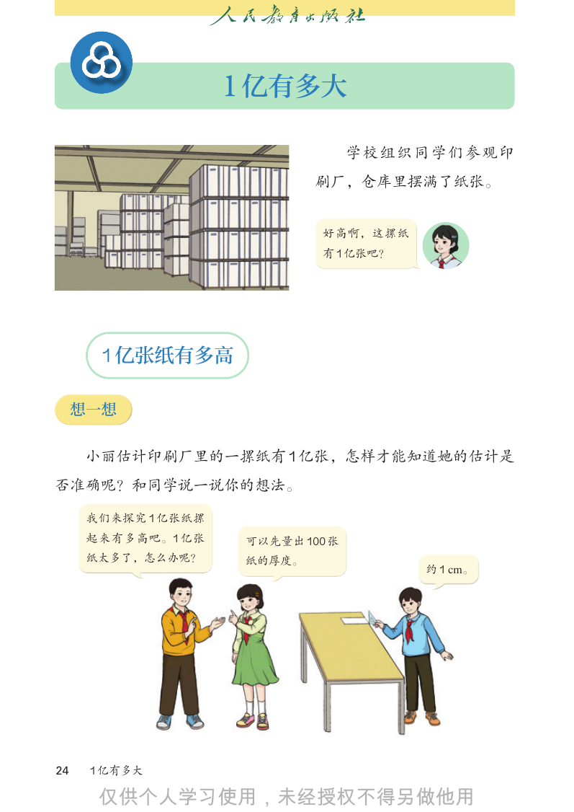

```text
                     1 亿有多大

                                    学校组织同学们参观印
                              刷厂，仓库里摆满了纸张。

                               好高啊，这摞纸
                               有 1 亿张吧？

       1 亿张纸有多高

     想一想

     小丽估计印刷厂里的一摞纸有 1 亿张，怎样才能知道她的估计是
否准确呢？和同学说一说你的想法。

      我们来探究 1 亿张纸摞
      起来有多高吧。1 亿张     可以先量出 100 张
      纸太多了，怎么办呢？      纸的厚度。
                                          约 1 cm。

24    1 亿有多大


```

## 教材第 25 页（PDF 第 30 页）

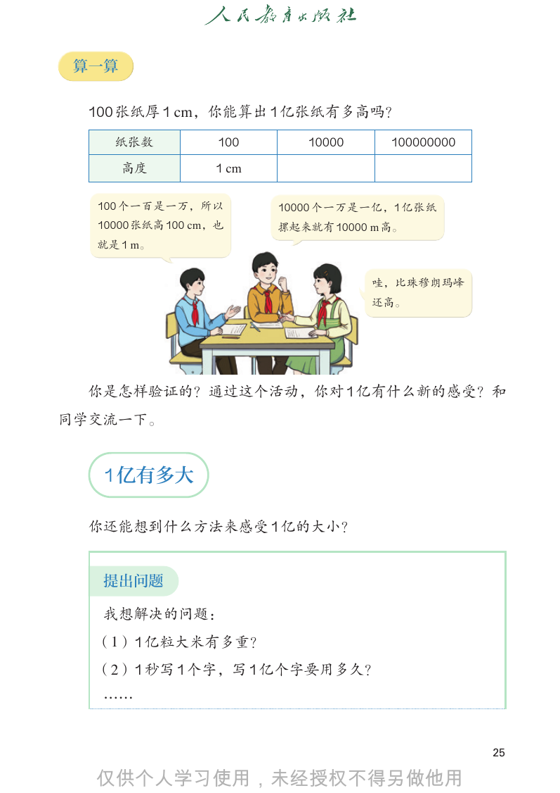

```text
 算一算

 100 张纸厚 1 cm，你能算出 1 亿张纸有多高吗？
    纸张数            100      10000      100000000

       高度         1 cm

  100 个一百是一万，所以          10000 个一万是一亿，1 亿张纸
  10000 张纸高 100 cm，也     摞起来就有 10000 m 高。
  就是 1 m。

                                     哇，比珠穆朗玛峰
                                     还高。

 你是怎样验证的？通过这个活动，你对 1 亿有什么新的感受？和
同学交流一下。

   1 亿有多大

  你还能想到什么方法来感受 1 亿的大小？

   提出问题

   我想解决的问题：
  （1） 1 亿粒大米有多重？
  （2） 1 秒写 1 个字，写 1 亿个字要用多久？
   ……

                                                   25


```

## 教材第 26 页（PDF 第 31 页）


```text
      分析问题

      怎样解决你提出的问题呢？

              只要称一称 100 粒大米          写 1 亿个字需要 1 亿秒。1 年
              有多重就知道了。               有多少秒？ 2 年呢？

      得出结论

      用想到的方法试一试，你有什么感受？

                                     一刻不停，3 年多才能写完
              1 亿 粒 大 米 大 约 重 2 t，   1 亿个字，那时候我已经上
              我 10 年都吃不完。            中学了。

        你想研究什么问题？和同学组成小组一起探索，并将你们
     的研究过程记录下来。

                              小组研究记录
        小组成员：
        研究问题：
        研究过程：

        结论：
        感想：

26   1 亿有多大


```

## 教材第 27 页（PDF 第 32 页）

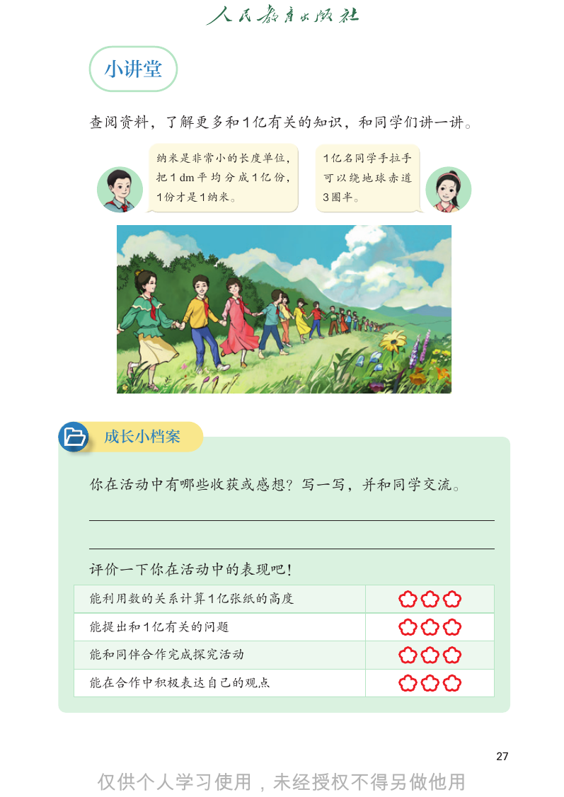

```text
 小讲堂

查阅资料，了解更多和 1 亿有关的知识，和同学们讲一讲。

      纳米是非常小的长度单位，            1 亿名同学手拉手
      把 1 dm 平 均 分 成 1 亿 份，   可以绕地球赤道
      1 份才是 1 纳米。             3 圈半。

 成长小档案

你在活动中有哪些收获或感想？写一写，并和同学交流。

评价一下你在活动中的表现吧！
能利用数的关系计算 1 亿张纸的高度

能提出和 1 亿有关的问题

能和同伴合作完成探究活动

能在合作中积极表达自己的观点

                                          27


```

## 教材第 28 页（PDF 第 33 页）

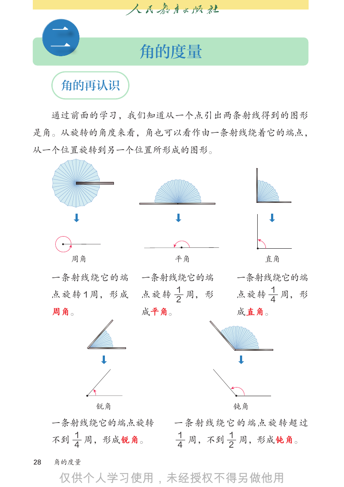

```text
     二                角的度量

      角的再认识

     通过前面的学习，我们知道从一个点引出两条射线得到的图形
是角。从旋转的角度来看，角也可以看作由一条射线绕着它的端点，
从一个位置旋转到另一个位置所形成的图形。

         周角               平角            直角

     一条射线绕它的端         一条射线绕它的端     一条射线绕它的端
                          1            1
     点 旋 转 1 周， 形 成   点旋转   周， 形   点旋转   周，形
                          2            4
     周角。              成平角。         成直角。

              锐角                   钝角

     一条射线绕它的端点旋转          一条射线绕它的端点旋转超过
       1                  1      1
     不到 周，形成锐角。             周，不到   周，形成钝角。
       4                  4      2
28   角的度量


```

## 教材第 29 页（PDF 第 34 页）

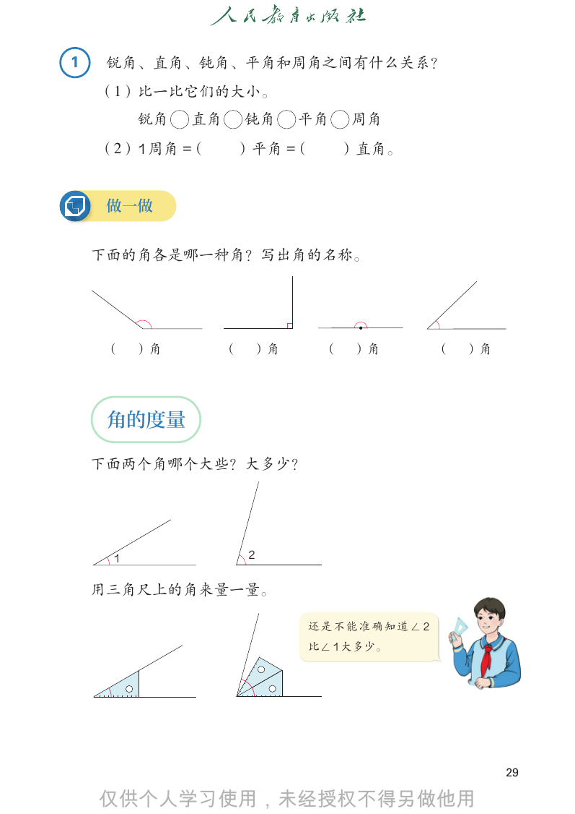

```text
1    锐角、直角、钝角、平角和周角之间有什么关系？
    （1）比一比它们的大小。
         锐角   直角       钝角   平角   周角
    （2）1 周角 =（     ）平角 =（        ）直角。

     做一做

    下面的角各是哪一种角？写出角的名称。

    （    ）角        （   ）角    （   ）角       （   ）角

     角的度量

    下面两个角哪个大些？大多少？

     1                 2

    用三角尺上的角来量一量。

                            还是不能准确知道∠ 2
                            比∠ 1 大多少。

                                                   29


```

## 教材第 30 页（PDF 第 35 页）

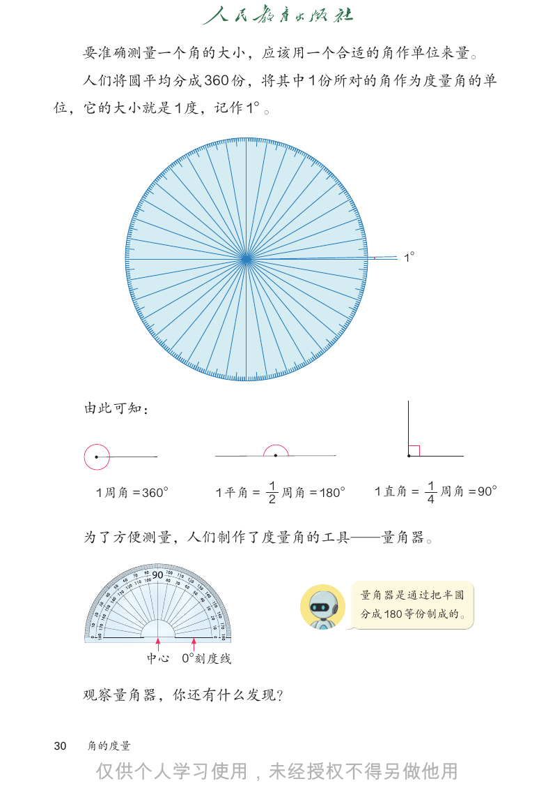

```text
     要准确测量一个角的大小，应该用一个合适的角作单位来量。
     人们将圆平均分成 360 份，将其中 1 份所对的角作为度量角的单
位，它的大小就是 1 度，记作 1°。

                                              1°

     由此可知：

      1 周角 = 360°
                           1
                    1 平角 = 2 周角 = 180°    1 直角 = 1 周角 = 90°
                                                 4

     为了方便测量，人们制作了度量角的工具—量角器。

                                         量角器是通过把半圆
                                         分成 180 等份制成的。

            中心 0°
                刻度线

     观察量角器，你还有什么发现？

30   角的度量


```

## 教材第 31 页（PDF 第 36 页）

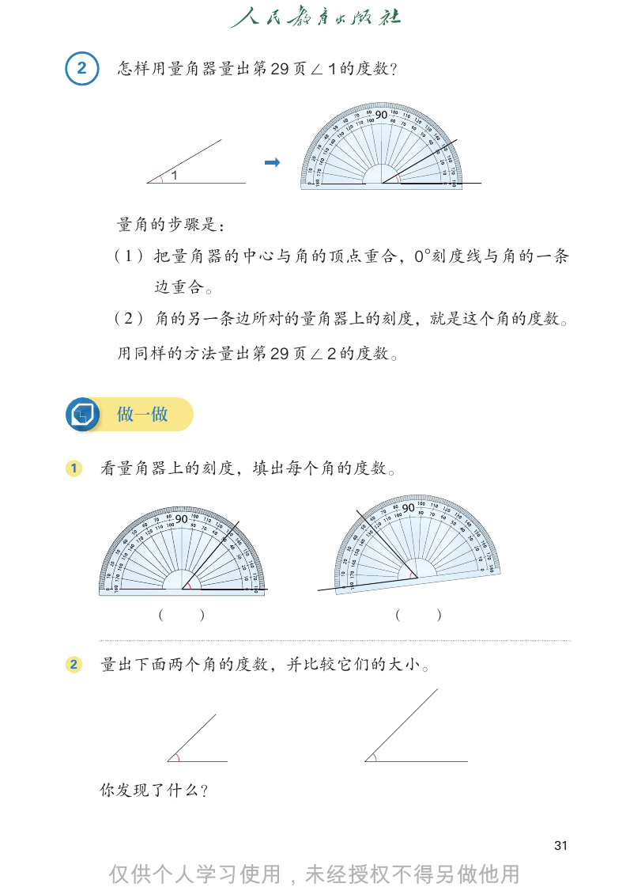

```text
2    怎样用量角器量出第 29 页∠ 1 的度数？

           1

     量角的步骤是：
    （1） 把量角器的中心与角的顶点重合，0 °
                         刻度线与角的一条
       边重合。
    （2） 角的另一条边所对的量角器上的刻度，就是这个角的度数。

     用同样的方法量出第 29 页∠ 2 的度数。

     做一做

1   看量角器上的刻度，填出每个角的度数。

       （       ）         （    ）

2   量出下面两个角的度数，并比较它们的大小。

    你发现了什么？

                                  31


```

## 教材第 32 页（PDF 第 37 页）

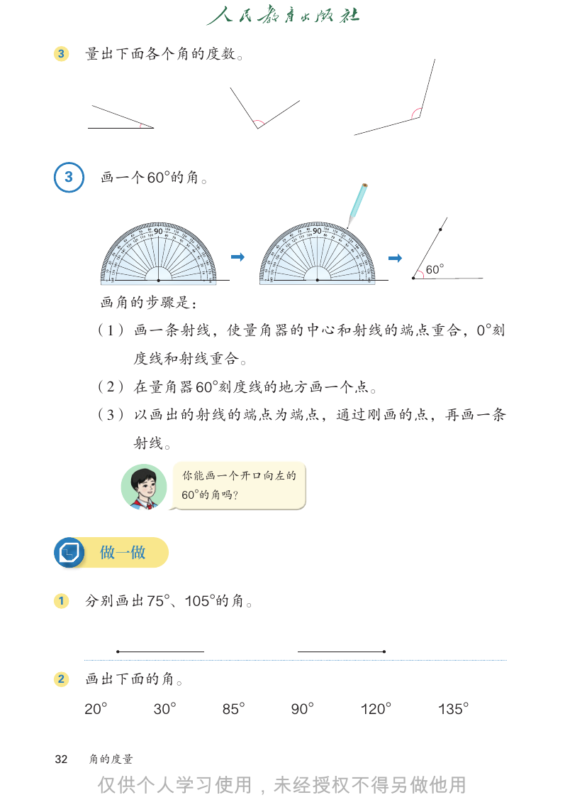

```text
3       量出下面各个角的度数。

    3    画一个 60°
               的角。

                                          60°

         画角的步骤是：
        （1） 画一条射线，使量角器的中心和射线的端点重合，0 °
                                    刻
              度线和射线重合。
        （2） 在量角器 60°
                   刻度线的地方画一个点。
        （3） 以画出的射线的端点为端点，通过刚画的点，再画一条
              射线。

                    你能画一个开口向左的
                    60°
                      的角吗？

         做一做

1       分别画出 75°
               、105°
                   的角。

2       画出下面的角。
        20°    30°     85°   90°   120°    135°

32      角的度量


```

## 教材第 33 页（PDF 第 38 页）

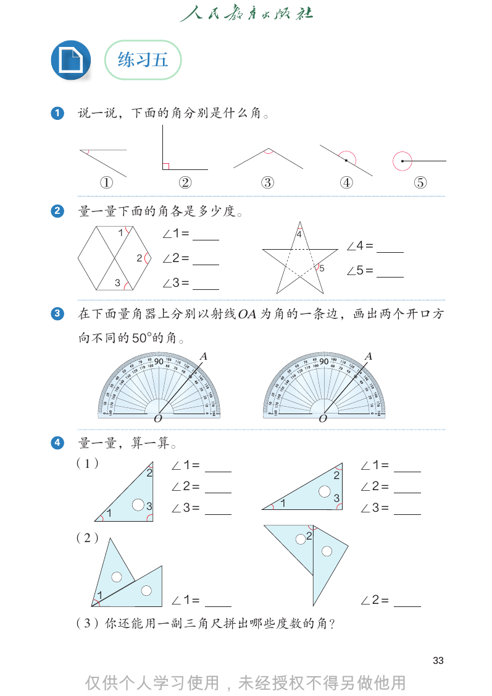

```text
              练习五

1   说一说，下面的角分别是什么角。

      ①                        ②       ③                       ④          ⑤

2   量一量下面的角各是多少度。
              1           ∠1 =                 4
                                                               ∠4 =
                  2       ∠2 =
                                                       5       ∠5 =
              3           ∠3 =

3   在下面量角器上分别以射线 OA 为角的一条边，画出两个开口方
    向不同的 50°
           的角。
                                   A                               A

                          O                            O

4   量一量，算一算。
    （1）                       ∠1 =                                 ∠1 =
                      2                                    2
                              ∠2 =                                 ∠2 =
                                           1               3
          1
                      3       ∠3 =                                 ∠3 =

    （2）                                            2

      1
                              ∠1 =                                 ∠2 =
    （3）你还能用一副三角尺拼出哪些度数的角？

                                                                               33


```

## 教材第 34 页（PDF 第 39 页）

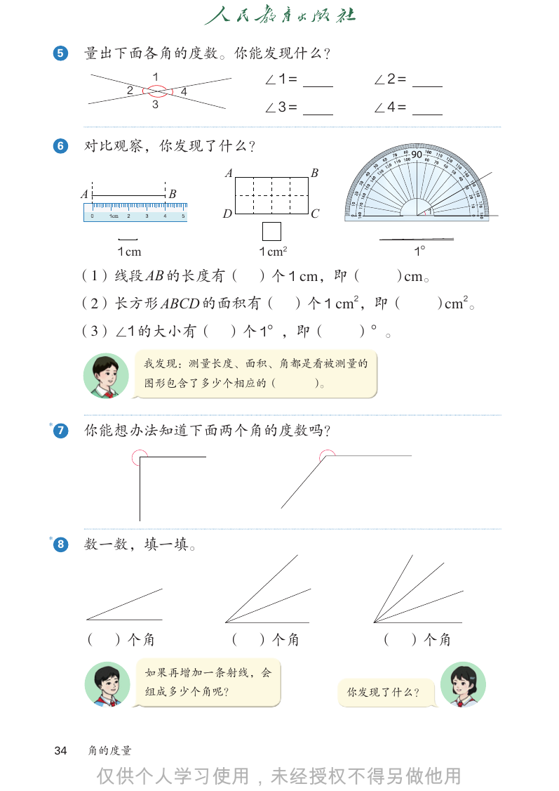

```text
    5    量出下面各角的度数。你能发现什么？
                     1               ∠1 =           ∠2 =
               2             4
                     3               ∠3 =           ∠4 =

    6    对比观察，你发现了什么？
                                 A           B
         A               B
                                 D           C                  1

              1 cm                   1 cm2                 1°
         （1）线段 AB 的长度有（              ）个 1 cm，即（         ）cm。
         （2）长方形 ABCD 的面积有（ ）个 1 cm2，即（                              ）cm2。
         （3）∠1 的大小有（             ）个 1°，即（         ）°。

                     我发现：测量长度、面积、角都是看被测量的
                     图形包含了多少个相应的（            ）。

*
    7    你能想办法知道下面两个角的度数吗？

*
    8    数一数，填一填。

         （   ）个角                 （ ）个角              （      ）个角

                     如果再增加一条射线，会
                     组成多少个角呢？                     你发现了什么？

    34   角的度量


```

## 教材第 35 页（PDF 第 40 页）

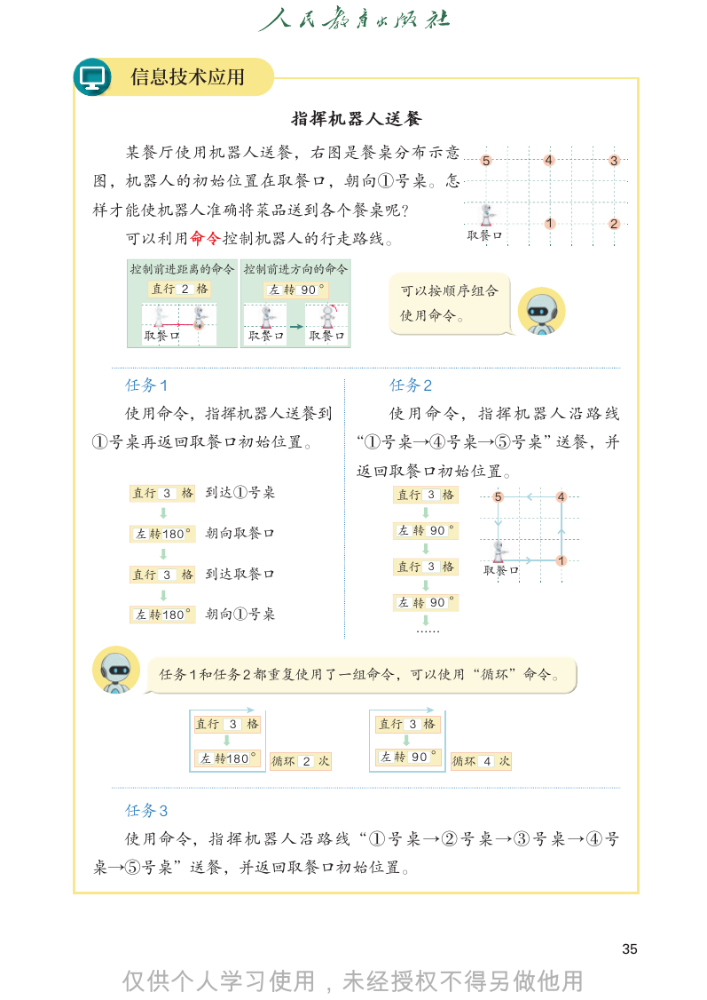

```text
  信息技术应用

                     指挥机器人送餐
  某餐厅使用机器人送餐，右图是餐桌分布示意                            5       4       3
图，机器人的初始位置在取餐口，朝向①号桌。怎
样才能使机器人准确将菜品送到各个餐桌呢？
                                                          1       2
  可以利用命令控制机器人的行走路线。                              ः丽ऐ

  ᣔ‫ݺݣ‬䔈䌊⻨⮱পБ ᣔ‫ݺݣ‬䔈᫦ा⮱পБ
    Ⱑ㵹2 ᵩ     ጓ90 c
                    䒙               可以按顺序组合
                                    使用命令。
          1
   ः丽ऐ         ः丽ऐ      ः丽ऐ

  任务 1                            任务 2
  使用命令，指挥机器人送餐到                   使 用 命 令， 指 挥 机 器 人 沿 路 线
①号桌再返回取餐口初始位置。                 “①号桌→④号桌→⑤号桌”送餐，并
                               返回取餐口初始位置。
  Ⱑ㵹3ᵩ 到达①号桌1                 Ⱙ㶁3 ᵱ
            ः丽ऐ                                       5       4

   ጓ 䒙180 c 朝向取餐口1                 ጛ90 f
                                      䒡
            ः丽ऐ
                                                              1
                 1                 Ⱙ㶁3 ᵱ      ऋ久घ
  Ⱑ㵹3ᵩ 到达取餐口
            ः丽ऐ
                                   ጛ90 f
                                      䒡
   ጓ 䒙180 c 朝向①号桌1
            ः丽ऐ
                                      ČČ

     任务 1 和任务 2 都重复使用了一组命令，可以使用“循环”命令。

             3 3
          直行直行 格 格             直行
                               直行 直行
                                 直行33格
                                     格
                                     33格
                                       格

           左180
          左转 转180
                ° °    2 次 左
                     2 次
                  循环循环     左转左
                             转左9
                               转转0 °
                               90  9
                                   °0°°
                                   90    4 次
                                      循环循环 4 次

  任务 3
  使用命令，指 挥 机 器 人 沿 路 线“ ① 号 桌 → ② 号 桌 → ③ 号 桌 → ④ 号
桌→⑤号桌”送餐，并返回取餐口初始位置。

                                                                      35


```

## 教材第 36 页（PDF 第 41 页）

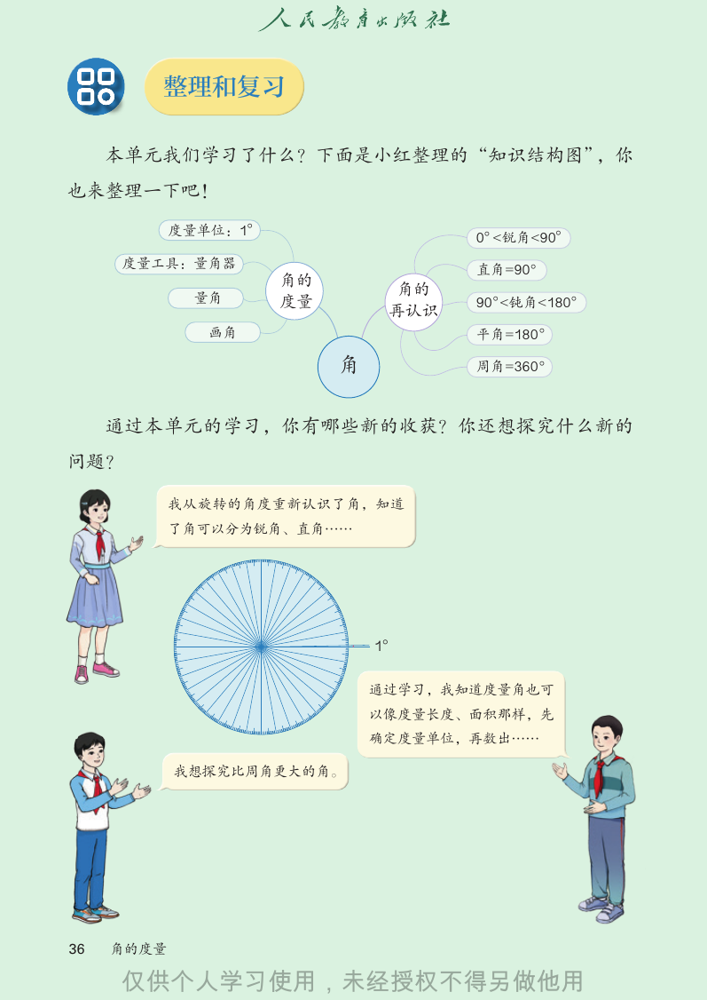

```text
        整理和复习

     本单元我们学习了什么？下面是小红整理的“知识结构图”，你
也来整理一下吧！
            度量单位：1°
                                      0°<锐角<90°
     度量工具：量角器                         直角=90°
                      角的
                                角的
             量角       度量              90 °
                                         <钝角<180°
                                再认识
               画角                     平角=180 °

                           角          周角=360 °

     通过本单元的学习，你有哪些新的收获？你还想探究什么新的
问题？

            我从旋转的角度重新认识了角，知道
            了角可以分为锐角、直角……

                               1°

                               通过学习，我知道度量角也可
                               以像度量长度、面积那样，先
                               确定度量单位，再数出……

            我想探究比周角更大的角。

36   角的度量


```

## 教材第 37 页（PDF 第 42 页）

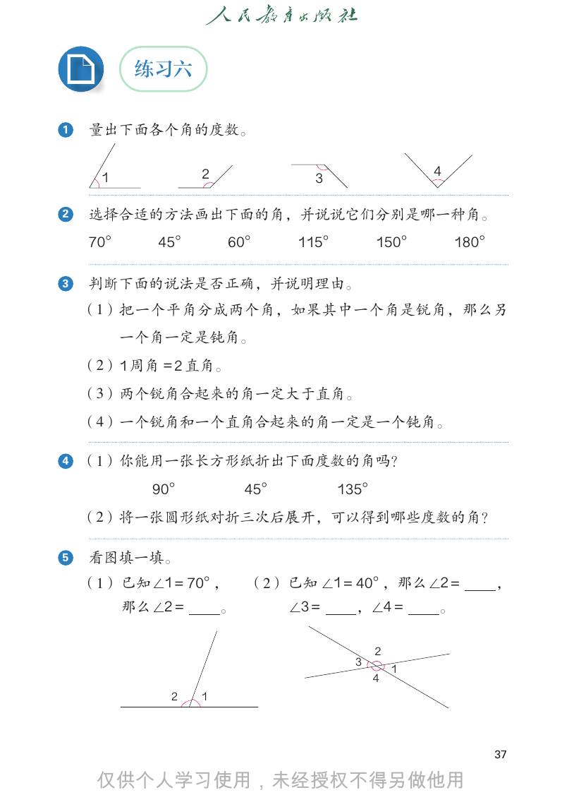

```text
           练习六

1   量出下面各个角的度数。

      1           2                             4
                              3

2   选择合适的方法画出下面的角，并说说它们分别是哪一种角。
    70°     45°       60°    115°       150°        180°

3   判断下面的说法是否正确，并说明理由。
    （1）把一个平角分成两个角，如果其中一个角是锐角，那么另
          一个角一定是钝角。
    （2）1 周角 = 2 直角。
    （3）两个锐角合起来的角一定大于直角。
    （4）一个锐角和一个直角合起来的角一定是一个钝角。

4   （1）你能用一张长方形纸折出下面度数的角吗？
            90°        45°        135°
    （2）将一张圆形纸对折三次后展开，可以得到哪些度数的角？

5   看图填一填。
    （1） 已知∠1 = 70°， （2） 已知 ∠1 = 40°，那么∠2 =                 ，
        那么∠2 =    。     ∠3 =    ，∠4 =  。

                                        2
                                    3
                                            1
                                        4
             2    1

                                                           37


```

## 教材第 38 页（PDF 第 43 页）

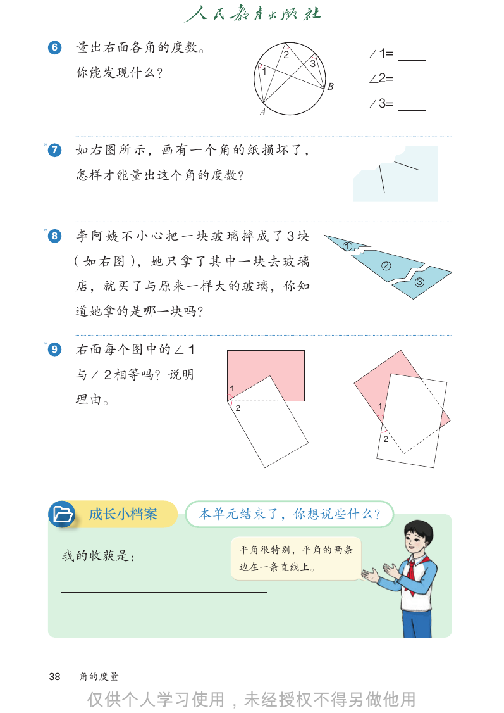

```text
    6     量出右面各角的度数。                  2               ∠1=
                                          3
          你能发现什么？                 1
                                                      ∠2=
                                              B

                                  A
                                                      ∠3=

*
    7     如右图所示，画有一个角的纸损坏了，
          怎样才能量出这个角的度数？

*
    8     李阿姨不小心把一块玻璃摔成了 3 块
                                                  1
         （如右图），她只拿了其中一块去玻璃                                 2
                                                           1
                                                               3
          店，就买了与原来一样大的玻璃，你知                                    2
                                                                   3
          道她拿的是哪一块吗？

*
    9     右面每个图中的∠ 1
          与∠ 2 相等吗？说明
                          1
          理由。                                          1
                              2

                                                           2

           成长小档案        本单元结束了，你想说些什么？

                              平角很特别，平角的两条
         我的收获是：
                              边在一条直线上。

    38    角的度量


```

## 教材第 39 页（PDF 第 44 页）

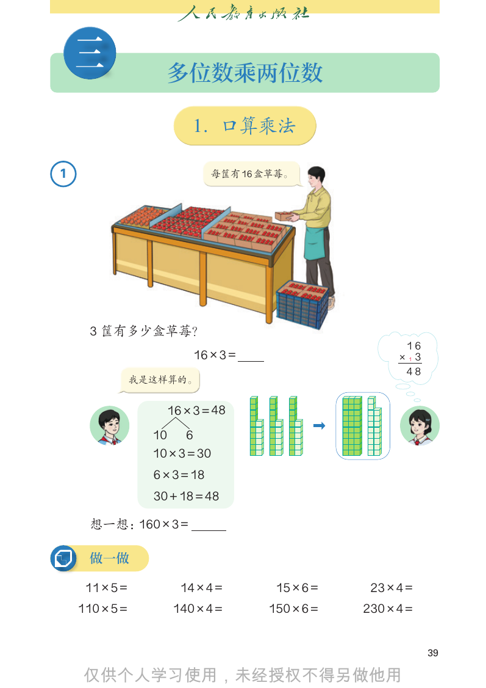

```text
    三               多位数乘两位数

                         1. 口算乘法

1                              每筐有 16 盒草莓。

      3 筐有多少盒草莓？
                                                         16
                         16 × 3 =                       ×13
                                                         48
                我是这样算的。

                    16 × 3 = 48
                  10 6
                  10 × 3 = 30
                  6 × 3 = 18
                  30 + 18 = 48

      想一想：160 × 3 =

      做一做

     11 × 5 =          14 × 4 =        15 × 6 =    23 × 4 =
    110 × 5 =        140 × 4 =        150 × 6 =   230 × 4 =

                                                              39


```

## 教材第 40 页（PDF 第 45 页）

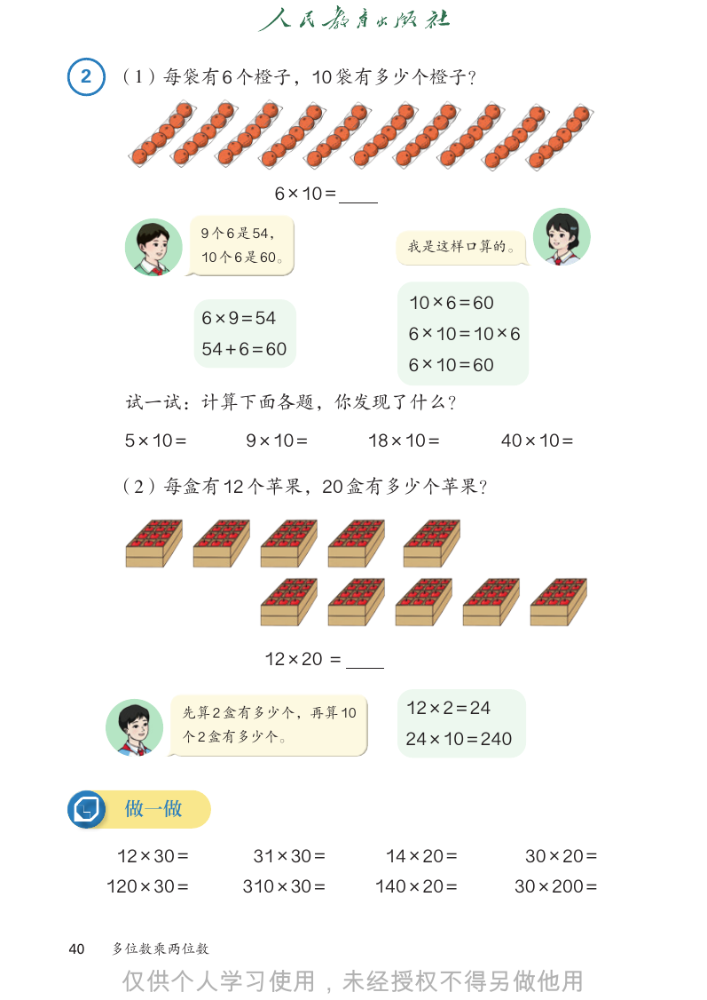

```text
 2    （1）每袋有 6 个橙子，10 袋有多少个橙子？

                           6 × 10 =
                  9 个 6 是 54，
                                          我是这样口算的。
                  10 个 6 是 60。

                                           10 × 6 = 60
                  6 × 9 = 54
                                           6 × 10 = 10 × 6
                  54 + 6 = 60
                                           6 × 10 = 60
       试一试：计算下面各题，你发现了什么？

       5 × 10 =         9 × 10 =      18 × 10 =          40 × 10 =

      （2）每盒有 12 个苹果，20 盒有多少个苹果？

                          12 × 20 =

              先算 2 盒有多少个，再算 10            12 × 2 = 24
              个 2 盒有多少个。                  24 × 10 = 240

       做一做

      12 × 30 =          31 × 30 =      14 × 20 =            30 × 20 =
     120 × 30 =        310 × 30 =     140 × 20 =          30 × 200 =

40   多位数乘两位数


```

## 教材第 41 页（PDF 第 46 页）

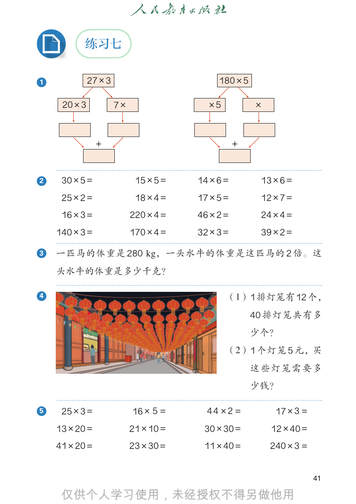

```text
           练习七

1             27 × 3                         180 × 5

     20 × 3            7×                 ×5           ×

                +                                  +

2    30 × 5 =                15 × 5 =   14 × 6 =        13 × 6 =
     25 × 2 =                18 × 4 =   17 × 5 =        12 × 7 =
     16 × 3 =               220 × 4 =   46 × 2 =        24 × 4 =
    140 × 3 =               170 × 4 =   32 × 3 =        39 × 2 =

3   一匹马的体重是 280 kg，一头水牛的体重是这匹马的 2 倍。这
    头水牛的体重是多少千克？

4                                              （1）1 排灯笼有 12 个，
                                                       40 排灯笼共有多
                                                       少个？
                                               （2）1 个灯笼 5 元，买
                                                       这些灯笼需要多
                                                       少钱？

5    25 × 3 =               16 × 5 =      44 ×2 =           17 × 3 =
    13 × 20 =               21 × 10 =    30 × 30 =         12 × 40 =
    41 × 20 =               23 × 30 =    11 × 40 =         240 × 3 =

                                                                       41


```

## 教材第 42 页（PDF 第 47 页）

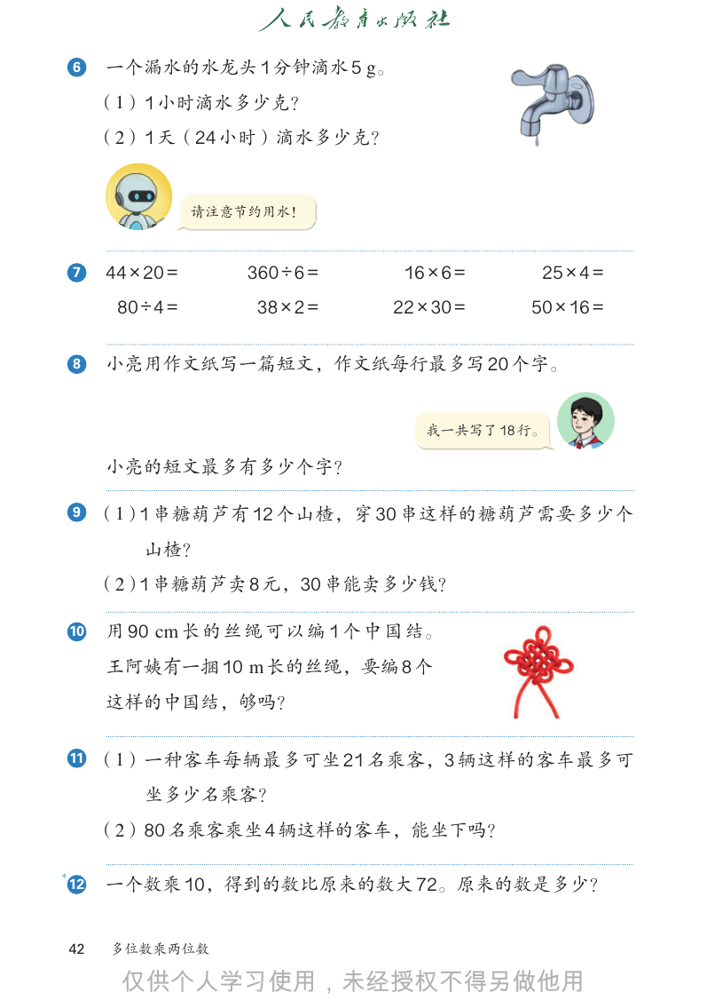

```text
    6    一个漏水的水龙头 1 分钟滴水 5 g。
         （1）1 小时滴水多少克？
         （2）1 天（24 小时）滴水多少克？

                     请注意节约用水！

    7    44 × 20 =      360 ÷ 6 =    16 × 6 =     25 × 4 =
          80 ÷ 4 =       38 × 2 =   22 × 30 =    50 × 16 =

    8    小亮用作文纸写一篇短文，作文纸每行最多写 20 个字。

                                        我一共写了 18 行。

         小亮的短文最多有多少个字？

    9    （1）1 串糖葫芦有 12 个山楂，穿 30 串这样的糖葫芦需要多少个
             山楂？
         （2）1 串糖葫芦卖 8 元，30 串能卖多少钱？

    10   用 90 cm 长的丝绳可以编 1 个中国结。
         王阿姨有一捆 10 m 长的丝绳，要编 8 个
         这样的中国结，够吗？

    11   （1）一种客车每辆最多可坐 21 名乘客，3 辆这样的客车最多可
             坐多少名乘客？
         （2）80 名乘客乘坐 4 辆这样的客车，能坐下吗？

*
    12   一个数乘 10，得到的数比原来的数大 72。原来的数是多少？

    42   多位数乘两位数


```

## 教材第 43 页（PDF 第 48 页）

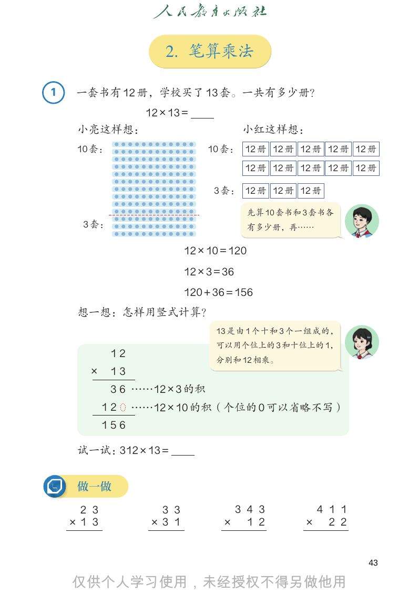

```text
                       2. 笔算乘法

1   一套书有 12 册，学校买了 13 套。一共有多少册？
                   12 × 13 =
     小亮这样想：
        小亮的这样想：                          小红这样想：
     10 套：                      10 套： 12 册 12 册 12 册 12 册 12 册
                                         12 册 12 册 12 册 12 册 12 册
       10套：

                                 3 套： 12 册 12 册 12 册

                                           先算 10 套书和 3 套书各
      3 套：
        3套：                                有多少册，再……

                           12 × 10 = 120
                           12 × 3 = 36
                           120 + 36 = 156
     想一想：怎样用竖式计算？
                                  13 是由 1 个十和 3 个一组成的，
                                  可以用个位上的 3 和十位上的 1，
             12
                                  分别和 12 相乘。
       ×     13
             3 6 ……12 × 3 的积
           12     ……12 × 10 的积（个位的 0 可以省略不写）
           156

     试一试：312 × 13 =

     做一做

     2 3             3 3            3 4 3             4 1 1
    ×1 3            ×3 1           × 1 2             × 2 2

                                                               43


```

## 教材第 44 页（PDF 第 49 页）

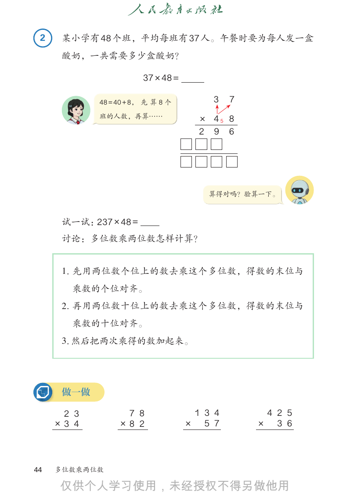

```text
 2    某小学有 48 个班，平均每班有 37 人。午餐时要为每人发一盒
      酸奶，一共需要多少盒酸奶？

                        37 × 48 =

            48 = 40 + 8， 先 算 8 个        3    7
            班的人数，再算……                 × 45 8
                                      2 9 6

                                        算得对吗？验算一下。

      试一试：237 × 48 =
      讨论：多位数乘两位数怎样计算？

      1. 先用两位数个位上的数去乘这个多位数，得数的末位与
       乘数的个位对齐。
      2. 再用两位数十位上的数去乘这个多位数，得数的末位与
       乘数的十位对齐。
      3. 然后把两次乘得的数加起来。

      做一做

      2 3         7 8                1 3 4        4 2 5
     ×3 4        ×8 2               × 5 7        × 3 6

44   多位数乘两位数


```

## 教材第 45 页（PDF 第 50 页）

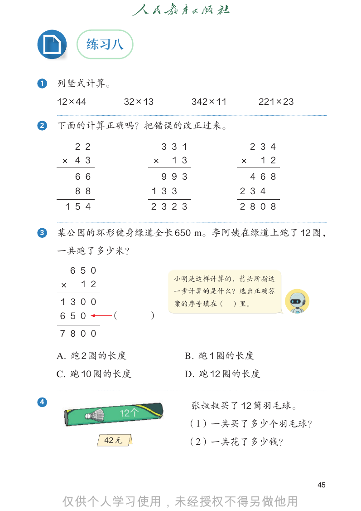

```text
          练习八

1   列竖式计算。
    12 × 44          32 × 13           342 × 11         221 × 23

2   下面的计算正确吗？把错误的改正过来。

       2 2                  3 3 1                   2 3 4
     × 4 3                 × 1 3                   × 1 2
        6 6                    9 9 3                4 6 8
        8 8                1 3 3                   2 3 4
     1 5 4                 2 3 2 3                 2 8 0 8

3   某公园的环形健身绿道全长 650 m。李阿姨在绿道上跑了 12 圈，
    一共跑了多少米？

      6 5 0
                                 小明是这样计算的，箭头所指这
     × 1 2
                                 一步计算的是什么？选出正确答
    1 3 0 0                      案的序号填在（          ）里。
    6 5 0      （          ）
    7 8 0 0

    A. 跑 2 圈的长度                    B. 跑 1 圈的长度
    C. 跑 10 圈的长度                   D. 跑 12 圈的长度

4
                                       张叔叔买了 12 筒羽毛球。
                                   （1）一共买了多少个羽毛球？
              42 元                 （2）一共花了多少钱？

                                                                   45


```

## 教材第 46 页（PDF 第 51 页）

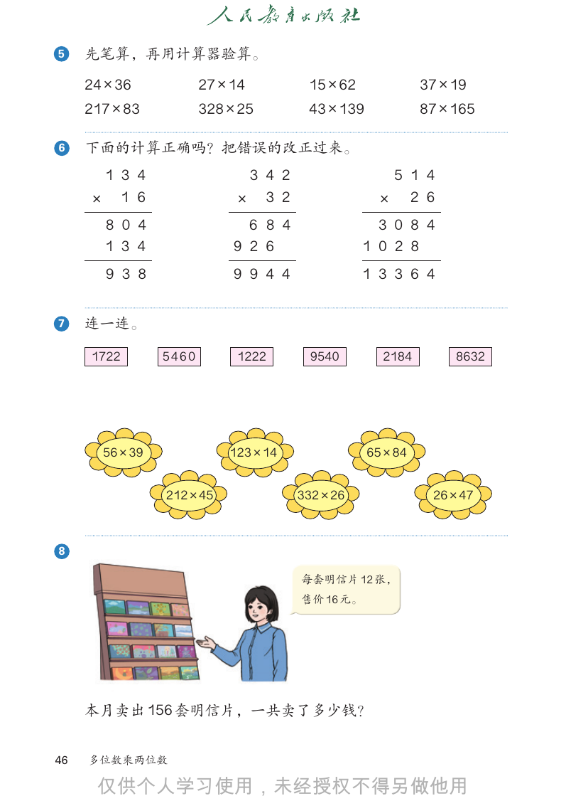

```text
5    先笔算，再用计算器验算。
     24 × 36            27 × 14         15 × 62              37 × 19
     217 × 83           328 × 25        43 × 139             87 × 165

6    下面的计算正确吗？把错误的改正过来。
       1 3 4                  3 4 2                   5 1 4
      × 1 6                  × 3 2                   × 2 6
        8 0 4                  6 8 4                3 0 8 4
        1 3 4                9 2 6                1 0 2 8
        9 3 8                9 9 4 4              1 3 3 6 4

7    连一连。

      1722       5460        1222        9540        2184         8632

       56 × 39              123 × 14               65 × 84

                 212 × 45              332 × 26                26 × 47

8

                                       每套明信片 12 张，
                                       售价 16 元。

     本月卖出 156 套明信片，一共卖了多少钱？

46   多位数乘两位数


```

## 教材第 47 页（PDF 第 52 页）

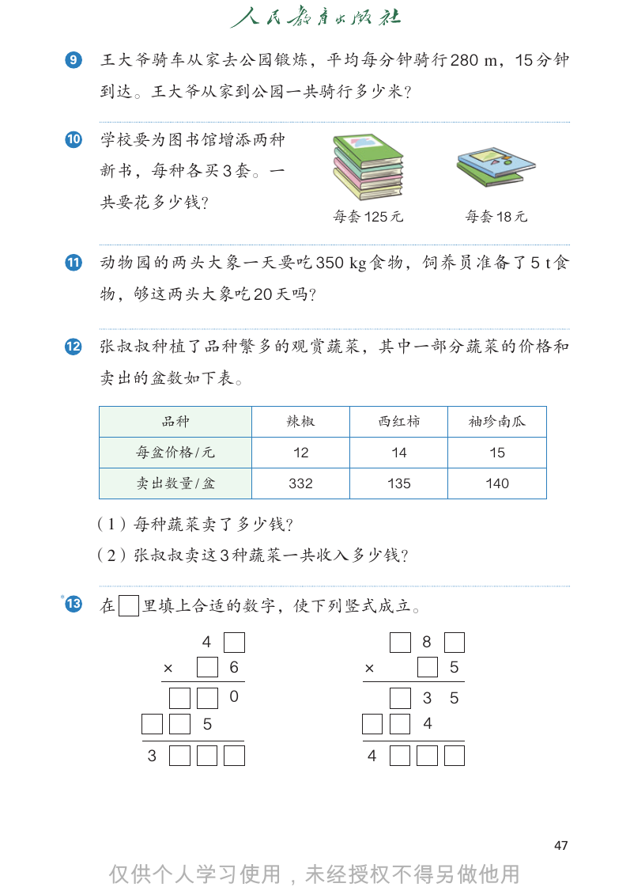

```text
    9    王大爷骑车从家去公园锻炼，平均每分钟骑行 280 m，15 分钟
         到达。王大爷从家到公园一共骑行多少米？

    10   学校要为图书馆增添两种
         新书，每种各买 3 套。一
         共要花多少钱？
                                     每套 125 元             每套 18 元

    11   动物园的两头大象一天要吃 350 kg 食物，饲养员准备了 5 t 食
         物，够这两头大象吃 20 天吗？

    12   张叔叔种植了品种繁多的观赏蔬菜，其中一部分蔬菜的价格和
         卖出的盆数如下表。

                  品种           辣椒           西红柿           袖珍南瓜

             每盆价格 / 元          12           14              15

             卖出数量 / 盆          332          135             140

         （1）每种蔬菜卖了多少钱？
         （2）张叔叔卖这 3 种蔬菜一共收入多少钱？

*
    13   在   里填上合适的数字，使下列竖式成立。

                       4                          8
                  ×        6            ×             5
                           0                      3   5
                       5                          4
              3                         4

                                                                    47


```

## 教材第 48 页（PDF 第 53 页）

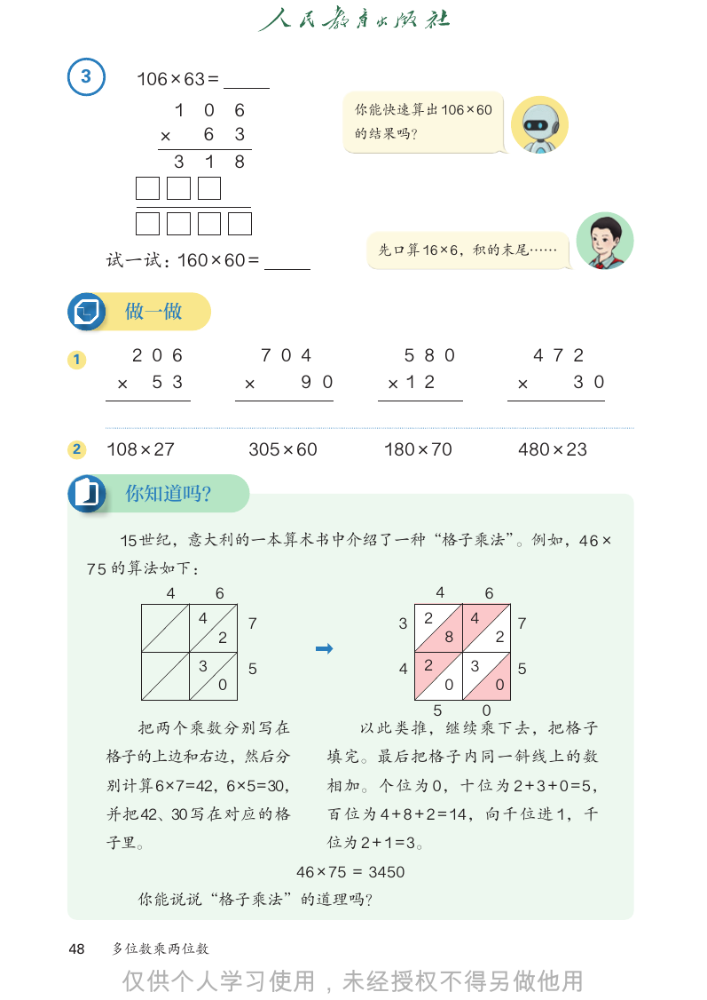

```text
    3      106 × 63 =
                   1   0       6                 你能快速算出106 × 60
               ×       6       3                 的结果吗？

                   3   1       8

                                                    先口算 16 × 6，积的末尾……
        试一试：160 × 60 =

          做一做

1         2 0 6                  7 0 4                5 8 0                     4 7 2
         × 5 3                 ×     9 0             ×1 2                     ×     3 0

2       108 × 27                   305 × 60          180 × 70                 480 × 23

          你知道吗？

         15 世纪，意大利的一本算术书中介绍了一种“格子乘法”。例如，46 ×
     7 5 的算法如下：
            4   6                                             4       6
                       4           7                  3   2       4           7
                           2                                  8           2
                       3           5                   4 2        3           5
                           0                                  0           0
                                                      5  0
            把两个乘数分别写在                             以此类推，继续乘下去，把格子
        格子的上边和右边，然后分                          填完。最后把格子内同一斜线上的数
        别计算6 × 7 = 42，6 × 5 = 30，             相加。个位为 0，十位为 2 + 3 + 0 = 5，
        并把42、30写在对应的格                         百位为 4 + 8 + 2 = 14，向千位进 1， 千
        子里。                                   位为 2 + 1 = 3。
                                        46 × 75 = 3450
            你能说说“格子乘法”的道理吗？

48      多位数乘两位数


```

## 教材第 49 页（PDF 第 54 页）

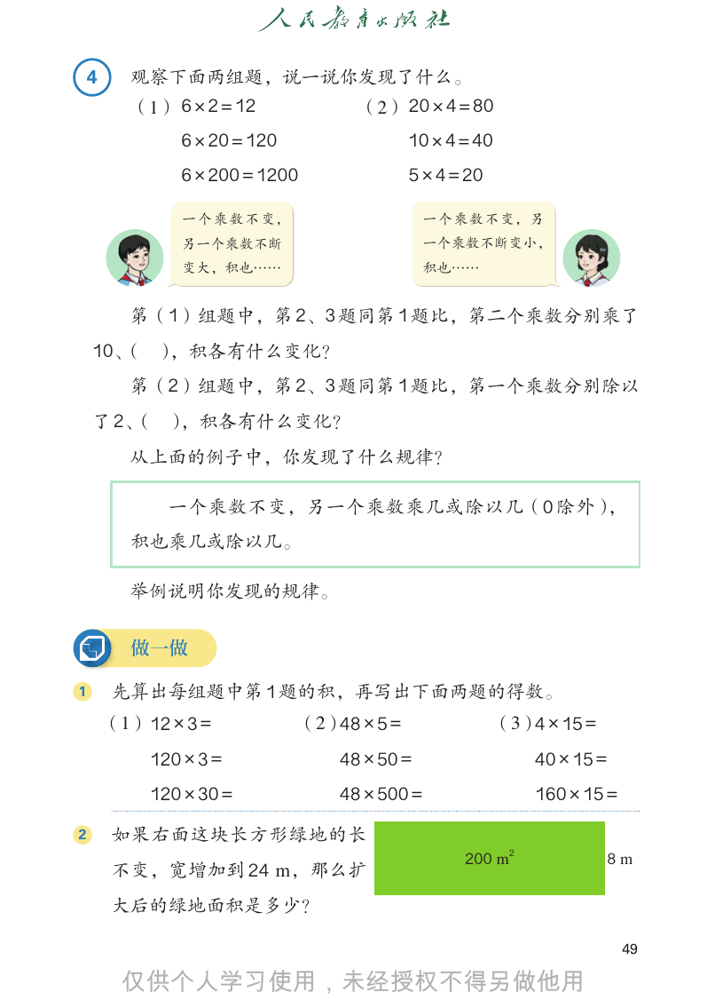

```text
    4     观察下面两组题，说一说你发现了什么。
          （1） 6 × 2 = 12 （2） 20 × 4 = 80
               6 × 20 = 120                  10 × 4 = 40
               6 × 200 = 1200                5 × 4 = 20

                一 个 乘 数 不 变，                    一个乘数不变，另
                另一个乘数不断                         一个乘数不断变小，
                变大，积也……                         积也……

          第（1）组题中，第 2、3 题同第 1 题比，第二个乘数分别乘了
    10、（   ），积各有什么变化？
          第（2）组题中，第 2、3 题同第 1 题比，第一个乘数分别除以
    了 2、（   ），积各有什么变化？
          从上面的例子中，你发现了什么规律？

              一个乘数不变，另一个乘数乘几或除以几（0 除外），
          积也乘几或除以几。

          举例说明你发现的规律。

          做一做

1       先算出每组题中第 1 题的积，再写出下面两题的得数。
        （1）12 × 3 =            （2）48 × 5 =                （3）4 × 15 =
            120 × 3 =              48 × 50 =                  40 × 15 =
            120 × 30 =             48 × 500 =                 160 × 15 =

2       如果右面这块长方形绿地的长
                                                    200 m2              8m
        不变，宽增加到 24 m，那么扩
        大后的绿地面积是多少？

                                                                           49


```

## 教材第 50 页（PDF 第 55 页）


```text
 5     用计算器计算下面各题，你发现了什么规律？
       11 × 11 = 121
       111 × 111 = 12321
       1111 × 1111 = 1234321
       11111 × 11111 = 123454321

                 乘积左右对称，中间的数字              为什么会有这样
                 是乘数的位数……                  的规律？

                                           1 1        1 1 1
                 列竖式可以说明这个            ×    1 1    ×   1 1 1
                 规律……
                                            1 1       1 1 1
                                          1 1       1 1 1
                                          1 2 1   1 1 1
                                                  1 2 3 2 1
       不计算，运用发现的规律，直接写出下面算式的得数。
       111111 × 111111 =           1111111 × 1111111 =
       11111111 × 11111111 =       111111111 × 111111111 =

       做一做

     用计算器计算每组前三题，再根据规律直接写出后两题的得数，
并用计算器进行检验。
     9×9=                      6×7=
     99 × 99 =                 66 × 67 =
     999 × 999 =               666 × 667 =
     9999 × 9999 =             6666 × 6667 =
     99999 × 99999 =           66666 × 66667 =
     请你根据规律，接着写出每组题的下一个算式及其得数。

50   多位数乘两位数


```

## 教材第 51 页（PDF 第 56 页）


```text
             练习九

1   口算。
    50 × 90 =          40 × 80 =         32 × 20 =              102 × 30 =
    70 × 140 =         300 × 60 =        21 × 40 =              25 × 30 =

2   408 × 50           506 × 26          3700 × 35              58 × 2500
    480 × 50           560 × 26          3070 × 35              85 × 2005

3   在       中填上“ > ”“ < ”或“ = ”。
    120 × 20      12 × 200               500 × 10         10 × 550
    16 × 400      210 × 4                19 × 300         30 × 180

4   下面是某文体用品店 8 月份部分体育用品销售情况，把表填完。

               商品                  篮球         足球                  排球

             单价 / 元                158           120               108

             数量 / 个                36             29               38

            销售金额 / 元

5   仔细观察每组题中乘数之间的关系，再计算。

        8                                   60

     16                                     180
             × 24 =                                    × 15 =
     32                                     240

     64                                     480

                                                                             51


```

## 教材第 52 页（PDF 第 57 页）


```text
6    根据每组题中第 1 题的积，写出下面两题的得数。
     （1）79 × 2 =            （2）240 × 3 =        （3）180 × 5 =
          79 × 20 =             24 × 3 =             180 × 15 =
          79 × 200 =            240 × 30 =           360 × 15 =

7
         乘数            20                       40         200
         乘数            5            5           10
          积                        200                     2000

8    根据下面第 1 题的积，找规律填出其他题的得数。
     15 × 14 = 210
     15 × 28 =                     15 × 42 =
     15 × 56 =                     15 × 70 =

9    计算下面第一列各题，你发现了什么规律？根据规律直接写出
     第二列各题的得数。
     15 × 15 =                      55 × 55 =
     25 × 25 =                      65 × 65 =
     35 × 35 =                      75 × 75 =
     45 × 45 =                      85 × 85 =

10   先写出前三个算式的积（可用计算器），再根据规律完成算式。
     3×4=
     33 × 34 =
     333 × 334 =
     ……
                   ×             = 111111222222

52    多位数乘两位数


```

## 教材第 53 页（PDF 第 58 页）


```text
6    张老师要为学校舞蹈队选购 18 套相同的服装，她带了 2600
     元，可以买哪几款服装？

     ①                   ②                   ③

         108 元               130 元               208 元

    阅读理解

    知道了要买的套数、带的钱数和三款服装的价格……
    要解决的问题是……

    分析解答

             我分别算出每款服装各买                  用估算的方法，解
             18 套的总价，有点麻烦。                决起来更方便。

     都买第一款：                        都买第一款：108 × 18
                                       估大         估大
     108 × 18 = 1944（元）2600 > 1944       110 × 20 = 2200（元）
     都买第二款：                        都买第二款：130 × 18
     130 × 18 = 2340（元）2600 > 2340                    估大
                                             130 × 20 = 2600（元）
     都买第三款：
                                     都买第三款：208 × 18
     208 × 18 = 3744（元）2600 < 3744           估小
                                           200 × 18 = 3600（元）
     答：张老师可以买第一款或第二款服装。

    回顾反思

             有的问题用估算                 要根据解决的问题，确定把
             就能解决。                   数往大估，还是往小估。

                                                             53


```

## 教材第 54 页（PDF 第 59 页）


```text
      做一做

     某学校 1026 名师生乘车去参观博物馆。每辆车限乘 48 人，19 辆
车够吗？

                          限乘人数里包括司机。

           练习十

1    录入一篇 3000 字的文章，丁叔叔平均每分钟录入 105 个字，30
     分钟能录完吗？

2    某大学的图书馆有 4 个自习教室，每个教室有 19 排座位，每排
     可坐 18 人。这些自习教室大约可以同时容纳多少名学生自习？

3    有 293 箱水蜜桃，每箱 18 kg。用一辆载质量 6 t 的货车一次能运
     走吗？

4    神舟十六号飞船绕地球一圈大
     约需要 90 分钟，它绕地球运
     行 201 圈大约需要多少时间？

5    某小学四年级师生共 192 人，准备去参观科技馆。科技馆的门票
     价格是每人 38 元，老师准备了 8000 元，够吗？

54   多位数乘两位数


```

## 教材第 55 页（PDF 第 60 页）


```text
               整理和复习

  下面是本单元学习结束后，小明整理的“知识结构图”，你也来
整理一下吧！
                              24×3=72
                            20 4
                口算乘法          20×3 =60
                               4×3 =12

   多位 数乘两位 数
                              60+12=72

                              15
                             ×12 12=10+2
                笔算乘法          30 15×12计算的是10个15与
                             15 2个15的和。
                             180

                           要结合实际问题来确定
                用估算解决问题
                           把数往大估还是往小估。

  通过本单元的学习，你还有哪些收获？本单元的知识和以前学
习的内容有什么关联吗？你还想探究哪些问题？

               我还用计算器探索了规律。

                          我发现不管几位数乘几位数，都是用
                          其中一个乘数的每一位数和另一个乘
                          数分别相乘，再把积相加。

               我还想探究多位数乘三位数、四位数
               的计算方法。

                                                   55


```

## 教材第 56 页（PDF 第 61 页）


```text
            练习十一

1    口算。
     23 × 300 =   72 × 20 =    19 × 40 =    140 × 50 =
     320 × 4 =    270 × 30 =   910 × 8 =    14 × 500 =

2    先笔算，再用计算器验算。
     62 × 38 158 × 64          59 × 139     830 × 40
     438 × 29     906 × 85     4060 × 56    7003 × 78

3    根据 32 × 15 = 480，直接写出下面各题的得数。
     16 × 15 =    64 × 15 =    32 × 30 =    320 × 15 =
     640 × 15 =   32 × 5 =     32 × 150 =   16 × 30 =

4    某市郊外的森林公园有124公顷森林。1公顷森林一年可滞尘32 t，
     一天可从地下吸出 85 t 水。（1 公顷 = 10000 平方米。
                                      ）
     （1）这个公园的森林一年可滞尘多少吨？
     （2）这个公园的森林一天可从地下吸出多少吨水？

5    每个排球 108 元，高老师要买 52 个这样的排球，带 5000 元钱
     够吗？

6    我国空间站每秒绕地球飞行的距离大约是
     7800 m。
     （1）1 小时绕地球飞行多少米？合多少千米？
        （可用计算器计算。）
     （2）每天绕地球飞行多少千米？

56   多位数乘两位数


```

## 教材第 57 页（PDF 第 62 页）


```text
    7    李老师带了 3000 元钱，要为学校选购 15 台同样的电话机，有
         多少种购买方案？分别还剩多少钱？

          128 元            108 元     198 元               210 元

    8    一块长方形绿地，如果长增加 1 m，面积就增加 16 m2 ；如果宽
         增加 1 m，面积就增加 25 m2。这块绿地的面积是多少？

*
    9    用 0、2、3、4、5 组成三位数乘两位数的乘法算式，你能写出
         几个？你能写出乘积最大的算式吗？

          思考题

          先分别根据前三个算式找出规律，再在方框里填上合适的数。
          31 × 39 = 1209            99 × 25 = 2475
          52 × 58 = 3016            999 × 25 = 24975
          63 × 67 = 4221            9999 × 25 = 249975
          74 × 76 =                 99999 × 25 = 24      75
          9    ×      5=                       × 25 =

          成长小档案             本单元结束了，你想说些什么？

                               积的变化规律很有趣，我还想
        我的收获是：
                               知道商的变化规律。

                                                                 57


```

## 教材第 58 页（PDF 第 63 页）


```text
     四        加法模型和乘法模型

 1    学校图书馆星期一借阅图书的人数如下表。
              类别    上午人数           下午人数
              教师         15          24
              学生         32          50

     根据表中信息，可以提出哪些加法问题？

              上午来了多少人？下午来了多少              教师一共多少人？
              人？上午和下午一共来了多少人？             学生一共……

     （1）上午来了多少人？              15 + 32 = 47（人）
     （2）下午来了多少人？              24 + 50 = 74（人）
     （3）一共来了多少人？              47 + 74 = 121（人）
         ……
      解决上面这些问题时，都用了什么数量关系？

     上午总人数 = 上午教师人数 + 上午学生人数
     下午总人数 = 下午教师人数 + 下午学生人数
         总人数 = 上午总人数           + 下午总人数           我发现：求总人数就是
                                                 把每部分人数加起来。

         总量 =      分量          +     分量

      请你列出解决其他几个问题所用的数量关系。
      如果知道总量和其中一个分量，怎么求另一个分量呢？
              根据减法是加法的
                                    分量 = 总量 − 分量
              逆运算，可以……

58   加法模型和乘法模型


```

## 教材第 59 页（PDF 第 64 页）


```text
2    全民阅读日，书店进行促销活动。

        34 元         21 元         49 元        26 元

       小丽有 100 元钱，要买 3 本不同的书送给 3 位好朋友。她
    可以买哪 3 本呢？

    阅读理解

       知道了 4 本书的价格，要买其中的 3 本，就是看哪 3 本书
    的总价在 100 元以内。
       要解决的问题是……

    分析解答

            从 4 本书里选出 3 本，有 4 种情况……

     34 + 21 + 49 = 104（元）   104 > 100   不可以
     34 + 21 + 26 = 81（元）     81 < 100   可以
     34 + 49 + 26 = 109（元）   109 > 100   不可以
     21 + 49 + 26 = 96（元）     96 < 100   可以

                                                     59


```

## 教材第 60 页（PDF 第 65 页）


```text
             还可以先算出 4 本书的总价是 130 元，再减去其中一本的
             价格，就是剩下 3 本的总价。只要减去的那本书的价格
             大于 30 元，剩下 3 本书的总价就不会超过 100 元。

      4 本书的总价：34 + 21 + 49 + 26 = 130（元）
      130 − 34 = 96（元）          96 < 100          可以
      ……

     回顾反思

      你们是根据什么数量关系解决这个问题的？
                         可 以 根 据“ 总 量 = 分 量 + 分 量 ”解 决，
                         也可以根据“分量 = 总量 − 分量”解决。

       答：她可以买《成语故事》
                  《长城故事》和《中国丹顶鹤》，
     或者买《长城故事》
             《有趣的数学》和《中国丹顶鹤》。

      做一做

     某小学有 95 名学生参加课后社团（每名学生只能参加一个社
团），情况如下。

      舞蹈社团                科技社团                美术社团
      男生   5名            男生 27 名             男生    18 名
      女生   22 名          女生      名           女生    18 名

     （1）舞蹈社团和美术社团共有多少名学生？
     （2）参加课后社团的女生有多少名？
     （3）你还能提出什么数学问题？试着解决一下。

60   加法模型和乘法模型


```

## 教材第 61 页（PDF 第 66 页）


```text
           练习十二

1   在      里填上合适的数。
    45 + 55 + 50 =            22 + 78 +    = 180
         − 55 − 45 = 50       180 − 22 −    = 78

2   下面问题中有哪些总量和分量之间的关系？和同学交流一下。
    （1）班级图书角借出 15 本图书后，还剩 30 本，图书角原有图书
        多少本？
    （2）外婆家养了30只兔，鸡比兔多15只，鸡和兔一共有多少只？
    （3）原有 30 辆共享单车，骑走 20 辆，放回 5 辆。现在有多
        少辆？

3   李爷爷果园里的苹果和梨丰收了。
    （1）苹果 180 kg，梨 460 kg。两种水果一共多少千克？
    （2）梨 460 kg，苹果比梨少 280 kg。两种水果一共多少千克？

4   某小学将开展秋季研学活动，师生乘车前往研学地点。学校准
    备租车，每辆车都正好坐满，两种租车方案如下表。

      车型     大巴（载客 55 人）   中巴（载客 32 人）     小巴（载客 8 人）
     方案①             8辆        5辆             2辆
     方案②             8辆        4辆              ？

    （1）参加研学的师生一共有多少人？
    （2）方案②中有多少人要坐小巴？

                                                    61


```

## 教材第 62 页（PDF 第 67 页）


```text
    3                                                   X X 生活超市
         右图是王阿姨去超市购物的小票，从小票
                                                  物品    单价/元 数量 金额/元
         中你可以知道什么？
                                                  牛奶    18.00   3箱     54.00

               每 箱 牛 奶 18 元， 买                    苹果     9.00   4 kg   36.00
                                 18 × 3 = 54（元）
               了 3 箱，花了 54 元。                     花生油 60.00     1桶     60.00

                                                  棒棒糖    2.00   6个     12.00

               每千克苹果 9 元，买                        合计：                  162.00
                                 9 × 4 = 36（元）
               了 4 kg，花了 36 元。
                                                  谢谢惠顾，欢迎下次光临。

            每件商品的价格，就是商品的 单价；买了多少，就是购
         买的 数量；一共花了多少钱，就是商品的 总价。根据上面的
         分析，可以得出下面的数量关系。

                        总价 = 单价 × 数量

          如果知道总价和数量，就可以求出单价；知道总价和单价，就可以
          求出数量。

          单价 = 总价 ÷ 数量                数量 = 总价 ÷ 单价

         做一做

1       举例说明什么是单价、数量和总价。

2       解决下面的实际问题，并和同学交流各题中有哪些数量关系。
        （1）每套校服 120 元，买 5 套要用多少钱？
        （2）学校买了 4 箱同样的粉笔，花了 840 元。每箱粉笔多少钱？

62      加法模型和乘法模型


```

## 教材第 63 页（PDF 第 68 页）


```text
4    水果店正在进行促销活动。
     王阿姨买了 4 kg 苹果，一共             苹果大促销
                                  原价：12 元 / 千克
     节省了多少钱？
                                  现价：9 元 / 千克
                                                 苹果大促销
                                                 原价：12元/千克
                                                 现价：9元/千克

    阅读理解

     知道了……                                原价指的是原
                                          来的单价……
     要解决的问题是……

    分析解答

           我 这 样 想： 节 省 的 钱 = 原    我这样想：节省的钱 =
           来的总价 − 现在的总价。           每千克便宜的钱 × 数量。

           12 × 4 − 9 × 4              （12 − 9）× 4
        = 48 − 36                      =3×4
        = 12（元）                        = 12（元）

    回顾反思
                 比较上面两种方法，它们之间有什么联系和区别？

     答：一共节省了 12 元。

     做一做

      某商场中秋节时进行促销活动。买 4 袋同样的大米，总价是
    236 元，比原来便宜了 84 元。这种大米原价每袋多少钱？

                                                             63


```

## 教材第 64 页（PDF 第 69 页）


```text
            练习十三

1    想一想，先填出数量关系，再写出相应的算式。
     15元                           ？元

                ？元                           126元

     总价 =                          单价 =
     算式：                           算式：

2    四季花店上午卖出三种花的情况如下，请在空格中填入适当的数。
           花名          单价 / 元      数量 / 枝           总价 / 元
           玫瑰            8                           288
           百合                           9            135
        向日葵              5              24

3

     套餐一：每份 21 元     套餐二：每份 18 元

                                   有 60 元，买 3 份，有几种买法？

64   加法模型和乘法模型


```

## 教材第 65 页（PDF 第 70 页）


```text
                                               X X 超市
4   这是妈妈去超市购物的小票。
                                        物品 单价/元 数量 金额/元
    请把缺失的信息补充完整。                        鲈鱼    25.00 2 kg
                                        西红柿   8.00         32.00
                                        矿泉水 15.00 6箱

                                        合计：���             172.00

                                        谢谢惠顾，欢迎下次光临。

5   学校买了 6 个篮球和 2 个足球，每个篮球 85 元，买足球共花了
    66 元。买篮球和足球一共花了多少钱？

6   小东根据信息“买 6 个碗和 6 个杯子，共花了 108 元，每个碗
    8 元”解决了一个问题，他列的算式是：108 ÷ 6 。小东解决的问
    题是（                                      ）。

7   学校组织四年级学生到某公园秋游，门票售价情况如下。

               票价
          成人            8元/人
                                      我们班有2位老师和
          儿童            4元/人          32 名 学 生， 最 少 需 要
         团体
                        6元/人          花多少钱？
     （10 人及以上）

8   牛奶售价如下图所示：

                                 8盒

       ①            ②           ③
       5元       16 元           24 元

    （1）哪种购买方式单价最便宜？为什么？
    （2）如果要买 20 盒牛奶，怎样购买最划算？

                                                                    65


```

## 教材第 66 页（PDF 第 71 页）


```text
 5

            我上学用了 9 分钟。                  我也用了 9 分钟。

       小红                                                 小明

                                                         小明家
      小红家                                 480 m
               675 m
                                 学校

                    480 m

              小丽家
                                 我用了 6 分钟。

                            小丽

       比一比，谁走得最快？

            小 红 比 小 明 走 得 快，          小 丽 比 小 明 走 得 快，
            因为他们用了同样的                 因为他们走的路程相
            时间，小红走得远。                 同，小丽用时少。

       小丽和小红谁走得快呢？
       小丽每分钟走的路程：480 ÷ 6 = 80（m）
       小红每分钟走的路程：675 ÷ 9 = 75（m）
       75 < 80，小丽走得最快。
       一共行了多长的路，就是 路程；每分钟（或每小时等）行的
     路程，就是 速度 ；行了几分钟（或几小时等），就是时间。

66    加法模型和乘法模型


```

## 教材第 67 页（PDF 第 72 页）


```text
         上面小丽的速度，可以写成 80 米 / 分，读作 80 米每分。飞机
    每小时飞行 800 km，飞机的速度就可写成 800 千米 / 时，读作 800
    千米每时。根据上面的例子，可以得出下面的数量关系。

                       路程 = 速度 × 时间

            如果知道路程和时间，就可以求出速度；知道路程和速度，
            就可以求出时间。

             速度 = 路程 ÷ 时间     时间 = 路程 ÷ 速度

         做一做

1       举例说明什么是速度、时间和路程。

2       解决下面的实际问题，并和同学交流各题中有哪些数量关系。
        （1）小林每分钟走 60 m，他 15 分钟走多少米？
        （2）蜜蜂每秒飞行 5 m，飞行 600 m 需要多长时间？

    6    早上 8：30，李叔叔开车从甲地出发，11：30 到达乙地。下
         面是李叔叔出发和到达时汽车仪表盘显示的里程数，李叔
         叔从甲地开往乙地的速度是多少？

                  甲地                  乙地

                                             67


```

## 教材第 68 页（PDF 第 73 页）


```text
     阅读理解

              仪表盘上的这个数据表示一辆车出厂之后行驶的总里程数。

       时刻            里程 /km
       8：30           2522            知道了……
       11：30          2792            要解决的问题是……

     分析解答

          根据“速度 = 路程 ÷ 时间”，要先求出从甲地到乙地的路程，再……

                        （2792 − 2522）÷ 3
                       = 270 ÷ 3
                       = 90（千米 / 时）
     答：李叔叔从甲地开往乙地的速度是 90 千米 / 时。

     回顾反思

          90 × 3 = 270（km），
          2522 + 270 = 2792（km），
          解答正确。

      做一做

1    下午 1：30，李叔叔开车从乙地到丙地，每小时行驶 90 km，下
     午 3：30 到达丙地。乙地和丙地之间的路程是多少千米？

2    甲、乙两个城市相距 305 km。高阿姨开车从甲城到乙城，行驶了
     3小时，离乙城还有20 km。高阿姨开车的速度是多少？

68   加法模型和乘法模型


```

## 教材第 69 页（PDF 第 74 页）


```text
          练习十四

1    小军和小东步行上学，小军的速度是 72 米 / 分，小东 5 分钟走了
     400 m。谁走得更快？
2    王叔叔坚持每天跑步 20 分钟，他平均每分钟能跑 300 m。王叔
     叔一星期能跑多少千米？
3    小明一家人开车从甲地到乙地，两地相距 500 km，他们正在 B
     服务区休息。

          115 km           117 km
     甲地            A 服务区            B 服务区           乙地

    （1）妈妈在服务区买了4袋特产，花了168元。每袋特产多少钱？
    （2）从 B 服务区到乙地，如果汽车每小时行驶95 km，3 小时后能
       到达吗？
4    刘叔叔从县城开车去王庄乡送化肥，去的时候速度是 40千米 / 时，
     用了3小时，原路返回用了2小时。
    （1）从县城到王庄乡有多远？
    （2）返回时平均每小时行多少千米？

      成长小档案                本单元结束了，你想说些什么？

                       总量 = 分量 + 分量、总价 = 单价 × 数量、
    我的收获是：
                       路程 = 速度 × 时间是常用的数量关系。

                                                     69


```

## 教材第 70 页（PDF 第 75 页）


```text
     五        平行四边形和梯形

      平行和垂直

     我们知道直线可以向两端无限延伸。

 1    在方格纸上任意画两条直线，会有哪几种情况？
                        ①①                     ②②   ③

       ①①①       ②②②       ③③③      ④④         ⑤⑤
         ①       ②         ③         ④         ⑤

      按线与线的位置关系分类。

       ④④④       ⑤⑤⑤
             我按有没有相交来分类，
             图①、图③和图⑤都没          这里画的是直线，它们
             有相交，是一类……           真的不相交吗？

      把没有相交的两条直线再画长一些，会怎样呢？

             ①             ③               ⑤
             ①             ③             ⑤

             图①和图③中的两条直线          图⑤中的两条直线
             还是没有相交。              相交了。

70   平行四边形和梯形


```

## 教材第 71 页（PDF 第 76 页）


```text
                                                                  b
                                                                                  a

        在同一个平面内不相交的两条直线叫作 平行线，也可以说这
    两条直线互相平行。
                                                      a                           a                    a
                    a
                                             a a b                a
                                                                  b   a       a   b            a
                b                             b                               b
                                         b                        b                                b

        上图中直线 a 与 b 互相平行，记作 a // b，读作 a 平行于 b。
        将相交的情况再分类，和同伴交流你的想法。
                                                                              a
                                                                  b

                    ②
                    ②                        ④
                                             ④                    ⑤
                                                                  ⑤

                    我把相交后有直角的分为一
                    类，没有直角的分为一类。

        两条直线相交成直角，就说这两条直线 互相垂直。其中一条
    直线叫作另一条直线的垂线，这两条直线的交点叫作垂足。

        a                   a                             a               a
                                a             a
                                                              b                       b
    O       b           O           bO            O       O               O
                        b                b

        上图中直线 a 与 b 互相垂直，记作 a ⊥ b，读作 a 垂直于 b。

        做一做

1    生活中，你在哪里见过互相平行和互相垂直的现象？说一说。

                                                                                          71


```

## 教材第 72 页（PDF 第 77 页）


```text
2       像右图那样，将两根硬纸条相交，旋转其中一根，
        观察角度的变化。你发现了什么？

3       下面各组直线互相垂直吗？量一量，说一说。

    2    你能画出互相垂直的两条直线吗？

                                                我用两把三角尺来画。                                                                                                                                                                           我用量角器画。

                                                           0

                                                           1 cm 2

                                                           3

                                                           4

                                                           5
                                                                    0   1 cm 2      3    4        5   6       7   8       9   10
                                                           6

                                                           7

                                                           8

                                                           9

                                                           10

         也可以用一把三角尺来画。
        （1）过直线上一点画这条直线的垂线。

                                            10                                      10                                             10                                     10                      10                                     10
                                            9                                       9                                         9                                           9                       9                                      9
                                        8                                       8                                         8                                           8                       8                                      8
                                    7                                       7                                         7                                           7                       7                                      7
                                6                                       6                                         6                                           6                       6                                      6
                            5                                       5                                         5                                           5                       5                                      5
                        4                                      4                                          4                                           4                       4                                      4
                    3                                      3                                          3                                           3                       3                                      3
                2                                      2                                      2                                               2                       2                                      2
              1cm                                    1cm                                    1cm                                             1cm                   1cm m                                     m
                                                                                                                                                                                                           1cm

          0                                      0                                      0                                               0                     0                                        0

        （2）过直线外一点画这条直线的垂线，用三角尺应该怎样
                    画呢？试一试。

72      平行四边形和梯形


```

## 教材第 73 页（PDF 第 78 页）


```text
    3    从直线外一点 A，到这条直线画几条线段。量一量所画线段的
         长度，哪一条最短？         A

         从直线外一点到这条直线所画的垂直线段最短，它的长度叫
    作这点到直线的距离。

         做一做

1       你能分别过点 A 和点 B，画出相应直线 l 的垂线吗？
                   l               A
                       A

               B
                               B       l

2       在下面各图中分别找出几组互相垂直的线段。

3       右图中，小明从 A 点过马路，怎样走路线最
        短？为什么？把最短的路线画出来。

                                           A

                                               73


```

## 教材第 74 页（PDF 第 79 页）


```text
    4    画一画，比一比。
        （1）像下面这样画出的两条直线平行吗？

                                                                                                                                          0

                                                                                                                                          1 cm0 20 1 cm
                                                                                                                                                      31 cm2 42 3 53 4 64 5 75 6 86 7 97 8108 9 9 10 10
                    0

                    1 cm0 20 1 cm
                                31 cm2 42 3 53 4 64 5 75 6 86 7 97 8108 9 9 10 10
                                                                                    0   1 cm 2   3   4   5   6   7   8   9   10

                                                                                    0   1 cm 2   3   4   5   6   7   8   9   10
                                                                                    0   1 cm 2   3   4   5   6   7   8   9   10                                                                           0   1 cm 2   3   4   5   6   7   8   9   10

                                                                                                                                                                                                          0   1 cm 2   3   4   5   6   7   8   9   10
                                                                                                                                                                                                          0   1 cm 2   3   4   5   6   7   8   9   10

        （2）下图中，a // b。在 a 上任选几个点，分别向 b 画垂直的
           线段。
           ① 这些线段与 a 也互相垂直吗？用三角尺量一量。
           ② 这些线段的长度相等吗？用圆规比一比。
                a                                                                                A                   B            C   D

                b
                                                                                                 E                   F            G   H

                端点分别在两条平行线上，且与
                平行线垂直的所有线段的长度都                                                                                                                                                                                                                          你还发现了什么？
                相等。

         做一做

1       过直线外一点画相应直线的平行线。
                                                                                                                                                                                                                                                        B
            A

                                                                                                                                  a
                                                                                                                                                                                                                                                              b

74      平行四边形和梯形


```

## 教材第 75 页（PDF 第 80 页）


```text
2       分别画出两条垂直于 c 的直线 a 和 b，说说 a 和 b 的关系。

                c
                                  c

3       下面的长方形对边互相平行吗？请说明理由。

    5    以右面的两条线段作为长方形的长和宽，画出
         长方形。你打算怎么画？

               长方形相邻的两条边互相垂
               直，我先画出一个直角……

                                             A      B
                              A       B
                                             D      C
                              D

         用三角尺先画一个     用圆规在直角的两条边            分别过点 B 和点 D 作
         直角。          上截出相应的长和宽。            垂线。

                                          还可以怎样画？

         做一做

1       画一个长 4 cm、宽 3 cm 的长方形。

2       画一个边长 5 cm 的正方形。

                                                        75


```

## 教材第 76 页（PDF 第 81 页）


```text
          练习十五

1    下面各图中哪两条线段互相平行？哪两条线段互相垂直？
                                                     C           D
     A      B    A                                   B
                         B                   A

                                     C
     D      C    E                           F                   E
                         D

2    折一折。
     （1）把一张长方形的纸折两次，使三条折痕互相平行。
     （2）把一张正方形的纸折两次，使两条折痕互相垂直。

3    摆一摆。
     （1）把两根小棒都摆成和第三根小棒互相平行，这两根小棒互
         相平行吗？
     （2）把两根小棒都摆成和第三根小棒互相垂直，这两根小棒有
         什么关系？                                           2   1
                                                         3   4
4    右面两条直线相交的角中，∠1 是直角。不测量 ,                                    2   1
     如何说明另外三个角也是直角？                                              3   4

5    分别过点 A 画 BC 的垂线。            A                   A               D

                     B               A   C       B           A           C D

6    右面各图中，哪些线段互相
                             B               C           B                     C
     平行？把各组平行线段涂上
     相同的颜色。

76   平行四边形和梯形


```

## 教材第 77 页（PDF 第 82 页）


```text
7    （1）下图是一个长方形的两条边， （2）以下面这条线段为左侧
             请把这个长方形画完整。               的边，画一个正方形。

8    你能在长方体和正方体的各个面上找到
     互相垂直的线段吗？

9    测定跳远成绩时，应该怎样测量？

10   从幸福镇修一条通往公路的水泥路，怎样修路
     最短呢？在右图中画出来。

11   下面各组直线 a、b 是否互相平行？想办法验证一下。
                               a   b

                                                   a

                                                   b
                       b

               a

12   下图中 a // b，量一量∠1、∠2 的度数，你能发现什么？
         a
     b                     1
                   2                   举例验证你的发现。

                                                       77


```

## 教材第 78 页（PDF 第 83 页）


```text
         平行四边形和梯形

     我们认识过平行四边形，你能说出在哪些地方见过平行四边
形吗？

     上面各图中都有平行四边形。

     两组对边分别平行的四边形，叫作平行四边形。

 6       平行四边形的边和角有什么特点？量一量，比一比。
     （1）

          A            B              A              B
           A            B            A              B

     D          C                D            C          D
      D          C              D            C

          A            B             A              B
          A            B             A              B

     D             C            D           C            D
     D         C                D               C

                            AB 与 CD 相等，AD 与 BC 相等。

78   平行四边形和梯形


```

## 教材第 79 页（PDF 第 84 页）


```text
    （2）
                              4                3                     4                       3

                           1 4             2   3                1 4              2           3

                          1                2                    1                2

             4

             4         2                                                             2

                      2                                                          2

                     ∠ 1 与∠ 3 相等，∠ 2 与∠ 4 相等。

     平行四边形的对边相等，对角相等。

     做一做

1   在点子图上画出两个不同的平行四边形。

2   你能用完全相同的两副三角尺拼出平行四边形吗？
                                                        A                    B
             1        2                                     2        1
3   你还能知道右面这个平行四边形哪些边  5 cm                                                              A                       B
          3     3 135°                     1        2                                            2       1
                                           D                    C
    的长度？哪些角的度数？                                                                                          5 cm
                                                    3                            3           135°
                                                                         D                           C

4   撕一撕，拼一拼，你发现了什么？
         4       3                     4            3                    3       4

     1       2                    14           32                   42       1           3                   3       4

                              1            2                    1                2                       2       1
                                                                                                                     79


```

## 教材第 80 页（PDF 第 85 页）


```text
     你见过下面这样的图形吗？它们有什么共同点？

     只有一组对边平行的四边形叫作梯形。                  上底

                                  腰           腰
           看右图，说一说梯形各部分的名称。

                                        下底

 7    观察下面的梯形，你发现了什么？

            我观察角……                 我观察边……

      量一量，折一折，验证你的发现。

      有一个角是直角的梯形叫作直角梯形。

       1        2

                              这个梯形的两腰相等，
      两腰相等的梯形叫作等腰梯形。
                              ∠ 1 和∠ 2 也相等。

80   平行四边形和梯形


```

## 教材第 81 页（PDF 第 86 页）


```text
    8    下面的图形有哪些共同的特点？它们之间又有哪些不同之处？

                这些图形都是四边形，
                都 有 四 条 边， 四 个     梯形只有一组对边互相平
                角……                行，平行四边形有……

         做一做

1       下面的图形中，是等腰梯形的画“            ”，是直角梯形的画“○”。

        （   ）     （   ）      （ ）    （   ）        （       ）
                                        a    A   B           C
2       右图中 a // b，说说图中有几个梯形，把它
        们指出来。                           b
                                         D           E       F

3       在下面的平行四边形中分别画一条线段。
        （1）画出直角梯形。               （2）画出等腰梯形。

4       在下面的图形中分别补上两条线段。
        （1）围成一个平行四边形。            （2）围成一个梯形。

                                                                 81


```

## 教材第 82 页（PDF 第 87 页）


```text
          练习十六

1    在下面方格纸中分别画一个平行四边形和一个梯形，说说这两
     个图形的特点。

2    照下面这样画两组平行线，涂色部分是平行四边形吗？为什么？

                                 你想这样画平行四边
                                 形吗？试一试。

3    （1）在平行四边形纸上剪一刀，使剪下的两个图形都是梯形。
     （2）在梯形纸上剪一刀，使剪下的图形中有一个是平行四边形。

                               另一个可能是什么图形？

4    一个四边形被正方形的纸遮住了一部分，这
     个四边形可能是什么图形？

5    一 个 周 长 是 42 m 的 平 行 四 边 形 花 坛，       AA   13 m
                                                13 m        BB

     AB 边长 13 m，BC 边有多长？
                                       D
                                       D               CC

82   平行四边形和梯形


```

## 教材第 83 页（PDF 第 88 页）


```text
    6    （1）用长方形纸剪出一个直角梯形。
         （2）用长方形纸剪出一个等腰梯形。

    7    用下面的小棒摆四边形，能摆出哪些四边形？

           （1）           （2）              （3）

    8    下面的图形怎样改才能成为平行四边形？

    9    说出下图中你学过的图形。
           A     B   C

                               梯形 BCDF。
           G     F   E   D

    10   用七巧板拼一拼。
         （1）用其中的两块拼一个梯形。
         （2）用其中的三块拼一个平行四边形。
         （3）用其中的四块拼一个等腰梯形。

*                                    A     B    C   D   E
    11   在右图中找出平行四边形和梯形。每种
         图形各有几个？

                                           H    G   F

                                                        83


```

## 教材第 84 页（PDF 第 89 页）


```text
           神奇的默比乌斯带

      你会用纸条变魔术吗？
      取两张两面颜色不同的长方形的长纸条，给它们标上序号
     ①②。

      把纸条①的两端粘贴在一起，形成一个环；把纸条②先捏着
     一端，将另一端扭转 180°，再粘贴起来，也形成一个环。

      ②号环有很多神奇的地方，不信，我们来试验一下！
      ①号环有几个面？②号环呢？用彩色笔涂一涂，看能不能一
     次连续不断地涂完②号环的整个面。
      拿剪刀，沿②号环的中线剪开，你有什么发现？

       如果沿②号环离边缘 1 宽度的地方一直剪下去，你会有什么
                 3
     发现？

      这个神奇的纸环叫作默比乌斯带。
      默比乌斯带是德国数学家默比乌斯在 1858 年发现的。它
     在生活和生产中都有应用。例如，机器上的传动带就可以做成
 “默比乌斯带”状，这样传动带就不会只磨损一面了。

84    平行四边形和梯形


```

## 教材第 85 页（PDF 第 90 页）


```text
       整理和复习

  下面是本单元学习结束后，小明整理的“知识结构图”，你也来
整理一下吧！
                దᄰᝈ
           ᄱ̔           ‫ۇ‬ᄰ

 ː౎ᄰጳᄊ
  ͯᎶТጇ

           ࣱᛡ

         两组对边互相平行             有直角         四边相等
                      平行四边形         长方形          正方形

                             有直角
                                    直角梯形
         只有一组对边平行
 四边形
                       梯形
                             两腰相等
                                    等腰梯形

         没有互相平行的边

  通过本单元的学习，你还有哪些收获？你还想研究哪些问题？

         我发现画垂线和以前学           我学会了通过观察边、
         过的画直角有关联……           角的特点来研究图形。

         我学会了用三角尺和          我还想研究平行四边形
         圆规来画长方形。           的面积。

                                                       85


```

## 教材第 86 页（PDF 第 91 页）


```text
               练习十七

1    （1）图中有几组互相平行的            （2） 图 中 有 几 组 互 相 垂 直
        线段？                         的线段？
           A   E          B                  A

           D   F          C         C        D           B

2    用三张长方形纸，分别剪出正方形、平行四边形和梯形。

                                                 D
3    过 点 P 分 别 画 出 直 线 AB、CD 的 平 行 线，                    P
     四条直线围成的是什么图形？                      A                    B
                                         C

4    将两张长方形纸随意交叉摆放，或将长方形纸和三角形纸随意
     交叉摆放，重叠的部分是什么图形？

5    观察下图中点 A 的运动，说一说形成了哪些图形。

       A              A         A                    A

86   平行四边形和梯形


```

## 教材第 87 页（PDF 第 92 页）


```text
6    判断下面的说法是否正确，并说明理由。
    （1）长方形是特殊的平行四边形。
    （2）两个完全相同的梯形一定能拼成一个平行四边形。
    （3）两个完全相同的梯形一定能拼成一个长方形。

7    在正六边形中画两条线段，可以分出哪些图形呢？

             我分出了两个三角形和一个长方形。

8    量出下面各图形中每个角的度数，再填写下表。

         ①         ②        ③      ④    ⑤

     图   形         各个角的度数          四个角的度数和
         ①
         ②
         ③
         ④
         ⑤

     你发现了什么？再任意画一个四边形试一试，你会得到同样的
     结论吗？

      成长小档案        本单元结束了，你想说些什么？

    我的收获是：                  我知道了长方形为
                            什么是特殊的平行
                            四边形。

                                             87


```

## 教材第 88 页（PDF 第 93 页）


```text
     六                          条形统计图

      单式条形统计图
                                                                        一           二       三        四        五       六
                                                                    1           2       3       4        5        6
 1    下面是 A 市 8 月的天气情况。
                                                                    8           9       10      11       12       13
          一        二       三         四       一五    二 六 三      日四     15五                                 19       20
                                                                                16六晴 17日 18
      1        2       3        4        15       2 一 6 3 二7 4 三 5 四            6 五 7 六      日
                                                                     22         23   24   25             26       27
                                                   1       2     3    4          5阴   6    7
      8        9       10       11一      812
                                           二      9 三13 10四 1411 五 12六          13日  14
                                                                     29         30
                                                                                 12五 31
                                                                                      13六  14
                                1        2        38一 17 49二 18510   611四       7
                                                                                20
                                                                     19          多云 21
                                                                   三                        日
                                         15       16
      15      16       17       18           19   115 20 216 21317   418        519  620  721
                                8        9        10     11    12    13         14
                                         22       23     24    25    26         27   28
                                                  8       9    10    11         12
                                                                                 阵雨 13    14
      22       23      24       25
                                15       1626
                                         29
                                                   2227 1823 2819
                                                  17
                                                  30     31
                                                                 24   25
                                                                     20          26
                                                                                21    27   28
                                                  15     16    17    18         19      20      21
                                22       23        29
                                                  24     2530  2631  27         28
      29       30      31                                                       雷阵雨
                                                  22      23    24   25         26      27      28
                                29       30       31
                                                  29     30    31
      这个月的每种天气各有多少天？你能把它们清楚地表示出来吗？
      小东这样表示：
           天气情况             晴            阴        多云        阵雨       雷阵雨

              天数            9            6          9         5             2

                                         天数             还可以用条形统计图来表示。
      小红这样表示：
                                             9
                                             8
                                             7
                                             6
                                             5
                                             4
                                             3
                                             2
          晴   阴 多云 阵雨 雷阵雨                    1
                                             0
                                                  晴      阴 多云 阵雨 雷阵雨 天气情况
      小红的方法和条形统计图，哪种表示更清楚？
      条形统计图和统计表各有什么特点？你能从中得到哪些信息？

88   条形统计图


```

## 教材第 89 页（PDF 第 94 页）


```text
      做一做

     统计本班同学出生的月份。

      出生月份      1   2   3   4   5   6       7       8        9        10   11   12

       人数

     把上面统计的数据用条形统计图表示出来。
人数
10
 9
 8
 7
 6
 5
 4
 3
 2
 1
 0
      1     2   3   4   5   6   7       8       9       10       11    12 出生月份

     （1） 参加统计的同学一共有（                ）人。
     （2） 有出生人数相同的月份吗？是哪几个月？
     （3）（       ）月出生的人数最多，（                     ）月出生的人数最少。

                                                                                 89


```

## 教材第 90 页（PDF 第 95 页）


```text
 2    下面是四年级同学最喜欢的图书的统计情况。

       图书种类           历史类      文学类      艺术类         科学类

           人数         12         28      16         32

      根据上面的数据绘制条形统计图。想一想：怎样画更合适？
             这里的数据比较大，如果 1 个格代表 1 个人的
             话，要画很多个格，太麻烦了！怎么办呢？

                           可以用“1 个格代表 2 个人”来试一试。
      人数
      34
      32
      30
      28
      26
      24
      22
      20
      18
      16
      14
      12
      10
       8
       6
       4
       2
       0
                历史类    文学类      艺术类    科学类          图书种类

     （1）最喜欢（           ）图书的人数最多。
     （2）如 果 最 喜 欢 艺 术 类 图 书 的 有 17      可以用半格代
                                        表（    ）人。
           人，在上图中怎样表示？
     （3）全校学生最喜欢的图书情况如下表，又该怎样用条形统
           计图表示呢？
       图书种类           历史类      文学类      艺术类         科学类

           人数         60        110      90         180

     （4）学校图书馆最近要采购一批新书，根据统计结果，你想
           提出什么建议？

90   条形统计图


```

## 教材第 91 页（PDF 第 96 页）


```text
 做一做

某小学四年级开展捐赠图书活动，下面是四（2）班捐书情况统
计表。

       小组       一组    二组   三组      四组      五组

      数量 / 本     40   30   25      35      45

（1） 把上面的数据用下面的条形统计图表示出来。

                四（2）班捐书情况统计图

       数量/本
        （   ）
        （   ）
        （   ）
        （   ）
        （   ）
        （   ）
        （   ）
        （   ）
        （   ）
        （   ）
                一组 二组 三组 四组 五组 小组

                           每格代表（    ）本书。

（2）下表是四（3）班的捐书情况，如果用条形统计图来表示，
  每格代表几本书合适？

       小组       一组    二组   三组      四组      五组

      数量 / 本     20   30   50      40      30

（3）该小学四年级有 8 个班，根据上面两个班的统计情况，估计
  一下四年级一共大约捐书多少本。

                                                91


```

## 教材第 92 页（PDF 第 97 页）


```text
         练习十八

1    班里举行知识竞赛，要为获奖同学采购奖品。现在调查本班每
     位同学最喜欢什么奖品，完成条形统计图。

       人数
        10
        9
        8
        7
        6
        5
        4
        3
        2
        1
        0
                 文具盒     彩笔       笔记本   书签     奖品

     （1）最喜欢（             ）的人数最多，最喜欢（                 ）的人数最少。
     （2）对于班里的奖品采购，你有什么建议？

2    调查班里同学的上学方式，完成下面的条形统计图。
      上学方式

      校车接送

      大人接送

      自己上学

             0   2   4   6    8   10 12 14 16 18 20 22 人数

     （1）用哪种方式上学的人数最多？
     （2）你有什么建议？

92   条形统计图


```

## 教材第 93 页（PDF 第 98 页）


```text
3
                 电视机

    下面是某商场一星期的电视机销售情况统计表。

      时间       星期一 星期二 星期三 星期四 星期五 星期六 星期日

     销售量 / 台    15     10   20   25   30   50   45

    把上面的数据用下面的条形统计图表示出来。
    销售量/台
        55

        50

        45

        40

        35

        30

        25

        20

        15

        10

         5

         0
               星期一   星期二 星期三 星期四 星期五 星期六 星期日    时间

    （1）这一星期哪天销售量最多？哪天最少？
    （2）你还能发现什么？你能提出什么建议？
    （3）请你预测下一星期哪两天销售的电视机台数可能最多。

                                                     93


```

## 教材第 94 页（PDF 第 99 页）


```text
4    下面是几种动物的平均寿命统计表。
        动物           狗       长颈鹿        大象        河马

      平均寿命 / 年       10        25        75        40

     把上面的数据用下面的条形统计图表示出来。
       动物

       河马

      大象

     长颈鹿

        狗

        0   5 10 15 20 25 30 35 40 45 50 55 60 65 70 75 平均寿命/年

     （1）每格代表（          ）年。
     （2）（    ）的平均寿命最长，（               ）的平均寿命最短。
     （3）你能用下面的条形统计图把上面的数据表示出来吗？

                                    上、下两幅条形统计图
      动物
                                    各有什么特点？

      河马

      大象

     长颈鹿

        狗

        0 10 20 30 40 50 60 70 80 平均寿命/年

     （4）如果某种动物的平均寿命是 23 年，在哪幅条形统计图中表
        示比较准确？
     （5）你还知道哪种动物的平均寿命？在条形统计图上表示出来。

94   条形统计图


```

## 教材第 95 页（PDF 第 100 页）


```text
                                                             一               二             三        四        五        六        日
                                                                                               1        2        3        4
                                  一             二              三             一
                                                                             四             二
                                                                                           五        三
                                                                                                    六        四
                                                                                                             日        五        六        日
                                                         5             61             72       83       91
                                                                                                         4       2
                                                                                                                 10        3
                                                                                                                          11       4
5           一        二        三            四             五              六             日                 晴
                                      1             2              3             4
                                                                                                                      18A 市 9 月
                                                                         5            69        7       8         9   10    11
                              5            6              7
                                                         12             8
                                                                        13            14       10
                                                                                               15       11
                                                                                                        16       17 这是
                                                一9             二10           三11           四         五
                                                                                                       阴六             日
       5        6        7            8                                                                               的天气情况。
                              12           13            14             12
                                                                        15            13
                                                                                      16
                                                                                       1       14
                                                                                               17       15
                                                                                                        18       16
                                                                                                                 24       17
                                                                                                                          25       18
                                                         19             20            21        2
                                                                                               22        3
                                                                                                        23        4
                                                                                                        多云
       12       13       14           15            16           17              18
                              19           5
                                           20             6
                                                          21            19
                                                                         7
                                                                        22            20
                                                                                       8
                                                                                      23       21
                                                                                               24
                                                                                                9       22
                                                                                                        25
                                                                                                        10       23
                                                                                                                 11       24       25
                                                         26             27            28       29       30
                                                                                                        阵雨
       19       20       21           22         23                24            25
                              26           12
                                           27            13
                                                         28             26
                                                                        14
                                                                        29            27
                                                                                      15
                                                                                      30        28
                                                                                                16      29
                                                                                                        17       30
                                                                                                                 18
                                                                                                        中雨
       26       27       28           29            30
                                           19            20             21            22        23      24       25
                                                                                                        小雨
                                           26            27             28             29       30
       根据例 1 的数据和上面的记录单，把各种天气情况的天数填写
       在下表中。

                                                                             各种天气情况的天数
                月份
                                               晴                                     阴                       多云                    雨

                8月

                9月

       把上面的数据分别用下面的条形统计图表示出来。
            A市8月天气情况统计图                                                                                     A市9月天气情况统计图
              A市8月天气情况统计图                                                                                     A市9月天气情况统计图
天数                                                                                             天数
  天数                                                                                             天数
 18                                                                                             18
 16 18                                                                                          16 18
    14 16                                                                                       14 16
    12 14                                                                                       12 14
    10 12                                                                                       10 12
     8 10                                                                                        8 10
     6 8                                                                                            6 8
     4 6                                                                                            4 6
     2 4                                                                                            2 4
     0 2                                                                                            0 2
            晴            阴      多云  雨 天气情况                                                                   晴            阴     多云  雨 天气情况
       0                                                                                                0
                晴             阴  多云  雨 天气情况                                                                      晴            阴  多云  雨 天气情况
     （1）9 月和 8 月比较，天气有什么变化？
     （2）9月A市已正式进入秋季，你认为A市9月的天气有什么特点？

                                                                                                                                            95


```

## 教材第 96 页（PDF 第 101 页）


```text
       复式条形统计图

 3     下面是某地区城乡人口数统计图。
                某地区城镇人口数统计图                                 某地区农村人口数统计图

 人口/万人                                        人口/万人
                                    59                     58
       60                                            60          54
                                                                       49
       50                     46                     50                      43
       40                35                          40                           34
       30          27                                30
             21
       20                                            20
       10                                            10
        0                                            0
            1980 1990 2000 2010 2020 年份                    1980 1990 2000 2010 2020 年份

     有时为了便于比较，往往把两幅统计图合成一幅，请你把下面
的统计图补充完整。
                               ᴅ౥࡯ഃΖϯघ᪥㐔䃖ళ

                                                                            ۪᪢
     ̩Ը˂̩                                                                  т౏
         60             58
                                   54
         50
         40
         30                    27
                    21
         20
         10
            0
                    1980       1990           2000        2010        2020   ࣺ͓

     这是复式条形统计图，看看它与单式条形统计图有什么区别，
然后回答下面的问题。
     （1）哪一年城镇人口数最多？哪一年最少？
              ᴅ౥࡯ഃΖϯघ᪥㐔䃖ళ

     （2） ࣺ͓
        哪一年农村人口数最多？哪一年最少？
                            ۪᪢
        2020                т౏
     （3）哪一年城乡人口数相差的数量最大？哪一年最小？
        2010
     （4）你还能得到哪些信息？
            2000

96   条形统计图                                                       54
        1990
                                         27

                     58

```

## 教材第 97 页（PDF 第 102 页）


```text
 做一做

四年级学生喜欢各项运动的人数情况如下表。
 运动项目         乒乓球              足球          跑步                游泳            跳绳

 男生人数           17              18              8            14            7

 女生人数           13               4              6            13            16

请根据以上数据绘制复式条形统计图。
                ‫ुڥ‬ᑌࠧᅱ‫ظ‬෥՚ᴮ᩸ҹል̜ఌᒁᣁ‫ڶ‬

ϧ᪝
                                                                            ⩤⩌
20                                                                          ຠ⩌
15

10

 5

 0
         Ϳ΀⤰            䋠⤰            䋾ₒ            ⍥∠            䌠㐠       䶦Ⱋ

（1）喜欢哪个项目的男生最多？喜欢哪个项目的女生最少？
（2）喜欢哪个项目的人数最多？喜欢哪个项目的人数最少？
（3）你还能结合统计图提出其他数学问题并解答吗？

 生活中的数学

 在生活中，还能看见下面这样的复式条形统计图。
                        —2024౎ऋ࿿৊‫؜‬੨ጺ‫ܮ‬ཥऺ཮
                 我国 2020—2024
                 ࿢ࡔ2020       年货物进出口总额统计图
                                                                       䉔➖䔈ऐ䷊
 䛾䷊Ϭٰ                                                                 䉔➖‫ܧ‬ऐ䷊
     450000
     400000
     350000                            180391       179854
                                                                  183791
     300000                  173137
     250000    142936
     200000
     150000                            236337       237656        254443
     100000    179279        214255
      50000
          0
               2020          2021      2022          2023         2024     ᎡЪ

                                                                                 97


```

## 教材第 98 页（PDF 第 103 页）


```text
           练习十九

1    四年级学生参加体育运动队的情况如下。
                       四年级体育运动队男、女生人数统计表

       运动队             篮球队         足球队     轮滑队        乒乓球队

      男生人数             20          24          18      22

      女生人数             15           8          26      25

     根据上表中的数据完成下面的统计图。

                       四年级体育运动队男、女生人数统计图

     人数
                                                       男生
      30
                                                       女生
      25
             20
      20
                  15
      15
      10
       5
       0
            篮球队              足球队         轮滑队        乒乓球队    运动队

     （1）四年级男生参加（                   ）的人数最多，女生参加（               ）
           的人数最多。
     （2）四年级参加足球队的男生比女生多（                            ）人，参加轮
           滑队的女生比男生多（                   ）人。
     （3）你还能提出哪些数学问题并解答？
     （4）对于学校开展的体育运动，你还想提出哪些建议？

98   条形统计图


```

## 教材第 99 页（PDF 第 104 页）


```text
2   某小学四年级开展“垃圾分类我先行”宣传和调查活动，调查
    了 A、B 两个社区某月垃圾分类情况，结果如下。
                      A、B 社区某月垃圾分类情况统计表
                                                                       单位：t
                                       各类垃圾质量
       社区
                  可回收物            厨余垃圾           有害垃圾             其他垃圾
       A              24              50              3                70
       B              25              61              5                65

    （1）根据统计表完成条形统计图。
                      A、B 社区某月垃圾分类情况统计图
                                                 A 社区          B 社区
           垃圾类别

           其他垃圾

           有害垃圾

           厨余垃圾

           可回收物                 24
                                 25

                  0   10   20    30   40   50   60   70   80    质量/t

    （2）图中 1 格代表（                ）t。
    （3）（    ）社区产生的可回收物更多，（                                 ）社区产生的厨
       余垃圾更多。
    （4）如果每人每天产生的垃圾约为 2 kg，每人每月（按 30 天
       算）产生的垃圾大约有多少千克？ B 社区约有 2600 人，一
       年产生的垃圾大约有多少吨？
    （5）你对社区垃圾分类有什么好的建议？

                                                                            99


```

## 教材第 100 页（PDF 第 105 页）


```text
3      某小学四年级学生一分钟跳绳成绩情况如下表。

         成绩        100 次及以下 101〜120 次 121〜140 次 141〜160 次 161 次及以上

       男生人数                2              8             18             14               3

       女生人数                1              4             17             8                9

       请根据以上数据绘制复式条形统计图。
       ϧ᪝                                                                               ⩤⩌
                                                                                        ຠ⩌
        20
        15
        10
         5
         0
                 100 ࣷВ̸        101_120       121_140        141_160   161 ࣷВ̷      ᜽㐖⁎

      （1）成绩在 121 〜 160 次的男生和女生各有多少人？女生成绩
             在 135 次及以上为优秀，女生成绩在 135 〜 140 次的有 12
             人。成绩为优秀的女生有多少人？
      （2）你还能得到哪些信息？

4      下面是我国 2018—2023 年电话用户数统计图。
                                                                   ‫ࠈڕ‬ႋស           ሰҷႋស
      ႁ੢˂੢
      200000
                                                                       168344     174358
      175000       156610        160135       159407      164283
      150000
      125000
      100000
       75000
       50000
       25000     19209         19103      18191        18070       17941        17333
             0
                    2018          2019        2020        2021         2022        2023     ࣺ͓
      （1）哪一年的固定电话用户最多？哪一年的移动电话用户最多？
      （2）你还能获得哪些信息？请提出两个问题并解答。

100    条形统计图


```

## 教材第 101 页（PDF 第 106 页）


```text
5    下面是我国 2025 年 9—12 月新能源发电量情况，看图回答问题。

                     我国 2025 年 9—12 月新能源发电量统计图

发电量/亿千瓦时                                                      核能    风力         太阳能

       1100                                            1046          1041
       1000
        900
        800                             733
                     672
        700
        600
        500                465                                     446   422
                                  387         394    398   412
        400    362
        300
        200
        100
          0
                     9月             10月                11月           12月         月份

    （1）（      ）月风力发电最多，是（                              ）亿千瓦时；
                                                            （               ）月风
       力发电最少，是（                         ）亿千瓦时。
    （2）2025 年 9—12 月，核能发电共计（                                  ）亿千瓦时，风力
       发电共计（                     ）亿千瓦时，太阳能发电共计（                             ）亿千
       瓦时。
    （3）根据统计图，你还有什么发现？

      成长小档案                      本单元结束了，你想说些什么？

    我的收获是：                                          我发现和统计表相
                                                    比，条形统计图能
                                                    更直观地表示信息。

                                                                                101


```

## 教材第 102 页（PDF 第 107 页）


```text
             寻找宝藏

                        北
                北           东

              西 西
                            北

                南
                                东 东
                    西       南
                        南

                                      5 号宝藏在存车处
4 号宝藏在校园的西                            的东南角……
南方向……

102   寻找宝藏


```

## 教材第 103 页（PDF 第 108 页）


```text
  校园寻宝

议一议

 下面是一幅藏宝图，你看懂它的意思了吗？

                   藏宝图

           食堂   教学楼           多功能厅       北

        体育馆        操场        升旗台   图书馆

                               存车处
      科技馆
                        大门

  寻宝指令:
      1号宝藏在校园北面中间建筑的2层，从西面数第一间教室里，离
  前黑板1 m处。
      ……
      3号宝藏在科技馆东南角最大的树下。
      ……

                        可以按寻宝指令在图上
       藏宝图标示了校园里各
                        标出宝物的位置。“东南
       个建筑物的位置……
                        角”是什么意思？

                                             103


```

## 教材第 104 页（PDF 第 109 页）


```text
  认一认

      在科学课上，我们已经认识了东、南、西、北四个方向。观察
指南针，你有什么新的发现？

                             北
                        北         北
                                 东
                      西 西
                                  东 东
                         南
                        西        南
                             南

             借助指南针，还可以辨                 东南是东和南之
             别东北、西北、东南、                 间的方向，和西
             西南这四个方向。                   北相对……

      请你拿着指南针和藏宝图，看看学校东北、西北、东南、西南
四个方向上都有哪些建筑。

  找一找

      根据老师给你的藏宝图中的寻宝指令，在图上标出宝藏的位置，
再去校园里寻宝吧！

       绘制藏宝图

      如果你是藏宝人，你能画出校园藏宝图吗？

              画图时一定要标            为方便藏宝，也要标清
              出方向……              宝藏的序号和位置……

104   寻找宝藏


```

## 教材第 105 页（PDF 第 110 页）


```text
    食堂              教学楼                 多功能厅          北
                             3号

                   2号

   体育馆                  操场        升旗台          图书馆

                                   1号

         5号                                          4号
                                         存车处
  科技馆

                             大门

  你读懂上面的藏宝图了吗？你有什么问题吗？

              建筑物内、外的场地很大，图上宝藏的位置只
              是一个大概位置，还要设计寻宝指令……

                     寻宝指令可以描述宝藏的准确
                     位置，包括方向、标志物……

  看看你的校园藏宝图是否把方向和藏宝位置都标好了，设计的
寻宝指令是否准确。
  每组评出一幅最佳藏宝图，说一说为什么选这幅作品，看看它
的寻宝指令从哪些方面描述了宝藏的位置。

                                                          105


```

## 教材第 106 页（PDF 第 111 页）


```text
      “藏宝—寻宝”大挑战

  藏一藏

      按照本组最佳藏宝图将宝物藏起来。藏宝时可以根据实际修改
寻宝指令。
                         不同小组要错开时间
                         藏宝，注意保密。

      藏完宝物之后，隐去藏宝图上标出的宝藏图标。

  找一找

      与其他小组交换藏宝图，一起去寻宝吧。

                      哪个小组最先找完宝藏，就
                      作为最优寻宝小组接受采访。

  问一问

      采访最优寻宝小组，看看他们是怎样快速找出所有宝藏的。

       小讲堂

      关于藏宝和寻宝，你还有哪些感兴趣的问题？

             描述方向时，只       确定位置除了和方
             能用指南针上的       向、距离有关，还
             八个方向吗？        和……

      从问题中选一个你感兴趣的，研究一下，给同学讲一讲。

106   寻找宝藏


```

## 教材第 107 页（PDF 第 112 页）


```text
小讲堂开播啦

           在军事、医学等方面，还经常用到点钟方向。

                    12点钟方向
                    12点钟方向
                  11       1
                  11 正前方 1
                      正前方
             10                   2
             10                   2
                  正左方   正右方
      9点钟方向       正左方   正右方           3点钟方向
      9点钟方向                           3点钟方向
                     站立者
                     站立者
              8                   4
              8                   4
                      正后方
                  7   正后方     5
                  7           5
                      6点钟方向
                      6点钟方向
                  点钟方向定位图
                  点钟方向定位图

 成长小档案

把你在本活动中的收获或感想写出来吧！

评价一下你在活动中的表现吧！

能理解四面八方的含义

能根据平面图正确地辨认方向

能正确绘制平面图

能通过合作交流解决问题

能积极地参与活动

                                              107


```

## 教材第 108 页（PDF 第 113 页）


```text
      七                   复习与关联
      这个学期学习了哪些知识？一起来整理一下吧！

        整理复习

  数与运算

      这学期我们认识了更大的数，学习了多位数乘两位数，下面是
小明整理的“知识结构图”，你也来整理一下吧！
                         计数单位和数位

                         读法和写法             十万
                                           百万
                                           千万
                                            亿
                                           十亿
                                           百亿
                                                         万 千 百 十 个
                                           千亿
             万以上数的认识   比大小
                                  1 0 0 3 8 4 0 0 0 5 0 0

      数与运算
                       用“万”或“亿”作单位进行改写       5200000=520万

                       求近似数       791460000≈8亿

                         口算

             多位数乘两位数     笔算

                         积的变化规律

      你有哪些收获？                             245人 376人
                     加法     =
                         总量 分量 + 分量
                              我认识了新的计数单位：十万、
                                             621人
                              百万、千万、亿、十亿……
              数量关系                       25元
                          总价=单价 × 数量
                                             125元
                     乘法
      数级       ……        亿级          万级 80km         个级
                          路程=速度 × 时间
                      千 百 十 亿 千 百 十 万        400 千
                                                 km 百 十              个
      数位       ……    亿    亿   亿        万   万     万
                     位    位   位    位   位   位     位   位   位   位   位   位
                          6   0    1   7   4     6   9   0   0   0   0

108   复习与关联


```

## 教材第 109 页（PDF 第 114 页）


```text
        数位顺序表中的这个                 把这个数改写成用“万”作
        数 中 的 两 个“6” 分            单位的数是……省略亿位后
        别表示……                     面的尾数，求近似数是……

                               1 4
                         ×     1 2 …………1 个十和 2 个一
                               2 8 …………1 4 × 2
                             1 4   …………1 4 × 1 0
                             1 6 8
                         计数单位和数位
                  笔算时，先用一个乘数个位
                         读法和写法                 十万
                                               百万
                  上的数去乘另一个乘数……
                                               千万
                                                亿
                                               十亿
                                               百亿
                                                              万 千 百 十 个
                                               千亿
                万以上数的认识 比大小
                                               1 0 0 3 8 4 0 0 0 5 0 0

         数与运算
                             用“万”或“亿”作单位进行改写               5200000=520万

 数量关系                        求近似数    791460000≈8亿

                             口算
  本学期我们总结了常见的数量关系，下面是小红整理的“知识
       多位数乘两位数 笔算
结构图”，你也来试着画一画吧！
              积的变化规律

                                                     245人 376人
                         加法       总量=分量 + 分量
                                                           621人
                 数量关系                                25元
                                  总价=单价 × 数量
                                                           125元
                         乘法
                                                    80km
                                  路程=速度 × 时间
                                                           400 km

  运用这些常见的数量关系，可以帮助我们解决不少实际问题。
  李叔叔计划从北京骑自行车到上海（中间经过南京），下面是计
划的骑行路程：
                        1033 km                295 km

    北京                                    南京            上海

                                                                    109


```

## 教材第 110 页（PDF 第 115 页）


```text
      （1）从北京到上海的骑行路程一共是多少千米？
      （2）如果李叔叔按照 115 千米 / 天的速度骑行，15 天后能到达上
            海吗？
      （3）李叔叔购买了 4 袋面包和 1 包
                                                  15 元                 36 元
            矿泉水，一共花了多少钱？

                    问题（1）可以用数量关
                    系“总量 = 分量 + 分量”    问 题（2） 可 以 用 数 量 关 系
                    来解决。               “路程 = 速度 × 时间”来解决。

                   问题（3）可先用数量关系“总价 = 单价 × 数量”
                   求出买面包的钱数，再利用“总量 = 分量 + 分量”，
                   把购买面包和矿泉水的钱数加起来。

  图形的认识与测量

      这学期我们学习了很多有关图形的知识，一起来整理吧！

                                                   a       a c
                      线       平行和垂直                b       b c
                                              c            a // b

                                                              看内圈刻度
                                      看外圈刻度

        图形的认识与测量
                            量角

                      角     画角                     2   1
                                                   中心               0°
                                                                     刻度线
                            角的分类      锐角＜直角＜钝角＜平角＜周角

                            平行四边形
                   平行四边形
                    和梯形
                            梯形

110   复习与关联


```

## 教材第 111 页（PDF 第 116 页）


```text
  在这些知识的学习中，你有哪些收获？

                   我从边和角两个方面研究了图形的特
                   点，了解了图形之间的关系。

 数据的收集、整理与表达

  本学期还学习了用条形统计图表示数据和用统计知识解决生活
中的实际问题，你有哪些收获？

                               我国 2018—2023 年电话用户数统计图
                                                                    ‫ࠈڕ‬ႋស         ሰҷႋស
              ႁ੢˂੢
              200000
      用条形统计                                                           168344     174358
              175000     156610     160135     159407      164283
      图表示数据   150000
              125000
      可以更清楚   100000
      地看出数量    75000
               50000
      的多少……    25000   19209      19103      18191      18070       17941      17333
                   0
                          2018       2019       2020       2021        2022       2023    ࣺ͓

 认识方向

  通过活动，我们认识了方向，学会了看平面图。
         北
   西北         东北
                                  辨 认 方 向 可 以 借 助 太 阳、
  西            东
                                  指南针，还可以……
   西南         东南
         南

                                                                                          111


```

## 教材第 112 页（PDF 第 117 页）


```text
        应用提升
1
       数级    ……         亿级                万级              个级
                    千   百   十   亿    千    百   十   万   千   百   十   个
       数位    ……     亿   亿   亿        万    万   万
                    位   位   位   位    位    位   位   位   位   位   位   位

      （1）在上面的数位顺序表中，写出一个比 1 亿大的数，让同学读
          出来。再任意指出这个数中的数字，说出它们的含义。
      （2）写 出 一 个 数 读 出 来， 让 同 学 写 出               你是怎么读、写

          来，看看与你写的一样吗。                            多位数的？

      （3）你能将写出的数改写成以“万”或“亿”作单位的数吗？

2     先想一想笔算乘法应注意什么，再分析下面两题的错误原因。
           3 4                       1 4 3
         × 2 1                      × 2 6
              8 4                 6 4 8
            6 8                 2 8 6
            7 6 4               3 5 0 8

3     在下表中适当的空格内填上“                       ”，再说一说几种图形之间的
      联系和区别。
                                      边                           角
         四边形                 两组对边         只有一组     两组对边
                    四边相等                                有四个直角
                             分别相等         对边平行     分别平行
         正方形
         长方形
       平行四边形
         梯形

112    复习与关联


```

## 教材第 113 页（PDF 第 118 页）


```text
4   小丽和小红正在动物园大门口看导游图。

                       动物园导游图                       北

                             猩猩馆

         长颈鹿馆                                飞禽馆

          象馆                                 海洋馆
                             狮虎山

                             大门
          猴山                                大熊猫馆

                               长 颈 鹿 馆 在 西 北 角。 去
          我先向东走去看大熊
                               长 颈 鹿 馆， 可 以 先 向 北
          猫， 然 后 我 想 去 看 猩
                               走 到 狮 虎 山， 再 向 西 北
          猩，可以怎么走呢？
                               走；也可以……
    小丽
                                                    小红

    （1）请你帮小丽和小红解决她们的问题。
    （2）说一说其他动物场馆分别在狮虎山的什么方向。
    （3）与同学互相提出问题，并试着解答。

                                                         113


```

## 教材第 114 页（PDF 第 119 页）


```text
              练习二十

1     读出下面各数。
      30600             7056200     13820000
      504200            12000900    406098000

2     写出下面横线上各数。
      （1）2024 年，我国普通小学招生一千六百一十六万六千三百一
          十一人，在校生总数一亿零五百八十四万三千七百四十三人。
      （2）截至 2024 年 12 月，我国普通小学专任教师有六百五十九
          万零七十二人。

3     将下面的数改写成用“万”或“亿”作单位的数。

      （1）2024 年， 我 国 生 产 汽 车 31560000 辆， 其 中 新 能 源 汽 车
          13170000 辆。
      （2）2024 年，我国生产工业机器人约 560000 套。
      （3）2024 年，我国完成造林面积约
          46400000000 m2，其中人工造
          林面积约 8000000000 m2。

      （4）截至 2024 年 12 月，我国电话用
          户总数约 2000000000 户，其中
          移动电话用户约1800000000户。

114    复习与关联


```

## 教材第 115 页（PDF 第 120 页）


```text
4   填空。

    （1）4607000430 是一个（                  ）位数，最高位是（                      ）位，
         7 在（       ）位上，表示 7 个（                   ）。
    （2）40200        42000              70 亿       6900000000
    430 × 30         43 × 300		        125 × 80     1250 × 40
    （3）一个乘法算式的积是 50，一个乘数乘 12，另一个乘数不
         变，积变成（             ）。

5   看谁算得都对。
    12 × 60 =               23 × 30 =                  5 × 90 =
    36 × 5 =                96 ÷ 4 =                   20 × 80 =
    11 × 600 =              27 × 2 =                   320 ÷ 8 =
    50 × 60 =               720 ÷ 9 =                  480 + 60 =
    140 × 40 =              84 ÷ 4 =                   200 × 40 =
    560 ÷ 7 =               70 × 130 =                 65 − 37 =

6   计算下面各题，并验算。
    39 × 84           207 × 22            273 × 96                420 × 64
    125 × 43          605 × 30            316 × 57                15 × 340

7   不计算，直接写出下面两题的得数。
     43 × 7 = 301            75 × 40 = 3000               × ☆ = 180
     43 × 21 =               150 × 40 =              （    × 2）× ☆ =
     43 × 700 =              75 × 20 =               （    ÷ 9）× ☆ =

                                                                             115


```

## 教材第 116 页（PDF 第 121 页）


```text
8     下面是某水果店上月的进货情况，请在空格内填上适当的数。
            水果        苹果             梨            葡萄

        单价 / 元         56            38

        数量 / 箱         132           75            9

        总价 / 元                                    405

9     你能用一张长方形纸折出 135°的角
      吗？折一折，画一画，并在右图中
      标出这个角。

10    选择合适的方式画出下面的角，并说一说分别属于哪一种角。
      65°      90°   142°     180°    360°

11    把符合要求的图形序号填在（             ）里。
      A. 正方形     B. 长方形      C. 平行四边形     D. 梯形
      （1）两组对边分别平行，有四个直角。                     （    ）
      （2）只有一组对边平行。                           （    ）
      （3）两组对边分别平行。                           （    ）

12    画一个和右面大小相同的梯形，再在
      里面画一条线段，把它分成一个平行
      四边形和一个三角形。

13    超市开展促销活动，一箱饮料 36 元，买 5 箱送 1 箱。某饭店要
      购买 480 箱这种饮料，一共需要多少钱？

14    一列火车长 415 m，每秒行驶 83 m，全车通过一个隧道用时
      2 分钟。这个隧道长多少米？
116   复习与关联


```

## 教材第 117 页（PDF 第 122 页）


```text
15   截至 2021 年，我国已公布了五批国家级非物质文化遗产名录
     （共 1557 项），其中前三批中的传统音乐与民间文学项目数量如
     下表。
                                          各批次项目数量
       类别
                     第一批        第二批           第三批      第四批     第五批
      传统音乐           72              67         16
      民间文学           31              53         41

     （1）请你查找相关资料完成统计表，并根据数据完成统计图。
     国家级非物质文化遗产名录中传统音乐与民间文学项目数量统计图

     项目数量                                    传统音乐    民间文学
       100

        80   72                                        我国入选联合国
                      67
                                                       教科文组织非物
        60                 53
                                                       质文化遗产名录
                                 41
        40                                             的项目数量位居
                31
                                                       世界第一。
        20                      16

         0
             第一批      第二批       第三批       第四批   第五批    批次

     （2）哪一批国家级非物质文化遗产名录中的传统音乐项目数量
       最多？哪一批中的民间文学项目数量最少？

16   王老师买了 29 个同样的篮球，付了 3600 元，售货员找回了一
     些钱。请你估计一下，王老师买的是下面哪种篮球？实际用了
     多少钱？找回多少钱？

         88 元                        123 元            168 元

                                                                     117


```

## 教材第 118 页（PDF 第 123 页）


```text
         *
         数学广角：鸡兔同笼

      我国古代数学名著《孙子算经》中记载了一道数学趣题
  —“鸡兔同笼”问题。

             今有雉兔同笼，上有三十五头，
             下有九十四足，问雉兔各几何？

       这道题的意思是：

        笼子里有若干只鸡和兔。从上面数，有 35 个头；
        从下面数，有 94 只脚。鸡和兔各有几只？

  尝试
                        我们可以先从数量较小的问
                        题来探索解决问题的方法。

      笼子里有若干只鸡和兔。从上面数，有 8 个头；从下面数，
  有 28 只脚。鸡和兔各有几只？

  探究
                          鸡：   兔：

        我先画出 8 只鸡，脚数
        不够，给 1 只鸡添上 2
        只脚变成 1 只兔……

118   复习与关联


```

## 教材第 119 页（PDF 第 124 页）


```text
 按顺序列表试试，看看你能发现什么规律。
          鸡   8   7   6    5   4   3   2   1   0
          兔   0   1
          脚 16 18

        从 4 只鸡和 4 只兔开始         每 减 少 1 只 鸡， 增 加 1 只 兔，
        数， 一 共 有 24 只 脚，       就增加 2 只脚，现在还差 4 只
        把 1 只鸡换成兔……            脚，要增加 2 只兔……

     你能用自己喜欢的方法解决《孙子算经》中的“鸡兔同笼”
问题吗？

反思
     下面是古人解决“鸡兔同笼”问题的方法，你能看懂吗？

（1） 假如让鸡抬起 1 只脚，兔抬起 2 只脚，还有 47 只脚。
（2） 这时，每只鸡 1 只脚，每只兔 2 只脚。笼子里只要有 1 只兔，
      脚的总数就比头的总数多 1。
（3） 这时脚的总数与头的总数之差 47 − 35 = 12，就是兔的只数。

     生活中还有类似“鸡兔同笼”的问题吗？

挑战自我

     我国古代数学名著《算法统宗》中记载了一道有趣的“百
僧百馍”问题。
           一百馒头一百僧，大和三个更无争。
           小和三人分一个，大小和尚得几丁？

     100 个和尚吃 100 个馒头。大和尚 1 人吃 3 个，小和尚 3 人
吃 1 个。大、小和尚各多少人？

                                                         119


```

## 教材第 120 页（PDF 第 125 页）


```text
       自我评价

  这个学期结束了，给自己的表现涂上小红花吧！

           学习表现        我的小红花

  喜欢学习数学

  上课专心听讲，积极思考老师提出的问题

  积极参与问题讨论并表达观点

  能认真完成数学作业

  积极发现并提出数学问题

  能应用学过的数学知识解决问题

  敢于挑战比较难的数学任务

  能合理安排时间学习数学

  知道自己数学学习上的不足

  你觉得自己还应在哪些方面更努力些？

120


```

## 教材第 121 页（PDF 第 126 页）


```text
后 记

  本套教科书（一 ~ 六年级）由人民教育出版社课程教材研究所小学数学课程教
材研究开发中心依据教育部《义务教育数学课程标准（2022 年版）》编写。
  本套教科书集中反映了基础教育课程改革的最新成果，总结了上一版《义务教
育教科书   数学》的编写经验，凝聚了教育专家、学科专家、教材编写人员、教研人
员及一线教师的集体智慧。参加本套教科书统稿的还有李海东、梁秋莲、曹培英，参
加本册教科书统稿的还有刘福林，参加本册教科书编写和讨论的还有王宁、王建国、
刘福林、孙乐之、李世耀、陈淑娟、邵虹、周冬梅等。本套教科书封面设计由中央美
术学院设计团队完成，人民教育出版社设计部制作。本册教科书版式设计为中央美术
学院何君设计团队，封面插图、内文插图绘制为中央美术学院郑琹语绘制团队。我们
感谢所有对教科书的编写、审读、试教、出版等提供过帮助与支持的同仁和社会各界
朋友。
  本册教科书出版之前，我们通过多种渠道与教科书选用作品的作者进行了联系，
得到了他们的大力支持。新华社、中国载人航天工程办公室、视觉中国、IC photo 为
本册教科书提供了图片素材。对此，我们表示衷心的感谢！
  我们真诚地希望广大教师、学生及家长在使用本册教科书过程中提出宝贵的意
见和建议。我们将本着精益求精的态度，集思广益，不断修订，努力使教科书日趋
完善。

  联系方式
  电    话：010-58758303，58758866
  电子邮箱：jcfk@pep.com.cn
  意见反馈平台：jcyjfk.pep.com.cn

                                 人民教育出版社   课程教材研究所


```

## 封面/前言/封底（PDF 第 127 页）


```text
®

           义 务 教 育 教 科 书

         四年级          上册

         YIWU JIAOYU JIAOKESHU

              SHUXUE

绿色印刷产品

```
