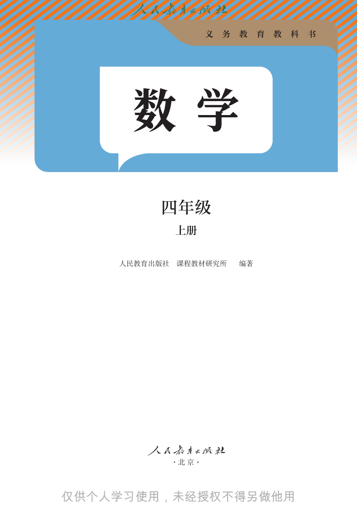
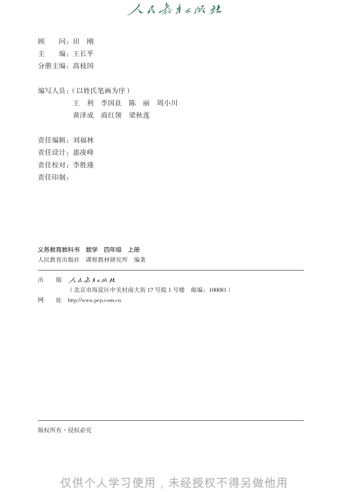
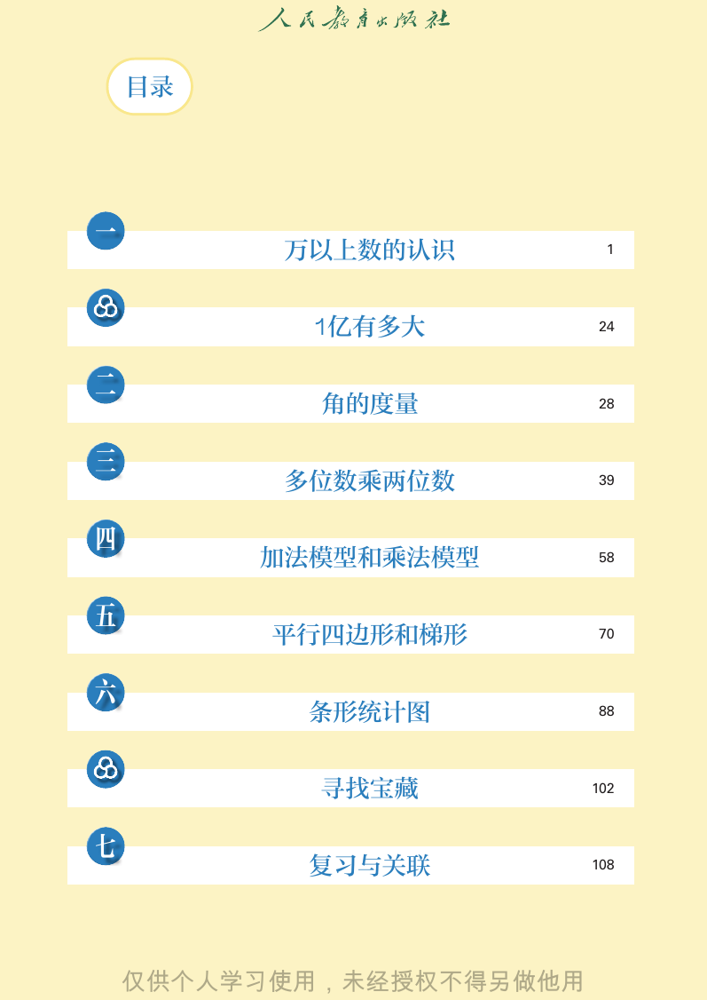

# 人教版《数学》四年级上册 · 目录与致同学（封面、前言、目录）

> 从 `docs/articles/textbook.md` 按页切出。版式、竖式和插图以页图为准（课程里是 `lessons/img/tNNN.png`）。版权归人民教育出版社，仅供个人学习使用。

## 封面/前言/封底（PDF 第 1 页）


```text
义   务   教   育   教   科   书

                四年级
                上册

```

## 封面/前言/封底（PDF 第 2 页）



```text
                      义   务   教    育   教   科   书

         四年级
              上册

    人民教育出版社   课程教材研究所         编著

              ·北 京·


```

## 封面/前言/封底（PDF 第 3 页）



```text
顾   问：田         刚
主   编：王长平
分册主编：高枝国

编写人员：（以姓氏笔画为序）
          王     利     李国良        陈    丽   周小川
          黄泽成         商红领        梁秋莲

责任编辑：刘福林
责任设计：惠凌峰
责任校对：李胜瑾
责任印制：

义务教育教科书         数学     四年级       上册
人民教育出版社         课程教材研究所           编著

出   版
      （北京市海淀区中关村南大街 17 号院 1 号楼 邮编：100081）
网   址    http://www.pep.com.cn
  
  
  
           
  
  
  
  
  
           

版权所有·侵权必究


```

## 封面/前言/封底（PDF 第 4 页）


```text
   致同学

  新学期开始了，你已经是一名四年级学生了。现在让我们一起
走进数学王国，去探索数学的奥秘吧！
  在前面的学习中，你已经认识了万以内的数，本学期我们将学
习更大的数，了解十进制计数法。在数的运算方面，我们将进一步
探索乘数是两位数的乘法，同时结合生活中的实际问题，总结加法
模型和乘法模型。在图形方面，我们将进一步认识角和平行四边形，
并认识梯形。
  上学期你已经学习了用表格整理数据的方法，本学期将进一步
学习用条形统计图来表示数据，同时了解统计在生活中的广泛应用。

  本次数学之旅不仅能使我们学到知识，增长本领，还会让我们
感受到数学思想方法的魅力。让我们出发吧！


```

## 封面/前言/封底（PDF 第 5 页）



```text
    目录

一
          万以上数的认识          1

           1亿有多大          24

二
            角的度量          28

三
          多位数乘两位数         39

四
         加法模型和乘法模型        58

五
          平行四边形和梯形        70

六
           条形统计图          88

            寻找宝藏          102

七
           复习与关联          108


```

