# 人教版《数学》四年级上册 · 第一单元 万以上数的认识（教材第 1–23 页）

> 从 `docs/articles/textbook.md` 按页切出。版式、竖式和插图以页图为准（课程里是 `lessons/img/tNNN.png`）。版权归人民教育出版社，仅供个人学习使用。

## 教材第 1 页（PDF 第 6 页）


```text
一          万以上数的认识

在日常生活和生产中，我们经常用到比万大的数。
下面是 2020 年第七次全国人口普查部分地区的数据。

 北京：21893095 人     广东：126012510 人

 山东：101527453 人    河南：99365519 人

 江苏：84748016 人     四川：83674866 人

                                    1


```

## 教材第 2 页（PDF 第 7 页）

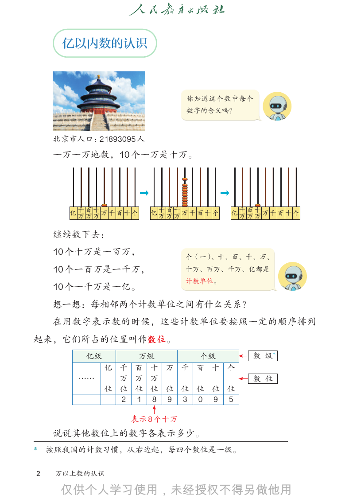

```text
      亿以内数的认识

                                你知道这个数中每个
                                数字的含义吗？

    北京市人口：21893095 人
    一万一万地数，10 个一万是十万。

       亿千 百十
        万 万 万 万 千 百十 个   亿千 百十
                          万 万 万 万 千 百十 个   亿千 百十
                                            万 万 万 万 千 百十 个

    继续数下去：
    10 个十万是一百万，                 个（一）、十、百、千、万、
    10 个一百万是一千万，                十万、百万、千万、亿都是
                                计数单位。
    10 个一千万是一亿。
    想一想：每相邻两个计数单位之间有什么关系？
    在用数字表示数的时候，这些计数单位要按照一定的顺序排列
起来，它们所占的位置叫作数位。
          亿级       万级      个级                  数 级
               亿 千 百 十 万 千 百 十 个
        ……       万 万 万                         数 位
               位 位 位 位 位 位 位 位 位
                 2 1 8 9 3 0 9 5

                    表示 8 个十万
    说说其他数位上的数字各表示多少。
*   按照我国的计数习惯，从右边起，每四个数位是一级。

2    万以上数的认识


```

## 教材第 3 页（PDF 第 8 页）

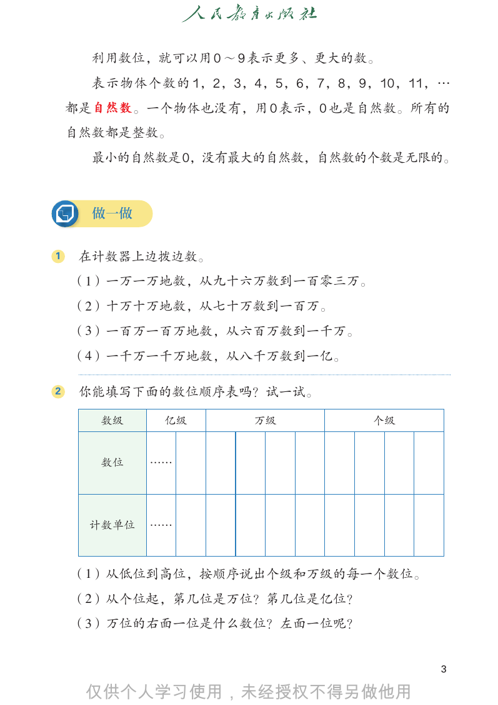

```text
      利用数位，就可以用 0 〜 9 表示更多、更大的数。
      表示物体个数的 1，2，3，4，5，6，7，8，9，10，11，…
    都是自然数。一个物体也没有，用 0 表示，0 也是自然数。所有的
    自然数都是整数。
      最小的自然数是0，没有最大的自然数，自然数的个数是无限的。

      做一做

1    在计数器上边拨边数。
    （1） 一万一万地数，从九十六万数到一百零三万。
    （2） 十万十万地数，从七十万数到一百万。
    （3） 一百万一百万地数，从六百万数到一千万。
    （4） 一千万一千万地数，从八千万数到一亿。

2    你能填写下面的数位顺序表吗？试一试。

      数级      亿级    万级         个级

       数位    ……

      计数单位   ……

    （1） 从低位到高位，按顺序说出个级和万级的每一个数位。
    （2） 从个位起，第几位是万位？第几位是亿位？
    （3） 万位的右面一位是什么数位？左面一位呢？

                                      3


```

## 教材第 4 页（PDF 第 9 页）

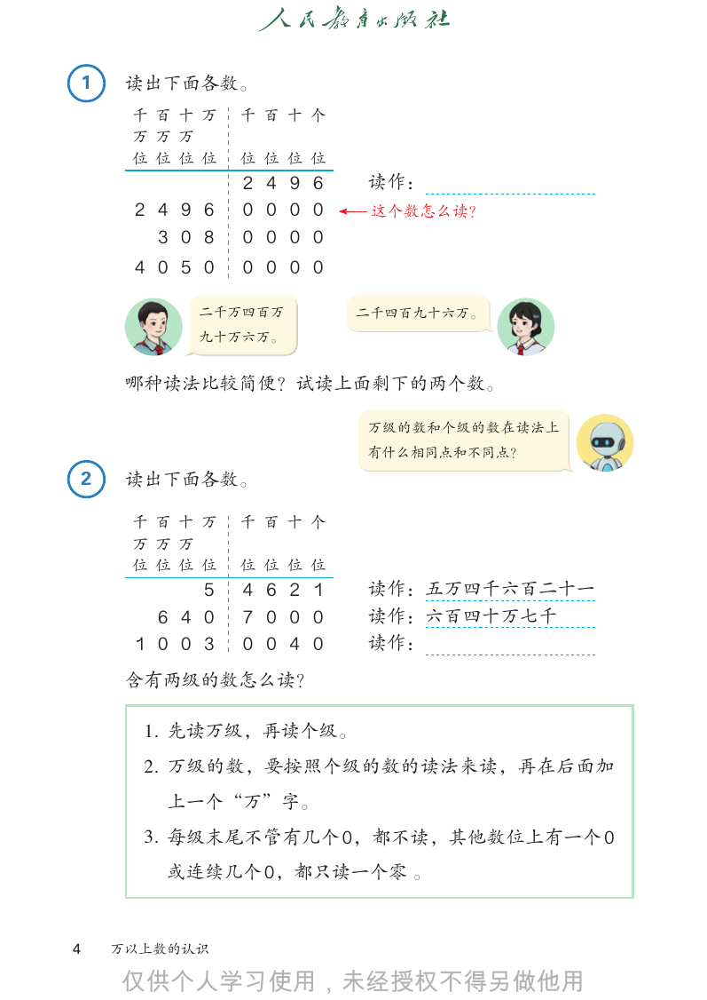

```text
    1    读出下面各数。
         千 百 十 万   千 百 十 个
         万 万 万
         位 位 位 位   位 位 位 位
                   2 4 9 6   读作：
         2 4 9 6   0 0 0 0    这个数怎么读？
           3 0 8   0 0 0 0
         4 0 5 0   0 0 0 0

              二千万四百万         二千四百九十六万。
              九十万六万。

         哪种读法比较简便？试读上面剩下的两个数。

                             万级的数和个级的数在读法上
                             有什么相同点和不同点？
    2    读出下面各数。

         千 百 十 万   千 百 十 个
         万 万 万
         位 位 位 位   位 位 位 位
               5   4 6 2 1   读作：五万四千六百二十一
           6 4 0   7 0 0 0   读作：六百四十万七千
         1 0 0 3   0 0 4 0   读作：
         含有两级的数怎么读？

          1. 先读万级，再读个级。
          2. 万级的数，要按照个级的数的读法来读，再在后面加
            上一个“万”字。
          3. 每级末尾不管有几个 0，都不读，其他数位上有一个 0
            或连续几个 0，都只读一个零 。

4       万以上数的认识


```

## 教材第 5 页（PDF 第 10 页）

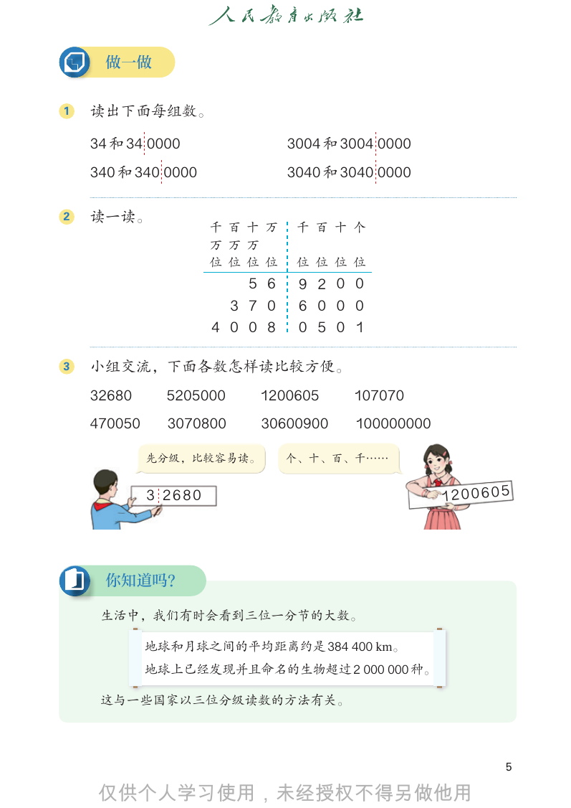

```text
      做一做

1   读出下面每组数。

    34 和 34 0000                3004 和 3004 0000
    340 和 340 0000              3040 和 3040 0000

2   读一读。
                      千 百 十 万    千 百 十 个
                      万 万 万
                      位 位 位 位    位 位 位 位
                          5 6    9 2 0 0
                        3 7 0    6 0 0 0
                      4 0 0 8    0 5 0 1

3   小组交流，下面各数怎样读比较方便。
    32680      5205000     1200605      107070
    470050     3070800     30600900     100000000

             先分级，比较容易读。         个、十、百、千……

             3 2680                                 1200605

      你知道吗？

     生活中，我们有时会看到三位一分节的大数。

             地球和月球之间的平均距离约是 384 400 km。
             地球上已经发现并且命名的生物超过 2 000 000 种。

     这与一些国家以三位分级读数的方法有关。

                                                          5


```

## 教材第 6 页（PDF 第 11 页）

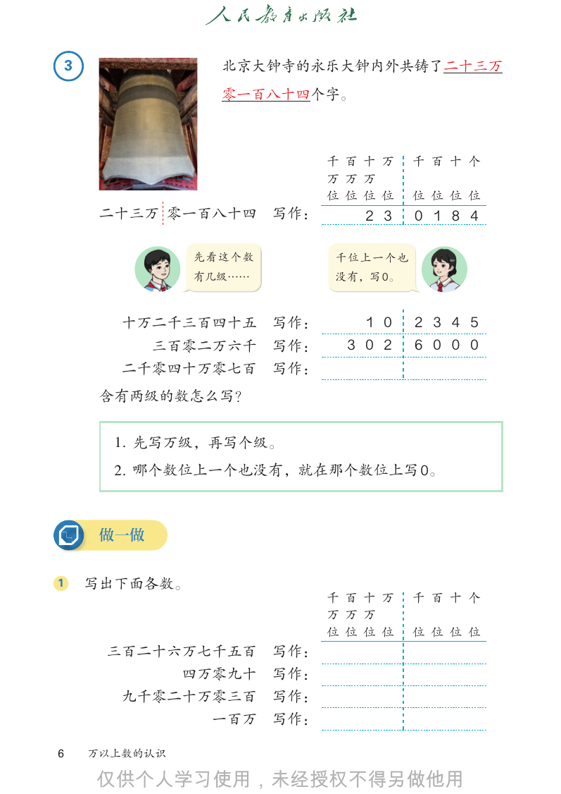

```text
    3               北京大钟寺的永乐大钟内外共铸了二十三万
                    零一百八十四个字。

                                千 百 十 万   千 百 十 个
                                万 万 万
                                位 位 位 位   位 位 位 位
         二十三万 零一百八十四      写作：       2 3   0 1 8 4

                  先看这个数         千位上一个也
                  有几级……         没有，写 0。

           十万二千三百四十五      写作：       1 0   2 3 4 5
               三百零二万六千    写作：     3 0 2   6 0 0 0
           二千零四十万零七百      写作：
         含有两级的数怎么写？

          1. 先写万级，再写个级。
          2. 哪个数位上一个也没有，就在那个数位上写 0。

         做一做

1       写出下面各数。
                                千 百 十 万   千 百 十 个
                                万 万 万
                                位 位 位 位   位 位 位 位
         三百二十六万七千五百       写作：
              四万零九十       写作：
          九千零二十万零三百       写作：
                一百万       写作：

6       万以上数的认识


```

## 教材第 7 页（PDF 第 12 页）

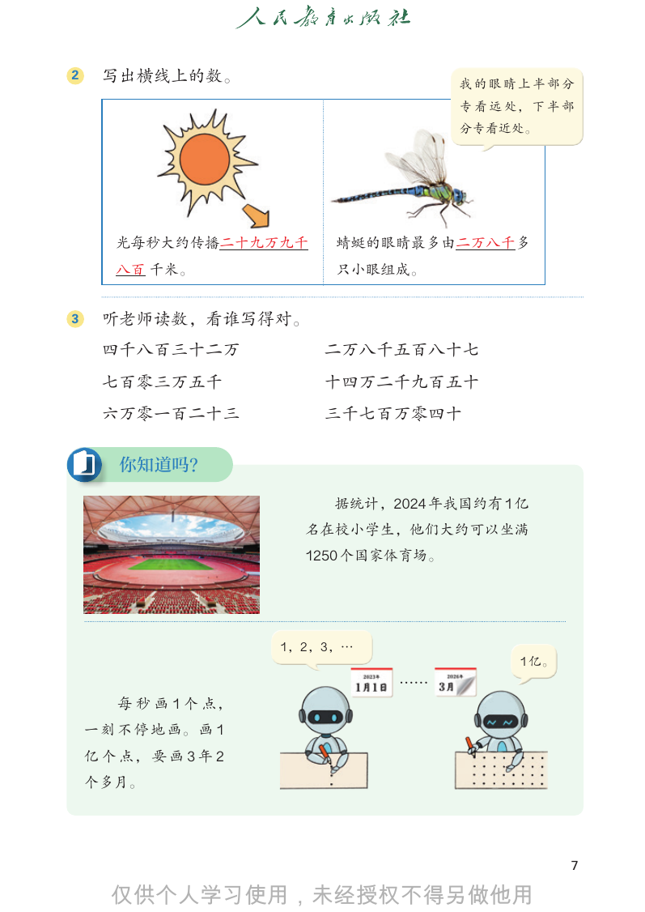

```text
2    写出横线上的数。                           我的眼睛上半部分
                                        专 看 远 处， 下 半 部
                                        分专看近处。

       光每秒大约传播二十九万九千        蜻蜓的眼睛最多由二万八千多
       八百 千米。               只小眼组成。

3    听老师读数，看谁写得对。
     四千八百三十二万              二万八千五百八十七
     七百零三万五千               十四万二千九百五十
     六万零一百二十三              三千七百万零四十

        你知道吗？

                            据统计，2024 年我国约有 1 亿
                         名在校小学生，他们大约可以坐满
                         1250 个国家体育场。

                       1，2，3，…
                                               1 亿。
                                 ……
       每 秒 画 1 个 点，
    一 刻 不 停 地 画。 画 1
    亿 个 点， 要 画 3 年 2
    个多月。

                                                      7


```

## 教材第 8 页（PDF 第 13 页）

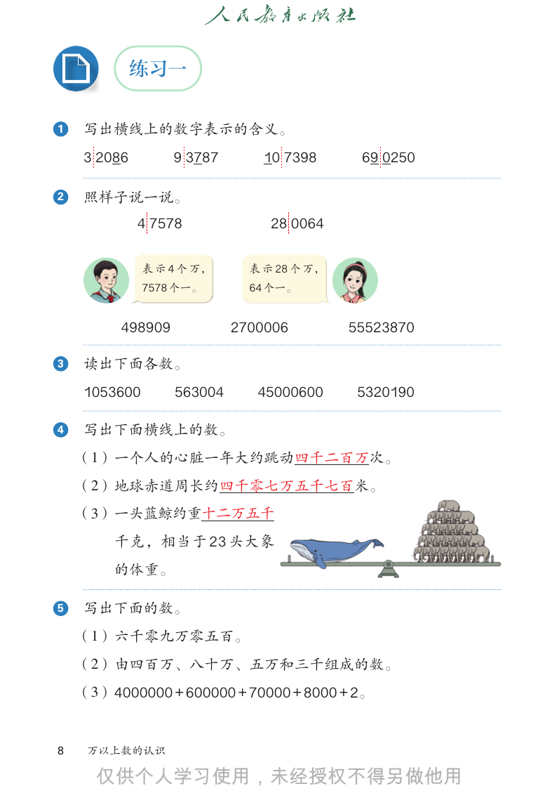

```text
              练习一

1    写出横线上的数字表示的含义。
     3 2086        9 3787       10 7398      69 0250

2    照样子说一说。
              4 7578             28 0064

               表 示 4 个 万，     表 示 28 个 万，
               7578 个一。       64 个一。

          498909            2700006         55523870

3    读出下面各数。
     1053600       563004      45000600      5320190

4    写出下面横线上的数。
    （1） 一个人的心脏一年大约跳动四千二百万次。
    （2） 地球赤道周长约四千零七万五千七百米。
    （3） 一头蓝鲸约重十二万五千
         千克，相当于 23 头大象
         的体重。

5    写出下面的数。
    （1） 六千零九万零五百。
    （2） 由四百万、八十万、五万和三千组成的数。
    （3） 4000000 + 600000 + 70000 + 8000 + 2。

8    万以上数的认识


```

## 教材第 9 页（PDF 第 14 页）

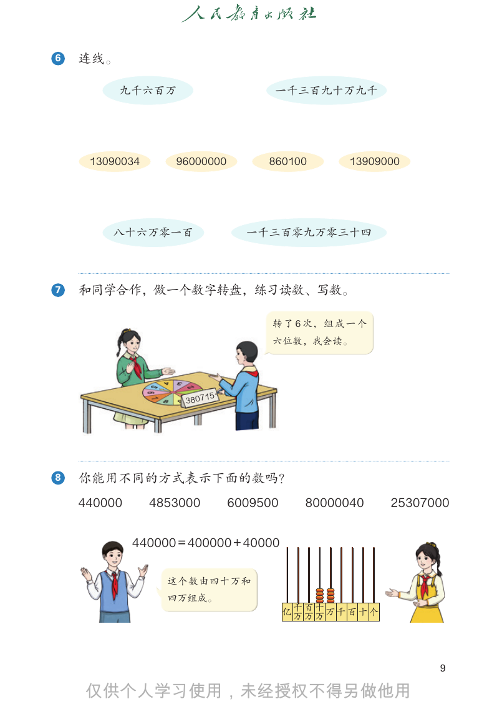

```text
6   连线。

          九千六百万                     一千三百九十万九千

     13090034      96000000        860100         13909000

        八十六万零一百                 一千三百零九万零三十四

7   和同学合作，做一个数字转盘，练习读数、写数。

                                    转 了 6 次， 组 成 一 个
                                    六位数，我会读。

                          5
                     38071

8   你能用不同的方式表示下面的数吗？
    440000      4853000       6009500      80000040       25307000

             440000 = 400000 + 40000

                  这个数由四十万和
                  四万组成。
                                        亿千 百十
                                         万 万 万 万 千 百十 个

                                                                9


```

## 教材第 10 页（PDF 第 15 页）

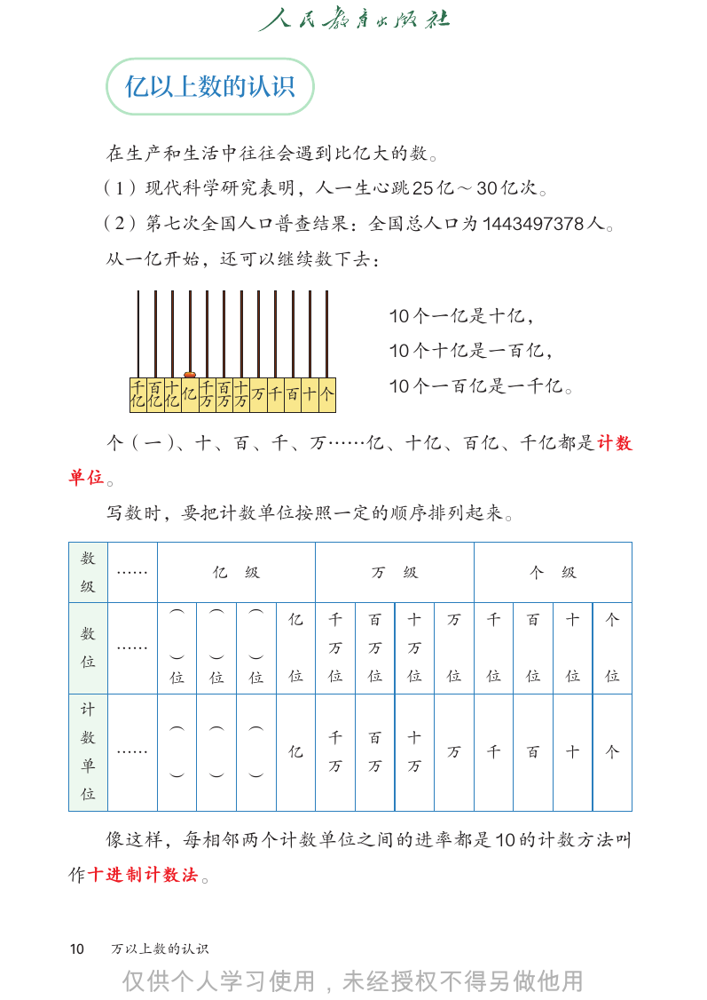

```text
      亿以上数的认识

     在生产和生活中往往会遇到比亿大的数。
     （1） 现代科学研究表明，人一生心跳 25 亿〜 30 亿次。
     （2） 第七次全国人口普查结果：全国总人口为 1443497378 人。
     从一亿开始，还可以继续数下去：

                                   10 个一亿是十亿，
                                   10 个十亿是一百亿，
       千 百 十 亿 千 百 十万 千 百十个        10 个一百亿是一千亿。
       亿 亿 亿 万 万万

     个（一）、十、百、千、万……亿、十亿、百亿、千亿都是计数
单位。
     写数时，要把计数单位按照一定的顺序排列起来。

 数
      ……       亿   级           万   级            个   级
 级
           ︵   ︵   ︵
                       亿   千   百    十   万   千   百   十   个
 数
      ……   ︶   ︶   ︶       万   万    万
 位
           位   位   位   位   位   位    位   位   位   位   位   位

 计         ︵   ︵   ︵
 数                         千   百    十
      ……               亿                万   千   百   十   个
 单         ︶   ︶   ︶       万   万    万
 位

     像这样，每相邻两个计数单位之间的进率都是 10 的计数方法叫
作十进制计数法。

10   万以上数的认识


```

## 教材第 11 页（PDF 第 16 页）


```text
    4

                                  全球人口约……

         读出下面各数。
          千 百 十 亿    千 百 十 万   千 百 十 个
          亿 亿 亿      万 万 万
          位 位 位 位    位 位 位 位   位 位 位 位
              8 0    0 0 0 0   0 0 0 0         读作：八十亿
            1 0 0    4 0 0 0   2 0 0 0         读作：
          4 0 0 3    0 5 0 0   0 0 0 0         读作：

         亿以上的数怎么读？

                 先分级，再从最高         读完亿级或万级的数，要加
                 级读起……            “亿”字或“万”字。

                    还要注意什么位置上的 0 不读，什么
                    位置上的 0 要读，读几个零。

          做一做

1       读出下面各数。

          92 0000 0000         267 0500 0000
        5080 4000 3000           3 0070 0400

                                                        11


```

## 教材第 12 页（PDF 第 17 页）

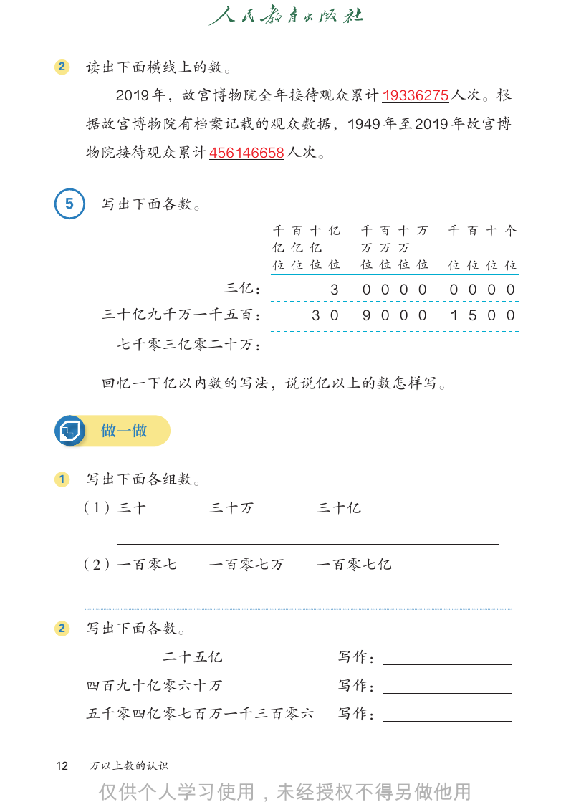

```text
2       读出下面横线上的数。
           2019 年，故宫博物院全年接待观众累计 19336275 人次。根
        据故宫博物院有档案记载的观众数据，1949 年至 2019 年故宫博
        物院接待观众累计 456146658 人次。

    5    写出下面各数。
                              千 百 十 亿   千 百 十 万   千 百 十 个
                              亿 亿 亿     万 万 万
                              位 位 位 位   位 位 位 位   位 位 位 位
                        三亿：         3   0 0 0 0   0 0 0 0
         三十亿九千万一千五百：              3 0   9 0 0 0   1 5 0 0
           七千零三亿零二十万：

         回忆一下亿以内数的写法，说说亿以上的数怎样写。

          做一做

1       写出下面各组数。
        （1） 三十      三十万           三十亿

        （2） 一百零七    一百零七万         一百零七亿

2       写出下面各数。
                 二十五亿               写作：
        四百九十亿零六十万                   写作：
        五千零四亿零七百万一千三百零六             写作：

12      万以上数的认识


```

## 教材第 13 页（PDF 第 18 页）

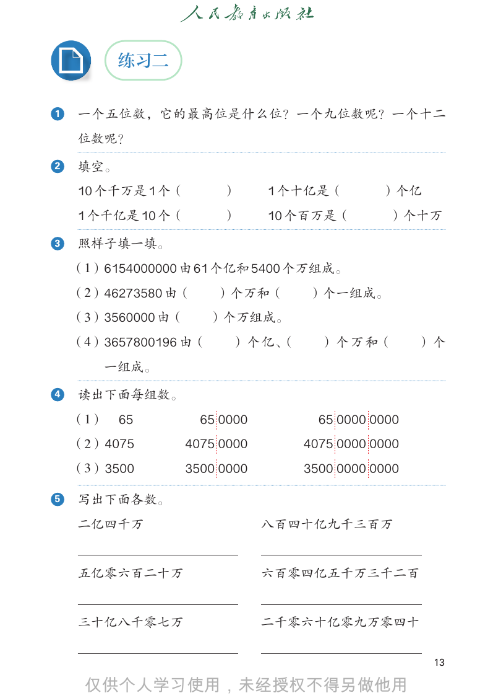

```text
          练习二

1   一个五位数，它的最高位是什么位？一个九位数呢？一个十二
    位数呢？
2   填空。
    10 个千万是 1 个（         ）      1 个十亿是（       ）个亿
    1 个千亿是 10 个（         ）      10 个百万是（       ）个十万
3   照样子填一填。
    （1）6154000000 由 61 个亿和 5400 个万组成。
    （2）46273580 由（      ）个万和（       ）个一组成。
    （3）3560000 由（      ）个万组成。
    （4）3657800196 由（      ） 个 亿、
                               （     ） 个 万 和（       ）个
        一组成。
4   读出下面每组数。
    （1）   65          65 0000        65 0000 0000
    （2） 4075        4075 0000      4075 0000 0000
    （3） 3500        3500 0000      3500 0000 0000

5   写出下面各数。
    二亿四千万                       八百四十亿九千三百万

    五亿零六百二十万                    六百零四亿五千万三千二百

    三十亿八千零七万                    二千零六十亿零九万零四十

                                                     13


```

## 教材第 14 页（PDF 第 19 页）

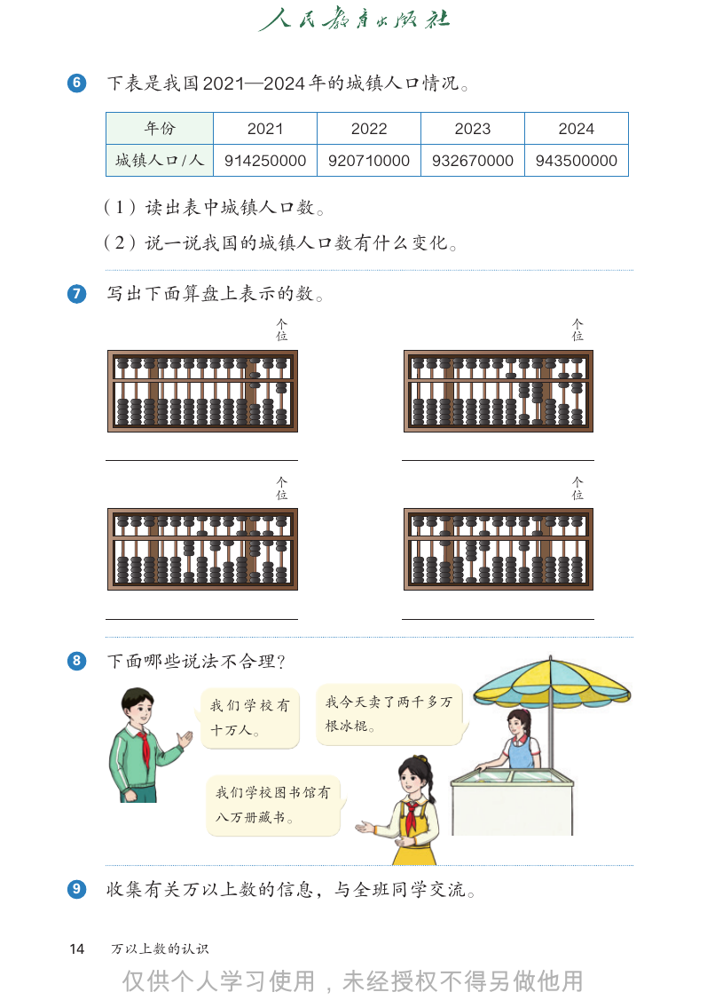

```text
6    下表是我国 2021—2024 年的城镇人口情况。

        年份          2021        2022        2023        2024
      城镇人口 / 人    914250000   920710000   932670000   943500000

     （1） 读出表中城镇人口数。
     （2） 说一说我国的城镇人口数有什么变化。

7    写出下面算盘上表示的数。
                        个位                                个位

                        个位                                个位

8    下面哪些说法不合理？

                 我们学校有        我今天卖了两千多万
                 十万人。         根冰棍。

                 我们学校图书馆有
                 八万册藏书。

9    收集有关万以上数的信息，与全班同学交流。

14   万以上数的认识


```

## 教材第 15 页（PDF 第 20 页）


```text
     数的大小比较

6    下面是 2024 年全国主要农产品的产量（单位：t）。

            稻谷：207534900                小麦：140099400

            玉米：294916900                大豆：20647800
     按照万以内数比较大小的方法，选择两种农产品的产量，比较
它们的大小。
    207534900 > 20647800          207534900    294916900

            位数多的数就大。                   位数相同的数呢？

     位数相同的两个数，从最高位比起，最高位上的数大的那个
数就大，如果最高位上的数相同，就比较下一个数位上的数。

     做一做

    比较下面每组中两个数的大小。
    92504    103600        830207000     1020010000
    28906    28890    100388770000       99385270000

                                                           15


```

## 教材第 16 页（PDF 第 21 页）

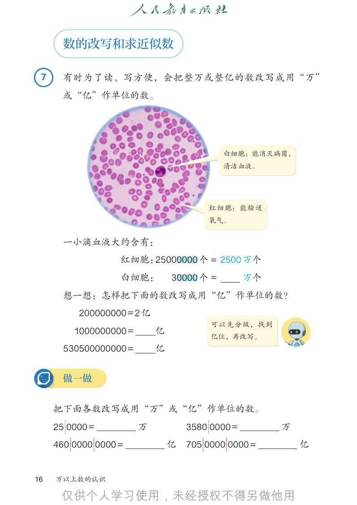

```text
       数的改写和求近似数

 7     有时为了读、写方便，会把整万或整亿的数改写成用“万”
       或“亿”作单位的数。

                                            白细胞：能消灭病菌，
                                            清洁血液。

                                        红细胞：能输送
                                        氧气。

       一小滴血液大约含有：
                   红细胞：25000000 个 = 2500 万个
                   白细胞：         30000 个 =         万个
       想一想：怎样把下面的数改写成用“亿”作单位的数？
          200000000 = 2 亿
                                         可 以 先 分 级， 找 到
         1000000000 =       亿
                                         亿位，再改写。
       530500000000 =       亿

       做一做

     把下面各数改写成用“万”或“亿”作单位的数。
     25 0000 =          万           3580 0000 =           万
     460 0000 0000 =            亿   705 0000 0000 =           亿

16   万以上数的认识


```

## 教材第 17 页（PDF 第 22 页）

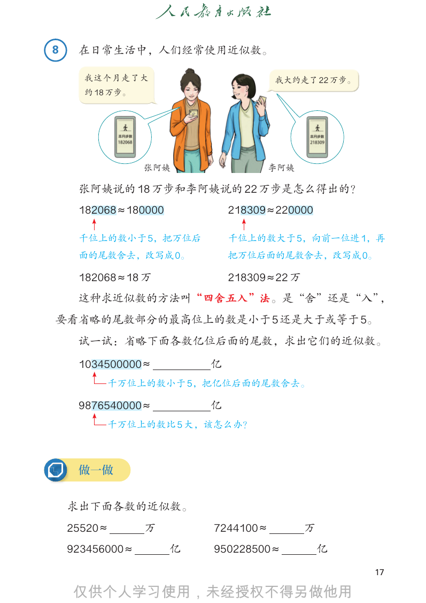

```text
8     在日常生活中，人们经常使用近似数。

       我这个月走了大                          我大约走了 22 万步。
       约 18 万步。

                  张阿姨                   李阿姨

      张阿姨说的 18 万步和李阿姨说的 22 万步是怎么得出的？
      182068 ≈ 180000           218309 ≈ 220000

      千位上的数小于5，把万位后             千位上的数大于 5，向前一位进 1，再
      面的尾数舍去，改写成0。              把万位后面的尾数舍去，改写成0。

      182068 ≈ 18 万             218309 ≈ 22 万
      这种求近似数的方法叫“四舍五入”法。是“舍”还是“入”，
要看省略的尾数部分的最高位上的数是小于 5 还是大于或等于 5。
      试一试：省略下面各数亿位后面的尾数，求出它们的近似数。

      1034500000 ≈          亿
              千万位上的数小于 5，把亿位后面的尾数舍去。

      9876540000 ≈          亿
              千万位上的数比 5 大，该怎么办？

      做一做

    求出下面各数的近似数。
    25520 ≈       万         7244100 ≈           万
    923456000 ≈         亿   950228500 ≈             亿
                                                        17


```

## 教材第 18 页（PDF 第 23 页）

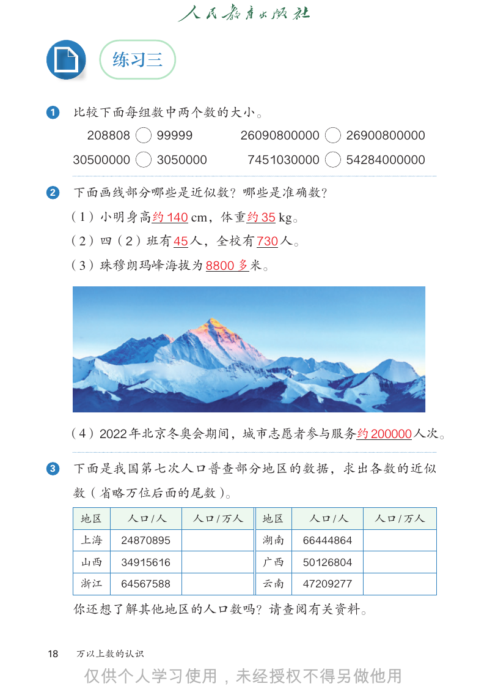

```text
           练习三

1    比较下面每组数中两个数的大小。
       208808   99999         26090800000      26900800000
     30500000   3050000           7451030000   54284000000

2    下面画线部分哪些是近似数？哪些是准确数？
     （1） 小明身高约 140 cm，体重约 35 kg。
     （2） 四（2）班有 45 人，全校有 730 人。
     （3） 珠穆朗玛峰海拔为 8800 多米。

     （4） 2022年北京冬奥会期间，城市志愿者参与服务约200000人次。

3    下面是我国第七次人口普查部分地区的数据，求出各数的近似
     数（省略万位后面的尾数）。
      地区    人口 / 人      人口 / 万人     地区    人口 / 人    人口 / 万人
      上海   24870895                 湖南   66444864
      山西   34915616                 广西   50126804
      浙江   64567588                 云南   47209277

     你还想了解其他地区的人口数吗？请查阅有关资料。

18    万以上数的认识


```

## 教材第 19 页（PDF 第 24 页）

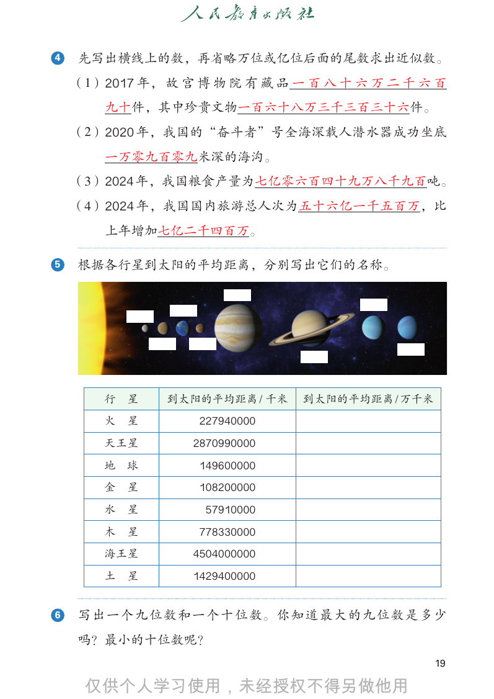

```text
4   先写出横线上的数，再省略万位或亿位后面的尾数求出近似数。
    （1） 2017 年， 故 宫 博 物 院 有 藏 品 一 百 八 十 六 万 二 千 六 百
        九十件，其中珍贵文物一百六十八万三千三百三十六件。
    （2） 2020 年，我国的“奋斗者”号全海深载人潜水器成功坐底
        一万零九百零九米深的海沟。
    （3） 2024 年，我国粮食产量为七亿零六百四十九万八千九百吨。
    （4） 2024 年，我国国内旅游总人次为五十六亿一千五百万，比
        上年增加七亿二千四百万。

5   根据各行星到太阳的平均距离，分别写出它们的名称。

        行   星   到太阳的平均距离 / 千米   到太阳的平均距离 / 万千米
        火   星       227940000
        天王星        2870990000
        地   球       149600000
        金   星       108200000
        水   星       57910000
        木   星       778330000
        海王星        4504000000
        土   星      1429400000

6   写出一个九位数和一个十位数。你知道最大的九位数是多少
    吗？最小的十位数呢？
                                                 19


```

## 教材第 20 页（PDF 第 25 页）

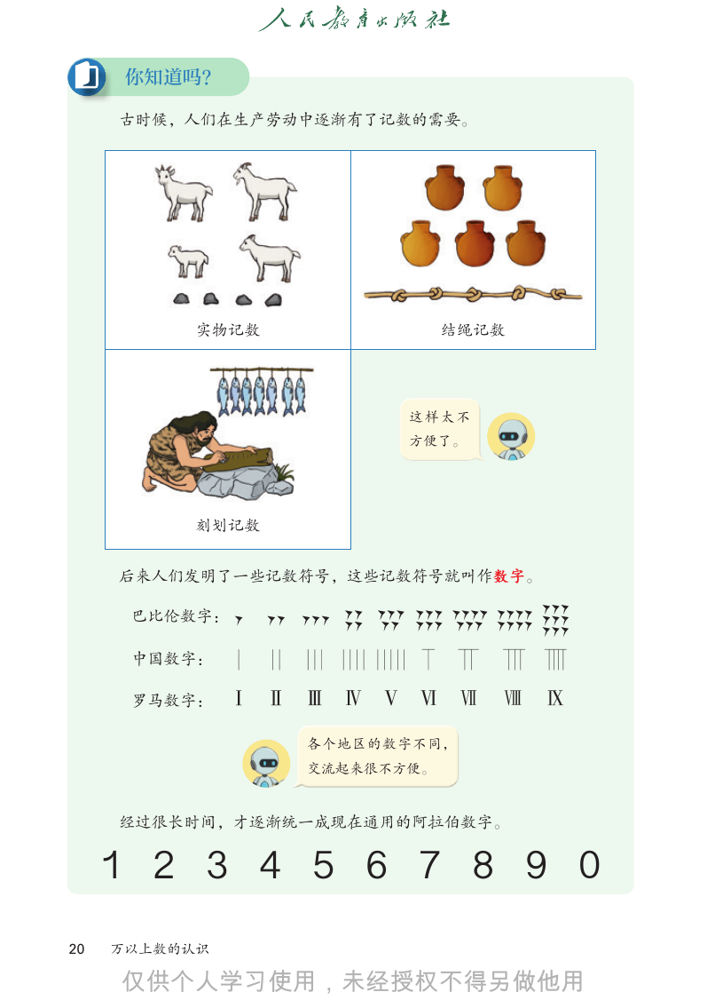

```text
      你知道吗？

     古时候，人们在生产劳动中逐渐有了记数的需要。

           实物记数               结绳记数

                         这样太不
                         方便了。

           刻划记数

     后来人们发明了一些记数符号，这些记数符号就叫作数字。

      巴比伦数字：

      中国数字：

      罗马数字：

                  各个地区的数字不同，
                  交流起来很不方便。

     经过很长时间，才逐渐统一成现在通用的阿拉伯数字。

     1 2 3 4 5 6 7 8 9 0
20   万以上数的认识


```

## 教材第 21 页（PDF 第 26 页）


```text
             整理和复习

          本单元我们学习了哪些知识？下面是小明整理的“知识结构
图”，你也来整理一下吧！
                     计数单位

           数的认识      数位       十进制计数法

万以上数的认识
                     数级

           数的读、写     先分级，再从高位起按级读、写

                     位数不同——位数多的数就大
           数的大小比较
                     位数相同——从最高位起，依次比较

                     以“万”为单位——末尾4个0改为“万”
           数的改写                                用“=”连接
                     以“亿”为单位——末尾8个0改为“亿”

           求近似数     “四舍五入”法——用“≈”连接

          关于本单元，你还有什么要提醒大家的？和同伴说一说吧！

             相邻的两个计数单位      读 数 和 写 数， 要
             之间的进率都是 10。    先分级……

                     用“四舍五入”法求
                     近似数时，看省略的
                     尾数部分的最高位。

                              每级末尾的 0 都不读，其他
                              数位上有一个 0 或连续几个
                              0，都只读一个零。

                                                   21


```

## 教材第 22 页（PDF 第 27 页）

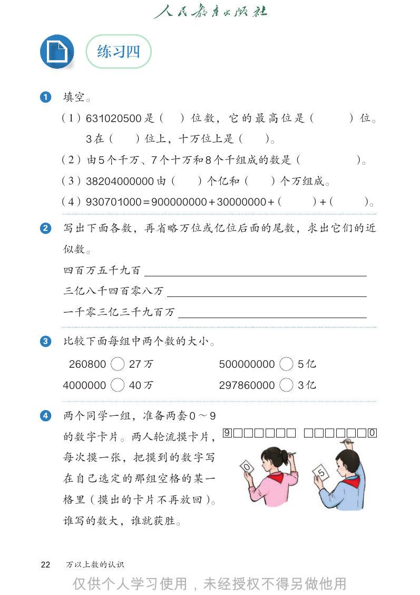

```text
           练习四

1    填空。
     （1） 631020500 是（ ） 位 数， 它 的 最 高 位 是（               ） 位。
         3 在（    ）位上，十万位上是（              ）。
     （2） 由 5 个千万、7 个十万和 8 个千组成的数是（                      ）。
     （3） 38204000000 由（     ）个亿和（        ）个万组成。
     （4） 930701000 = 900000000 + 30000000 +（    ）+（      ）。

2    写出下面各数，再省略万位或亿位后面的尾数，求出它们的近
     似数。
     四百万五千九百
     三亿八千四百零八万
     一千零三亿三千九百万

3    比较下面每组中两个数的大小。
       260800    27 万           500000000      5亿
     4000000     40 万           297860000      3亿

4    两个同学一组，准备两套 0 〜 9
     的数字卡片。两人轮流摸卡片， 9                                     0

     每次摸一张，把摸到的数字写
                                     0
                                                    5
     在自己选定的那组空格的某一
     格里（摸出的卡片不再放回）。
     谁写的数大，谁就获胜。

22    万以上数的认识


```

## 教材第 23 页（PDF 第 28 页）

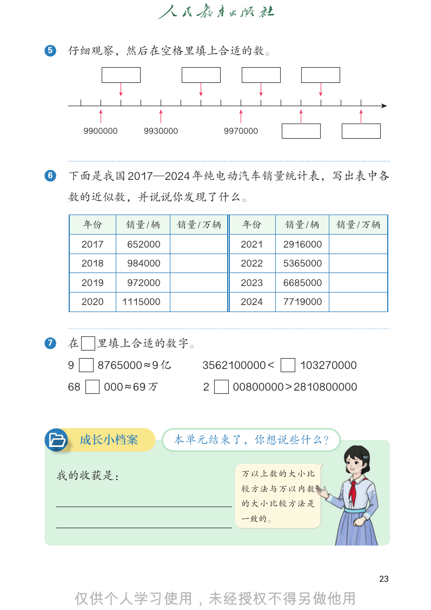

```text
5    仔细观察，然后在空格里填上合适的数。

          9900000       9930000         9970000

6    下面是我国 2017—2024 年纯电动汽车销量统计表，写出表中各
     数的近似数，并说说你发现了什么。

          年份        销量 / 辆    销量 / 万辆      年份     销量 / 辆    销量 / 万辆
          2017       652000                2021   2916000
          2018       984000                2022   5365000
          2019       972000                2023   6685000
          2020      1115000                2024   7719000

7    在      里填上合适的数字。
     9      8765000 ≈ 9 亿         3562100000 <      103270000
     68          000 ≈ 69 万       2      00800000 > 2810800000

         成长小档案                本单元结束了，你想说些什么？

    我的收获是：                                 万以上数的大小比
                                           较方法与万以内数
                                           的大小比较方法是
                                           一致的。

                                                                  23


```

