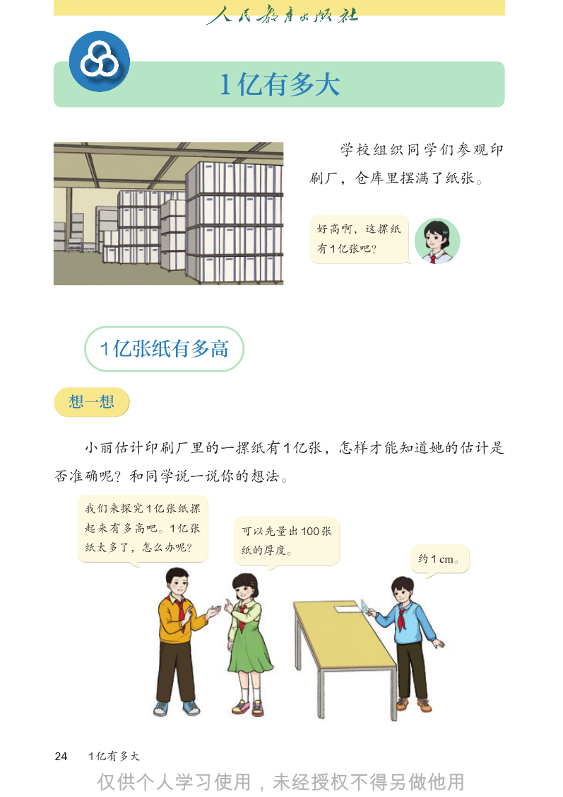
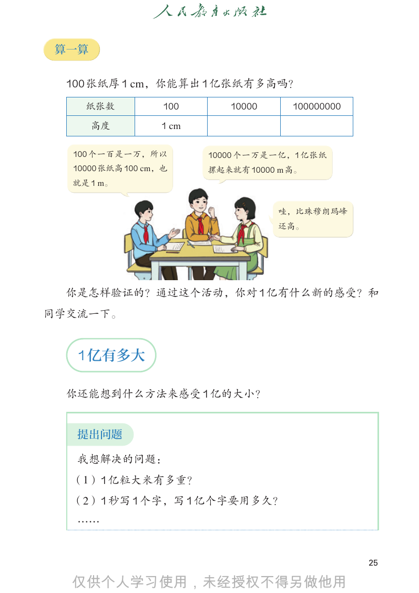
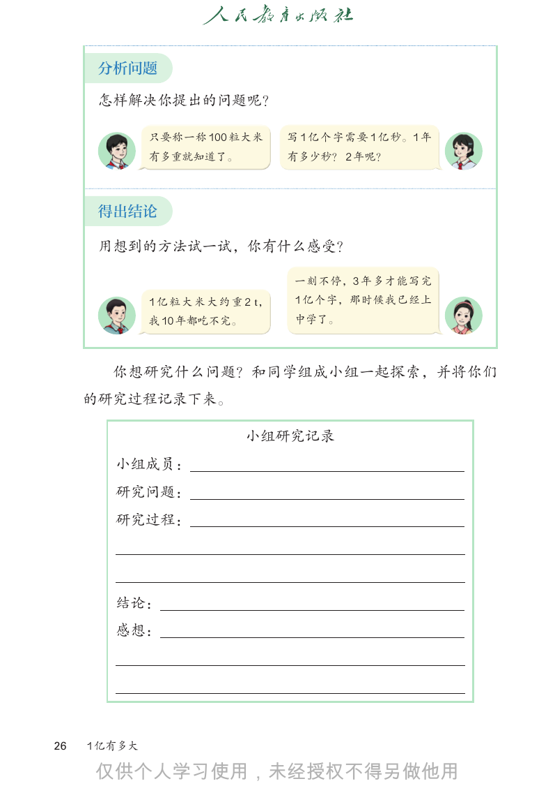
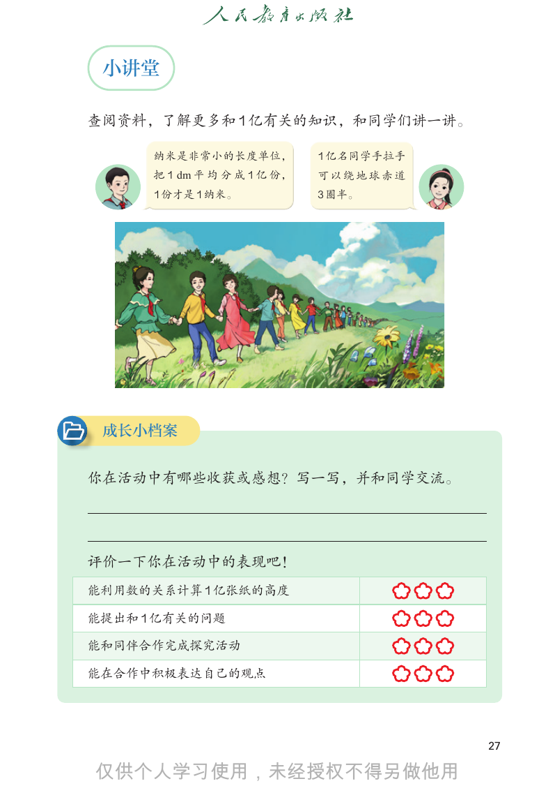

# 人教版《数学》四年级上册 · 综合与实践 1 亿有多大（教材第 24–27 页）

> 从 `docs/articles/textbook.md` 按页切出。版式、竖式和插图以页图为准（课程里是 `lessons/img/tNNN.png`）。版权归人民教育出版社，仅供个人学习使用。

## 教材第 24 页（PDF 第 29 页）



```text
                     1 亿有多大

                                    学校组织同学们参观印
                              刷厂，仓库里摆满了纸张。

                               好高啊，这摞纸
                               有 1 亿张吧？

       1 亿张纸有多高

     想一想

     小丽估计印刷厂里的一摞纸有 1 亿张，怎样才能知道她的估计是
否准确呢？和同学说一说你的想法。

      我们来探究 1 亿张纸摞
      起来有多高吧。1 亿张     可以先量出 100 张
      纸太多了，怎么办呢？      纸的厚度。
                                          约 1 cm。

24    1 亿有多大


```

## 教材第 25 页（PDF 第 30 页）



```text
 算一算

 100 张纸厚 1 cm，你能算出 1 亿张纸有多高吗？
    纸张数            100      10000      100000000

       高度         1 cm

  100 个一百是一万，所以          10000 个一万是一亿，1 亿张纸
  10000 张纸高 100 cm，也     摞起来就有 10000 m 高。
  就是 1 m。

                                     哇，比珠穆朗玛峰
                                     还高。

 你是怎样验证的？通过这个活动，你对 1 亿有什么新的感受？和
同学交流一下。

   1 亿有多大

  你还能想到什么方法来感受 1 亿的大小？

   提出问题

   我想解决的问题：
  （1） 1 亿粒大米有多重？
  （2） 1 秒写 1 个字，写 1 亿个字要用多久？
   ……

                                                   25


```

## 教材第 26 页（PDF 第 31 页）



```text
      分析问题

      怎样解决你提出的问题呢？

              只要称一称 100 粒大米          写 1 亿个字需要 1 亿秒。1 年
              有多重就知道了。               有多少秒？ 2 年呢？

      得出结论

      用想到的方法试一试，你有什么感受？

                                     一刻不停，3 年多才能写完
              1 亿 粒 大 米 大 约 重 2 t，   1 亿个字，那时候我已经上
              我 10 年都吃不完。            中学了。

        你想研究什么问题？和同学组成小组一起探索，并将你们
     的研究过程记录下来。

                              小组研究记录
        小组成员：
        研究问题：
        研究过程：

        结论：
        感想：

26   1 亿有多大


```

## 教材第 27 页（PDF 第 32 页）



```text
 小讲堂

查阅资料，了解更多和 1 亿有关的知识，和同学们讲一讲。

      纳米是非常小的长度单位，            1 亿名同学手拉手
      把 1 dm 平 均 分 成 1 亿 份，   可以绕地球赤道
      1 份才是 1 纳米。             3 圈半。

 成长小档案

你在活动中有哪些收获或感想？写一写，并和同学交流。

评价一下你在活动中的表现吧！
能利用数的关系计算 1 亿张纸的高度

能提出和 1 亿有关的问题

能和同伴合作完成探究活动

能在合作中积极表达自己的观点

                                          27


```

