# 人教版《数学》四年级上册 · 第二单元 角的度量（教材第 28–38 页）

> 从 `docs/articles/textbook.md` 按页切出。版式、竖式和插图以页图为准（课程里是 `lessons/img/tNNN.png`）。版权归人民教育出版社，仅供个人学习使用。

## 教材第 28 页（PDF 第 33 页）

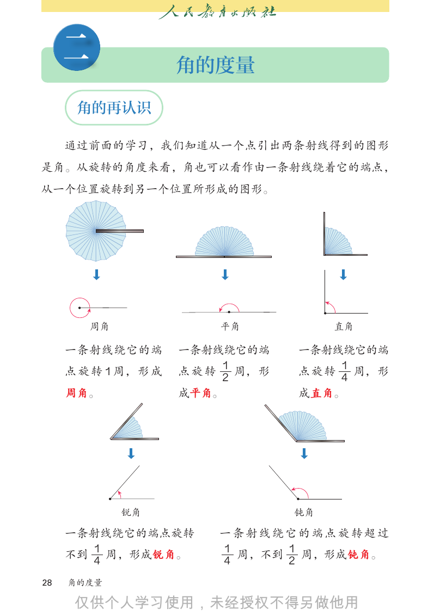

```text
     二                角的度量

      角的再认识

     通过前面的学习，我们知道从一个点引出两条射线得到的图形
是角。从旋转的角度来看，角也可以看作由一条射线绕着它的端点，
从一个位置旋转到另一个位置所形成的图形。

         周角               平角            直角

     一条射线绕它的端         一条射线绕它的端     一条射线绕它的端
                          1            1
     点 旋 转 1 周， 形 成   点旋转   周， 形   点旋转   周，形
                          2            4
     周角。              成平角。         成直角。

              锐角                   钝角

     一条射线绕它的端点旋转          一条射线绕它的端点旋转超过
       1                  1      1
     不到 周，形成锐角。             周，不到   周，形成钝角。
       4                  4      2
28   角的度量


```

## 教材第 29 页（PDF 第 34 页）

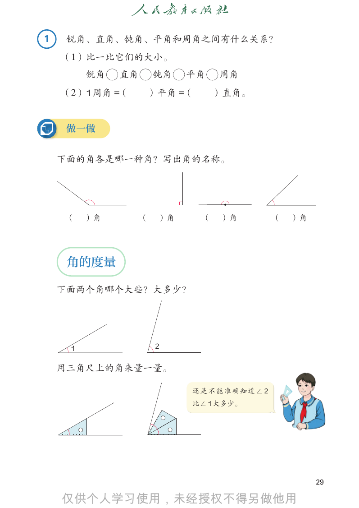

```text
1    锐角、直角、钝角、平角和周角之间有什么关系？
    （1）比一比它们的大小。
         锐角   直角       钝角   平角   周角
    （2）1 周角 =（     ）平角 =（        ）直角。

     做一做

    下面的角各是哪一种角？写出角的名称。

    （    ）角        （   ）角    （   ）角       （   ）角

     角的度量

    下面两个角哪个大些？大多少？

     1                 2

    用三角尺上的角来量一量。

                            还是不能准确知道∠ 2
                            比∠ 1 大多少。

                                                   29


```

## 教材第 30 页（PDF 第 35 页）

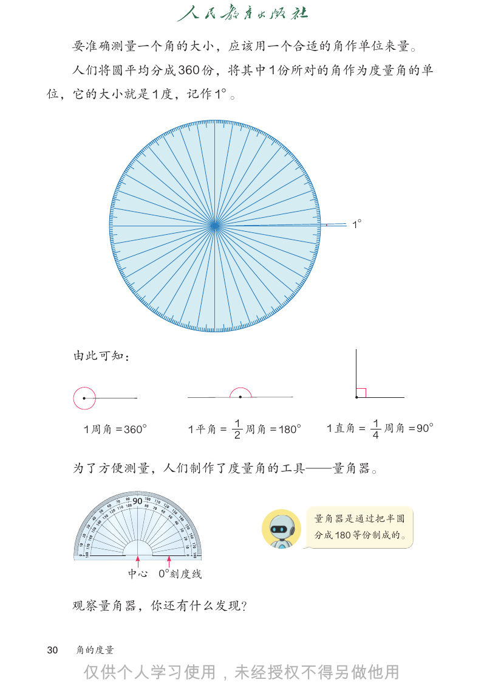

```text
     要准确测量一个角的大小，应该用一个合适的角作单位来量。
     人们将圆平均分成 360 份，将其中 1 份所对的角作为度量角的单
位，它的大小就是 1 度，记作 1°。

                                              1°

     由此可知：

      1 周角 = 360°
                           1
                    1 平角 = 2 周角 = 180°    1 直角 = 1 周角 = 90°
                                                 4

     为了方便测量，人们制作了度量角的工具—量角器。

                                         量角器是通过把半圆
                                         分成 180 等份制成的。

            中心 0°
                刻度线

     观察量角器，你还有什么发现？

30   角的度量


```

## 教材第 31 页（PDF 第 36 页）

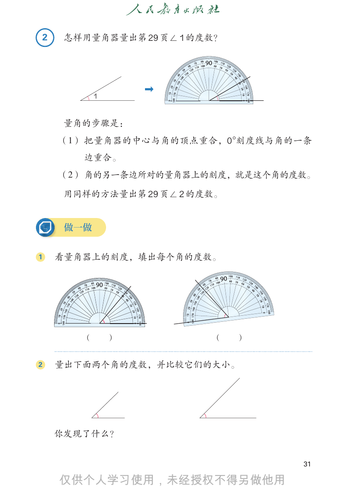

```text
2    怎样用量角器量出第 29 页∠ 1 的度数？

           1

     量角的步骤是：
    （1） 把量角器的中心与角的顶点重合，0 °
                         刻度线与角的一条
       边重合。
    （2） 角的另一条边所对的量角器上的刻度，就是这个角的度数。

     用同样的方法量出第 29 页∠ 2 的度数。

     做一做

1   看量角器上的刻度，填出每个角的度数。

       （       ）         （    ）

2   量出下面两个角的度数，并比较它们的大小。

    你发现了什么？

                                  31


```

## 教材第 32 页（PDF 第 37 页）

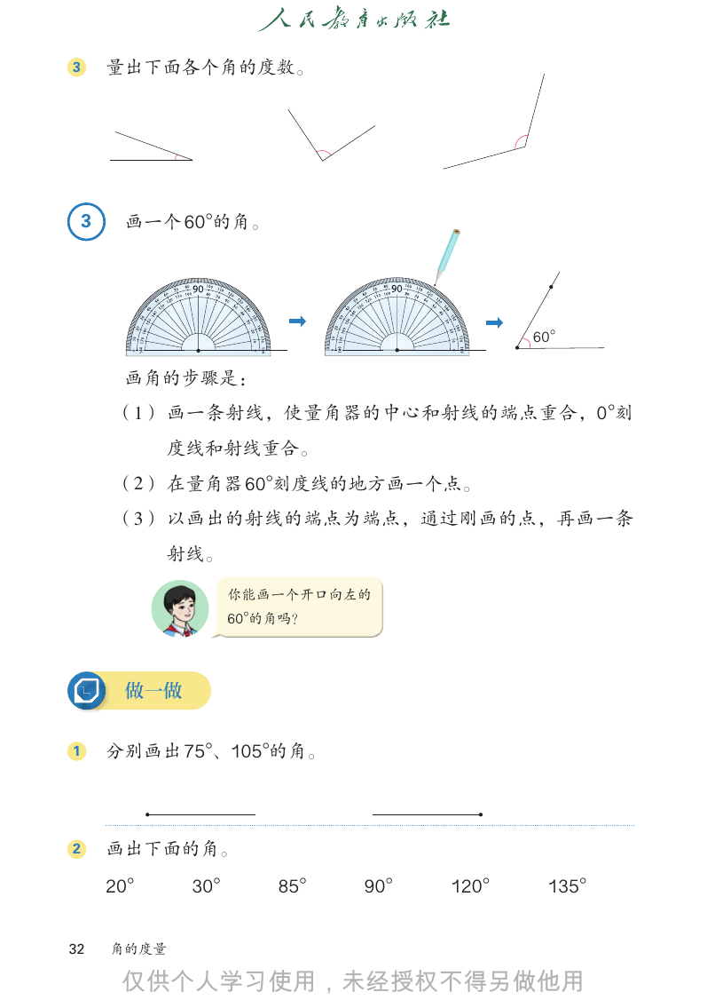

```text
3       量出下面各个角的度数。

    3    画一个 60°
               的角。

                                          60°

         画角的步骤是：
        （1） 画一条射线，使量角器的中心和射线的端点重合，0 °
                                    刻
              度线和射线重合。
        （2） 在量角器 60°
                   刻度线的地方画一个点。
        （3） 以画出的射线的端点为端点，通过刚画的点，再画一条
              射线。

                    你能画一个开口向左的
                    60°
                      的角吗？

         做一做

1       分别画出 75°
               、105°
                   的角。

2       画出下面的角。
        20°    30°     85°   90°   120°    135°

32      角的度量


```

## 教材第 33 页（PDF 第 38 页）

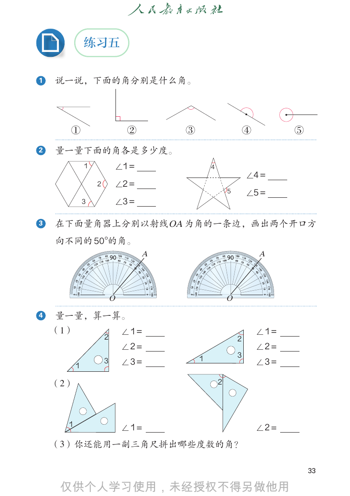

```text
              练习五

1   说一说，下面的角分别是什么角。

      ①                        ②       ③                       ④          ⑤

2   量一量下面的角各是多少度。
              1           ∠1 =                 4
                                                               ∠4 =
                  2       ∠2 =
                                                       5       ∠5 =
              3           ∠3 =

3   在下面量角器上分别以射线 OA 为角的一条边，画出两个开口方
    向不同的 50°
           的角。
                                   A                               A

                          O                            O

4   量一量，算一算。
    （1）                       ∠1 =                                 ∠1 =
                      2                                    2
                              ∠2 =                                 ∠2 =
                                           1               3
          1
                      3       ∠3 =                                 ∠3 =

    （2）                                            2

      1
                              ∠1 =                                 ∠2 =
    （3）你还能用一副三角尺拼出哪些度数的角？

                                                                               33


```

## 教材第 34 页（PDF 第 39 页）

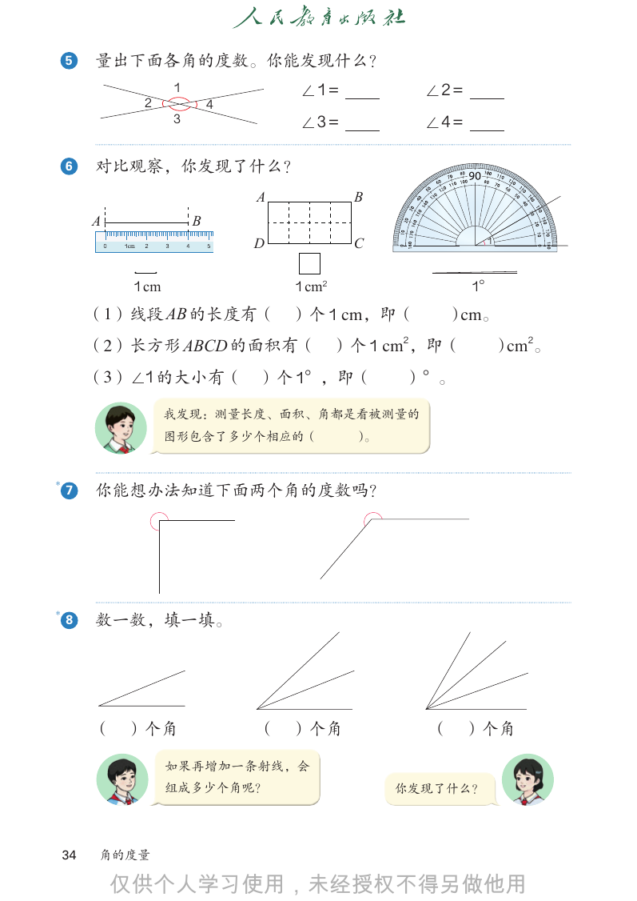

```text
    5    量出下面各角的度数。你能发现什么？
                     1               ∠1 =           ∠2 =
               2             4
                     3               ∠3 =           ∠4 =

    6    对比观察，你发现了什么？
                                 A           B
         A               B
                                 D           C                  1

              1 cm                   1 cm2                 1°
         （1）线段 AB 的长度有（              ）个 1 cm，即（         ）cm。
         （2）长方形 ABCD 的面积有（ ）个 1 cm2，即（                              ）cm2。
         （3）∠1 的大小有（             ）个 1°，即（         ）°。

                     我发现：测量长度、面积、角都是看被测量的
                     图形包含了多少个相应的（            ）。

*
    7    你能想办法知道下面两个角的度数吗？

*
    8    数一数，填一填。

         （   ）个角                 （ ）个角              （      ）个角

                     如果再增加一条射线，会
                     组成多少个角呢？                     你发现了什么？

    34   角的度量


```

## 教材第 35 页（PDF 第 40 页）

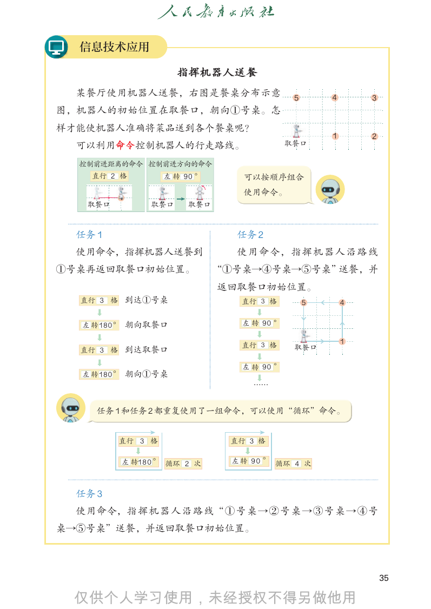

```text
  信息技术应用

                     指挥机器人送餐
  某餐厅使用机器人送餐，右图是餐桌分布示意                            5       4       3
图，机器人的初始位置在取餐口，朝向①号桌。怎
样才能使机器人准确将菜品送到各个餐桌呢？
                                                          1       2
  可以利用命令控制机器人的行走路线。                              ः丽ऐ

  ᣔ‫ݺݣ‬䔈䌊⻨⮱পБ ᣔ‫ݺݣ‬䔈᫦ा⮱পБ
    Ⱑ㵹2 ᵩ     ጓ90 c
                    䒙               可以按顺序组合
                                    使用命令。
          1
   ः丽ऐ         ः丽ऐ      ः丽ऐ

  任务 1                            任务 2
  使用命令，指挥机器人送餐到                   使 用 命 令， 指 挥 机 器 人 沿 路 线
①号桌再返回取餐口初始位置。                 “①号桌→④号桌→⑤号桌”送餐，并
                               返回取餐口初始位置。
  Ⱑ㵹3ᵩ 到达①号桌1                 Ⱙ㶁3 ᵱ
            ः丽ऐ                                       5       4

   ጓ 䒙180 c 朝向取餐口1                 ጛ90 f
                                      䒡
            ः丽ऐ
                                                              1
                 1                 Ⱙ㶁3 ᵱ      ऋ久घ
  Ⱑ㵹3ᵩ 到达取餐口
            ः丽ऐ
                                   ጛ90 f
                                      䒡
   ጓ 䒙180 c 朝向①号桌1
            ः丽ऐ
                                      ČČ

     任务 1 和任务 2 都重复使用了一组命令，可以使用“循环”命令。

             3 3
          直行直行 格 格             直行
                               直行 直行
                                 直行33格
                                     格
                                     33格
                                       格

           左180
          左转 转180
                ° °    2 次 左
                     2 次
                  循环循环     左转左
                             转左9
                               转转0 °
                               90  9
                                   °0°°
                                   90    4 次
                                      循环循环 4 次

  任务 3
  使用命令，指 挥 机 器 人 沿 路 线“ ① 号 桌 → ② 号 桌 → ③ 号 桌 → ④ 号
桌→⑤号桌”送餐，并返回取餐口初始位置。

                                                                      35


```

## 教材第 36 页（PDF 第 41 页）

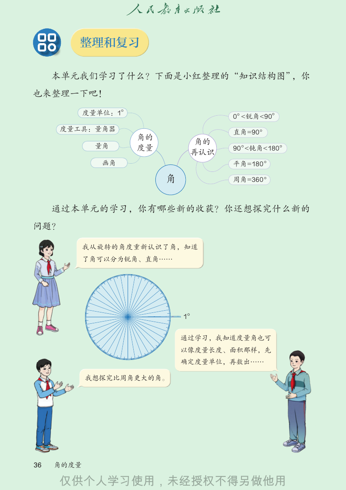

```text
        整理和复习

     本单元我们学习了什么？下面是小红整理的“知识结构图”，你
也来整理一下吧！
            度量单位：1°
                                      0°<锐角<90°
     度量工具：量角器                         直角=90°
                      角的
                                角的
             量角       度量              90 °
                                         <钝角<180°
                                再认识
               画角                     平角=180 °

                           角          周角=360 °

     通过本单元的学习，你有哪些新的收获？你还想探究什么新的
问题？

            我从旋转的角度重新认识了角，知道
            了角可以分为锐角、直角……

                               1°

                               通过学习，我知道度量角也可
                               以像度量长度、面积那样，先
                               确定度量单位，再数出……

            我想探究比周角更大的角。

36   角的度量


```

## 教材第 37 页（PDF 第 42 页）

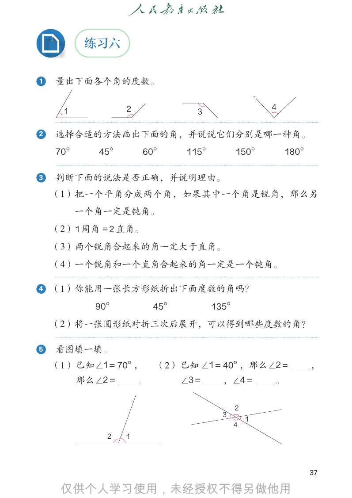

```text
           练习六

1   量出下面各个角的度数。

      1           2                             4
                              3

2   选择合适的方法画出下面的角，并说说它们分别是哪一种角。
    70°     45°       60°    115°       150°        180°

3   判断下面的说法是否正确，并说明理由。
    （1）把一个平角分成两个角，如果其中一个角是锐角，那么另
          一个角一定是钝角。
    （2）1 周角 = 2 直角。
    （3）两个锐角合起来的角一定大于直角。
    （4）一个锐角和一个直角合起来的角一定是一个钝角。

4   （1）你能用一张长方形纸折出下面度数的角吗？
            90°        45°        135°
    （2）将一张圆形纸对折三次后展开，可以得到哪些度数的角？

5   看图填一填。
    （1） 已知∠1 = 70°， （2） 已知 ∠1 = 40°，那么∠2 =                 ，
        那么∠2 =    。     ∠3 =    ，∠4 =  。

                                        2
                                    3
                                            1
                                        4
             2    1

                                                           37


```

## 教材第 38 页（PDF 第 43 页）

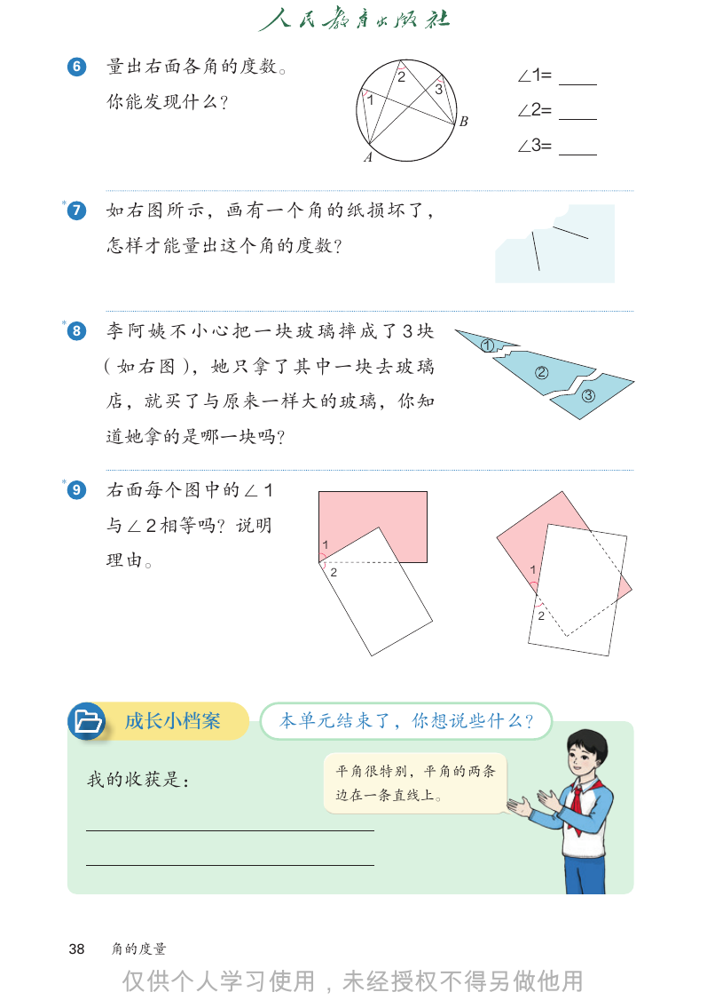

```text
    6     量出右面各角的度数。                  2               ∠1=
                                          3
          你能发现什么？                 1
                                                      ∠2=
                                              B

                                  A
                                                      ∠3=

*
    7     如右图所示，画有一个角的纸损坏了，
          怎样才能量出这个角的度数？

*
    8     李阿姨不小心把一块玻璃摔成了 3 块
                                                  1
         （如右图），她只拿了其中一块去玻璃                                 2
                                                           1
                                                               3
          店，就买了与原来一样大的玻璃，你知                                    2
                                                                   3
          道她拿的是哪一块吗？

*
    9     右面每个图中的∠ 1
          与∠ 2 相等吗？说明
                          1
          理由。                                          1
                              2

                                                           2

           成长小档案        本单元结束了，你想说些什么？

                              平角很特别，平角的两条
         我的收获是：
                              边在一条直线上。

    38    角的度量


```

