# 人教版《数学》四年级上册 · 第三单元 多位数乘两位数（教材第 39–57 页）

> 从 `docs/articles/textbook.md` 按页切出。版式、竖式和插图以页图为准（课程里是 `lessons/img/tNNN.png`）。版权归人民教育出版社，仅供个人学习使用。

## 教材第 39 页（PDF 第 44 页）

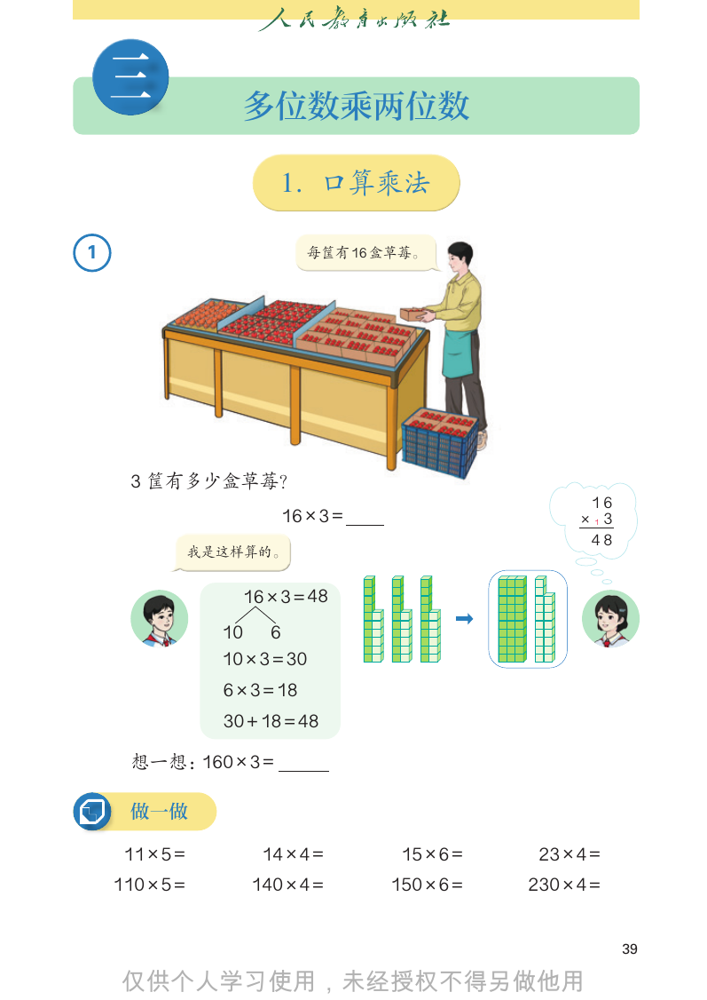

```text
    三               多位数乘两位数

                         1. 口算乘法

1                              每筐有 16 盒草莓。

      3 筐有多少盒草莓？
                                                         16
                         16 × 3 =                       ×13
                                                         48
                我是这样算的。

                    16 × 3 = 48
                  10 6
                  10 × 3 = 30
                  6 × 3 = 18
                  30 + 18 = 48

      想一想：160 × 3 =

      做一做

     11 × 5 =          14 × 4 =        15 × 6 =    23 × 4 =
    110 × 5 =        140 × 4 =        150 × 6 =   230 × 4 =

                                                              39


```

## 教材第 40 页（PDF 第 45 页）

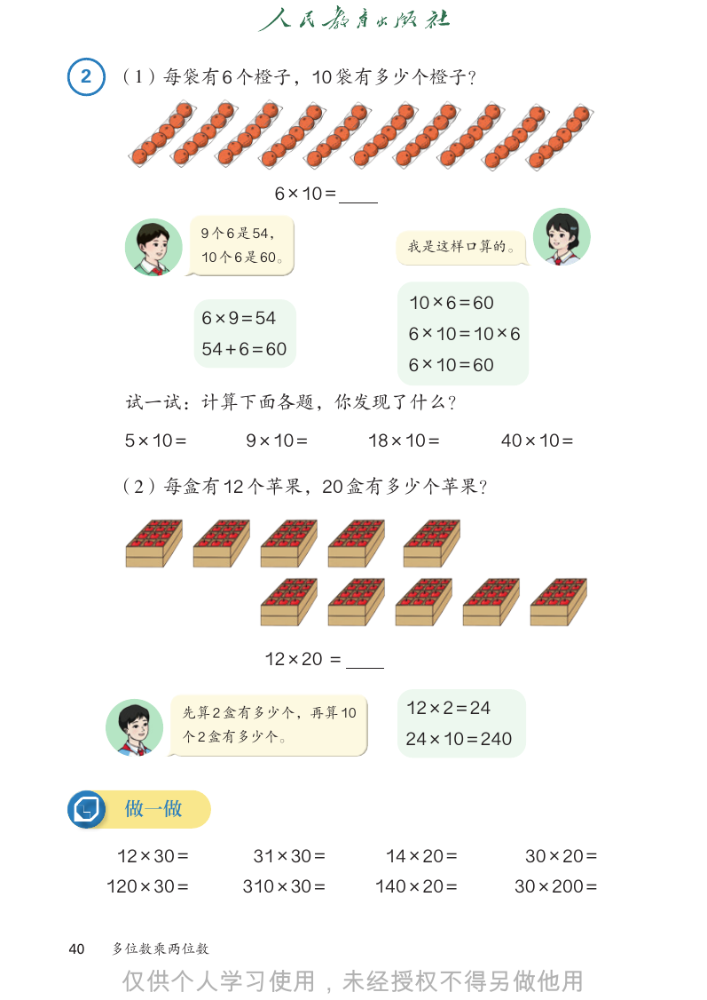

```text
 2    （1）每袋有 6 个橙子，10 袋有多少个橙子？

                           6 × 10 =
                  9 个 6 是 54，
                                          我是这样口算的。
                  10 个 6 是 60。

                                           10 × 6 = 60
                  6 × 9 = 54
                                           6 × 10 = 10 × 6
                  54 + 6 = 60
                                           6 × 10 = 60
       试一试：计算下面各题，你发现了什么？

       5 × 10 =         9 × 10 =      18 × 10 =          40 × 10 =

      （2）每盒有 12 个苹果，20 盒有多少个苹果？

                          12 × 20 =

              先算 2 盒有多少个，再算 10            12 × 2 = 24
              个 2 盒有多少个。                  24 × 10 = 240

       做一做

      12 × 30 =          31 × 30 =      14 × 20 =            30 × 20 =
     120 × 30 =        310 × 30 =     140 × 20 =          30 × 200 =

40   多位数乘两位数


```

## 教材第 41 页（PDF 第 46 页）

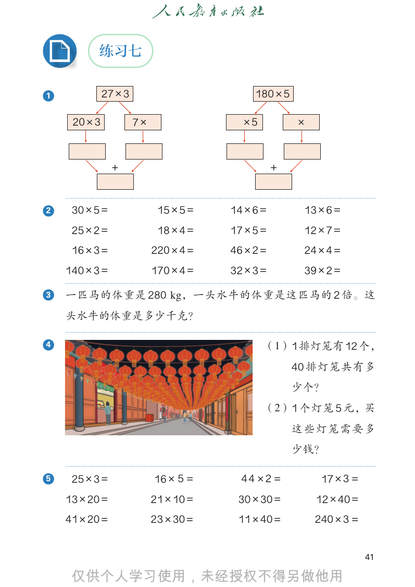

```text
           练习七

1             27 × 3                         180 × 5

     20 × 3            7×                 ×5           ×

                +                                  +

2    30 × 5 =                15 × 5 =   14 × 6 =        13 × 6 =
     25 × 2 =                18 × 4 =   17 × 5 =        12 × 7 =
     16 × 3 =               220 × 4 =   46 × 2 =        24 × 4 =
    140 × 3 =               170 × 4 =   32 × 3 =        39 × 2 =

3   一匹马的体重是 280 kg，一头水牛的体重是这匹马的 2 倍。这
    头水牛的体重是多少千克？

4                                              （1）1 排灯笼有 12 个，
                                                       40 排灯笼共有多
                                                       少个？
                                               （2）1 个灯笼 5 元，买
                                                       这些灯笼需要多
                                                       少钱？

5    25 × 3 =               16 × 5 =      44 ×2 =           17 × 3 =
    13 × 20 =               21 × 10 =    30 × 30 =         12 × 40 =
    41 × 20 =               23 × 30 =    11 × 40 =         240 × 3 =

                                                                       41


```

## 教材第 42 页（PDF 第 47 页）

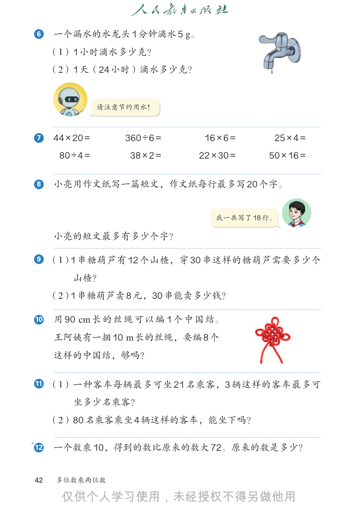

```text
    6    一个漏水的水龙头 1 分钟滴水 5 g。
         （1）1 小时滴水多少克？
         （2）1 天（24 小时）滴水多少克？

                     请注意节约用水！

    7    44 × 20 =      360 ÷ 6 =    16 × 6 =     25 × 4 =
          80 ÷ 4 =       38 × 2 =   22 × 30 =    50 × 16 =

    8    小亮用作文纸写一篇短文，作文纸每行最多写 20 个字。

                                        我一共写了 18 行。

         小亮的短文最多有多少个字？

    9    （1）1 串糖葫芦有 12 个山楂，穿 30 串这样的糖葫芦需要多少个
             山楂？
         （2）1 串糖葫芦卖 8 元，30 串能卖多少钱？

    10   用 90 cm 长的丝绳可以编 1 个中国结。
         王阿姨有一捆 10 m 长的丝绳，要编 8 个
         这样的中国结，够吗？

    11   （1）一种客车每辆最多可坐 21 名乘客，3 辆这样的客车最多可
             坐多少名乘客？
         （2）80 名乘客乘坐 4 辆这样的客车，能坐下吗？

*
    12   一个数乘 10，得到的数比原来的数大 72。原来的数是多少？

    42   多位数乘两位数


```

## 教材第 43 页（PDF 第 48 页）

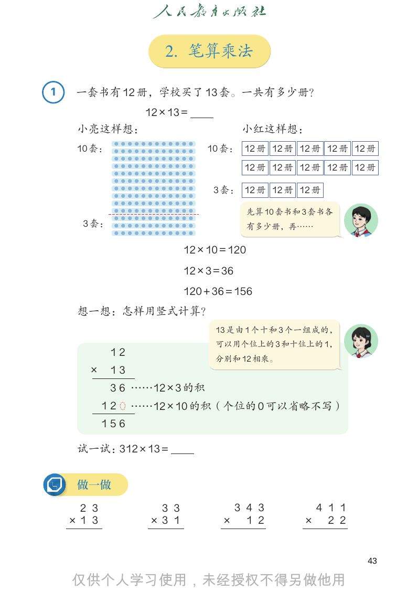

```text
                       2. 笔算乘法

1   一套书有 12 册，学校买了 13 套。一共有多少册？
                   12 × 13 =
     小亮这样想：
        小亮的这样想：                          小红这样想：
     10 套：                      10 套： 12 册 12 册 12 册 12 册 12 册
                                         12 册 12 册 12 册 12 册 12 册
       10套：

                                 3 套： 12 册 12 册 12 册

                                           先算 10 套书和 3 套书各
      3 套：
        3套：                                有多少册，再……

                           12 × 10 = 120
                           12 × 3 = 36
                           120 + 36 = 156
     想一想：怎样用竖式计算？
                                  13 是由 1 个十和 3 个一组成的，
                                  可以用个位上的 3 和十位上的 1，
             12
                                  分别和 12 相乘。
       ×     13
             3 6 ……12 × 3 的积
           12     ……12 × 10 的积（个位的 0 可以省略不写）
           156

     试一试：312 × 13 =

     做一做

     2 3             3 3            3 4 3             4 1 1
    ×1 3            ×3 1           × 1 2             × 2 2

                                                               43


```

## 教材第 44 页（PDF 第 49 页）

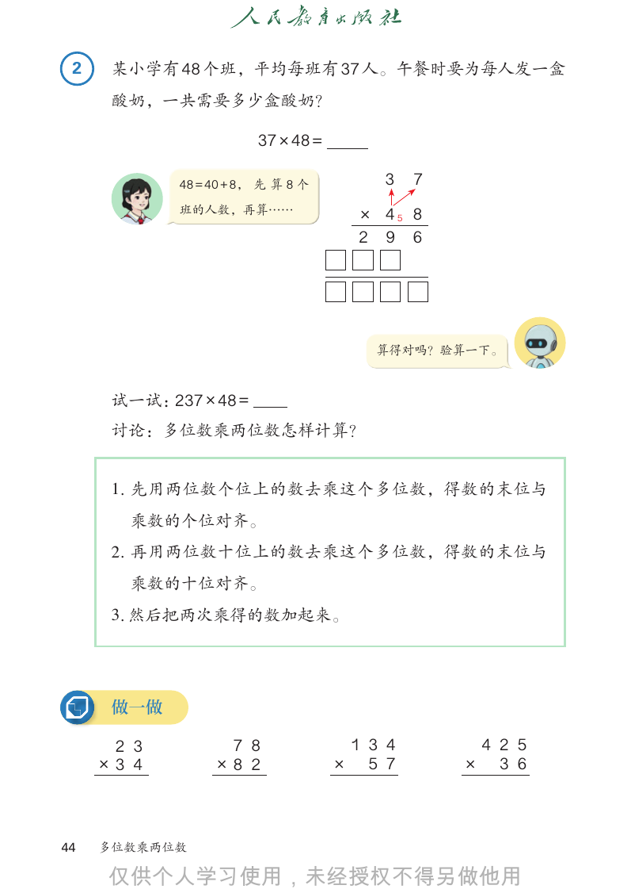

```text
 2    某小学有 48 个班，平均每班有 37 人。午餐时要为每人发一盒
      酸奶，一共需要多少盒酸奶？

                        37 × 48 =

            48 = 40 + 8， 先 算 8 个        3    7
            班的人数，再算……                 × 45 8
                                      2 9 6

                                        算得对吗？验算一下。

      试一试：237 × 48 =
      讨论：多位数乘两位数怎样计算？

      1. 先用两位数个位上的数去乘这个多位数，得数的末位与
       乘数的个位对齐。
      2. 再用两位数十位上的数去乘这个多位数，得数的末位与
       乘数的十位对齐。
      3. 然后把两次乘得的数加起来。

      做一做

      2 3         7 8                1 3 4        4 2 5
     ×3 4        ×8 2               × 5 7        × 3 6

44   多位数乘两位数


```

## 教材第 45 页（PDF 第 50 页）

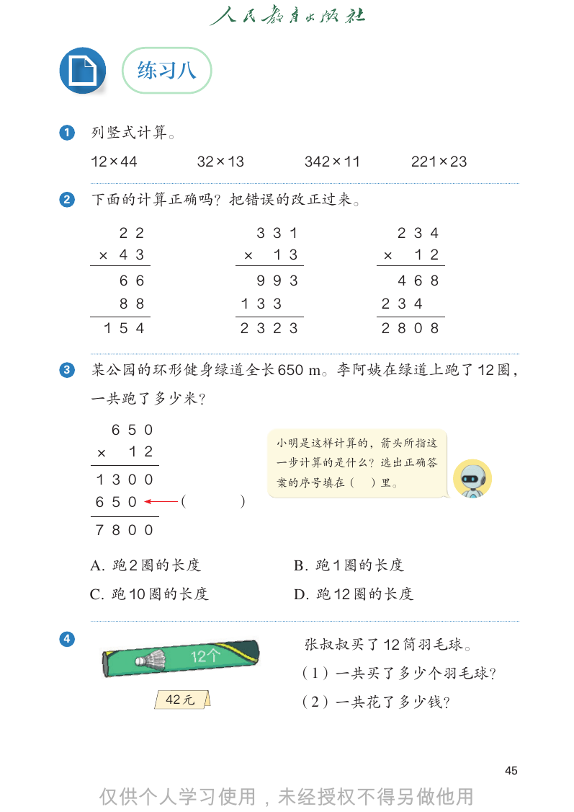

```text
          练习八

1   列竖式计算。
    12 × 44          32 × 13           342 × 11         221 × 23

2   下面的计算正确吗？把错误的改正过来。

       2 2                  3 3 1                   2 3 4
     × 4 3                 × 1 3                   × 1 2
        6 6                    9 9 3                4 6 8
        8 8                1 3 3                   2 3 4
     1 5 4                 2 3 2 3                 2 8 0 8

3   某公园的环形健身绿道全长 650 m。李阿姨在绿道上跑了 12 圈，
    一共跑了多少米？

      6 5 0
                                 小明是这样计算的，箭头所指这
     × 1 2
                                 一步计算的是什么？选出正确答
    1 3 0 0                      案的序号填在（          ）里。
    6 5 0      （          ）
    7 8 0 0

    A. 跑 2 圈的长度                    B. 跑 1 圈的长度
    C. 跑 10 圈的长度                   D. 跑 12 圈的长度

4
                                       张叔叔买了 12 筒羽毛球。
                                   （1）一共买了多少个羽毛球？
              42 元                 （2）一共花了多少钱？

                                                                   45


```

## 教材第 46 页（PDF 第 51 页）

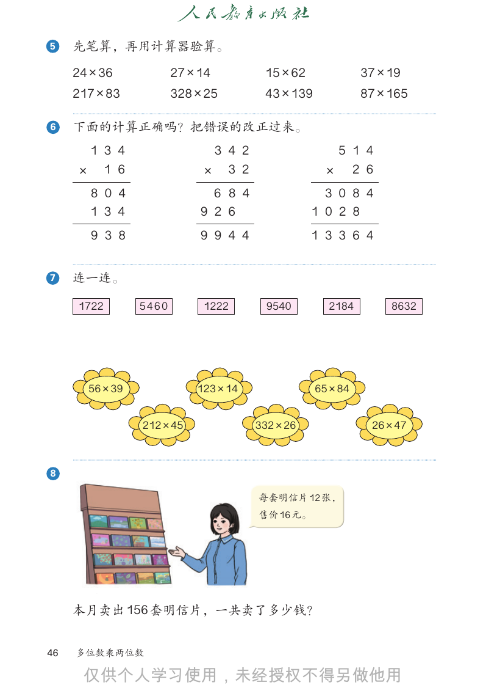

```text
5    先笔算，再用计算器验算。
     24 × 36            27 × 14         15 × 62              37 × 19
     217 × 83           328 × 25        43 × 139             87 × 165

6    下面的计算正确吗？把错误的改正过来。
       1 3 4                  3 4 2                   5 1 4
      × 1 6                  × 3 2                   × 2 6
        8 0 4                  6 8 4                3 0 8 4
        1 3 4                9 2 6                1 0 2 8
        9 3 8                9 9 4 4              1 3 3 6 4

7    连一连。

      1722       5460        1222        9540        2184         8632

       56 × 39              123 × 14               65 × 84

                 212 × 45              332 × 26                26 × 47

8

                                       每套明信片 12 张，
                                       售价 16 元。

     本月卖出 156 套明信片，一共卖了多少钱？

46   多位数乘两位数


```

## 教材第 47 页（PDF 第 52 页）

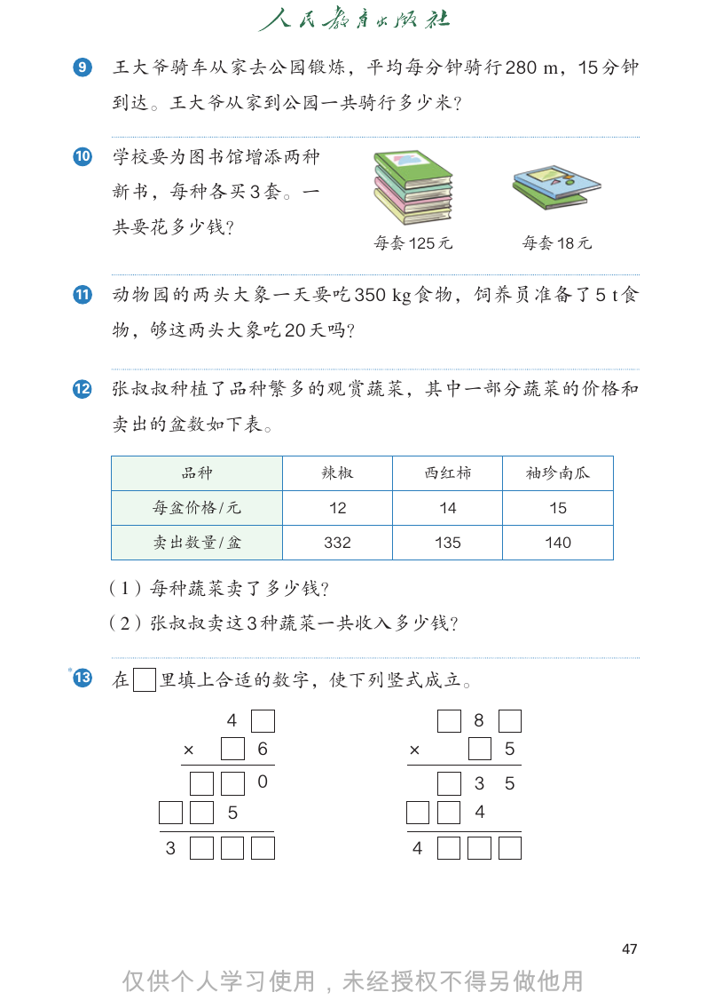

```text
    9    王大爷骑车从家去公园锻炼，平均每分钟骑行 280 m，15 分钟
         到达。王大爷从家到公园一共骑行多少米？

    10   学校要为图书馆增添两种
         新书，每种各买 3 套。一
         共要花多少钱？
                                     每套 125 元             每套 18 元

    11   动物园的两头大象一天要吃 350 kg 食物，饲养员准备了 5 t 食
         物，够这两头大象吃 20 天吗？

    12   张叔叔种植了品种繁多的观赏蔬菜，其中一部分蔬菜的价格和
         卖出的盆数如下表。

                  品种           辣椒           西红柿           袖珍南瓜

             每盆价格 / 元          12           14              15

             卖出数量 / 盆          332          135             140

         （1）每种蔬菜卖了多少钱？
         （2）张叔叔卖这 3 种蔬菜一共收入多少钱？

*
    13   在   里填上合适的数字，使下列竖式成立。

                       4                          8
                  ×        6            ×             5
                           0                      3   5
                       5                          4
              3                         4

                                                                    47


```

## 教材第 48 页（PDF 第 53 页）

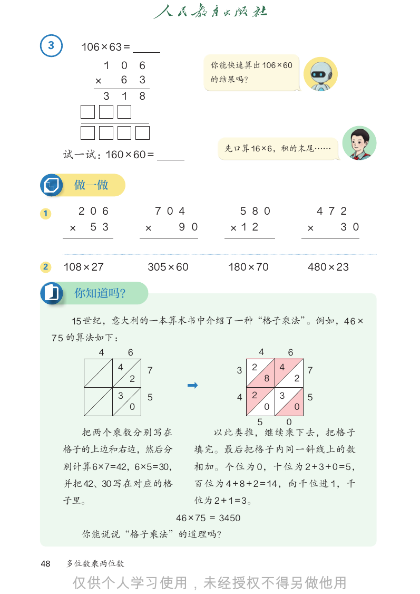

```text
    3      106 × 63 =
                   1   0       6                 你能快速算出106 × 60
               ×       6       3                 的结果吗？

                   3   1       8

                                                    先口算 16 × 6，积的末尾……
        试一试：160 × 60 =

          做一做

1         2 0 6                  7 0 4                5 8 0                     4 7 2
         × 5 3                 ×     9 0             ×1 2                     ×     3 0

2       108 × 27                   305 × 60          180 × 70                 480 × 23

          你知道吗？

         15 世纪，意大利的一本算术书中介绍了一种“格子乘法”。例如，46 ×
     7 5 的算法如下：
            4   6                                             4       6
                       4           7                  3   2       4           7
                           2                                  8           2
                       3           5                   4 2        3           5
                           0                                  0           0
                                                      5  0
            把两个乘数分别写在                             以此类推，继续乘下去，把格子
        格子的上边和右边，然后分                          填完。最后把格子内同一斜线上的数
        别计算6 × 7 = 42，6 × 5 = 30，             相加。个位为 0，十位为 2 + 3 + 0 = 5，
        并把42、30写在对应的格                         百位为 4 + 8 + 2 = 14，向千位进 1， 千
        子里。                                   位为 2 + 1 = 3。
                                        46 × 75 = 3450
            你能说说“格子乘法”的道理吗？

48      多位数乘两位数


```

## 教材第 49 页（PDF 第 54 页）

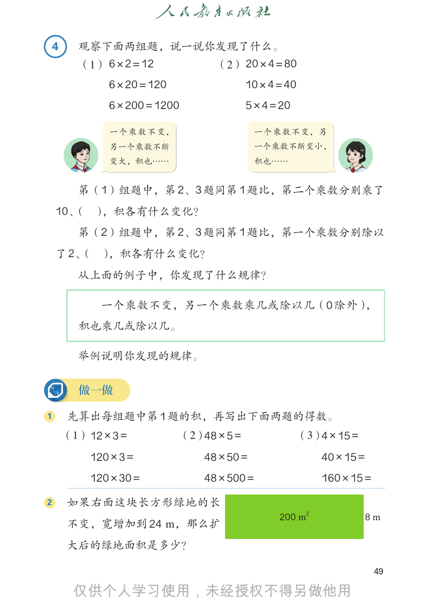

```text
    4     观察下面两组题，说一说你发现了什么。
          （1） 6 × 2 = 12 （2） 20 × 4 = 80
               6 × 20 = 120                  10 × 4 = 40
               6 × 200 = 1200                5 × 4 = 20

                一 个 乘 数 不 变，                    一个乘数不变，另
                另一个乘数不断                         一个乘数不断变小，
                变大，积也……                         积也……

          第（1）组题中，第 2、3 题同第 1 题比，第二个乘数分别乘了
    10、（   ），积各有什么变化？
          第（2）组题中，第 2、3 题同第 1 题比，第一个乘数分别除以
    了 2、（   ），积各有什么变化？
          从上面的例子中，你发现了什么规律？

              一个乘数不变，另一个乘数乘几或除以几（0 除外），
          积也乘几或除以几。

          举例说明你发现的规律。

          做一做

1       先算出每组题中第 1 题的积，再写出下面两题的得数。
        （1）12 × 3 =            （2）48 × 5 =                （3）4 × 15 =
            120 × 3 =              48 × 50 =                  40 × 15 =
            120 × 30 =             48 × 500 =                 160 × 15 =

2       如果右面这块长方形绿地的长
                                                    200 m2              8m
        不变，宽增加到 24 m，那么扩
        大后的绿地面积是多少？

                                                                           49


```

## 教材第 50 页（PDF 第 55 页）

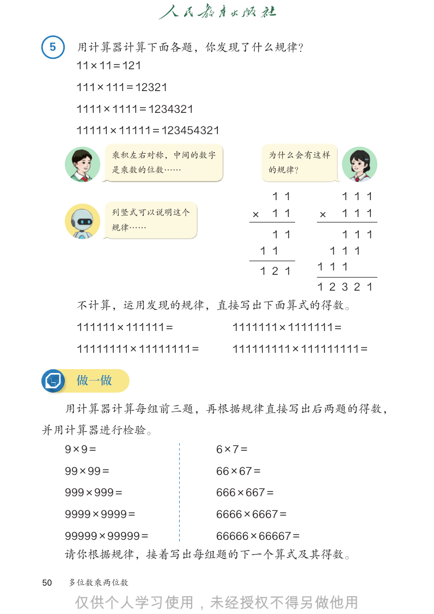

```text
 5     用计算器计算下面各题，你发现了什么规律？
       11 × 11 = 121
       111 × 111 = 12321
       1111 × 1111 = 1234321
       11111 × 11111 = 123454321

                 乘积左右对称，中间的数字              为什么会有这样
                 是乘数的位数……                  的规律？

                                           1 1        1 1 1
                 列竖式可以说明这个            ×    1 1    ×   1 1 1
                 规律……
                                            1 1       1 1 1
                                          1 1       1 1 1
                                          1 2 1   1 1 1
                                                  1 2 3 2 1
       不计算，运用发现的规律，直接写出下面算式的得数。
       111111 × 111111 =           1111111 × 1111111 =
       11111111 × 11111111 =       111111111 × 111111111 =

       做一做

     用计算器计算每组前三题，再根据规律直接写出后两题的得数，
并用计算器进行检验。
     9×9=                      6×7=
     99 × 99 =                 66 × 67 =
     999 × 999 =               666 × 667 =
     9999 × 9999 =             6666 × 6667 =
     99999 × 99999 =           66666 × 66667 =
     请你根据规律，接着写出每组题的下一个算式及其得数。

50   多位数乘两位数


```

## 教材第 51 页（PDF 第 56 页）

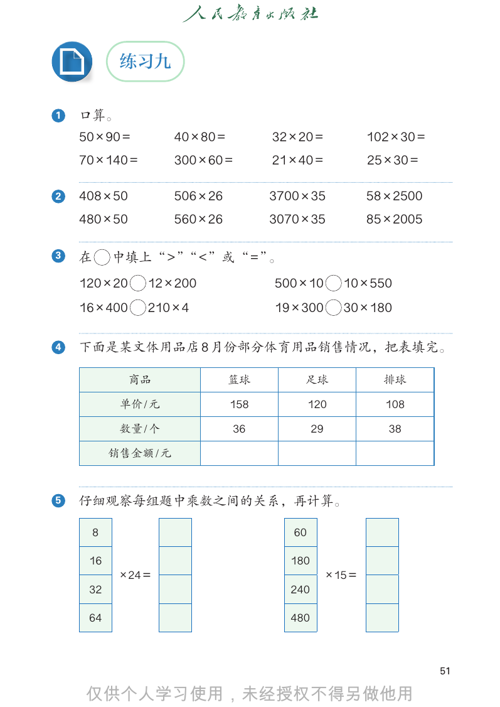

```text
             练习九

1   口算。
    50 × 90 =          40 × 80 =         32 × 20 =              102 × 30 =
    70 × 140 =         300 × 60 =        21 × 40 =              25 × 30 =

2   408 × 50           506 × 26          3700 × 35              58 × 2500
    480 × 50           560 × 26          3070 × 35              85 × 2005

3   在       中填上“ > ”“ < ”或“ = ”。
    120 × 20      12 × 200               500 × 10         10 × 550
    16 × 400      210 × 4                19 × 300         30 × 180

4   下面是某文体用品店 8 月份部分体育用品销售情况，把表填完。

               商品                  篮球         足球                  排球

             单价 / 元                158           120               108

             数量 / 个                36             29               38

            销售金额 / 元

5   仔细观察每组题中乘数之间的关系，再计算。

        8                                   60

     16                                     180
             × 24 =                                    × 15 =
     32                                     240

     64                                     480

                                                                             51


```

## 教材第 52 页（PDF 第 57 页）

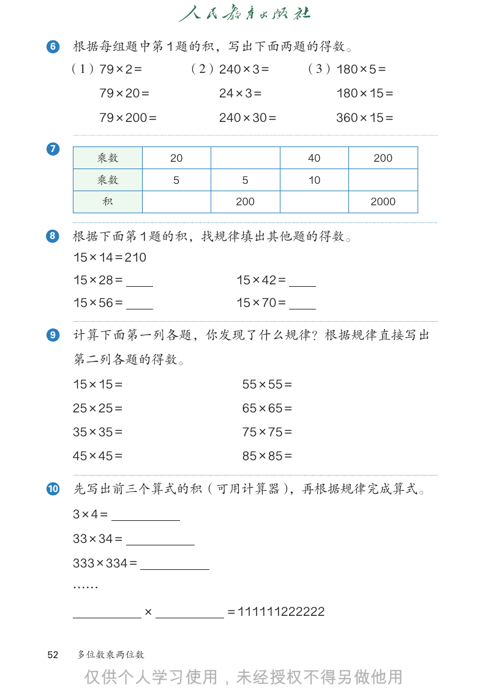

```text
6    根据每组题中第 1 题的积，写出下面两题的得数。
     （1）79 × 2 =            （2）240 × 3 =        （3）180 × 5 =
          79 × 20 =             24 × 3 =             180 × 15 =
          79 × 200 =            240 × 30 =           360 × 15 =

7
         乘数            20                       40         200
         乘数            5            5           10
          积                        200                     2000

8    根据下面第 1 题的积，找规律填出其他题的得数。
     15 × 14 = 210
     15 × 28 =                     15 × 42 =
     15 × 56 =                     15 × 70 =

9    计算下面第一列各题，你发现了什么规律？根据规律直接写出
     第二列各题的得数。
     15 × 15 =                      55 × 55 =
     25 × 25 =                      65 × 65 =
     35 × 35 =                      75 × 75 =
     45 × 45 =                      85 × 85 =

10   先写出前三个算式的积（可用计算器），再根据规律完成算式。
     3×4=
     33 × 34 =
     333 × 334 =
     ……
                   ×             = 111111222222

52    多位数乘两位数


```

## 教材第 53 页（PDF 第 58 页）

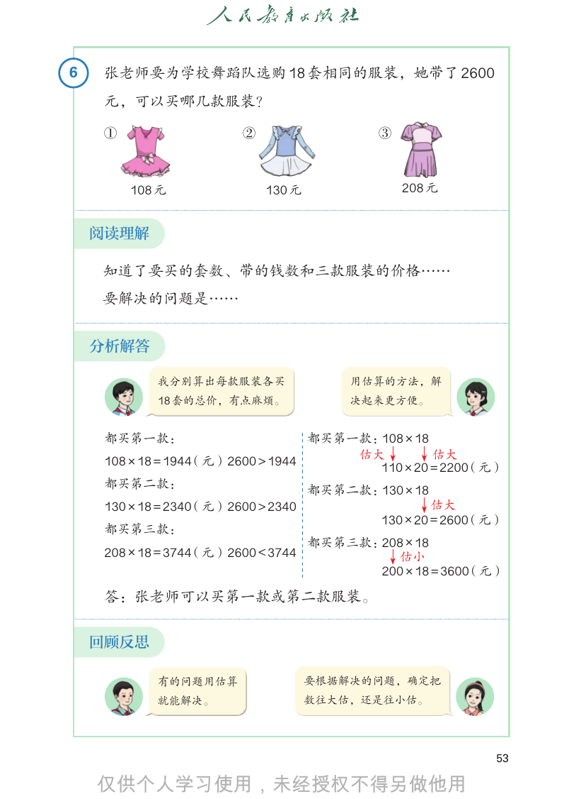

```text
6    张老师要为学校舞蹈队选购 18 套相同的服装，她带了 2600
     元，可以买哪几款服装？

     ①                   ②                   ③

         108 元               130 元               208 元

    阅读理解

    知道了要买的套数、带的钱数和三款服装的价格……
    要解决的问题是……

    分析解答

             我分别算出每款服装各买                  用估算的方法，解
             18 套的总价，有点麻烦。                决起来更方便。

     都买第一款：                        都买第一款：108 × 18
                                       估大         估大
     108 × 18 = 1944（元）2600 > 1944       110 × 20 = 2200（元）
     都买第二款：                        都买第二款：130 × 18
     130 × 18 = 2340（元）2600 > 2340                    估大
                                             130 × 20 = 2600（元）
     都买第三款：
                                     都买第三款：208 × 18
     208 × 18 = 3744（元）2600 < 3744           估小
                                           200 × 18 = 3600（元）
     答：张老师可以买第一款或第二款服装。

    回顾反思

             有的问题用估算                 要根据解决的问题，确定把
             就能解决。                   数往大估，还是往小估。

                                                             53


```

## 教材第 54 页（PDF 第 59 页）

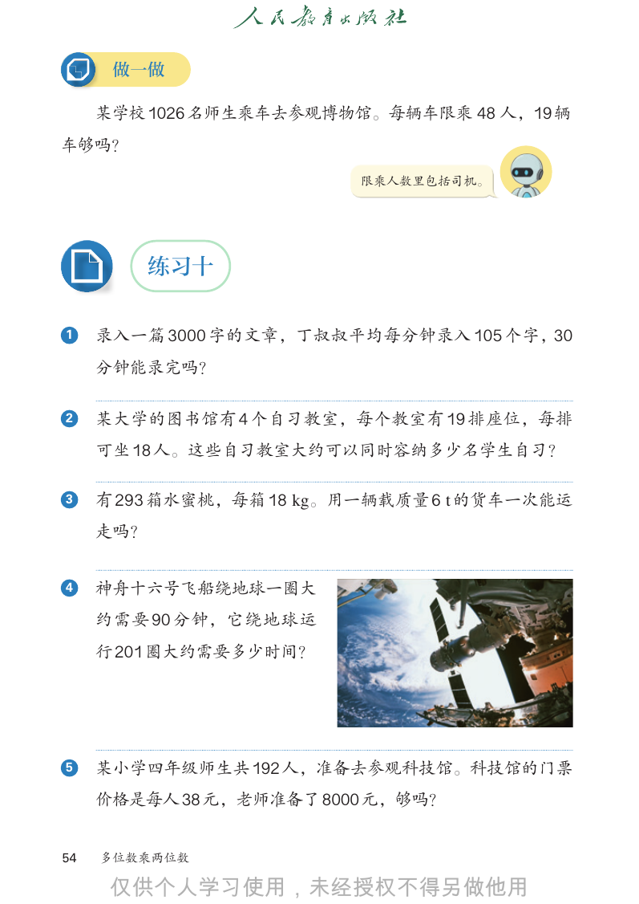

```text
      做一做

     某学校 1026 名师生乘车去参观博物馆。每辆车限乘 48 人，19 辆
车够吗？

                          限乘人数里包括司机。

           练习十

1    录入一篇 3000 字的文章，丁叔叔平均每分钟录入 105 个字，30
     分钟能录完吗？

2    某大学的图书馆有 4 个自习教室，每个教室有 19 排座位，每排
     可坐 18 人。这些自习教室大约可以同时容纳多少名学生自习？

3    有 293 箱水蜜桃，每箱 18 kg。用一辆载质量 6 t 的货车一次能运
     走吗？

4    神舟十六号飞船绕地球一圈大
     约需要 90 分钟，它绕地球运
     行 201 圈大约需要多少时间？

5    某小学四年级师生共 192 人，准备去参观科技馆。科技馆的门票
     价格是每人 38 元，老师准备了 8000 元，够吗？

54   多位数乘两位数


```

## 教材第 55 页（PDF 第 60 页）

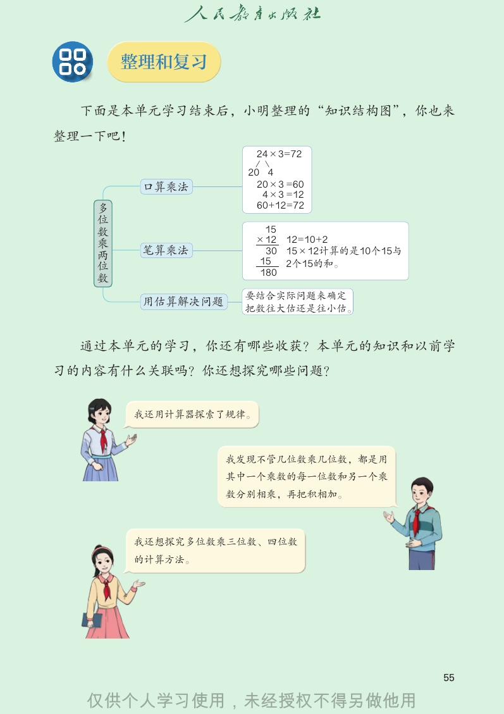

```text
               整理和复习

  下面是本单元学习结束后，小明整理的“知识结构图”，你也来
整理一下吧！
                              24×3=72
                            20 4
                口算乘法          20×3 =60
                               4×3 =12

   多位 数乘两位 数
                              60+12=72

                              15
                             ×12 12=10+2
                笔算乘法          30 15×12计算的是10个15与
                             15 2个15的和。
                             180

                           要结合实际问题来确定
                用估算解决问题
                           把数往大估还是往小估。

  通过本单元的学习，你还有哪些收获？本单元的知识和以前学
习的内容有什么关联吗？你还想探究哪些问题？

               我还用计算器探索了规律。

                          我发现不管几位数乘几位数，都是用
                          其中一个乘数的每一位数和另一个乘
                          数分别相乘，再把积相加。

               我还想探究多位数乘三位数、四位数
               的计算方法。

                                                   55


```

## 教材第 56 页（PDF 第 61 页）

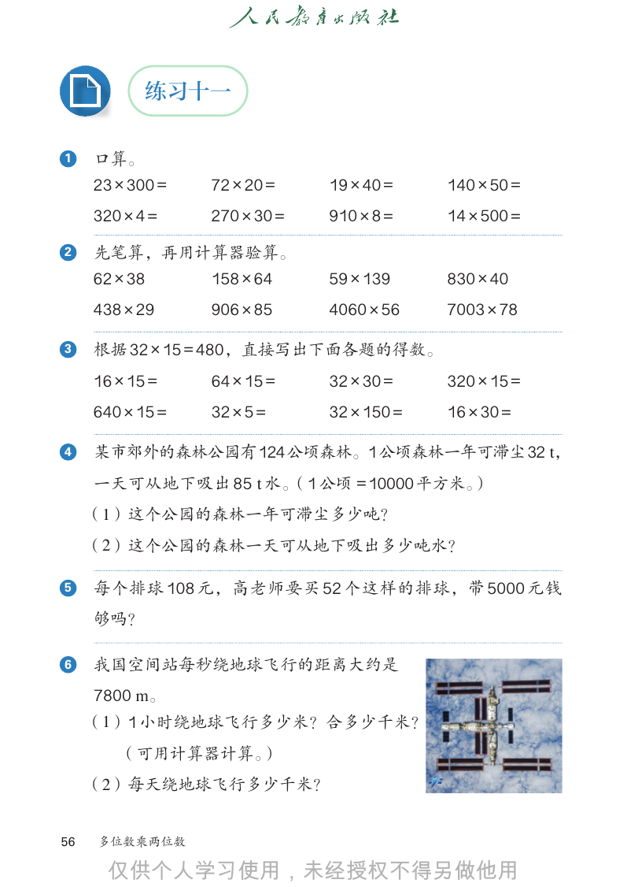

```text
            练习十一

1    口算。
     23 × 300 =   72 × 20 =    19 × 40 =    140 × 50 =
     320 × 4 =    270 × 30 =   910 × 8 =    14 × 500 =

2    先笔算，再用计算器验算。
     62 × 38 158 × 64          59 × 139     830 × 40
     438 × 29     906 × 85     4060 × 56    7003 × 78

3    根据 32 × 15 = 480，直接写出下面各题的得数。
     16 × 15 =    64 × 15 =    32 × 30 =    320 × 15 =
     640 × 15 =   32 × 5 =     32 × 150 =   16 × 30 =

4    某市郊外的森林公园有124公顷森林。1公顷森林一年可滞尘32 t，
     一天可从地下吸出 85 t 水。（1 公顷 = 10000 平方米。
                                      ）
     （1）这个公园的森林一年可滞尘多少吨？
     （2）这个公园的森林一天可从地下吸出多少吨水？

5    每个排球 108 元，高老师要买 52 个这样的排球，带 5000 元钱
     够吗？

6    我国空间站每秒绕地球飞行的距离大约是
     7800 m。
     （1）1 小时绕地球飞行多少米？合多少千米？
        （可用计算器计算。）
     （2）每天绕地球飞行多少千米？

56   多位数乘两位数


```

## 教材第 57 页（PDF 第 62 页）

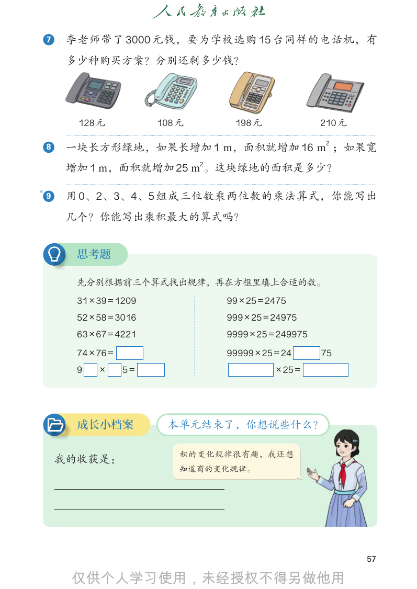

```text
    7    李老师带了 3000 元钱，要为学校选购 15 台同样的电话机，有
         多少种购买方案？分别还剩多少钱？

          128 元            108 元     198 元               210 元

    8    一块长方形绿地，如果长增加 1 m，面积就增加 16 m2 ；如果宽
         增加 1 m，面积就增加 25 m2。这块绿地的面积是多少？

*
    9    用 0、2、3、4、5 组成三位数乘两位数的乘法算式，你能写出
         几个？你能写出乘积最大的算式吗？

          思考题

          先分别根据前三个算式找出规律，再在方框里填上合适的数。
          31 × 39 = 1209            99 × 25 = 2475
          52 × 58 = 3016            999 × 25 = 24975
          63 × 67 = 4221            9999 × 25 = 249975
          74 × 76 =                 99999 × 25 = 24      75
          9    ×      5=                       × 25 =

          成长小档案             本单元结束了，你想说些什么？

                               积的变化规律很有趣，我还想
        我的收获是：
                               知道商的变化规律。

                                                                 57


```

