# 人教版《数学》四年级上册 · 第四单元 加法模型和乘法模型（教材第 58–69 页）

> 从 `docs/articles/textbook.md` 按页切出。版式、竖式和插图以页图为准（课程里是 `lessons/img/tNNN.png`）。版权归人民教育出版社，仅供个人学习使用。

## 教材第 58 页（PDF 第 63 页）

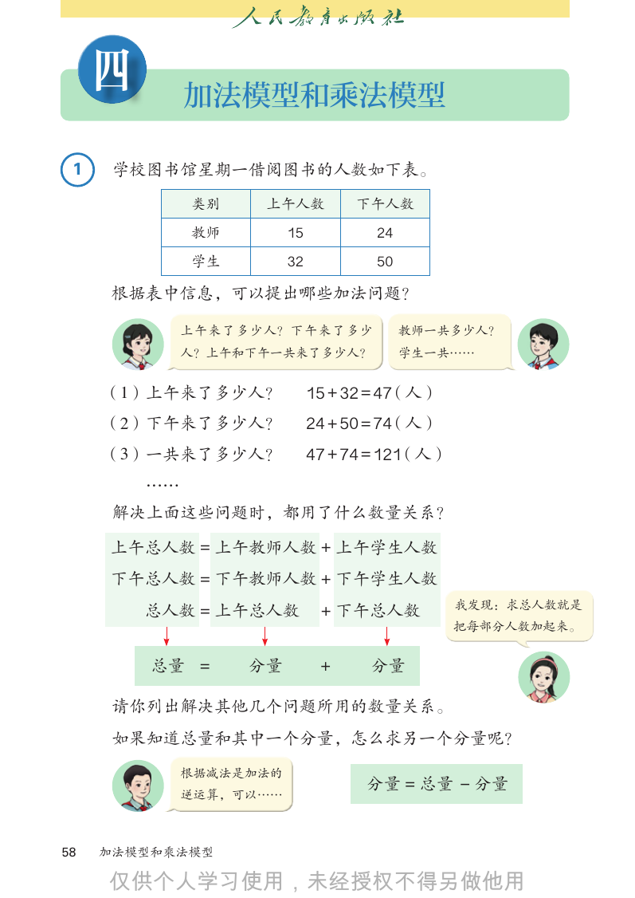

```text
     四        加法模型和乘法模型

 1    学校图书馆星期一借阅图书的人数如下表。
              类别    上午人数           下午人数
              教师         15          24
              学生         32          50

     根据表中信息，可以提出哪些加法问题？

              上午来了多少人？下午来了多少              教师一共多少人？
              人？上午和下午一共来了多少人？             学生一共……

     （1）上午来了多少人？              15 + 32 = 47（人）
     （2）下午来了多少人？              24 + 50 = 74（人）
     （3）一共来了多少人？              47 + 74 = 121（人）
         ……
      解决上面这些问题时，都用了什么数量关系？

     上午总人数 = 上午教师人数 + 上午学生人数
     下午总人数 = 下午教师人数 + 下午学生人数
         总人数 = 上午总人数           + 下午总人数           我发现：求总人数就是
                                                 把每部分人数加起来。

         总量 =      分量          +     分量

      请你列出解决其他几个问题所用的数量关系。
      如果知道总量和其中一个分量，怎么求另一个分量呢？
              根据减法是加法的
                                    分量 = 总量 − 分量
              逆运算，可以……

58   加法模型和乘法模型


```

## 教材第 59 页（PDF 第 64 页）

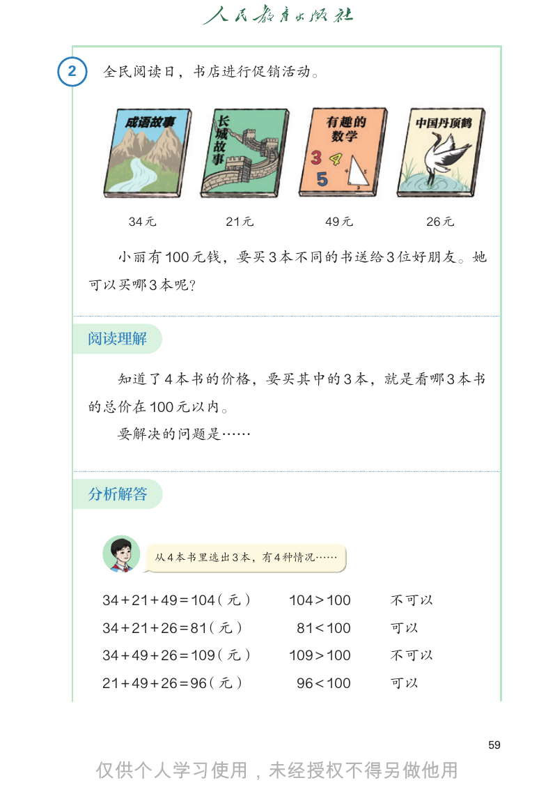

```text
2    全民阅读日，书店进行促销活动。

        34 元         21 元         49 元        26 元

       小丽有 100 元钱，要买 3 本不同的书送给 3 位好朋友。她
    可以买哪 3 本呢？

    阅读理解

       知道了 4 本书的价格，要买其中的 3 本，就是看哪 3 本书
    的总价在 100 元以内。
       要解决的问题是……

    分析解答

            从 4 本书里选出 3 本，有 4 种情况……

     34 + 21 + 49 = 104（元）   104 > 100   不可以
     34 + 21 + 26 = 81（元）     81 < 100   可以
     34 + 49 + 26 = 109（元）   109 > 100   不可以
     21 + 49 + 26 = 96（元）     96 < 100   可以

                                                     59


```

## 教材第 60 页（PDF 第 65 页）

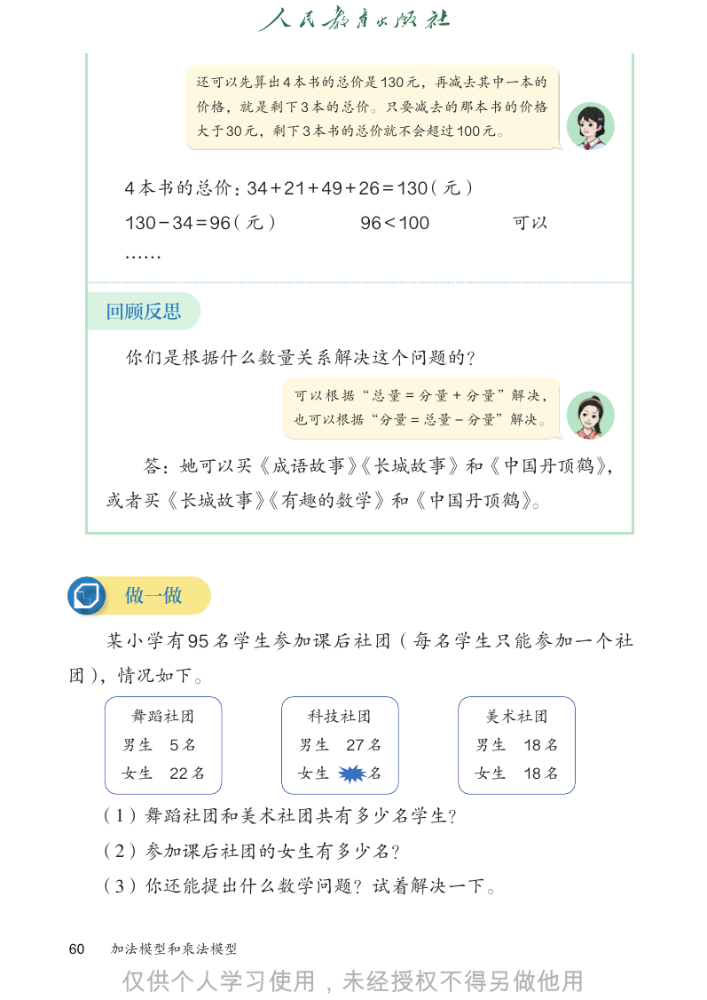

```text
             还可以先算出 4 本书的总价是 130 元，再减去其中一本的
             价格，就是剩下 3 本的总价。只要减去的那本书的价格
             大于 30 元，剩下 3 本书的总价就不会超过 100 元。

      4 本书的总价：34 + 21 + 49 + 26 = 130（元）
      130 − 34 = 96（元）          96 < 100          可以
      ……

     回顾反思

      你们是根据什么数量关系解决这个问题的？
                         可 以 根 据“ 总 量 = 分 量 + 分 量 ”解 决，
                         也可以根据“分量 = 总量 − 分量”解决。

       答：她可以买《成语故事》
                  《长城故事》和《中国丹顶鹤》，
     或者买《长城故事》
             《有趣的数学》和《中国丹顶鹤》。

      做一做

     某小学有 95 名学生参加课后社团（每名学生只能参加一个社
团），情况如下。

      舞蹈社团                科技社团                美术社团
      男生   5名            男生 27 名             男生    18 名
      女生   22 名          女生      名           女生    18 名

     （1）舞蹈社团和美术社团共有多少名学生？
     （2）参加课后社团的女生有多少名？
     （3）你还能提出什么数学问题？试着解决一下。

60   加法模型和乘法模型


```

## 教材第 61 页（PDF 第 66 页）

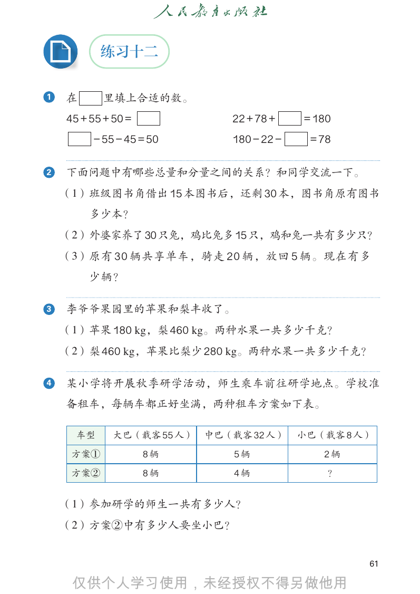

```text
           练习十二

1   在      里填上合适的数。
    45 + 55 + 50 =            22 + 78 +    = 180
         − 55 − 45 = 50       180 − 22 −    = 78

2   下面问题中有哪些总量和分量之间的关系？和同学交流一下。
    （1）班级图书角借出 15 本图书后，还剩 30 本，图书角原有图书
        多少本？
    （2）外婆家养了30只兔，鸡比兔多15只，鸡和兔一共有多少只？
    （3）原有 30 辆共享单车，骑走 20 辆，放回 5 辆。现在有多
        少辆？

3   李爷爷果园里的苹果和梨丰收了。
    （1）苹果 180 kg，梨 460 kg。两种水果一共多少千克？
    （2）梨 460 kg，苹果比梨少 280 kg。两种水果一共多少千克？

4   某小学将开展秋季研学活动，师生乘车前往研学地点。学校准
    备租车，每辆车都正好坐满，两种租车方案如下表。

      车型     大巴（载客 55 人）   中巴（载客 32 人）     小巴（载客 8 人）
     方案①             8辆        5辆             2辆
     方案②             8辆        4辆              ？

    （1）参加研学的师生一共有多少人？
    （2）方案②中有多少人要坐小巴？

                                                    61


```

## 教材第 62 页（PDF 第 67 页）

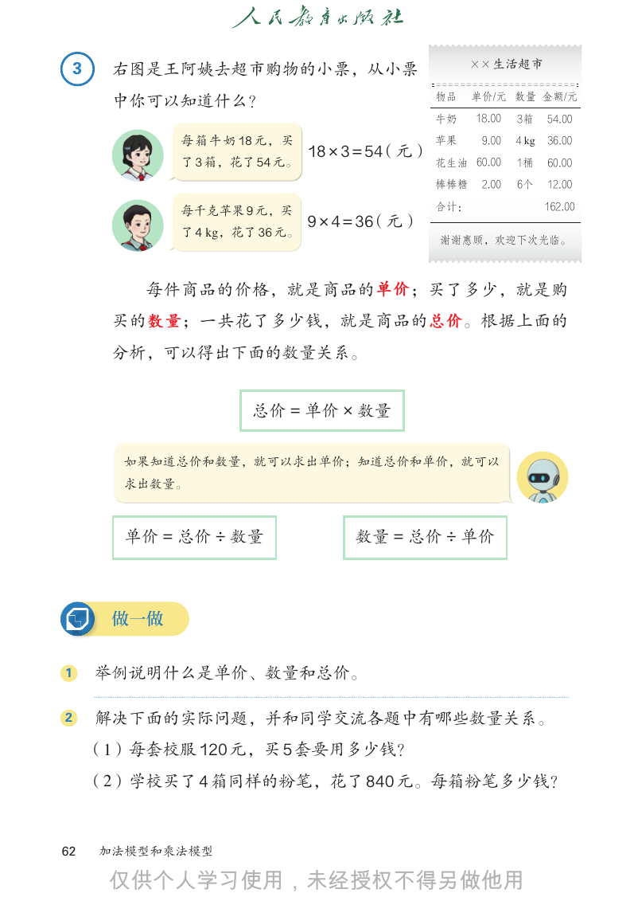

```text
    3                                                   X X 生活超市
         右图是王阿姨去超市购物的小票，从小票
                                                  物品    单价/元 数量 金额/元
         中你可以知道什么？
                                                  牛奶    18.00   3箱     54.00

               每 箱 牛 奶 18 元， 买                    苹果     9.00   4 kg   36.00
                                 18 × 3 = 54（元）
               了 3 箱，花了 54 元。                     花生油 60.00     1桶     60.00

                                                  棒棒糖    2.00   6个     12.00

               每千克苹果 9 元，买                        合计：                  162.00
                                 9 × 4 = 36（元）
               了 4 kg，花了 36 元。
                                                  谢谢惠顾，欢迎下次光临。

            每件商品的价格，就是商品的 单价；买了多少，就是购
         买的 数量；一共花了多少钱，就是商品的 总价。根据上面的
         分析，可以得出下面的数量关系。

                        总价 = 单价 × 数量

          如果知道总价和数量，就可以求出单价；知道总价和单价，就可以
          求出数量。

          单价 = 总价 ÷ 数量                数量 = 总价 ÷ 单价

         做一做

1       举例说明什么是单价、数量和总价。

2       解决下面的实际问题，并和同学交流各题中有哪些数量关系。
        （1）每套校服 120 元，买 5 套要用多少钱？
        （2）学校买了 4 箱同样的粉笔，花了 840 元。每箱粉笔多少钱？

62      加法模型和乘法模型


```

## 教材第 63 页（PDF 第 68 页）

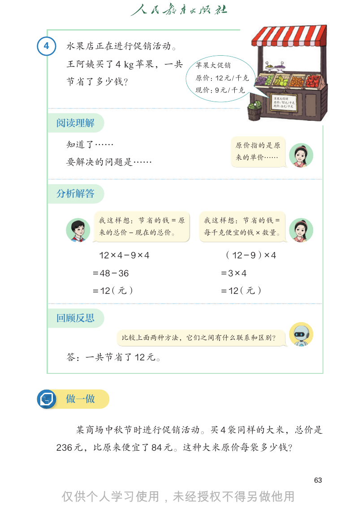

```text
4    水果店正在进行促销活动。
     王阿姨买了 4 kg 苹果，一共             苹果大促销
                                  原价：12 元 / 千克
     节省了多少钱？
                                  现价：9 元 / 千克
                                                 苹果大促销
                                                 原价：12元/千克
                                                 现价：9元/千克

    阅读理解

     知道了……                                原价指的是原
                                          来的单价……
     要解决的问题是……

    分析解答

           我 这 样 想： 节 省 的 钱 = 原    我这样想：节省的钱 =
           来的总价 − 现在的总价。           每千克便宜的钱 × 数量。

           12 × 4 − 9 × 4              （12 − 9）× 4
        = 48 − 36                      =3×4
        = 12（元）                        = 12（元）

    回顾反思
                 比较上面两种方法，它们之间有什么联系和区别？

     答：一共节省了 12 元。

     做一做

      某商场中秋节时进行促销活动。买 4 袋同样的大米，总价是
    236 元，比原来便宜了 84 元。这种大米原价每袋多少钱？

                                                             63


```

## 教材第 64 页（PDF 第 69 页）

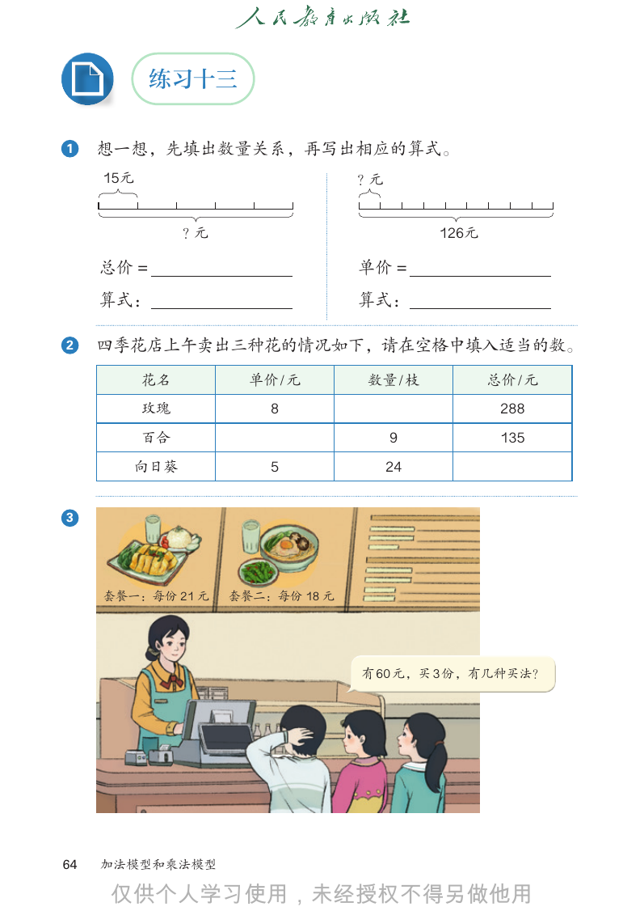

```text
            练习十三

1    想一想，先填出数量关系，再写出相应的算式。
     15元                           ？元

                ？元                           126元

     总价 =                          单价 =
     算式：                           算式：

2    四季花店上午卖出三种花的情况如下，请在空格中填入适当的数。
           花名          单价 / 元      数量 / 枝           总价 / 元
           玫瑰            8                           288
           百合                           9            135
        向日葵              5              24

3

     套餐一：每份 21 元     套餐二：每份 18 元

                                   有 60 元，买 3 份，有几种买法？

64   加法模型和乘法模型


```

## 教材第 65 页（PDF 第 70 页）

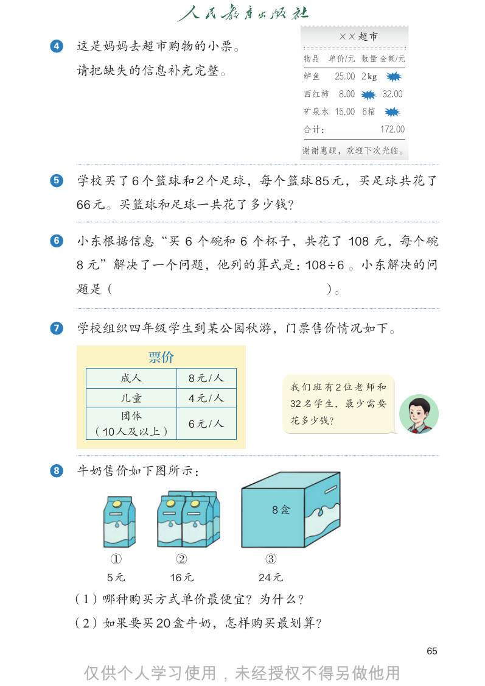

```text
                                               X X 超市
4   这是妈妈去超市购物的小票。
                                        物品 单价/元 数量 金额/元
    请把缺失的信息补充完整。                        鲈鱼    25.00 2 kg
                                        西红柿   8.00         32.00
                                        矿泉水 15.00 6箱

                                        合计：���             172.00

                                        谢谢惠顾，欢迎下次光临。

5   学校买了 6 个篮球和 2 个足球，每个篮球 85 元，买足球共花了
    66 元。买篮球和足球一共花了多少钱？

6   小东根据信息“买 6 个碗和 6 个杯子，共花了 108 元，每个碗
    8 元”解决了一个问题，他列的算式是：108 ÷ 6 。小东解决的问
    题是（                                      ）。

7   学校组织四年级学生到某公园秋游，门票售价情况如下。

               票价
          成人            8元/人
                                      我们班有2位老师和
          儿童            4元/人          32 名 学 生， 最 少 需 要
         团体
                        6元/人          花多少钱？
     （10 人及以上）

8   牛奶售价如下图所示：

                                 8盒

       ①            ②           ③
       5元       16 元           24 元

    （1）哪种购买方式单价最便宜？为什么？
    （2）如果要买 20 盒牛奶，怎样购买最划算？

                                                                    65


```

## 教材第 66 页（PDF 第 71 页）

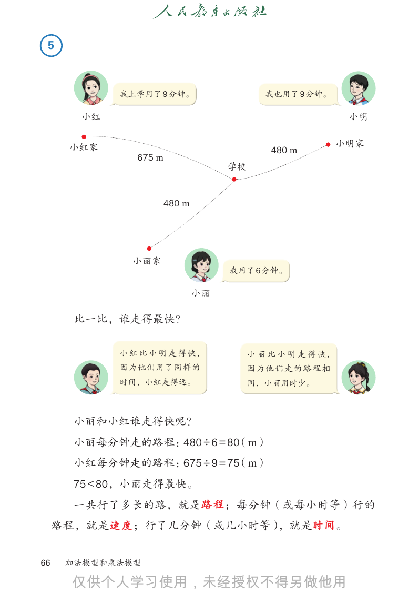

```text
 5

            我上学用了 9 分钟。                  我也用了 9 分钟。

       小红                                                 小明

                                                         小明家
      小红家                                 480 m
               675 m
                                 学校

                    480 m

              小丽家
                                 我用了 6 分钟。

                            小丽

       比一比，谁走得最快？

            小 红 比 小 明 走 得 快，          小 丽 比 小 明 走 得 快，
            因为他们用了同样的                 因为他们走的路程相
            时间，小红走得远。                 同，小丽用时少。

       小丽和小红谁走得快呢？
       小丽每分钟走的路程：480 ÷ 6 = 80（m）
       小红每分钟走的路程：675 ÷ 9 = 75（m）
       75 < 80，小丽走得最快。
       一共行了多长的路，就是 路程；每分钟（或每小时等）行的
     路程，就是 速度 ；行了几分钟（或几小时等），就是时间。

66    加法模型和乘法模型


```

## 教材第 67 页（PDF 第 72 页）

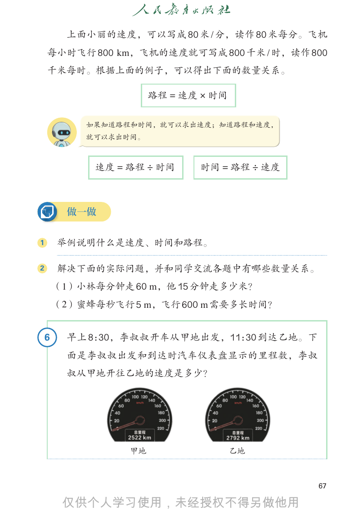

```text
         上面小丽的速度，可以写成 80 米 / 分，读作 80 米每分。飞机
    每小时飞行 800 km，飞机的速度就可写成 800 千米 / 时，读作 800
    千米每时。根据上面的例子，可以得出下面的数量关系。

                       路程 = 速度 × 时间

            如果知道路程和时间，就可以求出速度；知道路程和速度，
            就可以求出时间。

             速度 = 路程 ÷ 时间     时间 = 路程 ÷ 速度

         做一做

1       举例说明什么是速度、时间和路程。

2       解决下面的实际问题，并和同学交流各题中有哪些数量关系。
        （1）小林每分钟走 60 m，他 15 分钟走多少米？
        （2）蜜蜂每秒飞行 5 m，飞行 600 m 需要多长时间？

    6    早上 8：30，李叔叔开车从甲地出发，11：30 到达乙地。下
         面是李叔叔出发和到达时汽车仪表盘显示的里程数，李叔
         叔从甲地开往乙地的速度是多少？

                  甲地                  乙地

                                             67


```

## 教材第 68 页（PDF 第 73 页）

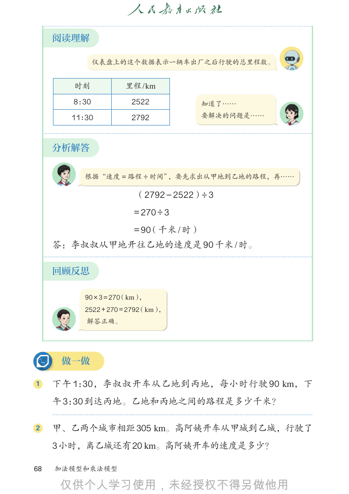

```text
     阅读理解

              仪表盘上的这个数据表示一辆车出厂之后行驶的总里程数。

       时刻            里程 /km
       8：30           2522            知道了……
       11：30          2792            要解决的问题是……

     分析解答

          根据“速度 = 路程 ÷ 时间”，要先求出从甲地到乙地的路程，再……

                        （2792 − 2522）÷ 3
                       = 270 ÷ 3
                       = 90（千米 / 时）
     答：李叔叔从甲地开往乙地的速度是 90 千米 / 时。

     回顾反思

          90 × 3 = 270（km），
          2522 + 270 = 2792（km），
          解答正确。

      做一做

1    下午 1：30，李叔叔开车从乙地到丙地，每小时行驶 90 km，下
     午 3：30 到达丙地。乙地和丙地之间的路程是多少千米？

2    甲、乙两个城市相距 305 km。高阿姨开车从甲城到乙城，行驶了
     3小时，离乙城还有20 km。高阿姨开车的速度是多少？

68   加法模型和乘法模型


```

## 教材第 69 页（PDF 第 74 页）

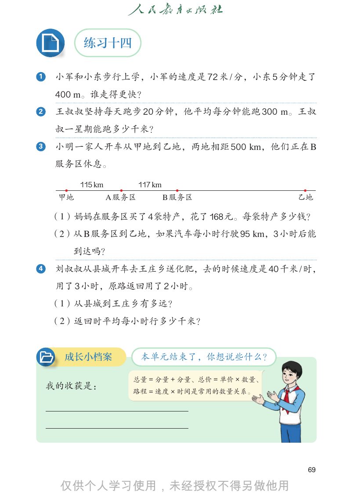

```text
          练习十四

1    小军和小东步行上学，小军的速度是 72 米 / 分，小东 5 分钟走了
     400 m。谁走得更快？
2    王叔叔坚持每天跑步 20 分钟，他平均每分钟能跑 300 m。王叔
     叔一星期能跑多少千米？
3    小明一家人开车从甲地到乙地，两地相距 500 km，他们正在 B
     服务区休息。

          115 km           117 km
     甲地            A 服务区            B 服务区           乙地

    （1）妈妈在服务区买了4袋特产，花了168元。每袋特产多少钱？
    （2）从 B 服务区到乙地，如果汽车每小时行驶95 km，3 小时后能
       到达吗？
4    刘叔叔从县城开车去王庄乡送化肥，去的时候速度是 40千米 / 时，
     用了3小时，原路返回用了2小时。
    （1）从县城到王庄乡有多远？
    （2）返回时平均每小时行多少千米？

      成长小档案                本单元结束了，你想说些什么？

                       总量 = 分量 + 分量、总价 = 单价 × 数量、
    我的收获是：
                       路程 = 速度 × 时间是常用的数量关系。

                                                     69


```

