# 人教版《数学》四年级上册 · 第五单元 平行四边形和梯形（教材第 70–87 页）

> 从 `docs/articles/textbook.md` 按页切出。版式、竖式和插图以页图为准（课程里是 `lessons/img/tNNN.png`）。版权归人民教育出版社，仅供个人学习使用。

## 教材第 70 页（PDF 第 75 页）

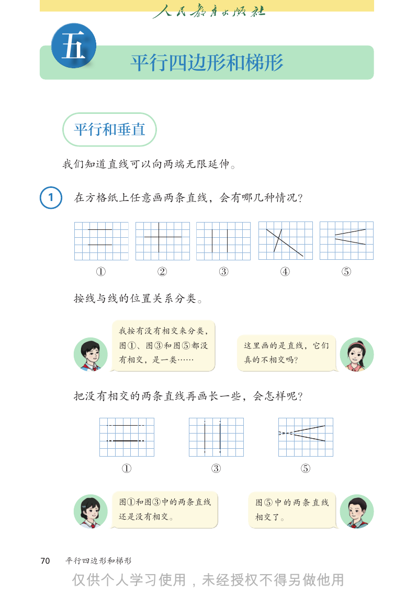

```text
     五        平行四边形和梯形

      平行和垂直

     我们知道直线可以向两端无限延伸。

 1    在方格纸上任意画两条直线，会有哪几种情况？
                        ①①                     ②②   ③

       ①①①       ②②②       ③③③      ④④         ⑤⑤
         ①       ②         ③         ④         ⑤

      按线与线的位置关系分类。

       ④④④       ⑤⑤⑤
             我按有没有相交来分类，
             图①、图③和图⑤都没          这里画的是直线，它们
             有相交，是一类……           真的不相交吗？

      把没有相交的两条直线再画长一些，会怎样呢？

             ①             ③               ⑤
             ①             ③             ⑤

             图①和图③中的两条直线          图⑤中的两条直线
             还是没有相交。              相交了。

70   平行四边形和梯形


```

## 教材第 71 页（PDF 第 76 页）

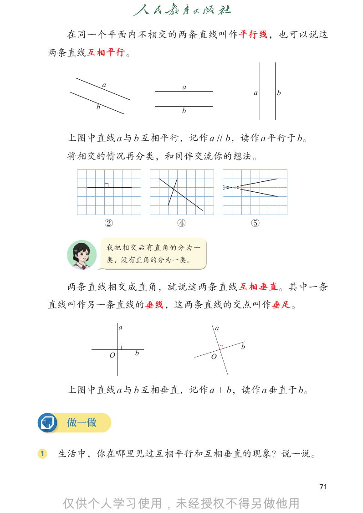

```text
                                                                  b
                                                                                  a

        在同一个平面内不相交的两条直线叫作 平行线，也可以说这
    两条直线互相平行。
                                                      a                           a                    a
                    a
                                             a a b                a
                                                                  b   a       a   b            a
                b                             b                               b
                                         b                        b                                b

        上图中直线 a 与 b 互相平行，记作 a // b，读作 a 平行于 b。
        将相交的情况再分类，和同伴交流你的想法。
                                                                              a
                                                                  b

                    ②
                    ②                        ④
                                             ④                    ⑤
                                                                  ⑤

                    我把相交后有直角的分为一
                    类，没有直角的分为一类。

        两条直线相交成直角，就说这两条直线 互相垂直。其中一条
    直线叫作另一条直线的垂线，这两条直线的交点叫作垂足。

        a                   a                             a               a
                                a             a
                                                              b                       b
    O       b           O           bO            O       O               O
                        b                b

        上图中直线 a 与 b 互相垂直，记作 a ⊥ b，读作 a 垂直于 b。

        做一做

1    生活中，你在哪里见过互相平行和互相垂直的现象？说一说。

                                                                                          71


```

## 教材第 72 页（PDF 第 77 页）

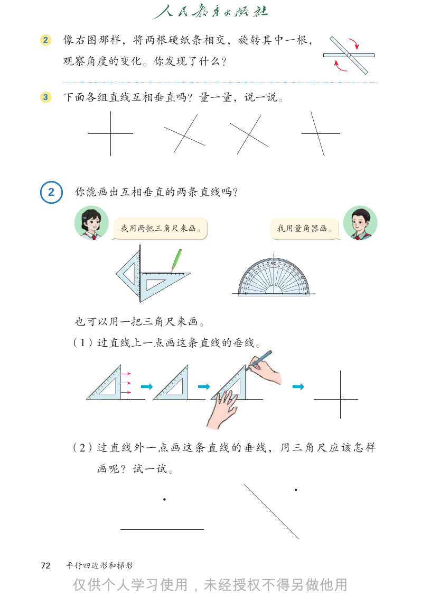

```text
2       像右图那样，将两根硬纸条相交，旋转其中一根，
        观察角度的变化。你发现了什么？

3       下面各组直线互相垂直吗？量一量，说一说。

    2    你能画出互相垂直的两条直线吗？

                                                我用两把三角尺来画。                                                                                                                                                                           我用量角器画。

                                                           0

                                                           1 cm 2

                                                           3

                                                           4

                                                           5
                                                                    0   1 cm 2      3    4        5   6       7   8       9   10
                                                           6

                                                           7

                                                           8

                                                           9

                                                           10

         也可以用一把三角尺来画。
        （1）过直线上一点画这条直线的垂线。

                                            10                                      10                                             10                                     10                      10                                     10
                                            9                                       9                                         9                                           9                       9                                      9
                                        8                                       8                                         8                                           8                       8                                      8
                                    7                                       7                                         7                                           7                       7                                      7
                                6                                       6                                         6                                           6                       6                                      6
                            5                                       5                                         5                                           5                       5                                      5
                        4                                      4                                          4                                           4                       4                                      4
                    3                                      3                                          3                                           3                       3                                      3
                2                                      2                                      2                                               2                       2                                      2
              1cm                                    1cm                                    1cm                                             1cm                   1cm m                                     m
                                                                                                                                                                                                           1cm

          0                                      0                                      0                                               0                     0                                        0

        （2）过直线外一点画这条直线的垂线，用三角尺应该怎样
                    画呢？试一试。

72      平行四边形和梯形


```

## 教材第 73 页（PDF 第 78 页）

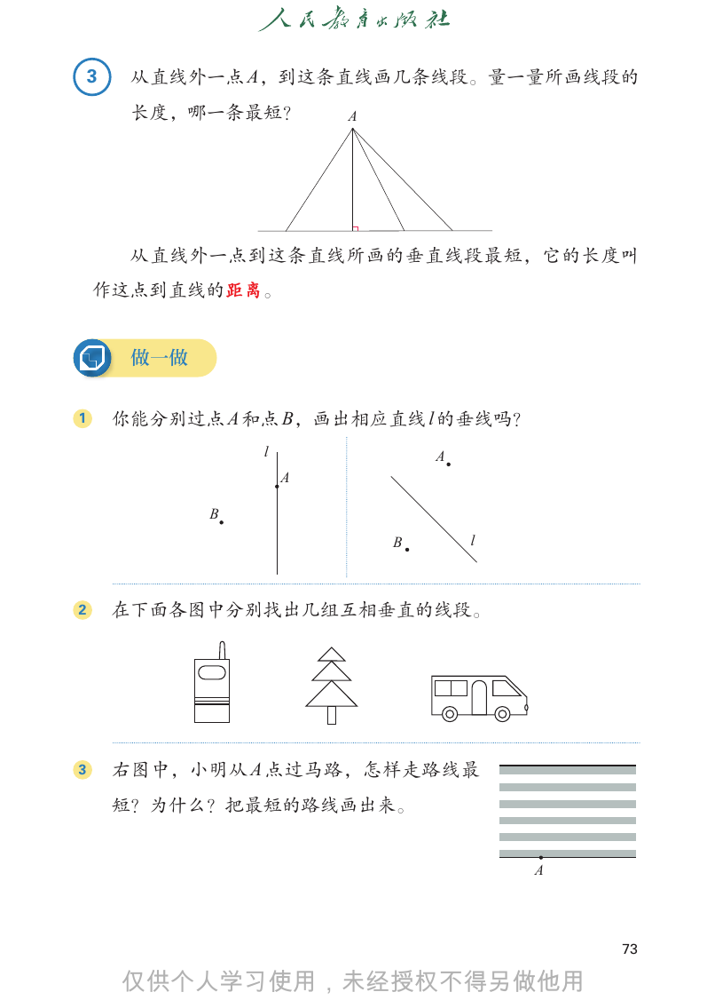

```text
    3    从直线外一点 A，到这条直线画几条线段。量一量所画线段的
         长度，哪一条最短？         A

         从直线外一点到这条直线所画的垂直线段最短，它的长度叫
    作这点到直线的距离。

         做一做

1       你能分别过点 A 和点 B，画出相应直线 l 的垂线吗？
                   l               A
                       A

               B
                               B       l

2       在下面各图中分别找出几组互相垂直的线段。

3       右图中，小明从 A 点过马路，怎样走路线最
        短？为什么？把最短的路线画出来。

                                           A

                                               73


```

## 教材第 74 页（PDF 第 79 页）

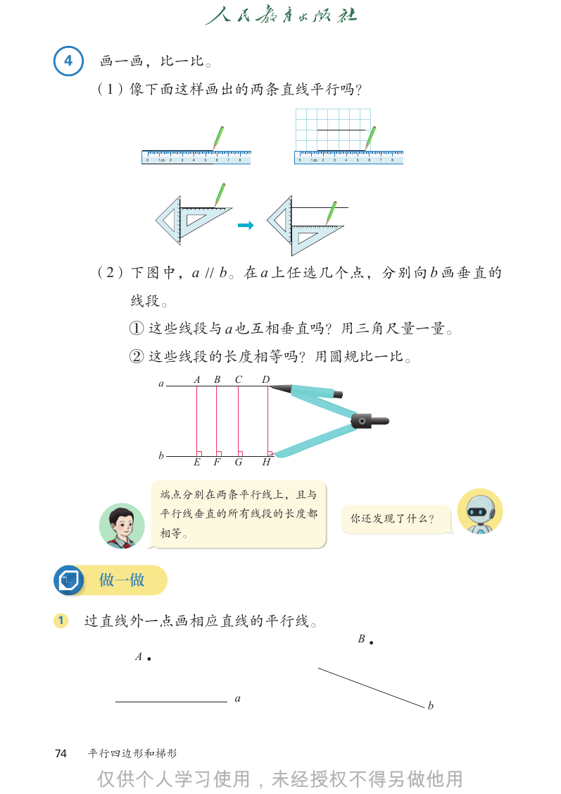

```text
    4    画一画，比一比。
        （1）像下面这样画出的两条直线平行吗？

                                                                                                                                          0

                                                                                                                                          1 cm0 20 1 cm
                                                                                                                                                      31 cm2 42 3 53 4 64 5 75 6 86 7 97 8108 9 9 10 10
                    0

                    1 cm0 20 1 cm
                                31 cm2 42 3 53 4 64 5 75 6 86 7 97 8108 9 9 10 10
                                                                                    0   1 cm 2   3   4   5   6   7   8   9   10

                                                                                    0   1 cm 2   3   4   5   6   7   8   9   10
                                                                                    0   1 cm 2   3   4   5   6   7   8   9   10                                                                           0   1 cm 2   3   4   5   6   7   8   9   10

                                                                                                                                                                                                          0   1 cm 2   3   4   5   6   7   8   9   10
                                                                                                                                                                                                          0   1 cm 2   3   4   5   6   7   8   9   10

        （2）下图中，a // b。在 a 上任选几个点，分别向 b 画垂直的
           线段。
           ① 这些线段与 a 也互相垂直吗？用三角尺量一量。
           ② 这些线段的长度相等吗？用圆规比一比。
                a                                                                                A                   B            C   D

                b
                                                                                                 E                   F            G   H

                端点分别在两条平行线上，且与
                平行线垂直的所有线段的长度都                                                                                                                                                                                                                          你还发现了什么？
                相等。

         做一做

1       过直线外一点画相应直线的平行线。
                                                                                                                                                                                                                                                        B
            A

                                                                                                                                  a
                                                                                                                                                                                                                                                              b

74      平行四边形和梯形


```

## 教材第 75 页（PDF 第 80 页）

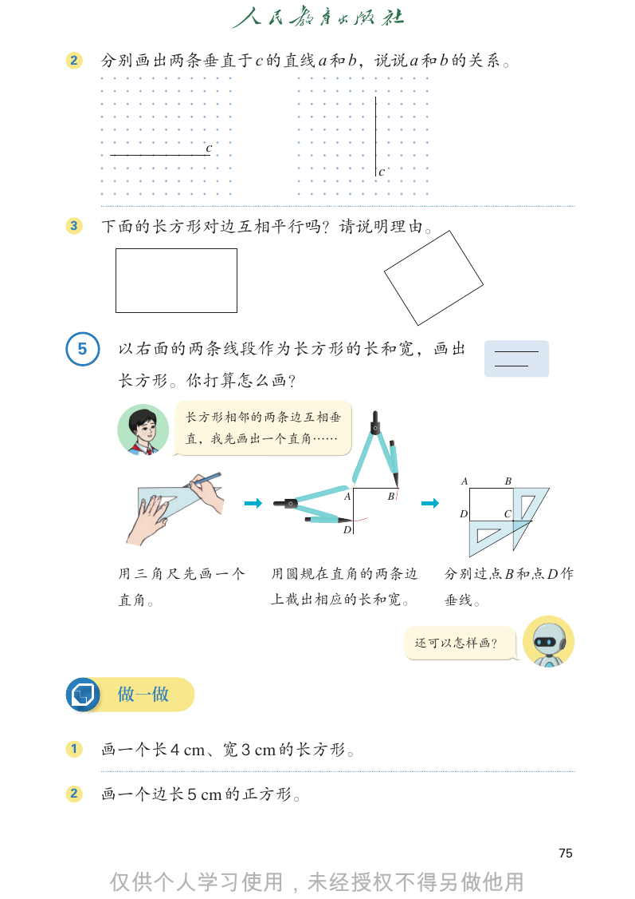

```text
2       分别画出两条垂直于 c 的直线 a 和 b，说说 a 和 b 的关系。

                c
                                  c

3       下面的长方形对边互相平行吗？请说明理由。

    5    以右面的两条线段作为长方形的长和宽，画出
         长方形。你打算怎么画？

               长方形相邻的两条边互相垂
               直，我先画出一个直角……

                                             A      B
                              A       B
                                             D      C
                              D

         用三角尺先画一个     用圆规在直角的两条边            分别过点 B 和点 D 作
         直角。          上截出相应的长和宽。            垂线。

                                          还可以怎样画？

         做一做

1       画一个长 4 cm、宽 3 cm 的长方形。

2       画一个边长 5 cm 的正方形。

                                                        75


```

## 教材第 76 页（PDF 第 81 页）

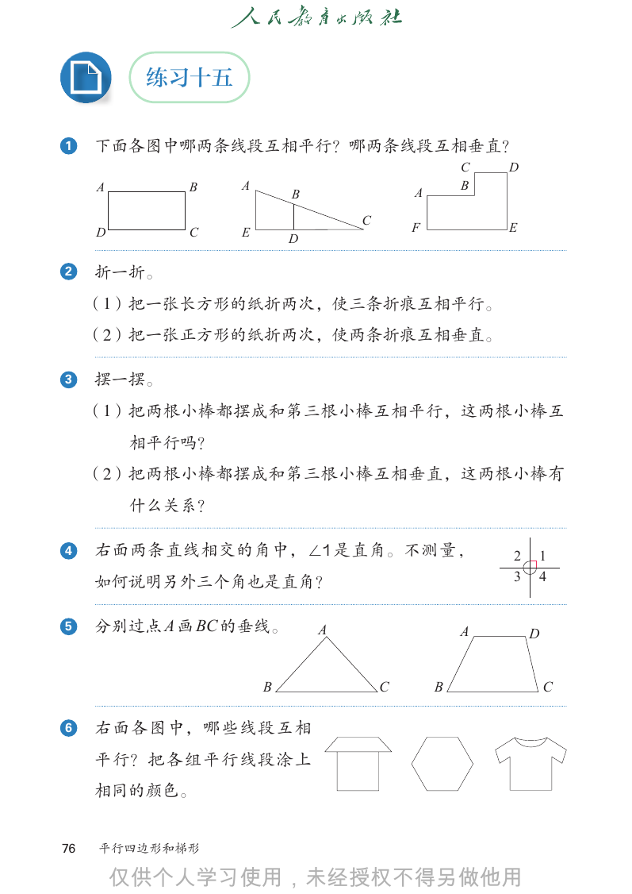

```text
          练习十五

1    下面各图中哪两条线段互相平行？哪两条线段互相垂直？
                                                     C           D
     A      B    A                                   B
                         B                   A

                                     C
     D      C    E                           F                   E
                         D

2    折一折。
     （1）把一张长方形的纸折两次，使三条折痕互相平行。
     （2）把一张正方形的纸折两次，使两条折痕互相垂直。

3    摆一摆。
     （1）把两根小棒都摆成和第三根小棒互相平行，这两根小棒互
         相平行吗？
     （2）把两根小棒都摆成和第三根小棒互相垂直，这两根小棒有
         什么关系？                                           2   1
                                                         3   4
4    右面两条直线相交的角中，∠1 是直角。不测量 ,                                    2   1
     如何说明另外三个角也是直角？                                              3   4

5    分别过点 A 画 BC 的垂线。            A                   A               D

                     B               A   C       B           A           C D

6    右面各图中，哪些线段互相
                             B               C           B                     C
     平行？把各组平行线段涂上
     相同的颜色。

76   平行四边形和梯形


```

## 教材第 77 页（PDF 第 82 页）

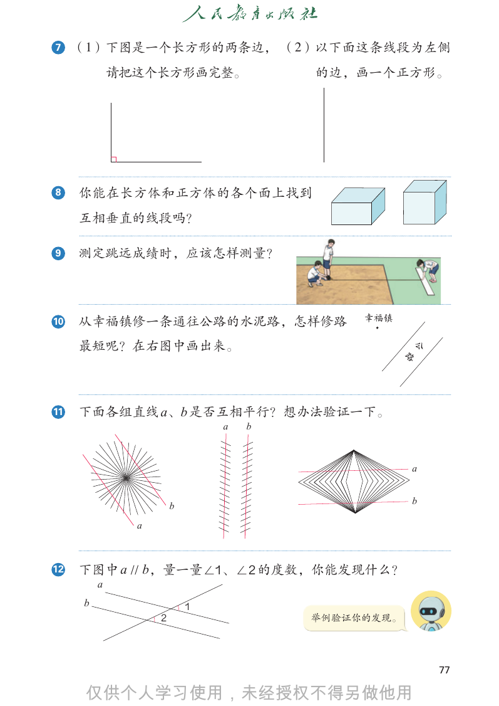

```text
7    （1）下图是一个长方形的两条边， （2）以下面这条线段为左侧
             请把这个长方形画完整。               的边，画一个正方形。

8    你能在长方体和正方体的各个面上找到
     互相垂直的线段吗？

9    测定跳远成绩时，应该怎样测量？

10   从幸福镇修一条通往公路的水泥路，怎样修路
     最短呢？在右图中画出来。

11   下面各组直线 a、b 是否互相平行？想办法验证一下。
                               a   b

                                                   a

                                                   b
                       b

               a

12   下图中 a // b，量一量∠1、∠2 的度数，你能发现什么？
         a
     b                     1
                   2                   举例验证你的发现。

                                                       77


```

## 教材第 78 页（PDF 第 83 页）

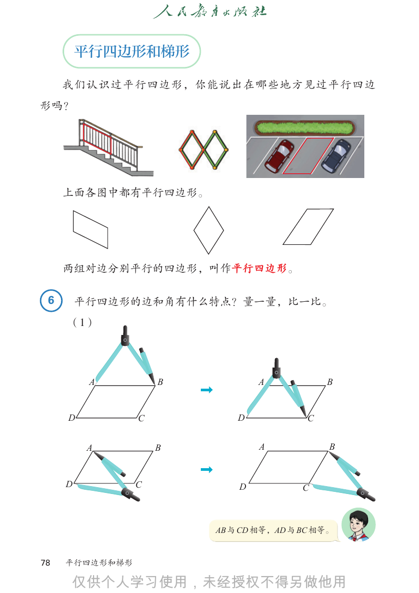

```text
         平行四边形和梯形

     我们认识过平行四边形，你能说出在哪些地方见过平行四边
形吗？

     上面各图中都有平行四边形。

     两组对边分别平行的四边形，叫作平行四边形。

 6       平行四边形的边和角有什么特点？量一量，比一比。
     （1）

          A            B              A              B
           A            B            A              B

     D          C                D            C          D
      D          C              D            C

          A            B             A              B
          A            B             A              B

     D             C            D           C            D
     D         C                D               C

                            AB 与 CD 相等，AD 与 BC 相等。

78   平行四边形和梯形


```

## 教材第 79 页（PDF 第 84 页）

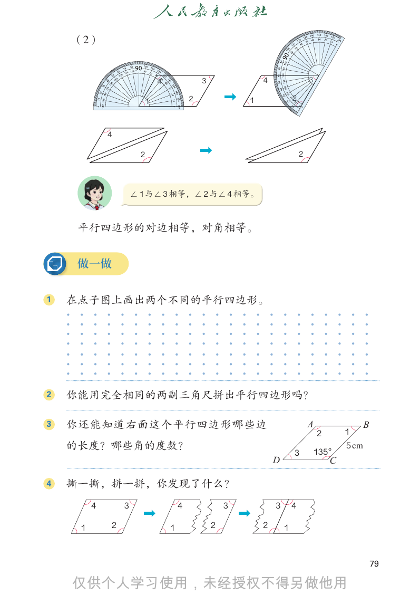

```text
    （2）
                              4                3                     4                       3

                           1 4             2   3                1 4              2           3

                          1                2                    1                2

             4

             4         2                                                             2

                      2                                                          2

                     ∠ 1 与∠ 3 相等，∠ 2 与∠ 4 相等。

     平行四边形的对边相等，对角相等。

     做一做

1   在点子图上画出两个不同的平行四边形。

2   你能用完全相同的两副三角尺拼出平行四边形吗？
                                                        A                    B
             1        2                                     2        1
3   你还能知道右面这个平行四边形哪些边  5 cm                                                              A                       B
          3     3 135°                     1        2                                            2       1
                                           D                    C
    的长度？哪些角的度数？                                                                                          5 cm
                                                    3                            3           135°
                                                                         D                           C

4   撕一撕，拼一拼，你发现了什么？
         4       3                     4            3                    3       4

     1       2                    14           32                   42       1           3                   3       4

                              1            2                    1                2                       2       1
                                                                                                                     79


```

## 教材第 80 页（PDF 第 85 页）

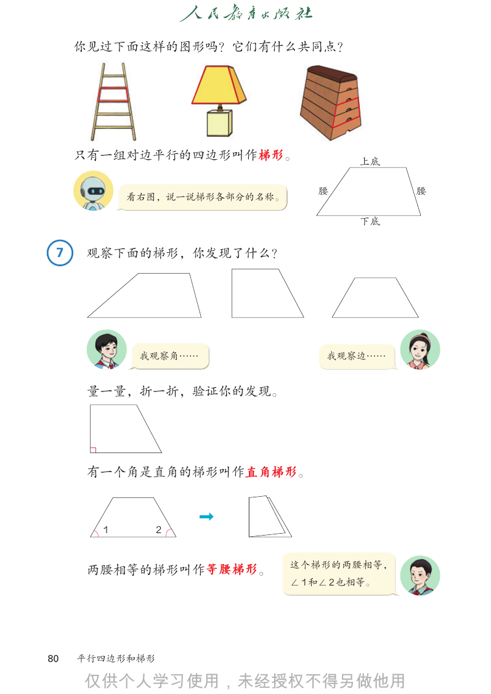

```text
     你见过下面这样的图形吗？它们有什么共同点？

     只有一组对边平行的四边形叫作梯形。                  上底

                                  腰           腰
           看右图，说一说梯形各部分的名称。

                                        下底

 7    观察下面的梯形，你发现了什么？

            我观察角……                 我观察边……

      量一量，折一折，验证你的发现。

      有一个角是直角的梯形叫作直角梯形。

       1        2

                              这个梯形的两腰相等，
      两腰相等的梯形叫作等腰梯形。
                              ∠ 1 和∠ 2 也相等。

80   平行四边形和梯形


```

## 教材第 81 页（PDF 第 86 页）

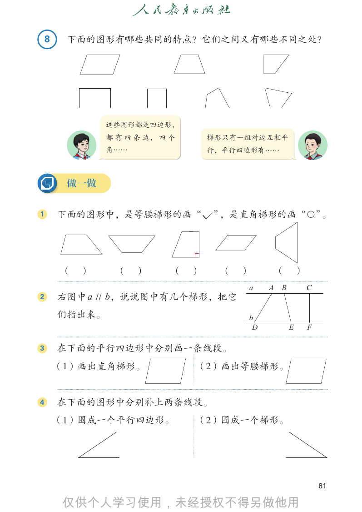

```text
    8    下面的图形有哪些共同的特点？它们之间又有哪些不同之处？

                这些图形都是四边形，
                都 有 四 条 边， 四 个     梯形只有一组对边互相平
                角……                行，平行四边形有……

         做一做

1       下面的图形中，是等腰梯形的画“            ”，是直角梯形的画“○”。

        （   ）     （   ）      （ ）    （   ）        （       ）
                                        a    A   B           C
2       右图中 a // b，说说图中有几个梯形，把它
        们指出来。                           b
                                         D           E       F

3       在下面的平行四边形中分别画一条线段。
        （1）画出直角梯形。               （2）画出等腰梯形。

4       在下面的图形中分别补上两条线段。
        （1）围成一个平行四边形。            （2）围成一个梯形。

                                                                 81


```

## 教材第 82 页（PDF 第 87 页）

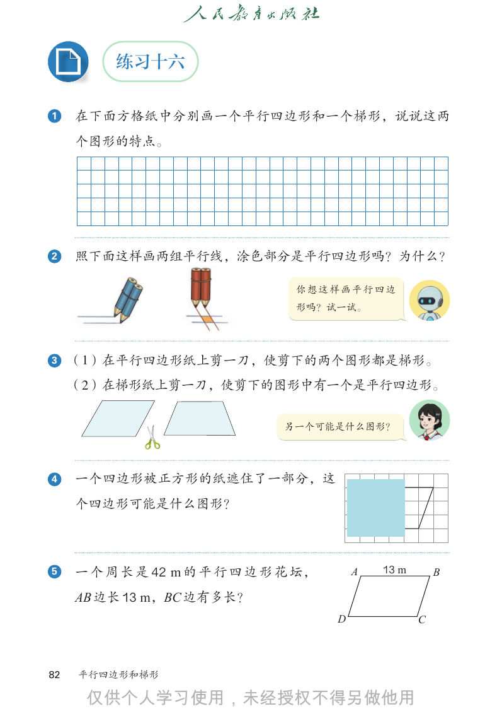

```text
          练习十六

1    在下面方格纸中分别画一个平行四边形和一个梯形，说说这两
     个图形的特点。

2    照下面这样画两组平行线，涂色部分是平行四边形吗？为什么？

                                 你想这样画平行四边
                                 形吗？试一试。

3    （1）在平行四边形纸上剪一刀，使剪下的两个图形都是梯形。
     （2）在梯形纸上剪一刀，使剪下的图形中有一个是平行四边形。

                               另一个可能是什么图形？

4    一个四边形被正方形的纸遮住了一部分，这
     个四边形可能是什么图形？

5    一 个 周 长 是 42 m 的 平 行 四 边 形 花 坛，       AA   13 m
                                                13 m        BB

     AB 边长 13 m，BC 边有多长？
                                       D
                                       D               CC

82   平行四边形和梯形


```

## 教材第 83 页（PDF 第 88 页）

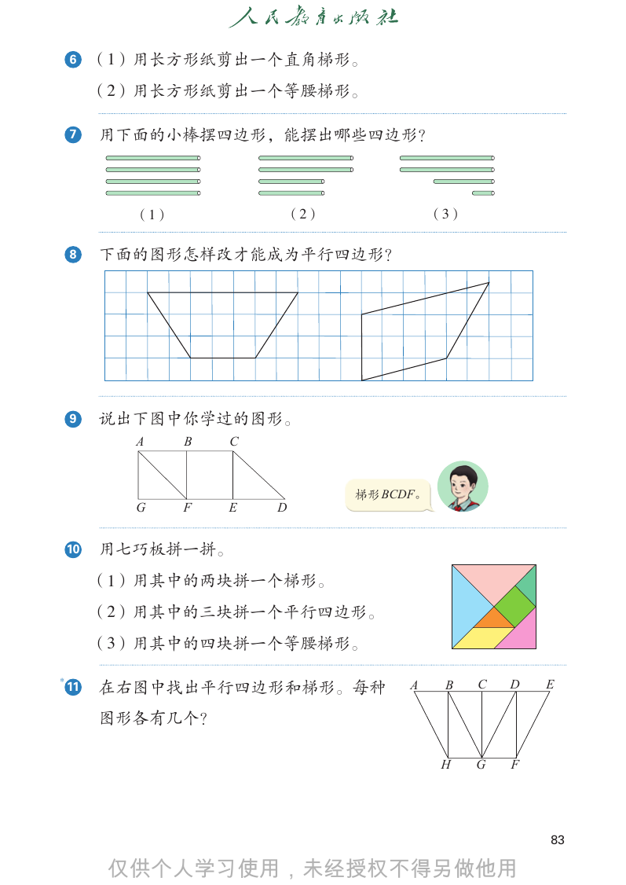

```text
    6    （1）用长方形纸剪出一个直角梯形。
         （2）用长方形纸剪出一个等腰梯形。

    7    用下面的小棒摆四边形，能摆出哪些四边形？

           （1）           （2）              （3）

    8    下面的图形怎样改才能成为平行四边形？

    9    说出下图中你学过的图形。
           A     B   C

                               梯形 BCDF。
           G     F   E   D

    10   用七巧板拼一拼。
         （1）用其中的两块拼一个梯形。
         （2）用其中的三块拼一个平行四边形。
         （3）用其中的四块拼一个等腰梯形。

*                                    A     B    C   D   E
    11   在右图中找出平行四边形和梯形。每种
         图形各有几个？

                                           H    G   F

                                                        83


```

## 教材第 84 页（PDF 第 89 页）

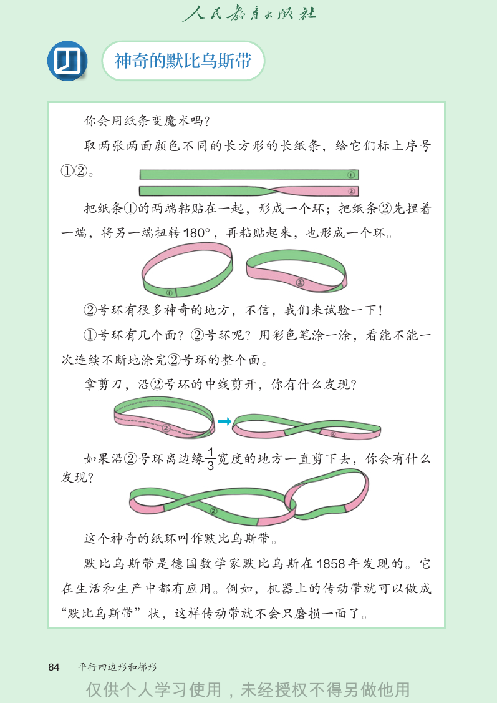

```text
           神奇的默比乌斯带

      你会用纸条变魔术吗？
      取两张两面颜色不同的长方形的长纸条，给它们标上序号
     ①②。

      把纸条①的两端粘贴在一起，形成一个环；把纸条②先捏着
     一端，将另一端扭转 180°，再粘贴起来，也形成一个环。

      ②号环有很多神奇的地方，不信，我们来试验一下！
      ①号环有几个面？②号环呢？用彩色笔涂一涂，看能不能一
     次连续不断地涂完②号环的整个面。
      拿剪刀，沿②号环的中线剪开，你有什么发现？

       如果沿②号环离边缘 1 宽度的地方一直剪下去，你会有什么
                 3
     发现？

      这个神奇的纸环叫作默比乌斯带。
      默比乌斯带是德国数学家默比乌斯在 1858 年发现的。它
     在生活和生产中都有应用。例如，机器上的传动带就可以做成
 “默比乌斯带”状，这样传动带就不会只磨损一面了。

84    平行四边形和梯形


```

## 教材第 85 页（PDF 第 90 页）

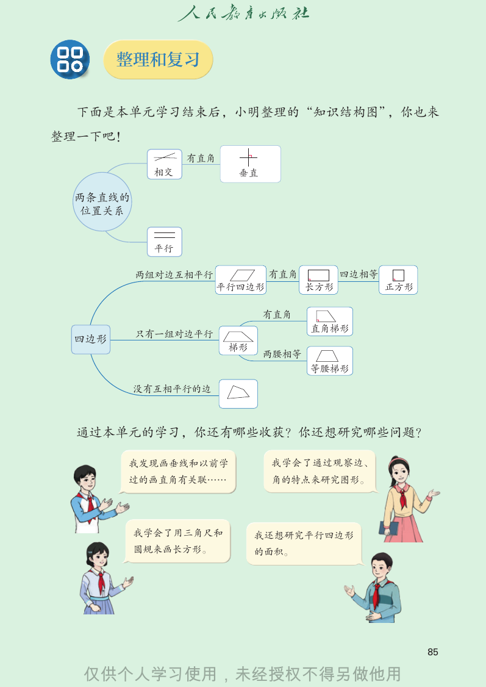

```text
       整理和复习

  下面是本单元学习结束后，小明整理的“知识结构图”，你也来
整理一下吧！
                దᄰᝈ
           ᄱ̔           ‫ۇ‬ᄰ

 ː౎ᄰጳᄊ
  ͯᎶТጇ

           ࣱᛡ

         两组对边互相平行             有直角         四边相等
                      平行四边形         长方形          正方形

                             有直角
                                    直角梯形
         只有一组对边平行
 四边形
                       梯形
                             两腰相等
                                    等腰梯形

         没有互相平行的边

  通过本单元的学习，你还有哪些收获？你还想研究哪些问题？

         我发现画垂线和以前学           我学会了通过观察边、
         过的画直角有关联……           角的特点来研究图形。

         我学会了用三角尺和          我还想研究平行四边形
         圆规来画长方形。           的面积。

                                                       85


```

## 教材第 86 页（PDF 第 91 页）

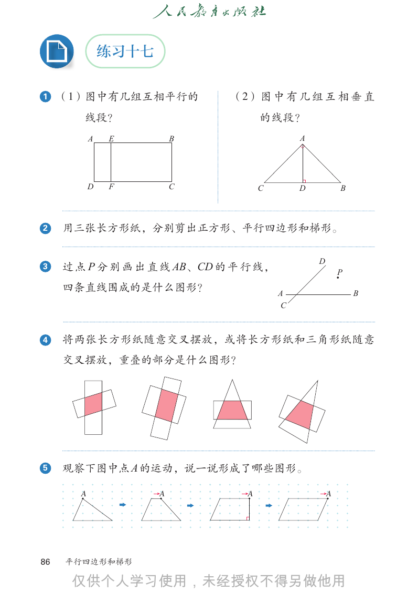

```text
               练习十七

1    （1）图中有几组互相平行的            （2） 图 中 有 几 组 互 相 垂 直
        线段？                         的线段？
           A   E          B                  A

           D   F          C         C        D           B

2    用三张长方形纸，分别剪出正方形、平行四边形和梯形。

                                                 D
3    过 点 P 分 别 画 出 直 线 AB、CD 的 平 行 线，                    P
     四条直线围成的是什么图形？                      A                    B
                                         C

4    将两张长方形纸随意交叉摆放，或将长方形纸和三角形纸随意
     交叉摆放，重叠的部分是什么图形？

5    观察下图中点 A 的运动，说一说形成了哪些图形。

       A              A         A                    A

86   平行四边形和梯形


```

## 教材第 87 页（PDF 第 92 页）

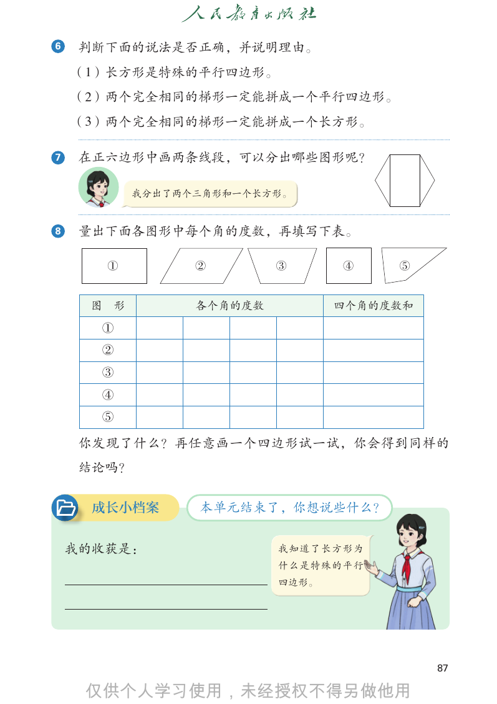

```text
6    判断下面的说法是否正确，并说明理由。
    （1）长方形是特殊的平行四边形。
    （2）两个完全相同的梯形一定能拼成一个平行四边形。
    （3）两个完全相同的梯形一定能拼成一个长方形。

7    在正六边形中画两条线段，可以分出哪些图形呢？

             我分出了两个三角形和一个长方形。

8    量出下面各图形中每个角的度数，再填写下表。

         ①         ②        ③      ④    ⑤

     图   形         各个角的度数          四个角的度数和
         ①
         ②
         ③
         ④
         ⑤

     你发现了什么？再任意画一个四边形试一试，你会得到同样的
     结论吗？

      成长小档案        本单元结束了，你想说些什么？

    我的收获是：                  我知道了长方形为
                            什么是特殊的平行
                            四边形。

                                             87


```

