# 人教版《数学》四年级上册 · 第六单元 条形统计图（教材第 88–101 页）

> 从 `docs/articles/textbook.md` 按页切出。版式、竖式和插图以页图为准（课程里是 `lessons/img/tNNN.png`）。版权归人民教育出版社，仅供个人学习使用。

## 教材第 88 页（PDF 第 93 页）

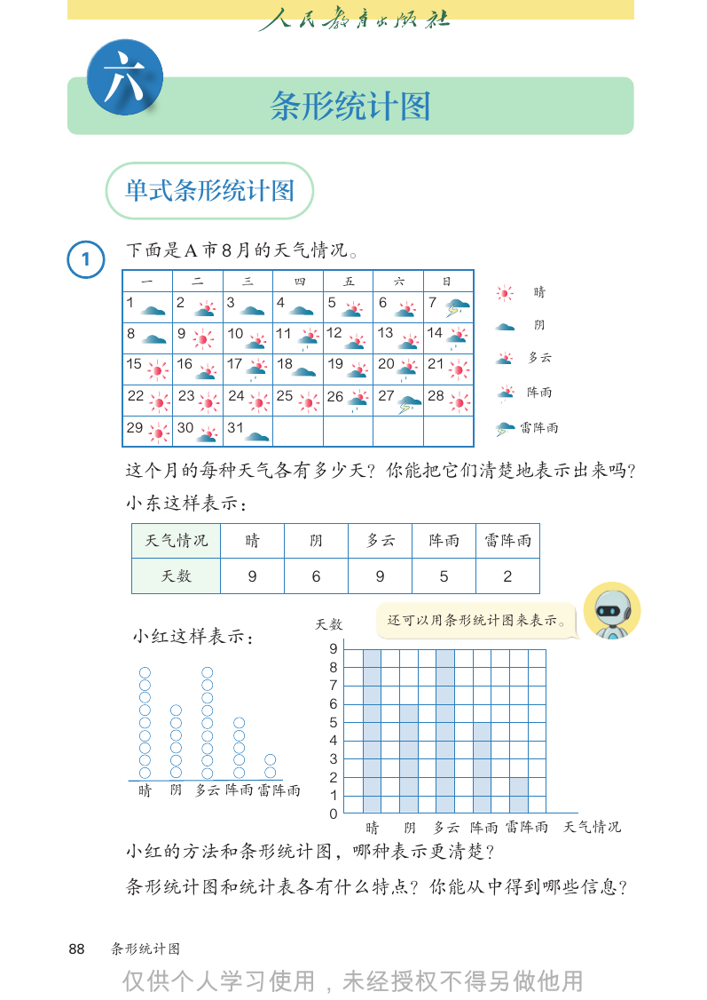

```text
     六                          条形统计图

      单式条形统计图
                                                                        一           二       三        四        五       六
                                                                    1           2       3       4        5        6
 1    下面是 A 市 8 月的天气情况。
                                                                    8           9       10      11       12       13
          一        二       三         四       一五    二 六 三      日四     15五                                 19       20
                                                                                16六晴 17日 18
      1        2       3        4        15       2 一 6 3 二7 4 三 5 四            6 五 7 六      日
                                                                     22         23   24   25             26       27
                                                   1       2     3    4          5阴   6    7
      8        9       10       11一      812
                                           二      9 三13 10四 1411 五 12六          13日  14
                                                                     29         30
                                                                                 12五 31
                                                                                      13六  14
                                1        2        38一 17 49二 18510   611四       7
                                                                                20
                                                                     19          多云 21
                                                                   三                        日
                                         15       16
      15      16       17       18           19   115 20 216 21317   418        519  620  721
                                8        9        10     11    12    13         14
                                         22       23     24    25    26         27   28
                                                  8       9    10    11         12
                                                                                 阵雨 13    14
      22       23      24       25
                                15       1626
                                         29
                                                   2227 1823 2819
                                                  17
                                                  30     31
                                                                 24   25
                                                                     20          26
                                                                                21    27   28
                                                  15     16    17    18         19      20      21
                                22       23        29
                                                  24     2530  2631  27         28
      29       30      31                                                       雷阵雨
                                                  22      23    24   25         26      27      28
                                29       30       31
                                                  29     30    31
      这个月的每种天气各有多少天？你能把它们清楚地表示出来吗？
      小东这样表示：
           天气情况             晴            阴        多云        阵雨       雷阵雨

              天数            9            6          9         5             2

                                         天数             还可以用条形统计图来表示。
      小红这样表示：
                                             9
                                             8
                                             7
                                             6
                                             5
                                             4
                                             3
                                             2
          晴   阴 多云 阵雨 雷阵雨                    1
                                             0
                                                  晴      阴 多云 阵雨 雷阵雨 天气情况
      小红的方法和条形统计图，哪种表示更清楚？
      条形统计图和统计表各有什么特点？你能从中得到哪些信息？

88   条形统计图


```

## 教材第 89 页（PDF 第 94 页）

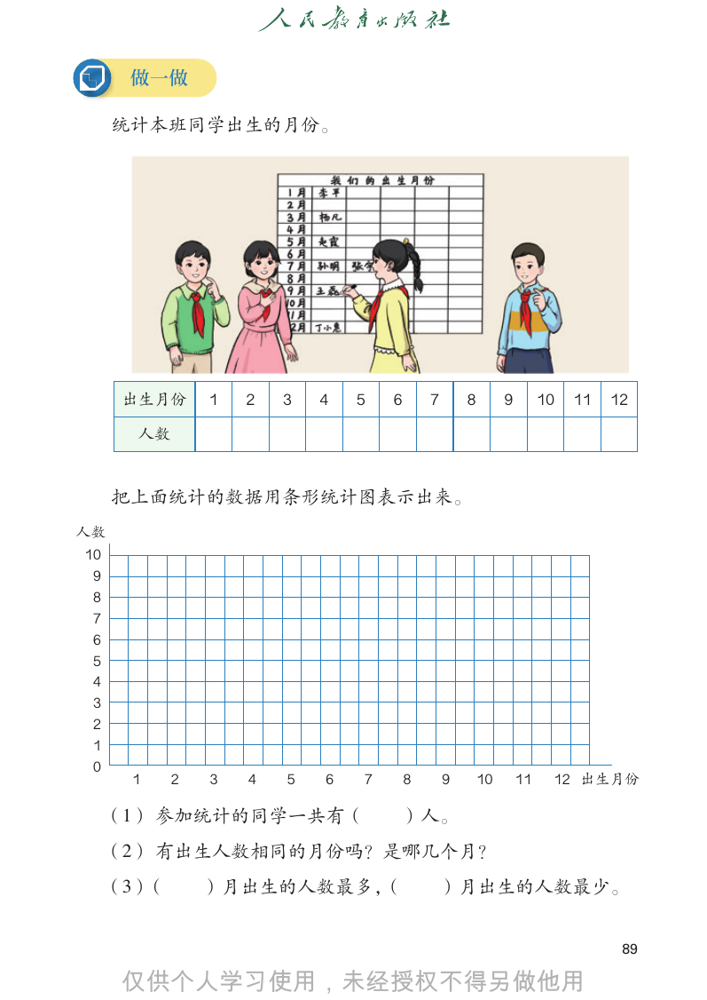

```text
      做一做

     统计本班同学出生的月份。

      出生月份      1   2   3   4   5   6       7       8        9        10   11   12

       人数

     把上面统计的数据用条形统计图表示出来。
人数
10
 9
 8
 7
 6
 5
 4
 3
 2
 1
 0
      1     2   3   4   5   6   7       8       9       10       11    12 出生月份

     （1） 参加统计的同学一共有（                ）人。
     （2） 有出生人数相同的月份吗？是哪几个月？
     （3）（       ）月出生的人数最多，（                     ）月出生的人数最少。

                                                                                 89


```

## 教材第 90 页（PDF 第 95 页）

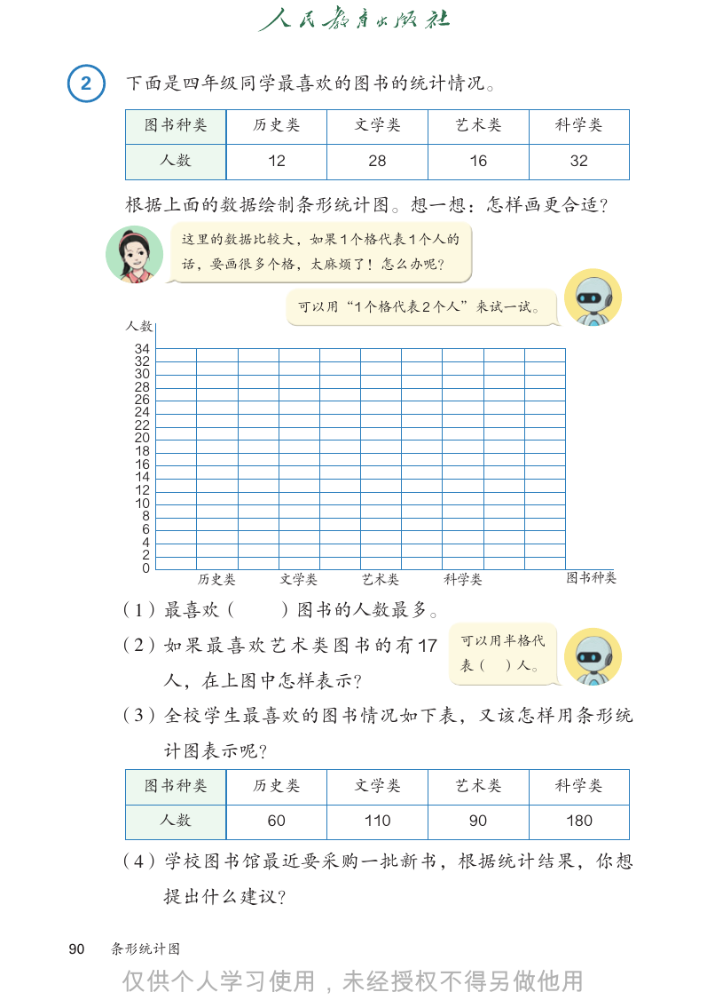

```text
 2    下面是四年级同学最喜欢的图书的统计情况。

       图书种类           历史类      文学类      艺术类         科学类

           人数         12         28      16         32

      根据上面的数据绘制条形统计图。想一想：怎样画更合适？
             这里的数据比较大，如果 1 个格代表 1 个人的
             话，要画很多个格，太麻烦了！怎么办呢？

                           可以用“1 个格代表 2 个人”来试一试。
      人数
      34
      32
      30
      28
      26
      24
      22
      20
      18
      16
      14
      12
      10
       8
       6
       4
       2
       0
                历史类    文学类      艺术类    科学类          图书种类

     （1）最喜欢（           ）图书的人数最多。
     （2）如 果 最 喜 欢 艺 术 类 图 书 的 有 17      可以用半格代
                                        表（    ）人。
           人，在上图中怎样表示？
     （3）全校学生最喜欢的图书情况如下表，又该怎样用条形统
           计图表示呢？
       图书种类           历史类      文学类      艺术类         科学类

           人数         60        110      90         180

     （4）学校图书馆最近要采购一批新书，根据统计结果，你想
           提出什么建议？

90   条形统计图


```

## 教材第 91 页（PDF 第 96 页）

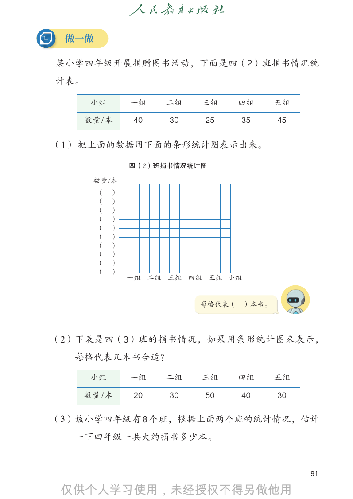

```text
 做一做

某小学四年级开展捐赠图书活动，下面是四（2）班捐书情况统
计表。

       小组       一组    二组   三组      四组      五组

      数量 / 本     40   30   25      35      45

（1） 把上面的数据用下面的条形统计图表示出来。

                四（2）班捐书情况统计图

       数量/本
        （   ）
        （   ）
        （   ）
        （   ）
        （   ）
        （   ）
        （   ）
        （   ）
        （   ）
        （   ）
                一组 二组 三组 四组 五组 小组

                           每格代表（    ）本书。

（2）下表是四（3）班的捐书情况，如果用条形统计图来表示，
  每格代表几本书合适？

       小组       一组    二组   三组      四组      五组

      数量 / 本     20   30   50      40      30

（3）该小学四年级有 8 个班，根据上面两个班的统计情况，估计
  一下四年级一共大约捐书多少本。

                                                91


```

## 教材第 92 页（PDF 第 97 页）

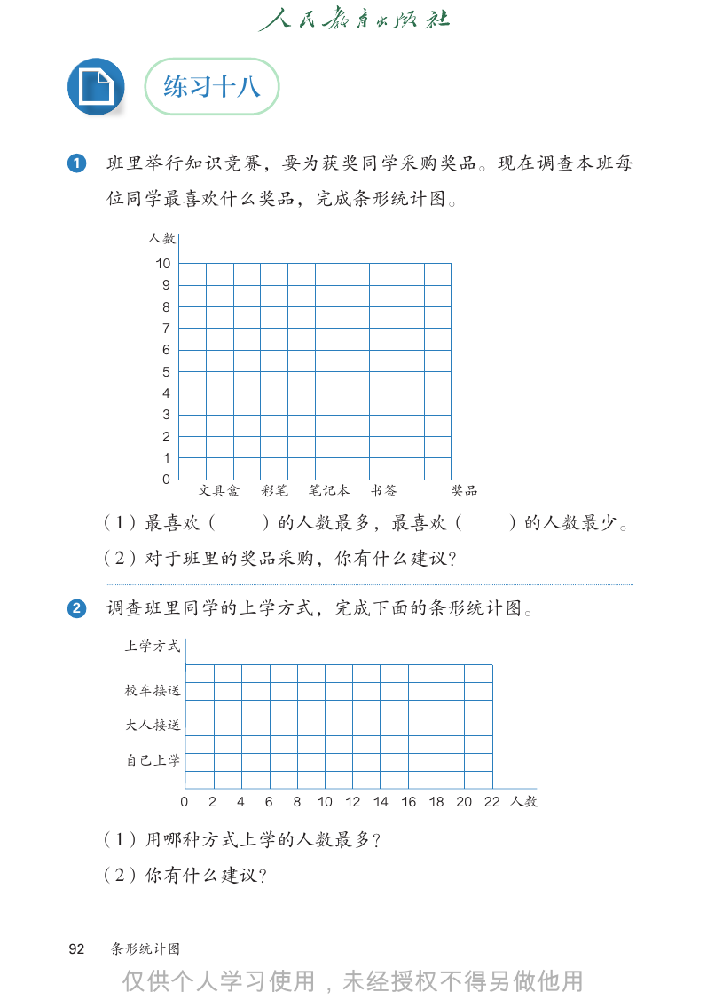

```text
         练习十八

1    班里举行知识竞赛，要为获奖同学采购奖品。现在调查本班每
     位同学最喜欢什么奖品，完成条形统计图。

       人数
        10
        9
        8
        7
        6
        5
        4
        3
        2
        1
        0
                 文具盒     彩笔       笔记本   书签     奖品

     （1）最喜欢（             ）的人数最多，最喜欢（                 ）的人数最少。
     （2）对于班里的奖品采购，你有什么建议？

2    调查班里同学的上学方式，完成下面的条形统计图。
      上学方式

      校车接送

      大人接送

      自己上学

             0   2   4   6    8   10 12 14 16 18 20 22 人数

     （1）用哪种方式上学的人数最多？
     （2）你有什么建议？

92   条形统计图


```

## 教材第 93 页（PDF 第 98 页）

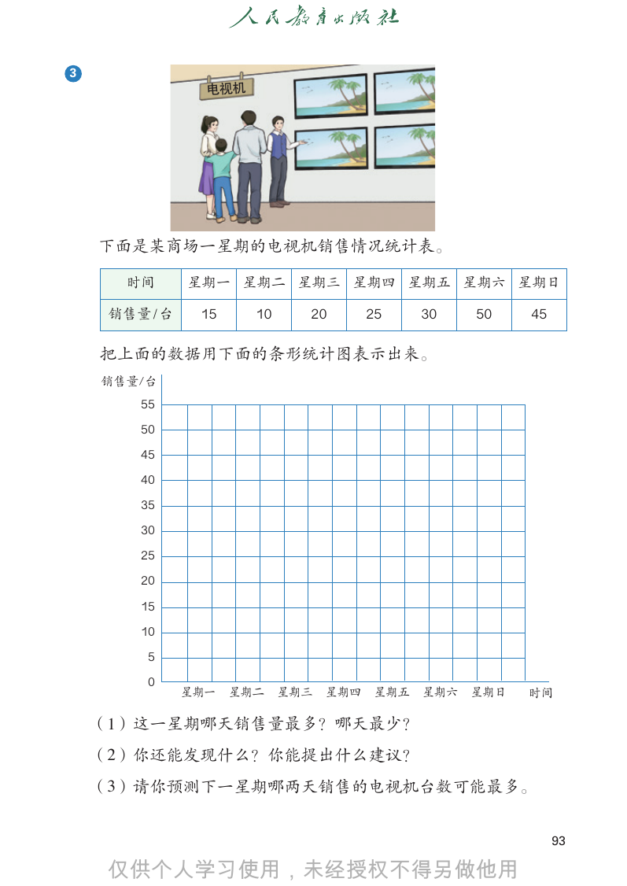

```text
3
                 电视机

    下面是某商场一星期的电视机销售情况统计表。

      时间       星期一 星期二 星期三 星期四 星期五 星期六 星期日

     销售量 / 台    15     10   20   25   30   50   45

    把上面的数据用下面的条形统计图表示出来。
    销售量/台
        55

        50

        45

        40

        35

        30

        25

        20

        15

        10

         5

         0
               星期一   星期二 星期三 星期四 星期五 星期六 星期日    时间

    （1）这一星期哪天销售量最多？哪天最少？
    （2）你还能发现什么？你能提出什么建议？
    （3）请你预测下一星期哪两天销售的电视机台数可能最多。

                                                     93


```

## 教材第 94 页（PDF 第 99 页）

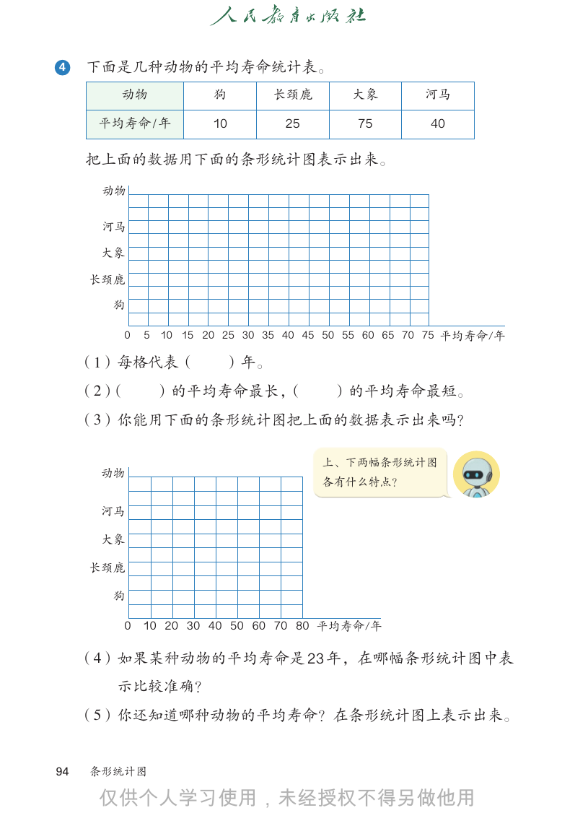

```text
4    下面是几种动物的平均寿命统计表。
        动物           狗       长颈鹿        大象        河马

      平均寿命 / 年       10        25        75        40

     把上面的数据用下面的条形统计图表示出来。
       动物

       河马

      大象

     长颈鹿

        狗

        0   5 10 15 20 25 30 35 40 45 50 55 60 65 70 75 平均寿命/年

     （1）每格代表（          ）年。
     （2）（    ）的平均寿命最长，（               ）的平均寿命最短。
     （3）你能用下面的条形统计图把上面的数据表示出来吗？

                                    上、下两幅条形统计图
      动物
                                    各有什么特点？

      河马

      大象

     长颈鹿

        狗

        0 10 20 30 40 50 60 70 80 平均寿命/年

     （4）如果某种动物的平均寿命是 23 年，在哪幅条形统计图中表
        示比较准确？
     （5）你还知道哪种动物的平均寿命？在条形统计图上表示出来。

94   条形统计图


```

## 教材第 95 页（PDF 第 100 页）

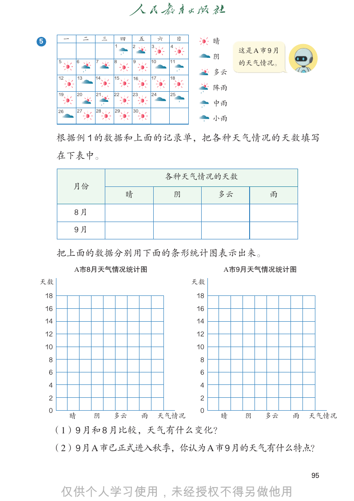

```text
                                                             一               二             三        四        五        六        日
                                                                                               1        2        3        4
                                  一             二              三             一
                                                                             四             二
                                                                                           五        三
                                                                                                    六        四
                                                                                                             日        五        六        日
                                                         5             61             72       83       91
                                                                                                         4       2
                                                                                                                 10        3
                                                                                                                          11       4
5           一        二        三            四             五              六             日                 晴
                                      1             2              3             4
                                                                                                                      18A 市 9 月
                                                                         5            69        7       8         9   10    11
                              5            6              7
                                                         12             8
                                                                        13            14       10
                                                                                               15       11
                                                                                                        16       17 这是
                                                一9             二10           三11           四         五
                                                                                                       阴六             日
       5        6        7            8                                                                               的天气情况。
                              12           13            14             12
                                                                        15            13
                                                                                      16
                                                                                       1       14
                                                                                               17       15
                                                                                                        18       16
                                                                                                                 24       17
                                                                                                                          25       18
                                                         19             20            21        2
                                                                                               22        3
                                                                                                        23        4
                                                                                                        多云
       12       13       14           15            16           17              18
                              19           5
                                           20             6
                                                          21            19
                                                                         7
                                                                        22            20
                                                                                       8
                                                                                      23       21
                                                                                               24
                                                                                                9       22
                                                                                                        25
                                                                                                        10       23
                                                                                                                 11       24       25
                                                         26             27            28       29       30
                                                                                                        阵雨
       19       20       21           22         23                24            25
                              26           12
                                           27            13
                                                         28             26
                                                                        14
                                                                        29            27
                                                                                      15
                                                                                      30        28
                                                                                                16      29
                                                                                                        17       30
                                                                                                                 18
                                                                                                        中雨
       26       27       28           29            30
                                           19            20             21            22        23      24       25
                                                                                                        小雨
                                           26            27             28             29       30
       根据例 1 的数据和上面的记录单，把各种天气情况的天数填写
       在下表中。

                                                                             各种天气情况的天数
                月份
                                               晴                                     阴                       多云                    雨

                8月

                9月

       把上面的数据分别用下面的条形统计图表示出来。
            A市8月天气情况统计图                                                                                     A市9月天气情况统计图
              A市8月天气情况统计图                                                                                     A市9月天气情况统计图
天数                                                                                             天数
  天数                                                                                             天数
 18                                                                                             18
 16 18                                                                                          16 18
    14 16                                                                                       14 16
    12 14                                                                                       12 14
    10 12                                                                                       10 12
     8 10                                                                                        8 10
     6 8                                                                                            6 8
     4 6                                                                                            4 6
     2 4                                                                                            2 4
     0 2                                                                                            0 2
            晴            阴      多云  雨 天气情况                                                                   晴            阴     多云  雨 天气情况
       0                                                                                                0
                晴             阴  多云  雨 天气情况                                                                      晴            阴  多云  雨 天气情况
     （1）9 月和 8 月比较，天气有什么变化？
     （2）9月A市已正式进入秋季，你认为A市9月的天气有什么特点？

                                                                                                                                            95


```

## 教材第 96 页（PDF 第 101 页）

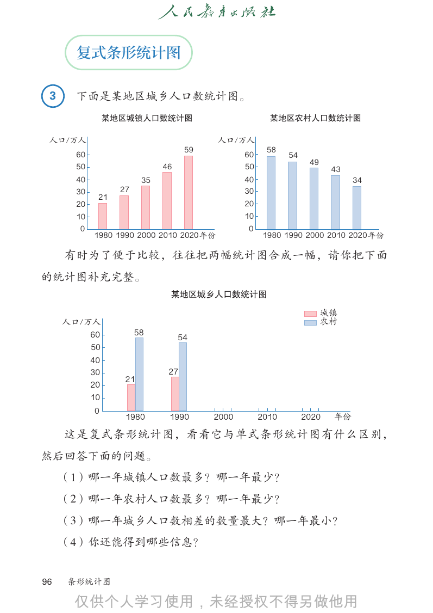

```text
       复式条形统计图

 3     下面是某地区城乡人口数统计图。
                某地区城镇人口数统计图                                 某地区农村人口数统计图

 人口/万人                                        人口/万人
                                    59                     58
       60                                            60          54
                                                                       49
       50                     46                     50                      43
       40                35                          40                           34
       30          27                                30
             21
       20                                            20
       10                                            10
        0                                            0
            1980 1990 2000 2010 2020 年份                    1980 1990 2000 2010 2020 年份

     有时为了便于比较，往往把两幅统计图合成一幅，请你把下面
的统计图补充完整。
                               ᴅ౥࡯ഃΖϯघ᪥㐔䃖ళ

                                                                            ۪᪢
     ̩Ը˂̩                                                                  т౏
         60             58
                                   54
         50
         40
         30                    27
                    21
         20
         10
            0
                    1980       1990           2000        2010        2020   ࣺ͓

     这是复式条形统计图，看看它与单式条形统计图有什么区别，
然后回答下面的问题。
     （1）哪一年城镇人口数最多？哪一年最少？
              ᴅ౥࡯ഃΖϯघ᪥㐔䃖ళ

     （2） ࣺ͓
        哪一年农村人口数最多？哪一年最少？
                            ۪᪢
        2020                т౏
     （3）哪一年城乡人口数相差的数量最大？哪一年最小？
        2010
     （4）你还能得到哪些信息？
            2000

96   条形统计图                                                       54
        1990
                                         27

                     58

```

## 教材第 97 页（PDF 第 102 页）

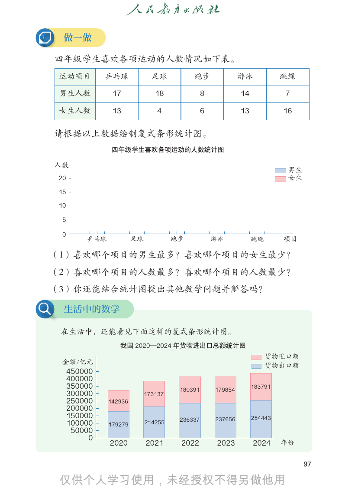

```text
 做一做

四年级学生喜欢各项运动的人数情况如下表。
 运动项目         乒乓球              足球          跑步                游泳            跳绳

 男生人数           17              18              8            14            7

 女生人数           13               4              6            13            16

请根据以上数据绘制复式条形统计图。
                ‫ुڥ‬ᑌࠧᅱ‫ظ‬෥՚ᴮ᩸ҹል̜ఌᒁᣁ‫ڶ‬

ϧ᪝
                                                                            ⩤⩌
20                                                                          ຠ⩌
15

10

 5

 0
         Ϳ΀⤰            䋠⤰            䋾ₒ            ⍥∠            䌠㐠       䶦Ⱋ

（1）喜欢哪个项目的男生最多？喜欢哪个项目的女生最少？
（2）喜欢哪个项目的人数最多？喜欢哪个项目的人数最少？
（3）你还能结合统计图提出其他数学问题并解答吗？

 生活中的数学

 在生活中，还能看见下面这样的复式条形统计图。
                        —2024౎ऋ࿿৊‫؜‬੨ጺ‫ܮ‬ཥऺ཮
                 我国 2020—2024
                 ࿢ࡔ2020       年货物进出口总额统计图
                                                                       䉔➖䔈ऐ䷊
 䛾䷊Ϭٰ                                                                 䉔➖‫ܧ‬ऐ䷊
     450000
     400000
     350000                            180391       179854
                                                                  183791
     300000                  173137
     250000    142936
     200000
     150000                            236337       237656        254443
     100000    179279        214255
      50000
          0
               2020          2021      2022          2023         2024     ᎡЪ

                                                                                 97


```

## 教材第 98 页（PDF 第 103 页）

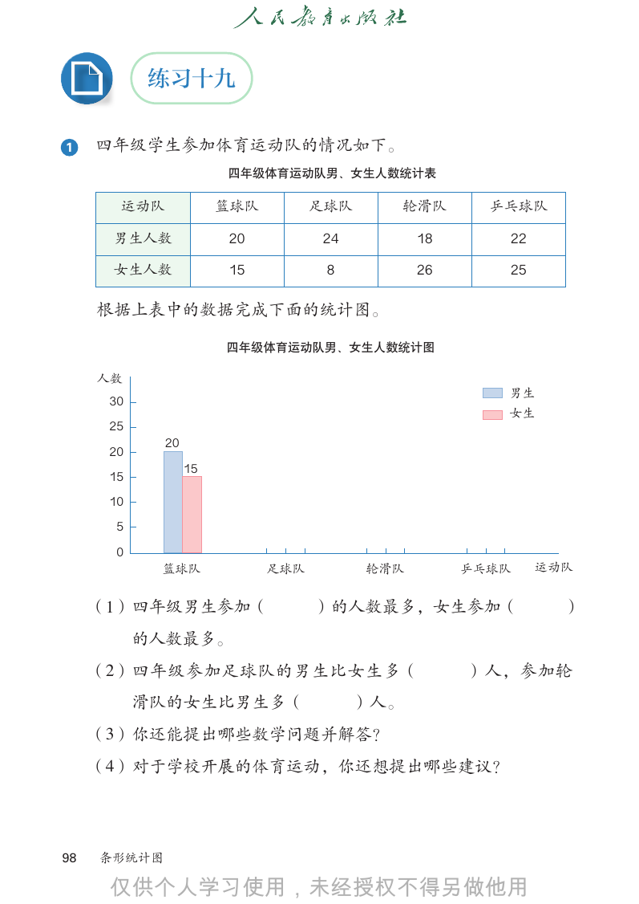

```text
           练习十九

1    四年级学生参加体育运动队的情况如下。
                       四年级体育运动队男、女生人数统计表

       运动队             篮球队         足球队     轮滑队        乒乓球队

      男生人数             20          24          18      22

      女生人数             15           8          26      25

     根据上表中的数据完成下面的统计图。

                       四年级体育运动队男、女生人数统计图

     人数
                                                       男生
      30
                                                       女生
      25
             20
      20
                  15
      15
      10
       5
       0
            篮球队              足球队         轮滑队        乒乓球队    运动队

     （1）四年级男生参加（                   ）的人数最多，女生参加（               ）
           的人数最多。
     （2）四年级参加足球队的男生比女生多（                            ）人，参加轮
           滑队的女生比男生多（                   ）人。
     （3）你还能提出哪些数学问题并解答？
     （4）对于学校开展的体育运动，你还想提出哪些建议？

98   条形统计图


```

## 教材第 99 页（PDF 第 104 页）

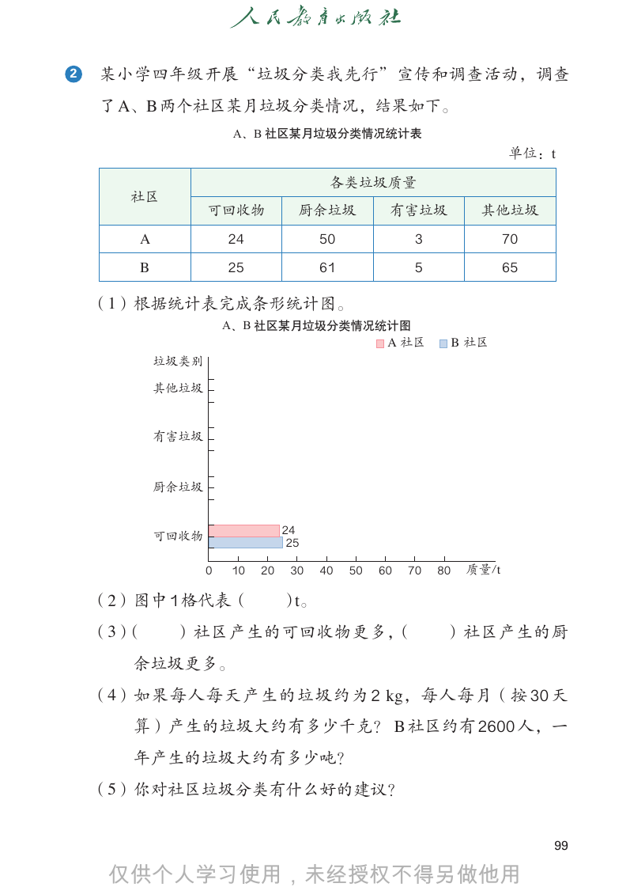

```text
2   某小学四年级开展“垃圾分类我先行”宣传和调查活动，调查
    了 A、B 两个社区某月垃圾分类情况，结果如下。
                      A、B 社区某月垃圾分类情况统计表
                                                                       单位：t
                                       各类垃圾质量
       社区
                  可回收物            厨余垃圾           有害垃圾             其他垃圾
       A              24              50              3                70
       B              25              61              5                65

    （1）根据统计表完成条形统计图。
                      A、B 社区某月垃圾分类情况统计图
                                                 A 社区          B 社区
           垃圾类别

           其他垃圾

           有害垃圾

           厨余垃圾

           可回收物                 24
                                 25

                  0   10   20    30   40   50   60   70   80    质量/t

    （2）图中 1 格代表（                ）t。
    （3）（    ）社区产生的可回收物更多，（                                 ）社区产生的厨
       余垃圾更多。
    （4）如果每人每天产生的垃圾约为 2 kg，每人每月（按 30 天
       算）产生的垃圾大约有多少千克？ B 社区约有 2600 人，一
       年产生的垃圾大约有多少吨？
    （5）你对社区垃圾分类有什么好的建议？

                                                                            99


```

## 教材第 100 页（PDF 第 105 页）

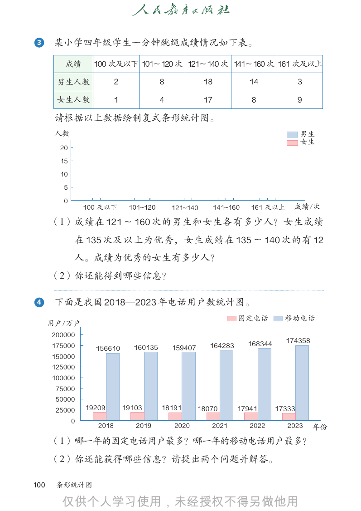

```text
3      某小学四年级学生一分钟跳绳成绩情况如下表。

         成绩        100 次及以下 101〜120 次 121〜140 次 141〜160 次 161 次及以上

       男生人数                2              8             18             14               3

       女生人数                1              4             17             8                9

       请根据以上数据绘制复式条形统计图。
       ϧ᪝                                                                               ⩤⩌
                                                                                        ຠ⩌
        20
        15
        10
         5
         0
                 100 ࣷВ̸        101_120       121_140        141_160   161 ࣷВ̷      ᜽㐖⁎

      （1）成绩在 121 〜 160 次的男生和女生各有多少人？女生成绩
             在 135 次及以上为优秀，女生成绩在 135 〜 140 次的有 12
             人。成绩为优秀的女生有多少人？
      （2）你还能得到哪些信息？

4      下面是我国 2018—2023 年电话用户数统计图。
                                                                   ‫ࠈڕ‬ႋស           ሰҷႋស
      ႁ੢˂੢
      200000
                                                                       168344     174358
      175000       156610        160135       159407      164283
      150000
      125000
      100000
       75000
       50000
       25000     19209         19103      18191        18070       17941        17333
             0
                    2018          2019        2020        2021         2022        2023     ࣺ͓
      （1）哪一年的固定电话用户最多？哪一年的移动电话用户最多？
      （2）你还能获得哪些信息？请提出两个问题并解答。

100    条形统计图


```

## 教材第 101 页（PDF 第 106 页）

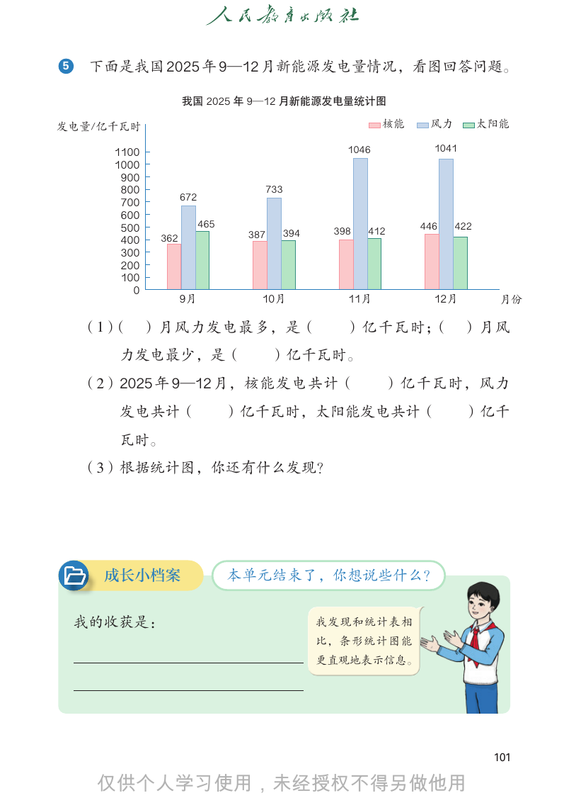

```text
5    下面是我国 2025 年 9—12 月新能源发电量情况，看图回答问题。

                     我国 2025 年 9—12 月新能源发电量统计图

发电量/亿千瓦时                                                      核能    风力         太阳能

       1100                                            1046          1041
       1000
        900
        800                             733
                     672
        700
        600
        500                465                                     446   422
                                  387         394    398   412
        400    362
        300
        200
        100
          0
                     9月             10月                11月           12月         月份

    （1）（      ）月风力发电最多，是（                              ）亿千瓦时；
                                                            （               ）月风
       力发电最少，是（                         ）亿千瓦时。
    （2）2025 年 9—12 月，核能发电共计（                                  ）亿千瓦时，风力
       发电共计（                     ）亿千瓦时，太阳能发电共计（                             ）亿千
       瓦时。
    （3）根据统计图，你还有什么发现？

      成长小档案                      本单元结束了，你想说些什么？

    我的收获是：                                          我发现和统计表相
                                                    比，条形统计图能
                                                    更直观地表示信息。

                                                                                101


```

