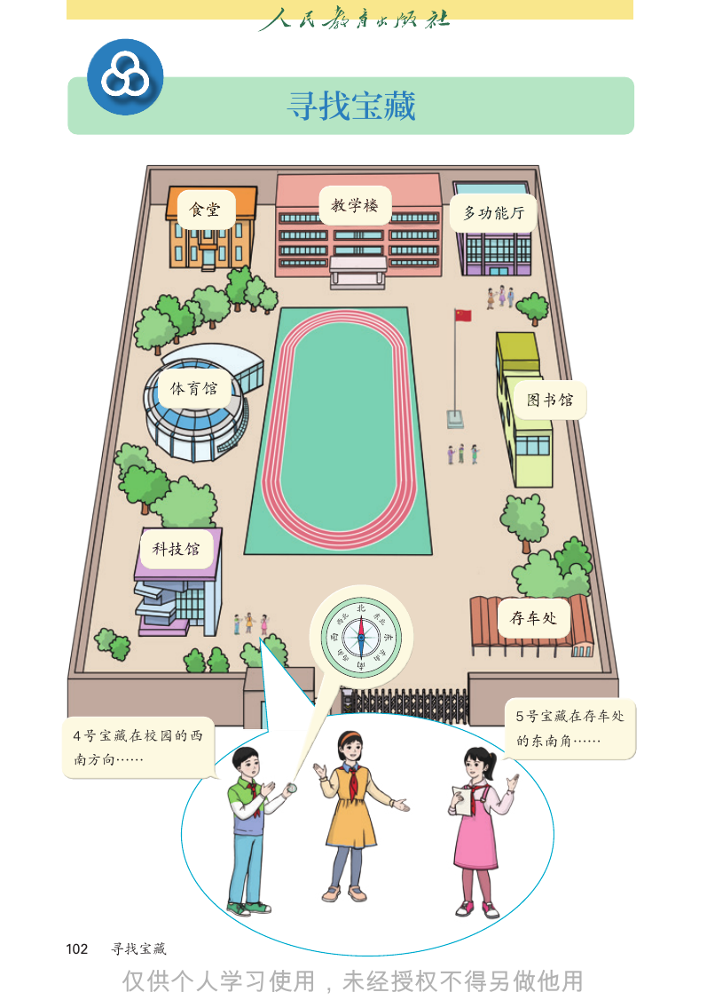
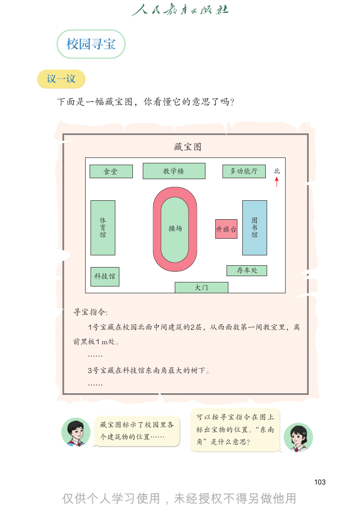
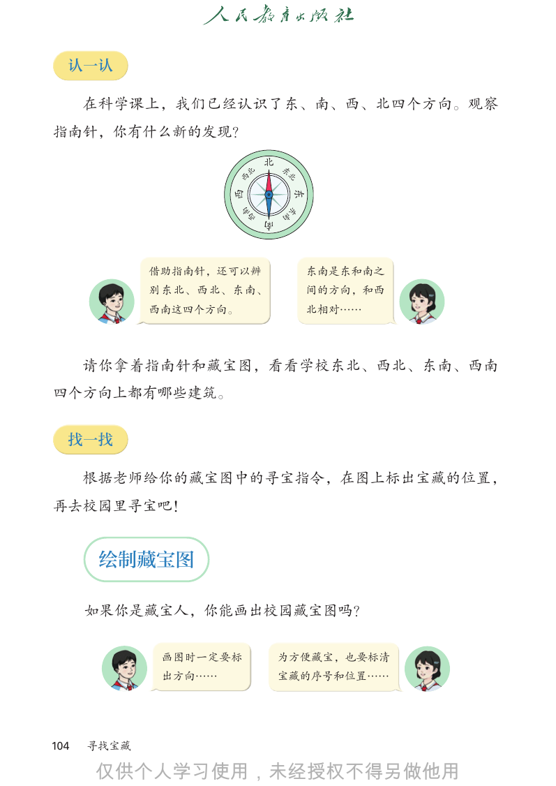
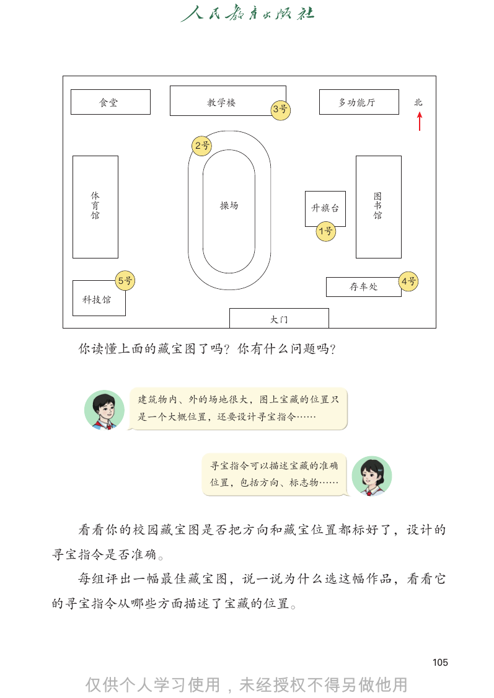
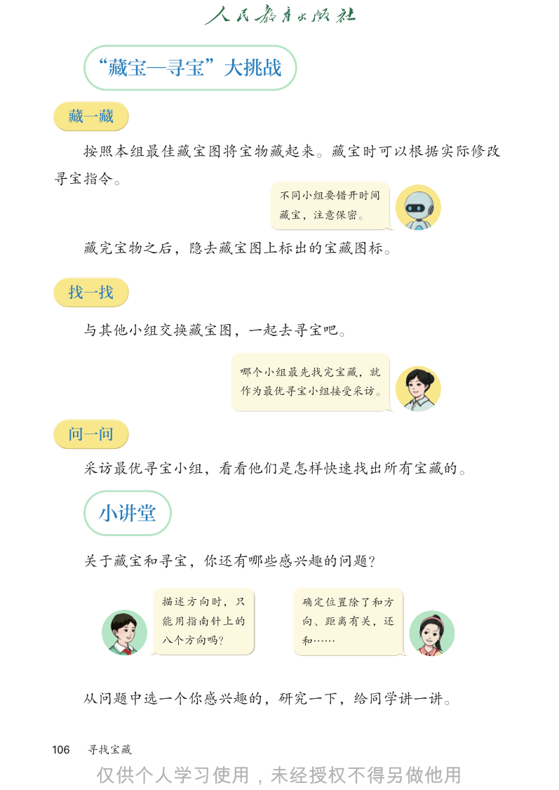
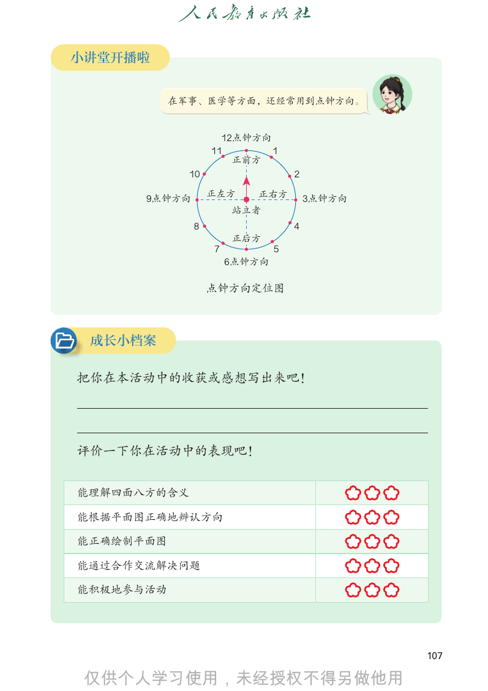

# 人教版《数学》四年级上册 · 综合与实践 寻找宝藏（教材第 102–107 页）

> 从 `docs/articles/textbook.md` 按页切出。版式、竖式和插图以页图为准（课程里是 `lessons/img/tNNN.png`）。版权归人民教育出版社，仅供个人学习使用。

## 教材第 102 页（PDF 第 107 页）



```text
             寻找宝藏

                        北
                北           东

              西 西
                            北

                南
                                东 东
                    西       南
                        南

                                      5 号宝藏在存车处
4 号宝藏在校园的西                            的东南角……
南方向……

102   寻找宝藏


```

## 教材第 103 页（PDF 第 108 页）



```text
  校园寻宝

议一议

 下面是一幅藏宝图，你看懂它的意思了吗？

                   藏宝图

           食堂   教学楼           多功能厅       北

        体育馆        操场        升旗台   图书馆

                               存车处
      科技馆
                        大门

  寻宝指令:
      1号宝藏在校园北面中间建筑的2层，从西面数第一间教室里，离
  前黑板1 m处。
      ……
      3号宝藏在科技馆东南角最大的树下。
      ……

                        可以按寻宝指令在图上
       藏宝图标示了校园里各
                        标出宝物的位置。“东南
       个建筑物的位置……
                        角”是什么意思？

                                             103


```

## 教材第 104 页（PDF 第 109 页）



```text
  认一认

      在科学课上，我们已经认识了东、南、西、北四个方向。观察
指南针，你有什么新的发现？

                             北
                        北         北
                                 东
                      西 西
                                  东 东
                         南
                        西        南
                             南

             借助指南针，还可以辨                 东南是东和南之
             别东北、西北、东南、                 间的方向，和西
             西南这四个方向。                   北相对……

      请你拿着指南针和藏宝图，看看学校东北、西北、东南、西南
四个方向上都有哪些建筑。

  找一找

      根据老师给你的藏宝图中的寻宝指令，在图上标出宝藏的位置，
再去校园里寻宝吧！

       绘制藏宝图

      如果你是藏宝人，你能画出校园藏宝图吗？

              画图时一定要标            为方便藏宝，也要标清
              出方向……              宝藏的序号和位置……

104   寻找宝藏


```

## 教材第 105 页（PDF 第 110 页）



```text
    食堂              教学楼                 多功能厅          北
                             3号

                   2号

   体育馆                  操场        升旗台          图书馆

                                   1号

         5号                                          4号
                                         存车处
  科技馆

                             大门

  你读懂上面的藏宝图了吗？你有什么问题吗？

              建筑物内、外的场地很大，图上宝藏的位置只
              是一个大概位置，还要设计寻宝指令……

                     寻宝指令可以描述宝藏的准确
                     位置，包括方向、标志物……

  看看你的校园藏宝图是否把方向和藏宝位置都标好了，设计的
寻宝指令是否准确。
  每组评出一幅最佳藏宝图，说一说为什么选这幅作品，看看它
的寻宝指令从哪些方面描述了宝藏的位置。

                                                          105


```

## 教材第 106 页（PDF 第 111 页）



```text
      “藏宝—寻宝”大挑战

  藏一藏

      按照本组最佳藏宝图将宝物藏起来。藏宝时可以根据实际修改
寻宝指令。
                         不同小组要错开时间
                         藏宝，注意保密。

      藏完宝物之后，隐去藏宝图上标出的宝藏图标。

  找一找

      与其他小组交换藏宝图，一起去寻宝吧。

                      哪个小组最先找完宝藏，就
                      作为最优寻宝小组接受采访。

  问一问

      采访最优寻宝小组，看看他们是怎样快速找出所有宝藏的。

       小讲堂

      关于藏宝和寻宝，你还有哪些感兴趣的问题？

             描述方向时，只       确定位置除了和方
             能用指南针上的       向、距离有关，还
             八个方向吗？        和……

      从问题中选一个你感兴趣的，研究一下，给同学讲一讲。

106   寻找宝藏


```

## 教材第 107 页（PDF 第 112 页）



```text
小讲堂开播啦

           在军事、医学等方面，还经常用到点钟方向。

                    12点钟方向
                    12点钟方向
                  11       1
                  11 正前方 1
                      正前方
             10                   2
             10                   2
                  正左方   正右方
      9点钟方向       正左方   正右方           3点钟方向
      9点钟方向                           3点钟方向
                     站立者
                     站立者
              8                   4
              8                   4
                      正后方
                  7   正后方     5
                  7           5
                      6点钟方向
                      6点钟方向
                  点钟方向定位图
                  点钟方向定位图

 成长小档案

把你在本活动中的收获或感想写出来吧！

评价一下你在活动中的表现吧！

能理解四面八方的含义

能根据平面图正确地辨认方向

能正确绘制平面图

能通过合作交流解决问题

能积极地参与活动

                                              107


```

