# 人教版《数学》四年级上册 · 第七单元 复习与关联（教材第 108–121 页）

> 从 `docs/articles/textbook.md` 按页切出。版式、竖式和插图以页图为准（课程里是 `lessons/img/tNNN.png`）。版权归人民教育出版社，仅供个人学习使用。

## 教材第 108 页（PDF 第 113 页）

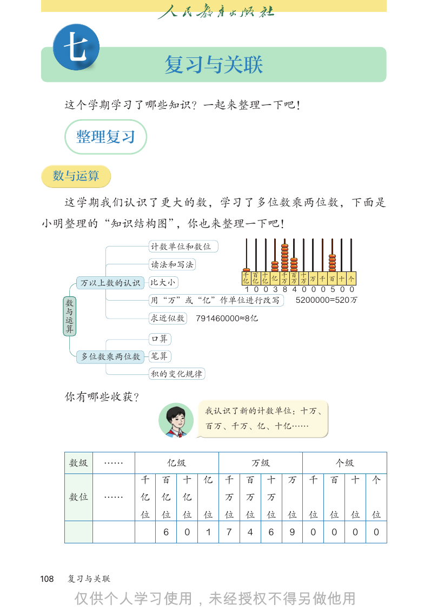

```text
      七                   复习与关联
      这个学期学习了哪些知识？一起来整理一下吧！

        整理复习

  数与运算

      这学期我们认识了更大的数，学习了多位数乘两位数，下面是
小明整理的“知识结构图”，你也来整理一下吧！
                         计数单位和数位

                         读法和写法             十万
                                           百万
                                           千万
                                            亿
                                           十亿
                                           百亿
                                                         万 千 百 十 个
                                           千亿
             万以上数的认识   比大小
                                  1 0 0 3 8 4 0 0 0 5 0 0

      数与运算
                       用“万”或“亿”作单位进行改写       5200000=520万

                       求近似数       791460000≈8亿

                         口算

             多位数乘两位数     笔算

                         积的变化规律

      你有哪些收获？                             245人 376人
                     加法     =
                         总量 分量 + 分量
                              我认识了新的计数单位：十万、
                                             621人
                              百万、千万、亿、十亿……
              数量关系                       25元
                          总价=单价 × 数量
                                             125元
                     乘法
      数级       ……        亿级          万级 80km         个级
                          路程=速度 × 时间
                      千 百 十 亿 千 百 十 万        400 千
                                                 km 百 十              个
      数位       ……    亿    亿   亿        万   万     万
                     位    位   位    位   位   位     位   位   位   位   位   位
                          6   0    1   7   4     6   9   0   0   0   0

108   复习与关联


```

## 教材第 109 页（PDF 第 114 页）

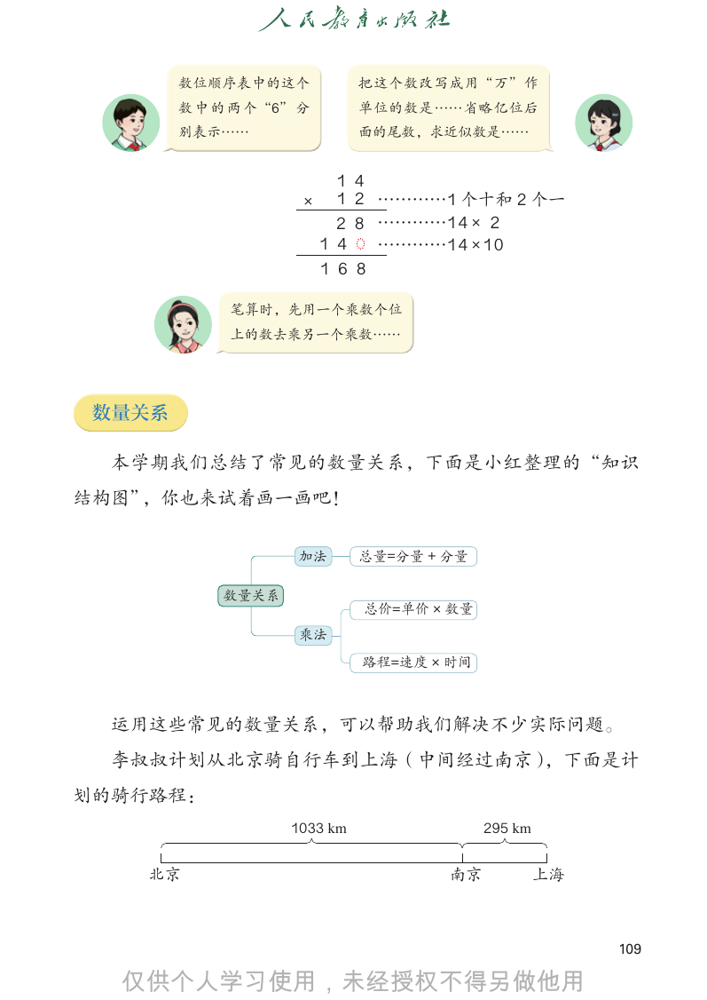

```text
        数位顺序表中的这个                 把这个数改写成用“万”作
        数 中 的 两 个“6” 分            单位的数是……省略亿位后
        别表示……                     面的尾数，求近似数是……

                               1 4
                         ×     1 2 …………1 个十和 2 个一
                               2 8 …………1 4 × 2
                             1 4   …………1 4 × 1 0
                             1 6 8
                         计数单位和数位
                  笔算时，先用一个乘数个位
                         读法和写法                 十万
                                               百万
                  上的数去乘另一个乘数……
                                               千万
                                                亿
                                               十亿
                                               百亿
                                                              万 千 百 十 个
                                               千亿
                万以上数的认识 比大小
                                               1 0 0 3 8 4 0 0 0 5 0 0

         数与运算
                             用“万”或“亿”作单位进行改写               5200000=520万

 数量关系                        求近似数    791460000≈8亿

                             口算
  本学期我们总结了常见的数量关系，下面是小红整理的“知识
       多位数乘两位数 笔算
结构图”，你也来试着画一画吧！
              积的变化规律

                                                     245人 376人
                         加法       总量=分量 + 分量
                                                           621人
                 数量关系                                25元
                                  总价=单价 × 数量
                                                           125元
                         乘法
                                                    80km
                                  路程=速度 × 时间
                                                           400 km

  运用这些常见的数量关系，可以帮助我们解决不少实际问题。
  李叔叔计划从北京骑自行车到上海（中间经过南京），下面是计
划的骑行路程：
                        1033 km                295 km

    北京                                    南京            上海

                                                                    109


```

## 教材第 110 页（PDF 第 115 页）

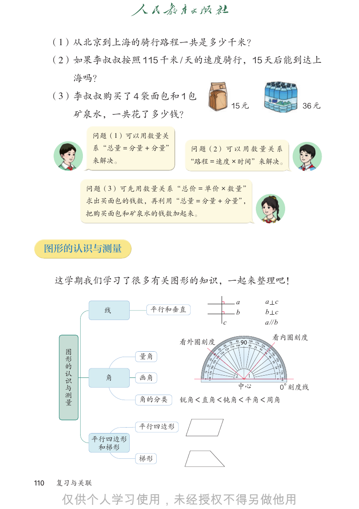

```text
      （1）从北京到上海的骑行路程一共是多少千米？
      （2）如果李叔叔按照 115 千米 / 天的速度骑行，15 天后能到达上
            海吗？
      （3）李叔叔购买了 4 袋面包和 1 包
                                                  15 元                 36 元
            矿泉水，一共花了多少钱？

                    问题（1）可以用数量关
                    系“总量 = 分量 + 分量”    问 题（2） 可 以 用 数 量 关 系
                    来解决。               “路程 = 速度 × 时间”来解决。

                   问题（3）可先用数量关系“总价 = 单价 × 数量”
                   求出买面包的钱数，再利用“总量 = 分量 + 分量”，
                   把购买面包和矿泉水的钱数加起来。

  图形的认识与测量

      这学期我们学习了很多有关图形的知识，一起来整理吧！

                                                   a       a c
                      线       平行和垂直                b       b c
                                              c            a // b

                                                              看内圈刻度
                                      看外圈刻度

        图形的认识与测量
                            量角

                      角     画角                     2   1
                                                   中心               0°
                                                                     刻度线
                            角的分类      锐角＜直角＜钝角＜平角＜周角

                            平行四边形
                   平行四边形
                    和梯形
                            梯形

110   复习与关联


```

## 教材第 111 页（PDF 第 116 页）

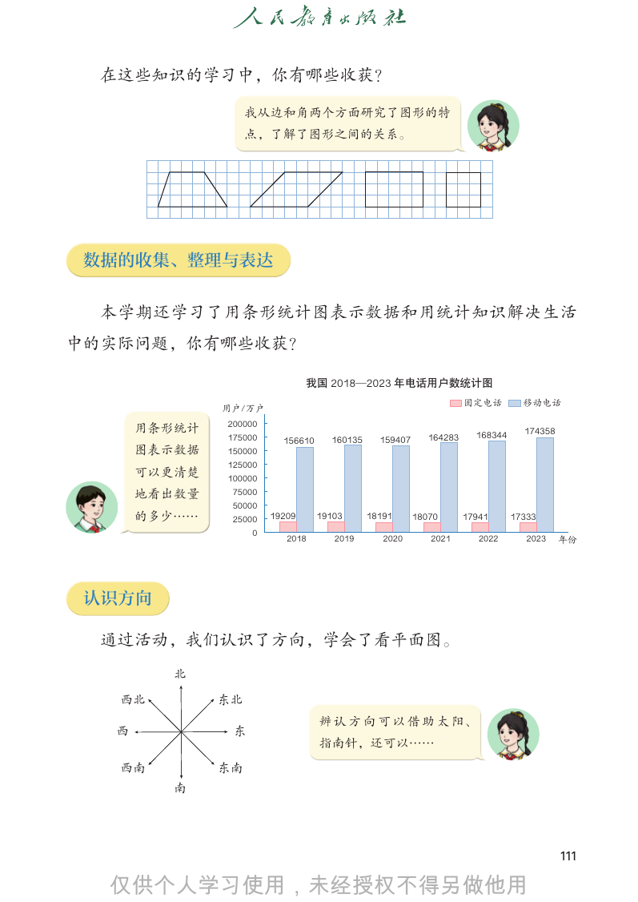

```text
  在这些知识的学习中，你有哪些收获？

                   我从边和角两个方面研究了图形的特
                   点，了解了图形之间的关系。

 数据的收集、整理与表达

  本学期还学习了用条形统计图表示数据和用统计知识解决生活
中的实际问题，你有哪些收获？

                               我国 2018—2023 年电话用户数统计图
                                                                    ‫ࠈڕ‬ႋស         ሰҷႋស
              ႁ੢˂੢
              200000
      用条形统计                                                           168344     174358
              175000     156610     160135     159407      164283
      图表示数据   150000
              125000
      可以更清楚   100000
      地看出数量    75000
               50000
      的多少……    25000   19209      19103      18191      18070       17941      17333
                   0
                          2018       2019       2020       2021        2022       2023    ࣺ͓

 认识方向

  通过活动，我们认识了方向，学会了看平面图。
         北
   西北         东北
                                  辨 认 方 向 可 以 借 助 太 阳、
  西            东
                                  指南针，还可以……
   西南         东南
         南

                                                                                          111


```

## 教材第 112 页（PDF 第 117 页）

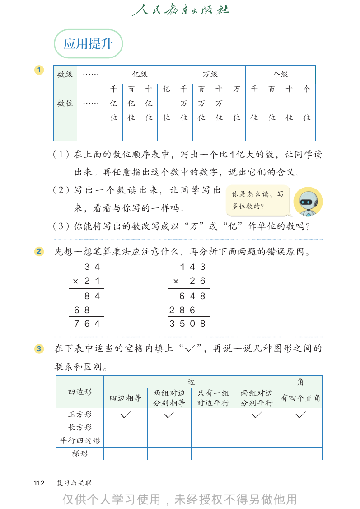

```text
        应用提升
1
       数级    ……         亿级                万级              个级
                    千   百   十   亿    千    百   十   万   千   百   十   个
       数位    ……     亿   亿   亿        万    万   万
                    位   位   位   位    位    位   位   位   位   位   位   位

      （1）在上面的数位顺序表中，写出一个比 1 亿大的数，让同学读
          出来。再任意指出这个数中的数字，说出它们的含义。
      （2）写 出 一 个 数 读 出 来， 让 同 学 写 出               你是怎么读、写

          来，看看与你写的一样吗。                            多位数的？

      （3）你能将写出的数改写成以“万”或“亿”作单位的数吗？

2     先想一想笔算乘法应注意什么，再分析下面两题的错误原因。
           3 4                       1 4 3
         × 2 1                      × 2 6
              8 4                 6 4 8
            6 8                 2 8 6
            7 6 4               3 5 0 8

3     在下表中适当的空格内填上“                       ”，再说一说几种图形之间的
      联系和区别。
                                      边                           角
         四边形                 两组对边         只有一组     两组对边
                    四边相等                                有四个直角
                             分别相等         对边平行     分别平行
         正方形
         长方形
       平行四边形
         梯形

112    复习与关联


```

## 教材第 113 页（PDF 第 118 页）

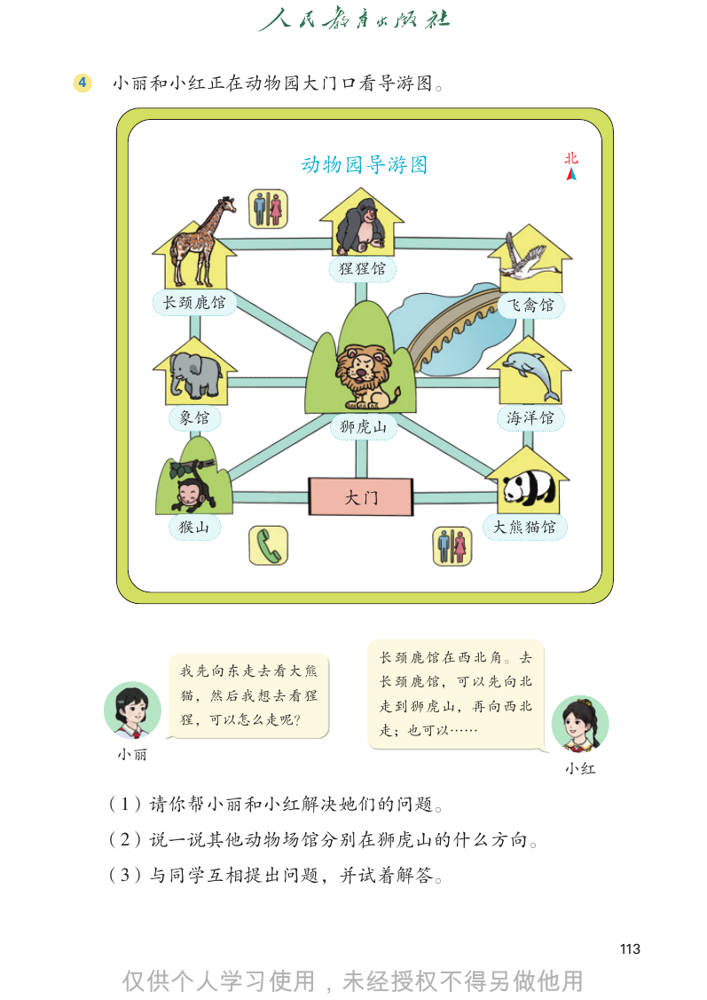

```text
4   小丽和小红正在动物园大门口看导游图。

                       动物园导游图                       北

                             猩猩馆

         长颈鹿馆                                飞禽馆

          象馆                                 海洋馆
                             狮虎山

                             大门
          猴山                                大熊猫馆

                               长 颈 鹿 馆 在 西 北 角。 去
          我先向东走去看大熊
                               长 颈 鹿 馆， 可 以 先 向 北
          猫， 然 后 我 想 去 看 猩
                               走 到 狮 虎 山， 再 向 西 北
          猩，可以怎么走呢？
                               走；也可以……
    小丽
                                                    小红

    （1）请你帮小丽和小红解决她们的问题。
    （2）说一说其他动物场馆分别在狮虎山的什么方向。
    （3）与同学互相提出问题，并试着解答。

                                                         113


```

## 教材第 114 页（PDF 第 119 页）

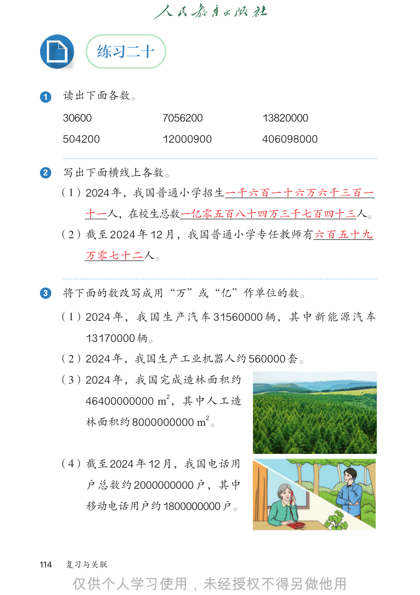

```text
              练习二十

1     读出下面各数。
      30600             7056200     13820000
      504200            12000900    406098000

2     写出下面横线上各数。
      （1）2024 年，我国普通小学招生一千六百一十六万六千三百一
          十一人，在校生总数一亿零五百八十四万三千七百四十三人。
      （2）截至 2024 年 12 月，我国普通小学专任教师有六百五十九
          万零七十二人。

3     将下面的数改写成用“万”或“亿”作单位的数。

      （1）2024 年， 我 国 生 产 汽 车 31560000 辆， 其 中 新 能 源 汽 车
          13170000 辆。
      （2）2024 年，我国生产工业机器人约 560000 套。
      （3）2024 年，我国完成造林面积约
          46400000000 m2，其中人工造
          林面积约 8000000000 m2。

      （4）截至 2024 年 12 月，我国电话用
          户总数约 2000000000 户，其中
          移动电话用户约1800000000户。

114    复习与关联


```

## 教材第 115 页（PDF 第 120 页）

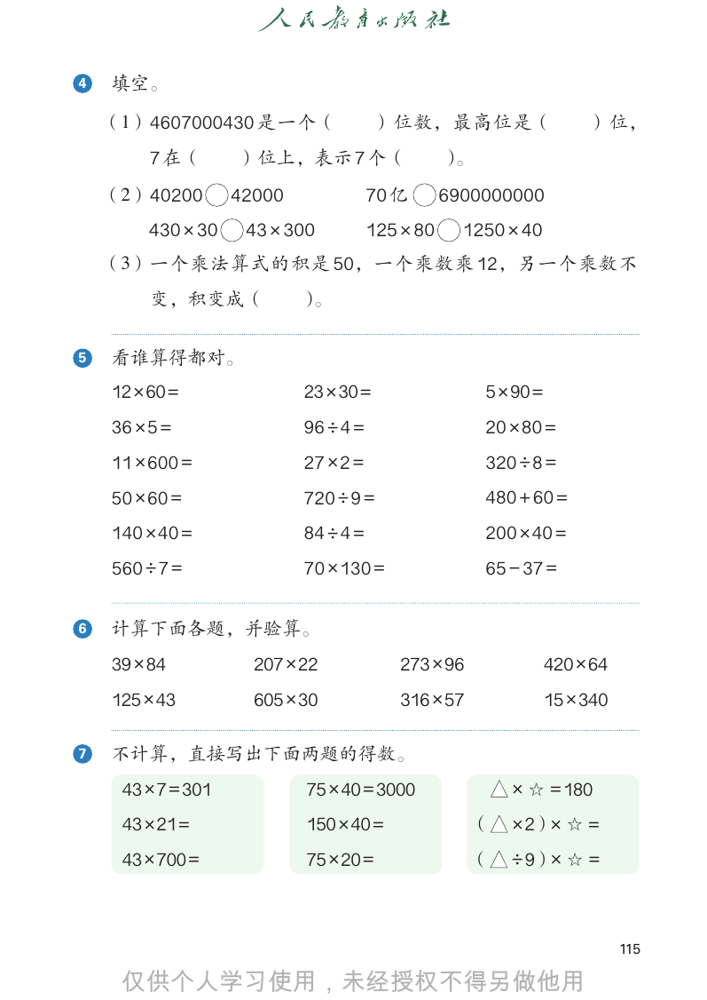

```text
4   填空。

    （1）4607000430 是一个（                  ）位数，最高位是（                      ）位，
         7 在（       ）位上，表示 7 个（                   ）。
    （2）40200        42000              70 亿       6900000000
    430 × 30         43 × 300		        125 × 80     1250 × 40
    （3）一个乘法算式的积是 50，一个乘数乘 12，另一个乘数不
         变，积变成（             ）。

5   看谁算得都对。
    12 × 60 =               23 × 30 =                  5 × 90 =
    36 × 5 =                96 ÷ 4 =                   20 × 80 =
    11 × 600 =              27 × 2 =                   320 ÷ 8 =
    50 × 60 =               720 ÷ 9 =                  480 + 60 =
    140 × 40 =              84 ÷ 4 =                   200 × 40 =
    560 ÷ 7 =               70 × 130 =                 65 − 37 =

6   计算下面各题，并验算。
    39 × 84           207 × 22            273 × 96                420 × 64
    125 × 43          605 × 30            316 × 57                15 × 340

7   不计算，直接写出下面两题的得数。
     43 × 7 = 301            75 × 40 = 3000               × ☆ = 180
     43 × 21 =               150 × 40 =              （    × 2）× ☆ =
     43 × 700 =              75 × 20 =               （    ÷ 9）× ☆ =

                                                                             115


```

## 教材第 116 页（PDF 第 121 页）

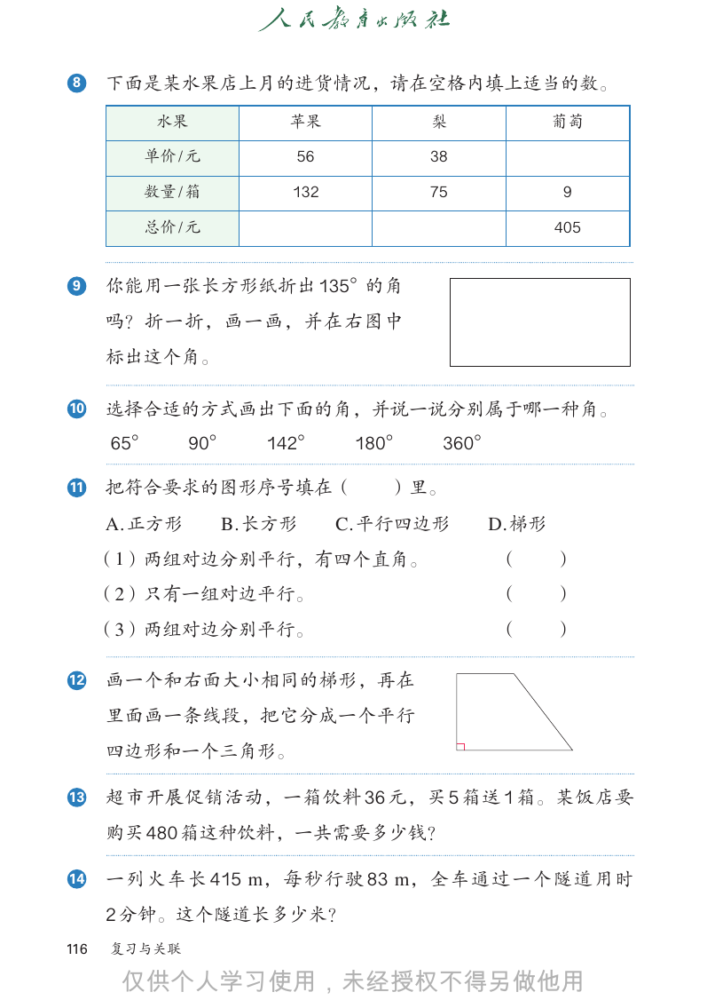

```text
8     下面是某水果店上月的进货情况，请在空格内填上适当的数。
            水果        苹果             梨            葡萄

        单价 / 元         56            38

        数量 / 箱         132           75            9

        总价 / 元                                    405

9     你能用一张长方形纸折出 135°的角
      吗？折一折，画一画，并在右图中
      标出这个角。

10    选择合适的方式画出下面的角，并说一说分别属于哪一种角。
      65°      90°   142°     180°    360°

11    把符合要求的图形序号填在（             ）里。
      A. 正方形     B. 长方形      C. 平行四边形     D. 梯形
      （1）两组对边分别平行，有四个直角。                     （    ）
      （2）只有一组对边平行。                           （    ）
      （3）两组对边分别平行。                           （    ）

12    画一个和右面大小相同的梯形，再在
      里面画一条线段，把它分成一个平行
      四边形和一个三角形。

13    超市开展促销活动，一箱饮料 36 元，买 5 箱送 1 箱。某饭店要
      购买 480 箱这种饮料，一共需要多少钱？

14    一列火车长 415 m，每秒行驶 83 m，全车通过一个隧道用时
      2 分钟。这个隧道长多少米？
116   复习与关联


```

## 教材第 117 页（PDF 第 122 页）

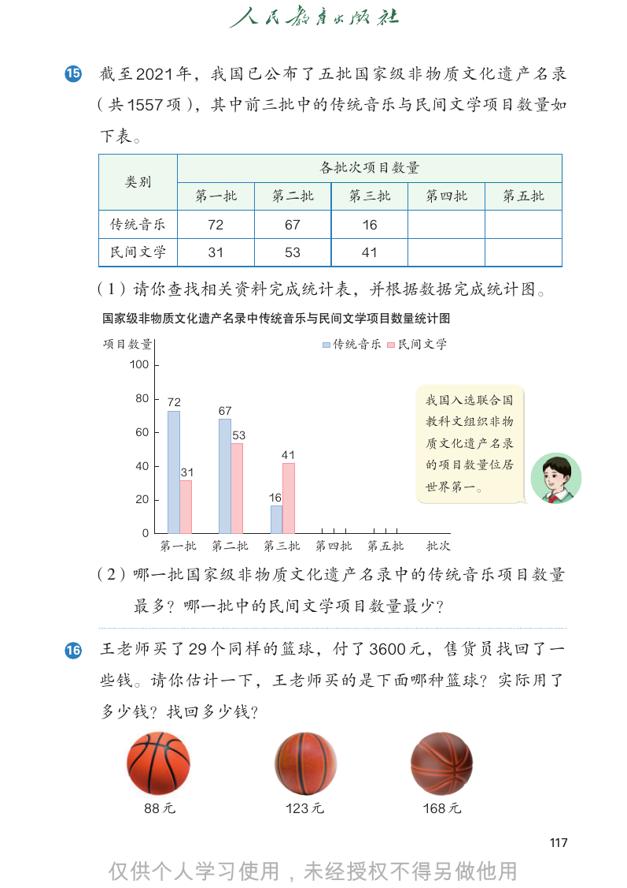

```text
15   截至 2021 年，我国已公布了五批国家级非物质文化遗产名录
     （共 1557 项），其中前三批中的传统音乐与民间文学项目数量如
     下表。
                                          各批次项目数量
       类别
                     第一批        第二批           第三批      第四批     第五批
      传统音乐           72              67         16
      民间文学           31              53         41

     （1）请你查找相关资料完成统计表，并根据数据完成统计图。
     国家级非物质文化遗产名录中传统音乐与民间文学项目数量统计图

     项目数量                                    传统音乐    民间文学
       100

        80   72                                        我国入选联合国
                      67
                                                       教科文组织非物
        60                 53
                                                       质文化遗产名录
                                 41
        40                                             的项目数量位居
                31
                                                       世界第一。
        20                      16

         0
             第一批      第二批       第三批       第四批   第五批    批次

     （2）哪一批国家级非物质文化遗产名录中的传统音乐项目数量
       最多？哪一批中的民间文学项目数量最少？

16   王老师买了 29 个同样的篮球，付了 3600 元，售货员找回了一
     些钱。请你估计一下，王老师买的是下面哪种篮球？实际用了
     多少钱？找回多少钱？

         88 元                        123 元            168 元

                                                                     117


```

## 教材第 118 页（PDF 第 123 页）

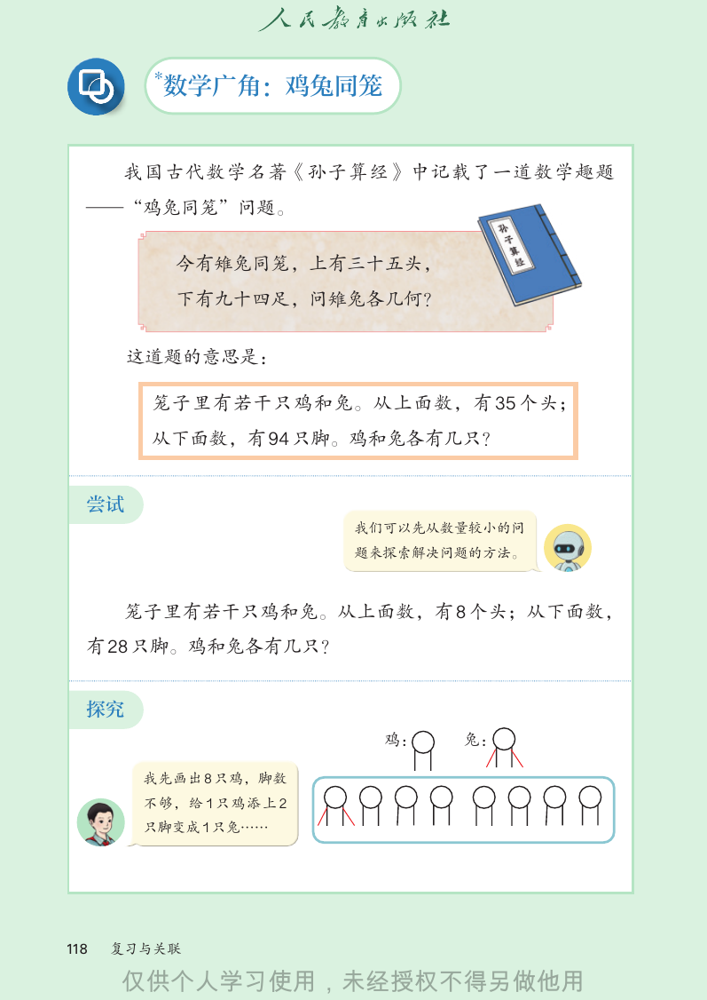

```text
         *
         数学广角：鸡兔同笼

      我国古代数学名著《孙子算经》中记载了一道数学趣题
  —“鸡兔同笼”问题。

             今有雉兔同笼，上有三十五头，
             下有九十四足，问雉兔各几何？

       这道题的意思是：

        笼子里有若干只鸡和兔。从上面数，有 35 个头；
        从下面数，有 94 只脚。鸡和兔各有几只？

  尝试
                        我们可以先从数量较小的问
                        题来探索解决问题的方法。

      笼子里有若干只鸡和兔。从上面数，有 8 个头；从下面数，
  有 28 只脚。鸡和兔各有几只？

  探究
                          鸡：   兔：

        我先画出 8 只鸡，脚数
        不够，给 1 只鸡添上 2
        只脚变成 1 只兔……

118   复习与关联


```

## 教材第 119 页（PDF 第 124 页）

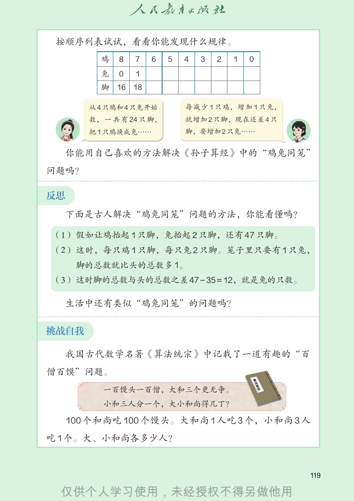

```text
 按顺序列表试试，看看你能发现什么规律。
          鸡   8   7   6    5   4   3   2   1   0
          兔   0   1
          脚 16 18

        从 4 只鸡和 4 只兔开始         每 减 少 1 只 鸡， 增 加 1 只 兔，
        数， 一 共 有 24 只 脚，       就增加 2 只脚，现在还差 4 只
        把 1 只鸡换成兔……            脚，要增加 2 只兔……

     你能用自己喜欢的方法解决《孙子算经》中的“鸡兔同笼”
问题吗？

反思
     下面是古人解决“鸡兔同笼”问题的方法，你能看懂吗？

（1） 假如让鸡抬起 1 只脚，兔抬起 2 只脚，还有 47 只脚。
（2） 这时，每只鸡 1 只脚，每只兔 2 只脚。笼子里只要有 1 只兔，
      脚的总数就比头的总数多 1。
（3） 这时脚的总数与头的总数之差 47 − 35 = 12，就是兔的只数。

     生活中还有类似“鸡兔同笼”的问题吗？

挑战自我

     我国古代数学名著《算法统宗》中记载了一道有趣的“百
僧百馍”问题。
           一百馒头一百僧，大和三个更无争。
           小和三人分一个，大小和尚得几丁？

     100 个和尚吃 100 个馒头。大和尚 1 人吃 3 个，小和尚 3 人
吃 1 个。大、小和尚各多少人？

                                                         119


```

## 教材第 120 页（PDF 第 125 页）

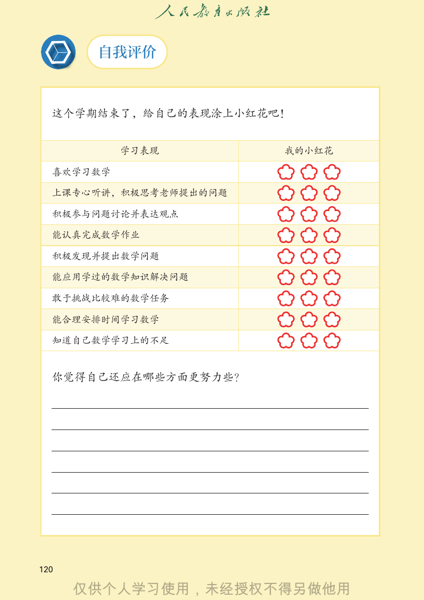

```text
       自我评价

  这个学期结束了，给自己的表现涂上小红花吧！

           学习表现        我的小红花

  喜欢学习数学

  上课专心听讲，积极思考老师提出的问题

  积极参与问题讨论并表达观点

  能认真完成数学作业

  积极发现并提出数学问题

  能应用学过的数学知识解决问题

  敢于挑战比较难的数学任务

  能合理安排时间学习数学

  知道自己数学学习上的不足

  你觉得自己还应在哪些方面更努力些？

120


```

## 教材第 121 页（PDF 第 126 页）

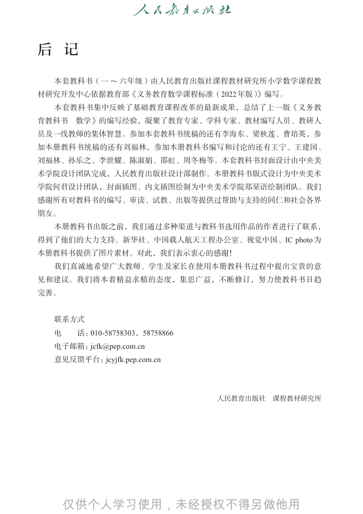

```text
后 记

  本套教科书（一 ~ 六年级）由人民教育出版社课程教材研究所小学数学课程教
材研究开发中心依据教育部《义务教育数学课程标准（2022 年版）》编写。
  本套教科书集中反映了基础教育课程改革的最新成果，总结了上一版《义务教
育教科书   数学》的编写经验，凝聚了教育专家、学科专家、教材编写人员、教研人
员及一线教师的集体智慧。参加本套教科书统稿的还有李海东、梁秋莲、曹培英，参
加本册教科书统稿的还有刘福林，参加本册教科书编写和讨论的还有王宁、王建国、
刘福林、孙乐之、李世耀、陈淑娟、邵虹、周冬梅等。本套教科书封面设计由中央美
术学院设计团队完成，人民教育出版社设计部制作。本册教科书版式设计为中央美术
学院何君设计团队，封面插图、内文插图绘制为中央美术学院郑琹语绘制团队。我们
感谢所有对教科书的编写、审读、试教、出版等提供过帮助与支持的同仁和社会各界
朋友。
  本册教科书出版之前，我们通过多种渠道与教科书选用作品的作者进行了联系，
得到了他们的大力支持。新华社、中国载人航天工程办公室、视觉中国、IC photo 为
本册教科书提供了图片素材。对此，我们表示衷心的感谢！
  我们真诚地希望广大教师、学生及家长在使用本册教科书过程中提出宝贵的意
见和建议。我们将本着精益求精的态度，集思广益，不断修订，努力使教科书日趋
完善。

  联系方式
  电    话：010-58758303，58758866
  电子邮箱：jcfk@pep.com.cn
  意见反馈平台：jcyjfk.pep.com.cn

                                 人民教育出版社   课程教材研究所


```

